# C# Native

C# Native is a small UI runtime. A C# function returns an `Element` tree. A keyed diff reconciles it onto real Android widgets. Release publishes with NativeAOT. The Debug listener applies a screen edit, and a lowerable `[ReloadCallable]` method body, in the same process.

The Android dev loop, from a machine that already has the SDK in [`global.json`](global.json), the `android` workload, a JDK, and an online emulator:

```sh
tools/devx/cnative doctor
tools/devx/cnative new hello
tools/devx/cnative run android --listener
tools/devx/cnative reset-state
```

`doctor` checks the SDK, the workload, `adb`, a device, and the IL compiler. `new hello` writes `samples/hello/HelloScreen.cs`. `run android --listener` publishes the Debug NativeAOT listener and watches that file. Saving the screen reloads it in the same process. `reset-state` clears the kept bags and shows the initializers again. The walkthrough is [docs/getting-started.md](docs/getting-started.md). Calling a native API from a screen is [docs/call-native-apis.md](docs/call-native-apis.md).

## Feed demo

The feed demo is the stories screen. It loads thirty items from `http://127.0.0.1:8094/stories` through [`Http`](docs/platform-modules.md), draws each row's bitmap through [`Image`](docs/platform-modules.md), and filters them with a [`TextInput`](docs/screen-program-subset.md) bound to `Query`. A decoded bitmap fades in over 180 ms times `animator_duration_scale`. The view is a hardware layer only while that animation runs. A cache hit does not fade. Scale 0 shows the bitmap immediately. After process death, [release restore](docs/platform-modules.md#release-restore) puts the same screen and the same query back. The nav snapshot is screen ids and bag fields, at most 64 KiB (`InstanceUi.NavLimit`). Program bytes are not stored. A larger snapshot is omitted and the next launch shows the launch screen. The recording and the still are in the progress85 artifacts and are not in this repository.

Measured on emulator-5554: the feed query survives `am kill`, the fade logs and the clip, and the e90430e release cold start under the guest-load gate. Those numbers are in the progress85 paragraph below. Built by `tools/check.sh` and not timed on a device: the showcase apks. `net10.0-ios` was not compiled.

`tools/check.sh` runs the core, devx, packing, and iOS managed-host tests, then `cnative inspect` on every sample screen and the counter, then the bench self-tests. Each step prints PASS or FAIL, and the script exits nonzero when any step fails. It needs bash and the .NET SDK. It does not require GNU `timeout` or `sha256sum`.

Startup numbers, each row with its method, are in [docs/performance.md](docs/performance.md). An older `tools/bench/mac-bench.sh --n 20` series is listed in [docs/devx/evidence/cold-start.txt](docs/devx/evidence/cold-start.txt) and was not remeasured here.

Reload, measured. Screen edit to the reply, n=20, one pid, Hyndman-Fan type 7: edit-to-screen p50 59.8246 ms, p90 74.8963 ms. [docs/devx/evidence/fixed-socket-percentiles.txt](docs/devx/evidence/fixed-socket-percentiles.txt). A lowerable edit of `CounterService.Next` and `LibraryFormat.Label` on listener pid 17466 swapped in that process in 15.4 ms and 5.8 ms. [docs/devx/evidence/call-table.txt](docs/devx/evidence/call-table.txt). Statement bodies of those two methods swapped on listener pid 18899 in 14.1 ms and 7.5 ms. [docs/devx/evidence/statement-body.txt](docs/devx/evidence/statement-body.txt). A feed screen on that pid loaded JSON from the host. [docs/devx/evidence/dogfood-feed.txt](docs/devx/evidence/dogfood-feed.txt). One `RequestRender` on the counter, n=10: listener pid 18395 first tap 113 µs, p90 1045.6 µs; Release pid 18507 first tap 108 µs, p90 218.1 µs. [docs/devx/evidence/tap-phases.txt](docs/devx/evidence/tap-phases.txt).

## Results

The paragraphs above are older series. They were not remeasured for this section. Mac emulator is the pixel_8 arm64 emulator. Emulator-run is emulator-5554, SwiftShader, API 34, in this workspace. Built is a publish from this workspace that was not timed on a device. A guest load at or above 2 means only same-run relatives are usable. The lists and the commands are in [docs/devx/evidence/scroll-floor.txt](docs/devx/evidence/scroll-floor.txt).

Mac emulator, `c666e52`, feed APK sha256 prefix `740a0f5d`, `--n 20 --repeat 5`, guest load 3.6–14. Feed minus floor block deltas: 57.0, 53.5, 64.0, 82.5, 66.0. Median 64.0. Bootstrap 95% interval 53.5–82.5. TotalTime p50: feed 337, thin 293.5, floor 274. Feed p50 minus floor p50 is 63. Marks, p50, milliseconds since process start. Feed: java_end 44.5, jcw_enter 55, jcw_register 55.5, jcw_registered 71.5, jni 74, enter 82, layout 183, idle 251, flush 295. Floor: oncreate 37, layout 143. Thin: java_end 46, thin_class 58, thin_jni 65, thin_oncreate 71.

Mac emulator, `ca9992e`, feed APK sha256 prefix `cc759810`, `--n 20 --repeat 5`, guest load 7–26. Feed minus floor block deltas: 65.5, 61.5, 56.5, 44.0, 32.5. Median 56.5. Interval 32.5–65.5. TotalTime p50: counter 303.5, feed 320.5, thin 281.5, floor 269.5. Feed jcw_register 54.0 to jcw_registered 66.5 is 12.5 ms. `a11y-dismiss.sh` with that arm64 feed APK logged `performed=1 gone=1 next=1 undone=1 restored=1`. That run has no layout split. The 23 ms after the first layout is the `c666e52` split above.

The feed's first layout is 40 behind the floor (183, and the floor is at 143). The floor is already in onCreate at 37. The feed enters OnCreate at 82, so screen work starts 45 later. Enter to layout is 101 on the feed. Floor onCreate to layout is 106. The managed screen and the first layout are not the extra. After layout, the feed takes 154 to TotalTime and the floor takes 131, about 23. Those two slices are the 63. Before enter, the feed spends 44.5 to java_end, 10.5 loading the activity class, 0.5 building the method string, 16 in `registerNativeMembers` (55.5 to 71.5), 2.5 through the managed static constructor, and 8 to enter OnCreate. The 16 is five `Delegate.CreateDelegate` lookups plus one `RegisterNatives`. Thin, one JNI method, takes 19 from java_end 46 to thin_jni 65. The feed takes 29.5 from java_end 44.5 to jni 74. The five registrations are the slice the thin activity does not pay.

Not kept. `NativePocDeferNatives`, emulator-run: baseline block deltas 200.0 and 233.0, median 216.5, interval 200.0–233.0. Deferred: 210.5 and 227.0, median 218.8, interval 210.5–227.0, inside the baseline. `NativePocFastNatives`, one `RegisterNatives` of five prebuilt delegates, two emulator-run pairs, `--n 6 --repeat 2`, guest_load_p50 5.0–7.6. First pair: baseline 269.5 and 324.0, median 296.8, interval 269.5–324.0. Fast: 138.5 and 268.5, median 203.5, interval 138.5–268.5. The 1.0 gap is a floor block at 829.5, from samples 1339 and 1020, both over 1.5 times the floor median and still included. Second pair: baseline 292.0 and 213.5, median 252.8, interval 213.5–292.0. Fast: 195.0 and 264.5, median 229.8, interval 195.0–264.5. The intervals overlap. Register to registered on that pair was 1.5 and 1.0. The flag stays false. RELR, `NativePocEmbedSo`, `NativePocPackRelocs`, `NativePocVersionScript`, and `NativePocSymbolOrder` stayed off. The reloc experiment did not shorten startup.

Not kept. Moving the row-fit padding and the image flush to a message posted after the launch frame, emulator-run, `--n 6 --repeat 2`, guest_load_p50 6.7–7.0. Baseline block deltas 201.5 and 235.0, median 218.2, interval 201.5–235.0. Treatment: 270.5 and 314.0, median 292.2, interval 270.5–314.0. The treatment interval sits above the baseline. The code is the one-frame skip again. On a baseline sample, layout and draw were the same millisecond and the direction warm was after `Displayed`. A later feed launch logged `image-us=135`. The Mac flush at 295 is still 42 before TotalTime 337, and this emulator did not show that slice getting shorter.

Emulator-run developer loop, template `/tmp/p37/loop`, Debug listener, pid 25116. Unchanged `cnative run android --once`: wrapper 1.185 s, including a 0.87 s CLI build, then `Skipping publish`, `Skipping install`, `Skipping launch`, `Skipping reload`. The same run with `dotnet exec` of the built CLI was 0.187 s. An edit of the title initializer, Hello to Hiya, was 0.250 s, skipped install and launch, and logged `reloaded in 56.5 ms (lower 32.3 ms, apply 16.5 ms)`. The pid stayed 25116.

`cnative inspect <Screen.cs>` renders on `HeadlessHost` and prints tree, accessibility, and layout as JSON. It exits 1 for a missing label, a touch target under 48 dp, no heading, or a focus-order reversal, and the message names the id. Devx `InspectTests` runs it on the counter, the feed, the visit form, and packing, and fails if any of those four reports a lint code. A long-press name is at least 48 dp tall, the minimum `AndroidHost.SetGesture` already applies, so packing's tent name is no longer 336 by 24. `tools/check.sh` this run reported core 88 passed, devx 152 passed, packing 14 passed, iOS managed-host 6 passed, and inspect clean on every sample screen, including the notes list, detail, and edit. `PlatformConformance.Run` is the create, update, remove, text, list, accessibility, and hot-reload apply checks, and it pushes a screen, pops it, checks the heading key, and applies again with the stack still at depth 2. It passed on `HeadlessHost`, on the managed reconciler, and on `IosLogicSurface`. The UIKit project was not compiled. The split is [docs/ios-status.md](docs/ios-status.md). `ReloadAotPublishTests` builds the generator in the default run and kills the child if that build passes 90 s. The NativeAOT publish runs only when `NATIVEPOC_RELOAD_AOT=1`, and that publish was not run here.

The earlier `--n 6 --repeat 2` pair set `IlcDehydrate` false. The feed x64 `.so` had a `.hydrated` section of 1,133,552 bytes and 3,377 relative relocations. Invariant globalization, event source, reflection JSON, and size-optimized LINQ were already off or on. `StackTraceSupport` stays true. With dehydration off the section is gone, relative relocations are 59,130, and the `.so` is 9,091,192 bytes. Emulator-run, `--n 6 --repeat 2`, guest_load_p50 6.3–7.0 on the dehydrated feed and 4.9–5.2 with it off. Feed minus floor block deltas: dehydrated 338.0 and 309.0, median 323.5, interval 309.0–338.0. Off: 248.5 and 280.0, median 264.2, interval 248.5–280.0. The off interval sits under the dehydrated interval. TotalTime p50 dehydrated counter/feed/thin/floor 980.5/942.0/694.0/620.0. Off: 924.5/825.5/618.5/553.0. The floor also fell, from 620.0 to 553.0. Since process, feed, dehydrated: before 48.0, so_reloc 49.0, so_ctors 50.0, after 62.0, java_end 71.0. Off: before 68.5, so_reloc 75.0, so_ctors 77.5, after 87.0, java_end 90.5. Before to java_end is 23 ms and 22 ms. This emulator did not show a shorter load. The crash on the off build, pid 8962, logged `at NativePoc.CrashReport.ThrowNow() + 0x27` and `crash-screen`. There is no new Mac number. `NativePocFastNatives` and `NativePocDeferNatives` stay false.

Back on. The same emulator, one interleaved run, `--n 12 --repeat 4 --quiesce warn`. Wet is `IlcDehydrate` false, package `com.scratch.nativepoc`. Dry is `IlcDehydrate` true, package `com.scratch.nativepoc.dry`, so both APKs stay installed. The activity class is `crc64ee53024f7ed0aa60.MainActivity` on both. The floor is the same x64 list floor in every round. guest_load_p50 wet/dry/floor 5.6/5.6/5.7. n=48 each. TotalTime p50/p90 wet 809.0/874.4, dry 725.0/786.2, floor 627.5/723.7. Block deltas, series p50 minus floor p50, Hyndman-Fan 7, bootstrap B=1000 seed 8946: wet 149.5, 197.5, 168.5, 176.0, median 172.2, interval 149.5–197.5. Dry 62.5, 90.5, 99.5, 85.5, median 88.0, interval 62.5–99.5. The dry interval sits under the wet interval. No floor round was over 1.5 times the floor median. Dry is also smaller. The `.so` is 7,258,176 with dehydration on and 9,128,264 with it off, 1,870,088 bytes. The APK is 3,297,004 and 3,476,869, 179,865 bytes. Dry `.hydrated` NOBITS 1,136,232, RELACOUNT 3,379, `.rela.dyn` 81,144, `.data` 73,680. Wet has no `.hydrated`, RELACOUNT 59,261, `.rela.dyn` 1,422,312, `.data` 1,210,912. Since process, p50: wet before 55.5, so_ctors 65.5, after 91.0, java_end 95.5. Before to java_end is 40.0. so_ctors to after is 25.5. Dry before 38.0, so_ctors 43.5, after 60.5, java_end 66.5. Before to java_end is 28.5. so_ctors to after is 17.0. present_p50 wet 201.0, dry 165.0. layout wet 198.5, dry 161.0. Release sets `IlcDehydrate` true. Both bench `.so` files contain `PersistStore`, because that publish predates compiling the file only when `NativePocPersist` is true. The shipped counter and feed were republished after that removal. The dry package id is the bench package. The shipped product id is `com.scratch.nativepoc`. There is no new Mac number.

Emulator-run, visit x64, `NativePocPersist` true. Remember on pid 19301 logged `persist-put key=visit.place chars=4`, `persist-put key=visit.stop chars=25`, and `persist-record key=visit.stop id=Pier`. force-stop, then Recall on pid 19429 logged `persist-get key=visit.place chars=4`, `persist-get key=visit.stop chars=25`, and `persist-record-load key=visit.stop id=Pier`. The dump showed text `Pier`. The store is files under the app files directory, length-prefixed text, no reflection. `PersistStore.cs` is compiled only when `NativePocPersist` is true. A UTF-16 search finds `persist-put` in the visit `.so`. The counter `.so` has no `persist-put` and no `HttpURLConnection`. The feed `.so` has `HttpURLConnection` and no `persist-put`. A unit test edits the Remember literal from `Pier` to `Quay`, re-lowers, and the interpreter writes `Place=Quay` before the await. That reload was not driven through the emulator listener.

Emulator-run, the dev listener on emulator-5554, `cnative run android --listener --root visit`. Remember on pid 21265 logged `persist-put key=visit.place chars=4`, `persist-put key=visit.stop chars=25`, and `persist-record key=visit.stop id=Pier`. The place field and a visible `Pier` mark both read Pier. The mark literal was then edited to `Quay`. The same pid logged `hotreload-applied Visit program=1` and `state kept Place="Pier"`. The listener printed `reloaded in 28.6 ms (apply 24.0 ms)` and `edit-to-reply 72 ms`. The dump showed place Pier and mark Quay. force-stop, then a new process pid 21607 logged `nav-restore depth=8` and `state-loaded bytes=26264`, and Recall logged `persist-get key=visit.place chars=4`, `persist-get key=visit.stop chars=25`, and `persist-record-load key=visit.stop id=Pier`. The mark literal and the stop heading were put back to `Pier` and `Stop` after that run.

The 88 ms dry block delta against the 172 ms wet one is mostly after `java_end`. Measured from the same `/tmp/p41/bench` logs, n=48 each, median of paired deltas, Hyndman-Fan 7, `majflt` 0 on every sample. Wet before to so-reloc is 8.0 ms and +329 minor faults. Dry is 2.0 ms and +32 minor faults. RELACOUNT is 59,261 wet and 3,379 dry. so-reloc to so-ctors is 0.0 ms on both, +17 and +18 minor faults. so-ctors to after is 9.0 ms and +210 minor faults wet, 13.0 ms and +492 minor faults dry. Dry `.hydrated` is 1,136,232 bytes, about 277 pages. The extra dry faults in that slice are the hydration fill. Before to java-oncreate-end, paired, is 27.0 ms wet and 20.0 ms dry. The difference of the published p50s on that same slice is 40.0 against 28.5. Before to after, minor faults, 555 wet and 543 dry. The faults move from the reloc slice into the hydrate slice. present_p50 is 201.0 wet and 165.0 dry. `simpleperf` was not run. The counters are `/proc` `minflt` from `loadmark.c` and `StartupProbe.java`.

Rejected. `NativePocHydratePrefetch` calls `madvise(MADV_WILLNEED)` on the writable NOBITS tail at the end of the so-ctors constructor. A fresh interleaved run, emulator-5554, `--n 12 --repeat 4 --quiesce warn`, packages `com.scratch.nativepoc.base` and `com.scratch.nativepoc.pref`, both dehydrated, marks, http, and recycler on, persist and nav off. guest_load_p50 base/pref/floor 5.5/5.6/5.6. n=48 each. TotalTime p50/p90 base 740.5/796.9, pref 777.0/853.2, floor 660.0/734.6. Block deltas, series p50 minus floor p50: base 99.5, 56.5, 89.0, 44.5, median 72.8, interval 44.5–99.5. Prefetch 162.5, 104.0, 131.5, 83.0, median 117.8, interval 83.0–162.5. The intervals overlap and the prefetch median is higher. Paired so-ctors to after: base 12.0 ms and +489.5 minor faults, prefetch 19.5 ms and +769.0 minor faults. Every prefetch sample logged `startup hydrate-prefetch bytes=1260004`. No floor total was over 1.5 times the floor median 660.0 (max 811.0). The flag stays false. The default `.so` has no `hydrate-prefetch` string.

`Nav` push and pop compile only when `NativePocNav` is true. `NavFocus.cs` is the file that logs `nav-focus`. Tested: `PlatformConformance` on `HeadlessHost`, the managed reconciler, and `IosLogicSurface` pushes, pops, checks focus key `heading`, and keeps depth 2 across `Apply`. `tools/check.sh` this run: core 87, devx 152, packing 14, iOS managed-host 6, `passed=11 failed=0`. Emulator-run, the same listener, TalkBack service `com.google.android.marvin.talkback/.TalkBackService` enabled. Open on pid 22247 logged `nav-slide dir=push` and `nav-focus heading=Halt acted=1 held=1 depth=9`. Android back logged `nav-back invoked`, `nav-slide dir=pop`, and `nav-focus heading=Visit acted=1 held=1 depth=8`. `held` is `IsAccessibilityFocused` on the heading. The uiautomator dump did not mark `accessibilityFocused`. Depth 9 is the listener showing every sample onto one stack. An earlier edit of the stop heading to `Halt`, pid 21265, logged `reloaded in 18.9 ms (apply 14.6 ms)` and `reply Halt`, and the dump stayed on that screen. Counter `.hydrated` 1,077,344 and RELACOUNT 3,544. Feed 1,130,936 and 3,574. Visit 1,121,928 and 3,578. The three dex sha256 values are unchanged from the previous arm64 publish. A UTF-16 search finds `nav-focus` in the visit arm64 `.so` and not in the counter or feed `.so`. `persist-put` is in the visit `.so` and absent from counter and feed. Feed has `HttpURLConnection`. Counter has neither. The iOS `IosPlatform.Push` line `nav-focus heading=` is authored and was not compiled.

Emulator-run scroll, emulator-5554, SwiftShader, `scroll-bench.sh --swipes 8 --rounds 5`. Feed is the unit 162 dry bench APK, package `com.scratch.nativepoc.dry`, and that `.so` still contains `PersistStore`. Floor is the x64 list floor. guest load 1.44 to 3.81. Rounds 1 through 4 are at or above 2, so the comparison is same-run. Quiesce warned and left `com.scratch.nativepoc` running. gfxinfo janky percent, feed 35.78, 40.60, 37.39, 37.84, 31.54. Floor 58.65, 58.49, 55.75, 52.54, 41.48. Feed minus floor: -22.87, -17.89, -18.36, -14.70, -9.94. Median -17.89. The five deltas sit under zero. Framestats janky percent tracks the same gap. A few framestats rows have a FrameCompleted−IntendedVsync of about 10^11 ms (feed rounds 0, 1, and 4 had 3, 2, and 1 such rows). Those rows inflate p99. Work p50 stays under the floor on every round. No scroll code changed.

A cold launch of one screen is depth 1. `ScreenNav.Show` updates a program and does not push an id that is not already on the stack. The first `Show` on an empty stack adds that id only when `LaunchRoot` is empty or equal to it. `Push` builds the stack the user made, and `Restore` replays that stack. Tested: `A_catalog_of_screens_does_not_deepen_a_one_screen_launch` returned depth 4 before that change and depth 1 after it. Emulator-run, the dev listener, `--root notes`, TalkBack service `com.google.android.marvin.talkback/.TalkBackService`. Open logged `nav-focus heading=Note acted=1 held=1 depth=2`. Android back logged `nav-focus heading=Notes acted=1 held=1 depth=1`. The uiautomator dump did not mark `accessibilityFocused`. A cold launch logged `depth=1 top=notes`.

The dry present_p50 of 165 is the first draw. `/tmp/p41/bench/summary.txt` has dry draw and present both at 165.0, and TotalTime p50 725.0 against the floor 627.5. A fresh dehydrated feed on emulator-5554, `--n 12 --repeat 4`, package `com.scratch.nativepoc.base`, marks the first measure, layout, draw, and image flush. guest_load_p50 5.4. n=48. present_p50 and the first draw are both 161.5. First measure is 142.0 and its took-ms p50 is 0.0. First layout is 160.0 and its took-ms p50 is 6.5. Paint duration p50 is 0.0 and content duration p50 is 0.0. Render to measure, paired, is 21.0. java-oncreate-end to draw, paired, is 98.5. Phase flush and phase image were logged on 2 of 48 samples, at since-process 734, after present. Block deltas against the floor: 79.5, 90.5, 101.5, 87.5, median 89.0, interval 79.5–101.5. TotalTime p50/p90 739.0/818.6 against the floor 655.0/771.4. That gap is the wait from the end of `onCreate` to the first traversal, not an image flush.

Rejected. Skipping `Invalidate` when the view is not attached, same run, package `com.scratch.nativepoc.skip`. TotalTime p50/p90 767.5/891.8, present_p50 174.5. Block deltas 94.0, 130.5, 153.5, 79.0, median 112.2, interval 79.0–153.5. The intervals overlap and the skip median is higher. Paint and content duration stayed 0.0. No floor total was over 1.5 times 655.0. The call stays unconditional.

`scroll-bench.sh` drops a framestats row whose FrameCompleted−IntendedVsync is above 10000 ms and prints `clock_drop`. `adb` was reading the quiesce package list on stdin, so a force-stop stopped only the first bench package. The stop now redirects that stdin and waits until `pidof` is empty for every bench package. Self-tests passed on Linux bash 5.2.21 and on GNU bash 3.2.0 at `/tmp/bash-3.2/bash`. Emulator-run, `--swipes 8 --rounds 5`, the base feed against the x64 list floor. Both packages were force-stopped before every round, and `top` was not the other bench package. guest_load_p50 is 1.3 for both. Floor rounds 3 and 4 and feed round 4 are at or above 2, so those rounds are same-run. A separate package, `com.scratch.floor`, was the top CPU on floor rounds 3 and 4. It is not `com.scratch.listfloor`. Janky percent, bootstrap B=1000 seed 8946: feed median 28.4, interval 22.0–32.5. Floor median 43.4, interval 42.6–52.2. Feed minus floor median -17.9, interval -23.8 to -10.6. Frame p90 feed minus floor median -16.4, interval -20.0 to -8.6. Frame p99 median -22.7, interval -45.8 to -14.2. Feed round 3 and floor round 2 each logged `clock_drop 1`. The five janky deltas sit under zero.

`samples/notes` is a list, a detail screen, and an edit screen. It compiles only when persist and nav are both on. Add stores `notes.last` and `notes.item`. Edit keeps the id, writes the title back, and pops. The draft field submits with Send, the title moves to the body with Next, and the body saves with Go. Emulator-run on the listener: Add Milk logged `persist-put key=notes.last` and `persist-record key=notes.item id=Milk`. Edit to Oats logged `field-next from=title to=body`, `field-submit key=body`, and `persist-record id=Milk`. Back returned to the list. force-stop, then a new process logged `nav-restore depth=2` and the dump showed Note and Oats. A hot reload of the detail heading from Note to Card on pid 2335 logged `hotreload-applied Card program=1` and `state kept Title="Oats"`. The dump stayed on that screen. The heading source was put back to Note. Cold start of the notes Release, package `com.scratch.nativepoc.notes`, interleaved with the same floor, `--n 12 --repeat 4`. guest_load_p50 10.5 and 10.3, so only same-run relatives are usable. TotalTime p50/p90 notes 1447.0/1657.0, floor 1302.0/1472.6. present_p50 400.5. Block deltas 65.0, 229.0, 102.5, 134.5, median 118.5, interval 65.0–229.0. One launch logged `depth=1 top=notes`. No floor total was over 1.5 times 1302.0. The x64 APK is 3,097,461 bytes and the `.so` is 7,137,984. The arm64 APK is 2,937,720 bytes and the `.so` is 7,366,664. Visit now includes the notes screens. Its arm64 `.so` is 7,597,120 bytes. The previous visit `.so` was 7,568,584 bytes. Counter and feed contain neither `nav-focus` nor `persist-put`. Notes and visit contain both. Feed and visit contain `HttpURLConnection`. Counter and notes do not.

Release cold start does not open `nativepoc-state.bin`, does not replay a nav checkpoint, and the notes screen does not call `Persist.Get`. Emulator-run, emulator-5554, one interleaved `--n 12 --repeat 4 --quiesce warn` with notes (`com.scratch.nativepoc.notes`), a field-defer build (`com.scratch.nativepoc.noteslazy`), feed (`com.scratch.nativepoc.base`), and the x64 list floor. guest_load_p50 7.8, 7.9, 8.0, and 8.2, so these totals are same-run relatives. n=48 each. Every notes, noteslazy, and feed sample logged `state-load`, `nav-restore`, and `persist-read` at 0 ms. Those three are not the gap between notes and feed. TotalTime p50/p90 notes 1436.5/1555.3, feed 1317.0/1484.3, floor 1246.5/1370.9. present_p50 notes 380.5, feed 358.0. Block deltas, series p50 minus floor p50, Hyndman-Fan 7, bootstrap B=1000 seed 8946: notes 295.0, 118.5, 193.5, 98.0, median 156.0, interval 98.0–295.0. Feed 99.0, 44.5, 18.5, 59.5, median 52.0, interval 18.5–99.0. The intervals overlap. Paired activity-return to first-present is 54.0 ms on notes and 86.0 ms on feed, so notes is not waiting longer for the first traversal. activity-return p50 is 312.5 on notes and 245.5 on feed. `setContentView` (`content-view`) is the same millisecond as activity-return. Window focus is after present: present to focus, paired, is 712.0 ms on the 35 notes samples that logged it. No floor total was over 1.5 times 1246.5 (max 1522.0). The earlier +118.5 and about +89 ms were different runs, guest_load_p50 10.5 and 5.4.

The notes field turned touch focus and autofill on during the first `OnPreDraw`. The noteslazy package deferred that until after the launch idler, on that same run. TotalTime p50/p90 1448.0/1563.9, present_p50 363.5. Block deltas 190.0, 196.5, 213.0, 198.0, median 197.2, interval 190.0–213.0. The interval overlaps the notes interval and the median is higher. Rejected. Focus and autofill stay on the first pre-draw.

The wait until the first traversal sits after `setContentView` and `OnResume` and before the first `OnPreDraw`. On the feed in that run, content-view p50 is 245.0, resume is 250.0, activity-return is 245.5, and first-present is 358.0. The paired wait is 86.0 ms. Window focus is 735.0 ms after present on the feed samples that logged it. The hypothesis was that `ReportFullyDrawn` calls system_server from that first `OnPreDraw` and lengthens the frame `am start -W` records. A second interleaved run moved the call to the idle handler, package `com.scratch.nativepoc.drawn`, with the same feed baseline and the floor, `--n 12 --repeat 4`. guest_load_p50 feed/drawn/floor 7.7/7.9/7.9. n=48. TotalTime p50/p90 feed 1327.5/1462.9, drawn 1327.0/1522.1, floor 1281.0/1372.5. present_p50 feed 322.0, drawn 280.0. Paired activity-return to present is 92.0 ms on feed and 75.0 ms on drawn. On feed, present to report-fully-drawn is 0.0 ms. On drawn the report is at the idle handler, p50 981.5 on the 12 samples the log captured. Block deltas: feed 23.5, 104.5, -21.0, 9.5, median 16.5, interval -21.0–104.5. Drawn 45.5, 86.0, 53.5, 10.0, median 49.5, interval 10.0–86.0. The intervals overlap and the drawn median is higher. Rejected. `ReportFullyDrawn` stays in the first `OnPreDraw`. No floor total was over 1.5 times 1281.0 (max 1544.0).

A lowering error in a watched screen shows an on-device overlay and leaves the process up. Emulator-run, the dev listener, `--root notes`, pid 7809. A broken `samples/notes/NotesScreen.cs` line 33 logged `subset.not-a-screen: Invalid expression term ')'` and `The edit was not applied`. The overlay text was `samples/notes/NotesScreen.cs:33` and `Invalid expression term ')'`. The log was `dev-overlay id=subset.not-a-screen file=samples/notes/NotesScreen.cs:33 message=Invalid expression term ')'`. The dump still showed Note and Oats under the overlay. The restart prompt was declined. Restoring the line logged `reloaded in 23.6 ms (apply 20.2 ms)`, `edit-to-reply 64 ms`, `dev-overlay clear`, and `hotreload-applied Note` on the same pid. The next dump had no `dev-overlay`. The source was put back. `DevOverlay` is compiled only for a Debug listener. UTF-16 and ASCII `dev-overlay` are absent from the counter, feed, visit, and notes Release arm64 `.so` files.

The clean-folder walkthrough is [docs/getting-started.md](docs/getting-started.md). This run, seconds: pack 10.574, template install 0.399, `dotnet new` 0.566, tool install 0.597, doctor 0.294, `cnative run android` to `cnative: watching` 23.813, inspect 0.096 (exit 0, lint empty, heading `home/title` text Howdy), `tools/check.sh` 20.384. The edit logged `reloaded in 31.9 ms (lower 0.8 ms, apply 21.9 ms)` and `state kept Title="Hello" (initializer "Howdy")` on pid 8287. `cnative reset-state` then the dump showed Howdy. `dotnet new cnative-app --nav --persist` wrote both properties `true` (0.521 s). A default `dotnet new` wrote both `false` (0.566 s, and a second plain folder 0.492 s). A Debug build of the flagged project compiled `PersistStore.cs` and `NavFocus.cs`. The default listener `.so` has neither UTF-16 `persist-put` nor `nav-focus`. core 88, devx 152, packing 14, iOS managed-host 6, `passed=11 failed=0`. The machine already had the SDK and the IL compiler package. `mac-bench.sh --self-test` and `scroll-bench.sh --self-test` passed on macOS `/bin/bash` 3.2. The Mac emulator is still off. There is no new Mac timing.

Emulator-run, visit x64, pid 32456. IME Next on Place logged `field-next from=place to=when`. IME Go on When logged `field-submit key=when` and `a11y-announce text=Place is required`. With the keyboard shown (`mInputShown=true`, screen 1080x2400, visible bottom 1517), Place bottom 394 and When bottom 541 logged `field-scroll` `above=1`. Debug listener pid 32727, edit of the Locate title to Find: `reloaded in 27.1 ms (apply 23.2 ms)`, `state kept Place="Cafe" (initializer "")`, and the field still read Cafe. The source was put back to Locate.

`activity-return` 312.5 against 245.5 is the since-process clock at the end of `onCreate`, from the previous notes/feed/floor run (`/tmp/p44/bench174`, n=48). It is not the time spent building the screen. The paired body of `onCreate`, activity mark to activity-return, is 41.0 ms on notes and 26.5 ms on feed. Eval is 0 ms on both. Mount is 0 ms on notes and 4.5 ms on feed, and feed inflates more views (8 against 4). Nav is 19 µs on notes and 15 µs on feed. Inside that body the slices are activity to nav 16.5 against 13.5, nav to state-load 1.0 against 0.5, state-load to eval 13.5 against 6.0, and eval to return 3.0 against 1.0. The state-load to eval slice is the first `EditText`: the log writes `field-handle` there, and the feed screen has no text field. The other 52 ms of the 67 ms since-process gap is before the activity mark. Managed main is 109 against 75, and managed to activity is 118 against 104. guest_load_p50 on that run was about 8, so those two are cross-process and not a screen cost. `content-view` is the same millisecond as activity-return (312.5 and 245.0).

The change under test constructed that field with `defStyle` 0, skipping `editTextStyle`. Fresh interleaved run, emulator-5554, `--n 12 --repeat 4 --quiesce warn`, notes (`com.scratch.nativepoc.notes`), the plain-field package (`com.scratch.nativepoc.plain`), feed (`com.scratch.nativepoc.base`), and the x64 list floor. guest_load_p50 8.1, 8.3, 8.2, and 8.2, so these totals are same-run relatives. n=48. TotalTime p50/p90 notes 1454.0/1613.9, plain 1342.5/1490.3, feed 1364.5/1492.6, floor 1275.0/1444.6. present_p50 notes 427.0, plain 378.5, feed 339.5. activity-return p50 notes 309.0, plain 280.5, feed 228.0. The plain field did shrink the inside of `onCreate`: activity to return 54.5 against 36.0, and state-load to eval 15.5 against 11.0. Block deltas, series p50 minus floor p50, Hyndman-Fan 7, B=1000 seed 8946: notes 222.5, 112.5, 140.0, 248.0, median 181.2, interval 112.5–248.0. Plain 25.0, -62.0, 62.0, 204.5, median 43.5, interval -62.0–204.5. The intervals overlap. Rejected. The field stays `new EditText(context)`. No floor total was over 1.5 times 1275.0 (max 1544.0).

`NavTransition` animates a nav push and pop with an Android `Slide`. It is compiled only when `NativePocTransition` is true. The duration passed to the transition is 180 ms, and the system animator scale shortens it. `animator_duration_scale` or `transition_animation_scale` at 0 skips the transition. That is the Remove animations setting. Emulator-run, package `com.scratch.nativepoc.motion`, pid 1966. A push at scale 1.0 logged `nav-transition instant=0 scale=1.0 motion=1.0 ms=180 dir=push`. gfxinfo for that window: 9 frames, p50 34 ms, p90 93 ms. A pop at scale 0 logged `instant=1 scale=0.0 motion=0.0 ms=0 dir=pop` and rendered 2 frames, p50 32 ms. A push at scale 0 logged `instant=1` and rendered 3 frames, p50 17 ms, p90 32 ms. `MotionScale` is the tested decision: either scale at 0 is instant, and the duration is the 180 ms basis times the smaller scale. UTF-16 `nav-transition` is in the motion x64 `.so` and absent from the visit x64 `.so` and the feed x64 `.so`. Those two still contain `nav-slide`, which is the animation used when the module is off.

Theme mode `system` follows `uiMode`. Text is `sp`, and a button wraps. Emulator-run screenshots are in the progress45 artifacts: notes and visit in light (`theme mode=system dark=0 scale=1.0`), dark (`dark=1 scale=1.0`), and font scale 2.0 (`scale=2.0`). At scale 2 the notes heading is 996 by 123 px, the title field 996 by 161, and Add 996 by 141. At scale 1 those were 77, 126, and 126 tall. Visit at scale 2 shows Place, When, idle, Locate, Save, Remember, Recall, and Pier, each the full 996 px width. Pier's bottom is 1529. `cnative inspect` flags `fixed-height` for a text container with `Grow`, and when a text box does not grow at font scale 2. Notes and visit do not use `Grow`. The lint is empty on both.

`samples/showcase` is Northroom, four screens for a small ceramics shelf: home, the shelf, a piece, and the room. It compiles only when `NativePocShowcase` is true. That flag sets the package to `com.scratch.nativepoc.showcase` and the cold-start root to `home`. The home screen is one gradient banner, a row of three smaller tinted cards, and two list rows with a chevron. The shelf is a two-column grid of gradient tiles with the piece name under each tile, and the same top-left back arrow as the piece and the room. The piece screen is a large tile, the title, the note, that back arrow (accessibility label Back), and one pill-shaped button. The button reads Keep and is outlined until the piece is kept. It then reads Kept, fills, and its accessibility label is Unkeep. There is no second chip. The page stays the neutral surface. The accent `0xFF0F6E56` is the banner and the kept button. `Style.Across` lays a column out horizontally and splits the width left after padding and gaps, so the margins stay equal and each child stays inside the parent. `Style.Wash` is the second stop of a top-to-bottom gradient, and `Style.Stroke` is a 2 dp outline. Nav and the slide compile with `NativePocNav` and `NativePocTransition`. Keep stores `northroom.keep` through `Persist.Put`. Night and large type call `Theme.Mode` and `Theme.Scale`. The host applies system-bar insets on the content root of every screen. `cnative inspect` adds `system-bar` when a child sits in the top 24 dp. `Format(Element)` shifts the measured boxes by that inset, so a screen that starts at the origin is not flagged. A box passed in already under 24 dp is.

Emulator-run, emulator-5554, API 34, 1080x2400, density 420, SwiftShader. `cnative inspect` reported an empty lint on home, the shelf, the piece, and the room. Tested: `Inspect_flags_content_under_the_system_bars` flags a title at top 8 and does not flag the body at top 64, and a measured column has no `system-bar`. On the device the right home card's rounded corner matches the left. The inset from the outer edge grows 35, 28, 20, 12, 6, then 2 px over the first 30 px of the corner on both cards. The outer shadow is on both outer edges, (215, 212, 205) at 1 px and the page color (244, 241, 234) by 16 px. At font scale 1 the shelf back arrow is [42,170][168,296], the same bounds as the piece arrow, and the heading is [42,348][1038,460]. At font scale 2.0 the shelf opens with the heading at [42,389][1038,529], below the status bar, and the log is `a11y-reveal need=0`. Keep on Harbor bowl logged `persist-put key=northroom.keep chars=6`. The button text became Kept and the content description became Unkeep. The Night switch turned the page dark, the status bar and the navigation bar took the page color `(28, 25, 23)`, and the room read `Night is on.`

The stills are artifacts, not files in this repo. Light, dark, and font scale 2.0, for home, the shelf, the piece, and the room: `/opt/cursor/artifacts/progress49/showcase/home-light.png`, `home-dark.png`, `home-font2.png`, `shelf-light.png`, `shelf-dark.png`, `shelf-font2.png`, `piece-light.png`, `piece-dark.png`, `piece-font2.png`, `room-light.png`, `room-dark.png`, `room-font2.png`. The clip is `/opt/cursor/artifacts/progress49/showcase/northroom.mp4`. `ffprobe` reports 18.133333 s, 544 frames, 1080x2400, 30 fps. It shows home, the shelf, the piece, Keep turning into Kept, back, the room, then the same room and home after Night.

The x64 APK is 3,183,477 bytes, sha256 `24589f5e1d3cecf399146ce30e9747c6cb31a5792af31984c955da3cd8f97c7e`. The `.so` is 7,383,120 bytes, sha256 `31e74516a45198e1a3b4e7e65f8fdbebb8c6d4d5a6494f4bd514f71ccc3e00c2`. `classes.dex` is 56,900 bytes and contains `NativeAotRuntimeProvider`. UTF-16 `nav-transition`, `nav-focus`, `persist-put`, and `Harbor` are in that `.so`. UTF-16 `dev-overlay`, `image-sample`, and `jni-bind` are absent. The arm64 APK is 3,015,544 bytes, sha256 `c724fc5471ea7f5f4f0855f13599a1aa724f733cede8a05579d21c86c4eaed7c`. The arm64 `.so` is 7,621,704 bytes, sha256 `097bc890c216216256b86e96ecda69f0dbd88a33442bb6f4c5af63e36318ef28`. It was not installed on this x86_64 emulator.

Cold start of that x64 APK, `tools/bench/mac-bench.sh --n 12 --repeat 4 --quiesce warn`, interleaved with the x64 list floor, n=48, all COLD, Hyndman-Fan 7. guest_load_p50 showcase 8.2 and floor 8.4, so these totals are same-run relatives. TotalTime p50/p90 showcase 1500.5/1628.5, floor 1371.5/1511.3. present_p50 showcase 376.0. Block deltas, showcase p50 minus floor p50: 24.5, 200.0, 126.5, 142.0, median 134.2, interval 24.5–200.0, B=1000 seed 8946. Since-process p50: runtime showcase 219.0 and floor 156.0, theme 222.0, gradient 256.0, shadow 256.5, render 269.0 and floor 205.0, layout 366.0 and floor 340.5, draw 376.0 and floor 343.5. `phase=paint ms` p50 is 0. Theme is 3 ms after runtime. The first shadow is 0.5 ms after the first gradient. Deferring elevation until after the first present was a second run of the same bench, guest_load_p50 8.1 and 8.3. Block deltas 176.5, 108.5, 100.0, 188.0, median 142.5, interval 100.0–188.0. The median did not drop. Rejected. Elevation stays on the first frame. There is no new Mac timing.

A later x64 publish of the same flags added stopwatch marks on that path. `tools/bench/mac-bench.sh --n 12 --repeat 4 --quiesce warn`, interleaved with the same list floor, n=48, all COLD, Hyndman-Fan 7. guest_load_p50 showcase 7.7 and floor 7.7, so these totals are same-run relatives. TotalTime p50/p90 showcase 1398.0/1558.6, floor 1293.0/1430.1. present_p50 showcase 394.0. Block deltas, showcase p50 minus floor p50: 97.5, 42.5, 108.5, 121.5, median 103.0, interval 42.5–121.5, B=1000 seed 8946. Since-process p50: runtime showcase 231.5 and floor 107.5, render 269.5 and floor 185.5, layout 378.5 and floor 306.0, draw 394.0 and floor 314.5. The new stopwatch p50 values, microseconds: theme-resolve 5391.5, gradient-create 466.0, shadow-create 1177.5, stat-measure 205.0, traversal 43429.5. grid-measure did not fire. Since-process p50 for those marks: theme-resolve 252.0, gradient-create 269.5, shadow-create 269.5, stat-measure 335.0, traversal 380.0. Traversal is the largest of those phases, 43.4 ms from the scroll's first measure to its first layout. Theme resolve is 5.4 ms. Gradient creation is 0.5 ms and shadow creation is 1.2 ms, and the two overlap on the hero. Stat measure is 0.2 ms. No floor total was over 1.5 times 1293.0 (max 1482). Deferring card outlines and elevation until after the recorded frame was a second run of the same bench. Traversal us p50 fell to 36167.5. guest_load_p50 showcase 7.5 and floor 7.7. TotalTime p50/p90 showcase 1381.5/1551.6, floor 1320.5/1416.5. present_p50 319.0. Block deltas 118.0, 82.0, -21.5, 49.0, median 65.5, interval -21.5–118.0. The high end stayed at 118.0 against 121.5, and the showcase total moved 16.5 ms while the floor total moved the other way. Rejected. Outlines and elevation stay on the first frame. The APK that was measured for the kept run is 3,187,573 bytes, sha256 `7188c3eb1fdd45b964038149b1be046d49682027388d77bfe25c1585adb16300`. Its `.so` is 7,386,096 bytes, sha256 `989edc5c040b130e8ac0f004b0f97d48efbdadbf504a89175d0cf6182a06826b`. `classes.dex` is 56,856 bytes and contains `NativeAotRuntimeProvider`. UTF-16 `nav-transition`, `nav-focus`, `persist-put`, and `Harbor` are in that `.so`. UTF-16 `dev-overlay`, `hotreload`, `image-sample`, and `jni-bind` are absent. The arm64 showcase was not rebuilt. `Every_Northroom_screen_runs_on_the_headless_host` runs home, the shelf, the piece, and the room on `HeadlessHost` and checks the 24 dp inset, the shared back arrow, Keep, and font scale 2. The UIKit host was not compiled. `net10.0-ios` was not compiled. There is no new Mac timing.

The Debug listener on that emulator, package `com.scratch.nativepoc`, `--root home`, pid 4478, is the hot reload of this run. The first push of `src/NativePoc.Screen/Screen.cs` failed with `Keyed children cannot be mixed with unkeyed children` while the warm tree was still mounted. The process stayed up. The push of `samples/showcase/HomeScreen.cs` then presented Northroom and logged `reload-nav depth=1 top=home`. The shelf was depth 2 and Harbor bowl was depth 3. Keep logged `persist-put key=northroom.keep chars=6`, and the button read Kept with accessibility label Unkeep. Saving the banner subtitle to "Small-batch ceramics, fired this week." and the pieces value from 8 to 12, while that piece was on screen, wrote the file twice. The first apply was `reloaded in 43.8 ms (apply 39.1 ms)`, edit-to-reply 88 ms, device prepare 1.7 ms and eval 11.9 ms. The second was `reloaded in 14.0 ms (apply 12.3 ms)`, edit-to-reply 52 ms, prepare 0.1 ms and eval 1.7 ms. Both logged `reload-nav depth=3 top=piece kept=harbor`, and the visible row stayed Harbor bowl and Kept. Back logged depth 2 and then depth 1 with heading Northroom, and home showed the new subtitle and 12. `samples/showcase/HomeScreen.cs` was restored after that. The clip taken while the apply ran, with the piece left on Kept, is `/opt/cursor/artifacts/progress50/showcase/northroom-reload.mp4`. The clip of the edited home, the return to Harbor bowl still reading Kept, and home again is `/opt/cursor/artifacts/progress50/showcase/northroom-after.mp4`.

The warm-tree refusal was the reconciler. `TreeDiff` treated any keyed child as a keyed list and then required keys on both sides, so the unkeyed warm column (`RecordProgram.WarmProgram`, the text `.`) threw `Keyed children cannot be mixed with unkeyed children` on the first push of `src/NativePoc.Screen/Screen.cs`. The lowerer was not the cause. Every child of that screen has a key, and a real mix inside one parent is still `subset.mixed-keys` with the node span, which the dev overlay shows as `file:line`. The diff now replaces the children when one side is entirely unkeyed and the other is entirely keyed. A mix on either side still throws the same message. `WarmReloadTests` covers both directions, an unkeyed edit that keeps the child, and the mix. The Debug listener on emulator-5554, package `com.scratch.nativepoc`, `--root home`, pid 25611, applied that first push: `reloaded in 822.2 ms (apply 59.2 ms)`, `reply Counter 0 program=1 present=1`, then Packing, then home at `reload-nav depth=1 top=home`. There was no mixed-keys line and no `dev-overlay`. Harbor bowl at depth 3 logged `persist-put key=northroom.keep chars=6`, and the button read Kept. Saving the piece title as `state.Title + " · fired"` applied in `reloaded in 106.4 ms (apply 99.1 ms)`, edit-to-reply 148 ms, and the visible title became `Harbor bowl · fired` while Kept stayed. The home subtitle "Small-batch ceramics, fired this week." and the pieces value 12 then applied in `reloaded in 21.2 ms (apply 18.9 ms)`, edit-to-reply 60 ms. Back returned to that home. `samples/showcase/HomeScreen.cs` and `samples/showcase/PieceScreen.cs` were restored after that. The clip is `/opt/cursor/artifacts/progress51/showcase/northroom-reload.mp4`. `ffprobe` reports 19.986578 s, 451 frames, 720x1280, `avg_frame_rate` 5073750/224849 (22.57 fps). The median frame interval is 0.0387 s, 25.8 fps. `adb shell screenrecord --size 720x1280` wrote it. Full 1080x2400 `screenrecord` on this emulator stored 2 frames.

The same x64 showcase, `tools/bench/mac-bench.sh --n 12 --repeat 4 --quiesce warn`, interleaved with the same list floor, n=48, all COLD, Hyndman-Fan 7. guest_load_p50 showcase 7.8 and floor 7.9, so these totals are same-run relatives. TotalTime p50/p90 showcase 1017.0/1073.2, floor 660.5/835.9. present_p50 354.0. Block deltas, showcase p50 minus floor p50: 288.5, 411.5, 335.5, 373.5, median 354.5, interval 288.5–411.5, B=1000 seed 8946. Stopwatch us p50: traversal 21686.5, scroll-measure 7187.5, scroll-layout 676.5, scroll-draw 5492.5, hero-measure 3844.0, stat-measure 490.0, pieces-measure 141.0, kept-measure 38.0, kiln-measure 43.0, shelf-measure 718.5, room-measure 36.0. The paired gap from the end of the first scroll measure to the start of its layout is 9860 us p50. Four later cold starts logged a second scroll measure, `scroll-measure-again`, at 34, 37, 39, and 47 us, so that gap is the window relayout. Hero measure is the largest subtree inside the scroll measure. Building one bold `StaticLayout` off the main thread before the first frame dropped hero-measure us p50 to 1493.5 and traversal us p50 to 16438.5. That second run, guest_load_p50 6.8 and 6.8, TotalTime p50/p90 showcase 1028.0/1090.1, floor 695.5/839.3. Block deltas 389.0, 227.0, 343.5, 363.5, median 353.5, interval 227.0–389.0. The showcase total did not drop. Rejected. The warm is not in this tree. The x64 APK of the breakdown run is 3,191,669 bytes, sha256 `257098a5cda15f1bfd8c98dc80ef163a278530142ef0bf32c90bdac3638cd467`. The x64 APK from this commit is 3,191,669 bytes, sha256 `bb8161bd65683ce2a4780c1312af5cca2a6cd784562d9a3640ecd47846217677`. Its `.so` is 7,395,984 bytes, sha256 `9b722d536f658a9f73a14a5c62286566327db2c9bab90a0a4b4bf6c68cc517ce`. `classes.dex` is 58,132 bytes, sha256 `6e0431c9173978798e7262894ee6f6b0347ba0089cf18afa13cc5c6fd11b7be9`, and contains `NativeAotRuntimeProvider`. UTF-16 `scroll-measure`, `Harbor`, `nav-transition`, and `persist-put` are in that `.so`. UTF-16 `HoldCard`, `text-warm`, `dev-overlay`, `hotreload`, `image-sample`, and `jni-bind` are absent. The arm64 APK from this commit is 3,023,736 bytes, sha256 `306257501ec52ae7bc339d5c5f6d3070cc0e53aceaa5026efda3393be8c9fe2e`. Its `.so` is 7,635,320 bytes, sha256 `e776261bc59d401e4092450d689c2d117a5ca46f637040fa88c5b9caf9ce73ee`. It was not installed on this x86_64 emulator. There is no new Mac timing.

The canonical cold-start floor for Northroom is an empty column, key `page`, package `com.scratch.nativepoc.widgetfloor`, screen id `floor`. It is the showcase Release with the same flags plus `NativePocWidgetFloor`. The activity on both packages is `crc64ee53024f7ed0aa60.MainActivity`. How to publish and run it is in [docs/getting-started.md](docs/getting-started.md). The emulator is `emulator-5554`, AVD `poc34`, API 34, x86_64, 1080x2400, density 420, SwiftShader, started as `emulator -avd poc34 -accel on -no-window -no-audio -no-boot-anim -gpu swiftshader_indirect -no-snapshot-save -memory 2048 -cores 2`. `tools/bench/mac-bench.sh --device emulator-5554 --n 12 --repeat 4 --quiesce warn`, n=48, all COLD, Hyndman-Fan 7. guest_load_p50 showcase 6.2 and floor 6.3, so these totals are same-run relatives. TotalTime p50/p90 showcase 946.0/1031.7, floor 647.5/748.3. present_p50 showcase 125.0. Block deltas, showcase p50 minus floor p50: 351.0, 386.5, 216.0, 315.5, median 333.2, interval 216.0–386.5, B=1000 seed 8946. Stopwatch us p50: relayout-gap 4191.5, scroll-measure 5329.5, scroll-again 38.0, scroll-layout 700.0, scroll-draw 7015.0. The first insets line is top 128, bottom 63, left 0, right 0, and it is logged before that first scroll measure. The 4191.5 µs gap runs from the end of the measure to the start of layout, which is `relayoutWindow`. The second measure is the 38.0 µs `scroll-measure-again`. One later publish left decor fitting on, skipped the inset padding and `RequestApplyInsets`, and skipped rewriting the bar colors before `setContentView`. That run still logged scroll-again 40.5 µs and relayout-gap 4652.0 µs. Against the same floor APK, guest_load_p50 showcase 5.8 and floor 5.7, TotalTime p50/p90 showcase 883.0/960.2, floor 541.5/737.3. Block deltas 361.5, 306.5, 318.0, 393.5, median 339.8, interval 306.5–393.5. That interval is higher than 216.0–386.5. Rejected. `SetDecorFitsSystemWindows(false)` and the inset padding stay. On the launch checked before the revert, the Northroom heading was [105,233][975,345] and the status bar was [0,0][1080,128]. The measured showcase APK is 3,191,669 bytes, sha256 `2418e74e260ae6dcff0a4a33c086f0fe3d2ec94a882f10ef455cb9e9af643a9c`. The floor APK is 3,191,669 bytes, sha256 `5bb30c9131a1fa391be1f706514c529bf0f05472c33cca0d097a72fce78b85f9`. The arm64 showcase was not rebuilt. There is no new Mac timing.

The same empty column, measured again with a stopwatch on every stage from process start through the first present. The emulator config, separate from the times below, is emulator-5554, AVD poc34, API 34, x86_64, 1080x2400, density 420, SwiftShader, started as `emulator -avd poc34 -accel on -no-window -no-audio -no-boot-anim -gpu swiftshader_indirect -no-snapshot-save -memory 2048 -cores 2`. `tools/bench/mac-bench.sh --device emulator-5554 --n 12 --repeat 4 --quiesce warn`, n=48, all COLD, Hyndman-Fan 7, B=1000 seed 8946. guest_load_p50 showcase 6.2 and floor 6.2, so these totals are same-run relatives. TotalTime p50/p90 showcase 844.5/976.2, floor 500.0/700.7. present_p50 showcase 119.5 and floor 107.0. ui_p50 96.7 and 99.9. framestats draw_p50, SwapBuffers minus IssueDrawCommandsStart, 382.5 and 25.9. Block deltas, showcase p50 minus floor p50: 332.0, 374.5, 400.5, 305.5, median 353.2, interval 305.5–400.5. The canonical run in the paragraph above is median 333.2, interval 216.0–386.5. Paired p50, showcase then floor. Since-process clocks, milliseconds: java-attach 16.5 and 16.0, java-oncreate 35.5 and 34.0, java-oncreate-end 37.0 and 35.0, so-ctors 22.0 and 23.5, runtime 60.5 and 62.5, render 82.0 and 73.5, first present 119.5 and 107.0, idle 701.5 and 338.0. Stopwatch durations, microseconds: tree-build 10.0 and 5.0, tree-diff 35.0 and 14.0, view-create 9349.0 and 981.5, typeface 75.5 and 0, outline 253.5 and 0, gradient-create 459.0 and 0, shadow-create 1228.0 and 0, views-hero 931.0 and 0, views-page 155.5 and 0, views-stats 16.0 and 0, views-pieces 246.0 and 0, views-kept 187.5 and 0, views-kiln 164.5 and 0, views-shelf 237.5 and 0, views-room 124.5 and 0, traversal 11454.5 on the showcase, scroll-draw 4719.5 on the showcase, present-to-idle 581379.5 and 234199.0. The floor's first page passes are page-measure 6.0, page-layout 9.0, and page-draw 280.0. The views-* sum is 2062.5 µs. That sum, and the typeface, outline, gradient, and shadow durations, are inside view-create. Traversal and scroll-draw overlap each other and finish before the first present. present-to-idle runs from that pre-draw to the launch idle handler. Of the 353.2 ms block-delta median, present-to-idle is 347.2 ms. The first-present clocks differ by 12.5 ms, and that slice holds the 8.4 ms view-create delta and the 11.5 ms traversal. Process start through java-oncreate-end differs by 2.0 ms. TotalTime minus the idle clock is 143.0 ms on the showcase and 162.0 ms on the floor, so the time before the process mark is not the gap. The 347.2 ms is the part of the canonical 333 ms that the traversal phases left over. Framestats draw differs by 356.6 ms. scroll-draw is 4.7 ms. The UI thread is waiting in swap while SwiftShader draws the gradient, shadow, and outline frame.

That chrome is now created in the callback two frames after the idle handler, so the frame `am start -W` records is drawn without it. The same bench again, guest_load_p50 10.4 and 10.4, samples kept. TotalTime p50/p90 showcase 550.5/742.4, floor 445.0/564.0. present_p50 117.0 and 99.5. draw_p50 86.6 and 20.4. present-to-idle 287484.0 and 211508.5 µs. idle 417.5 and 313.5. Block deltas 41.5, 134.5, 99.5, 82.5, median 91.0, interval 41.5–134.5. That interval sits under 305.5–400.5. Kept. guest_load 10.4 is a different session from the 6.2 attribution run, so the absolute totals are relatives inside this run. The paired block delta is the comparison. After the chrome callback, the Northroom heading was [105,233][975,345] and the status bar was [0,0][1080,128].

`ReportFullyDrawn` now runs on the first frame that has the gradient, shadow, and outline, not on the first pre-draw. The mark is `phase=fully-styled`. The emulator config, separate from the times below, is emulator-5554, AVD poc34, API 34, x86_64, 1080x2400, density 420, SwiftShader, started as `emulator -avd poc34 -accel on -no-window -no-audio -no-boot-anim -gpu swiftshader_indirect -no-snapshot-save -memory 2048 -cores 2`. `tools/bench/mac-bench.sh --device emulator-5554 --n 12 --repeat 4 --quiesce warn`, n=48, all COLD, Hyndman-Fan 7, B=1000 seed 8946. Three packages, interleaved. Deferred chrome is `com.scratch.nativepoc.showcase`. Chrome on the first frame is `com.scratch.nativepoc.immediate` (`NativePocImmediateChrome`). The floor is `com.scratch.nativepoc.widgetfloor`. guest_load_p50 10.0, 10.0, and 9.9, so these totals are same-run relatives. TotalTime p50/p90 deferred 1089.0/1233.7, immediate 1306.0/1526.4, floor 998.0/1160.2. present_p50 401.5, 444.5, and 369.5. framestats draw_p50 99.0, 311.8, and 30.1. fully-styled p50 930.0, 1048.5, and 740.5. idle p50 835.0, 1119.5, and 746.5. present-to-idle 405545, 645537, and 335955 µs. Block deltas, series p50 minus floor p50: deferred 121.0, 5.0, 78.5, 132.0, median 99.8, interval 5.0–132.0. Immediate 289.5, 359.0, 324.5, 308.0, median 316.2, interval 289.5–359.0. Deferred fully-styled is 118.5 ms under the immediate fully-styled. The deferred idle clock is 95 ms before fully-styled, so the launch report still lands on the unstyled frame, and the styled frame still arrives sooner than drawing the chrome on the first frame. One deferred sample logged first-present 256, idle 906, gradient 954, shadow 957, fully-styled 1007, report-fully-drawn 1008. The matching immediate sample logged gradient 204, first-present 544, fully-styled 1191, report-fully-drawn 1191, idle 1213. The deferred framestats row is the unstyled first frame. The immediate framestats row is the chrome frame. Deferred APK 3,203,957 bytes, sha256 `e951a9f66e2bef827b1c6188dd53b724186623ca7ee65b5d98a7348c7718ef15`. Immediate APK 3,203,957 bytes, sha256 `f2de7e6f7f95dfb6059104b7afa383ea4d0574d83999eaf9b188df88a8ed6b5b`. Floor APK 3,203,957 bytes, sha256 `023e4218eae85fc330bae448abcae5d29eef2cec30d7a7a7f5a85d0f10cdd9e5`.

`adb shell screenrecord --size 720x1280 --bit-rate 8000000 --time-limit 3` recorded four cold starts of that deferred APK. cold-1 is 720x1280, 46 frames, duration 2.697 s, avg_frame_rate 517500/30343. On cold-2 the frame at 2.067 s shows Northroom text with no green hero, no stat-card fill, and no white shelf or room button. The next frame, at 2.253 s, has the green hero and those cards, so that unstyled frame stays up for 186 ms of the recording. cold-3 shows the same unstyled frame from 2.005 s to 2.157 s, 152 ms. cold-1 and cold-4 capture the first content frame already styled. The strip is `/opt/cursor/artifacts/progress54/showcase/unstyled-styled.png`, cold-2 unstyled on the left and styled on the right.

A throwaway build put the same fills, radii, and gradients on the first frame and set elevation to 0. Package `com.scratch.nativepoc.flat`. The same bench, guest_load_p50 flat 8.0, deferred 8.1, floor 8.2. TotalTime p50/p90 flat 1237.0/1401.1, deferred 1056.0/1172.5, floor 950.0/1084.3. fully-styled p50 1006.0, 885.0, and 700.0. framestats draw_p50 294.4, 96.5, and 30.0. shadow-create on the flat build is 0. gradient-create is 271.5 µs. Block deltas, flat p50 minus floor p50: 350.0, 270.0, 342.5, 262.5, median 306.2, interval 262.5–350.0. Deferred on that run: 175.0, 71.5, 144.5, 0.0, median 108.0, interval 0.0–175.0. Flat fully-styled is 121 ms behind the deferred fully-styled. Rejected. Elevation stays, and the chrome stays on the callback two frames after the idle handler. The flat APK is 3,203,957 bytes, sha256 `1d550833cfcd8c11446030ee1f8b5a811465e720fa9d30cdf3046104f4d90a01`. It is not in this tree. The x64 showcase rebuilt from this commit is 3,203,957 bytes, sha256 `2c2b1a878edbe751d2de04cb95837c4da63daa4476aa4eac2d9f144aa68a7d77`. Its `.so` is 7,427,600 bytes, sha256 `e8349e87da4d3d04b8ad0053a3e394c0f321856245ab3ca1c88bd4c2e3574d24`. The arm64 showcase is 3,031,928 bytes, sha256 `f5b77e15c359eff2244f25fcae1f19299c6fb86cf1d2ff44ebe7abdaade58d50`. Its `.so` is 7,667,624 bytes, sha256 `e16838a0246508d537565e505ef69bbe92681a1d500fa60b6784b19513e8dfa9`. The arm64 APK was not installed on this x86_64 emulator. On the x64 rebuild, after the chrome callback, the Northroom heading was [105,233][975,345] in light and in dark, and the status bar was [0,0][1080,128]. The stills are `/opt/cursor/artifacts/progress54/showcase/home-light.png` and `home-dark.png`. `tools/check.sh` this run: core 102, devx 162, packing 14, iOS managed-host 6, `passed=11 failed=0`. The UIKit host was not compiled. `net10.0-ios` was not compiled.

A throwaway build painted a solid `ColorDrawable` on that first frame and left the gradient, the elevation shadow, and the stroke on the same callback. The hero fill was the darker gradient stop `0xFF0F6E56`. The midpoint `0xFF278B6F` fails the 16 sp lede, ratio 3.36 against the 4.5 body bar, while `0xFF0F6E56` passes the title at 5.65 and the lede at 4.97. Cards used their own fill. Corner radius was a clip outline. The emulator config, separate from the times below, is emulator-5554, AVD poc34, API 34, x86_64, 1080x2400, density 420, SwiftShader, started as `emulator -avd poc34 -accel on -no-window -no-audio -no-boot-anim -gpu swiftshader_indirect -no-snapshot-save -memory 2048 -cores 2`. `tools/bench/mac-bench.sh --device emulator-5554 --n 12 --repeat 4 --quiesce warn`, n=48, all COLD, Hyndman-Fan 7, B=1000 seed 8946. Three packages, interleaved. The solid fill is `com.scratch.nativepoc.showcase`. The current unpainted first frame is `com.scratch.nativepoc.blank`. The floor is `com.scratch.nativepoc.widgetfloor`. guest_load_p50 7.1, 7.1, and 7.1, so these totals are same-run relatives. TotalTime p50/p90 solid 1072.0/1254.0, blank 938.0/1063.7, floor 873.5/982.5. present_p50 395.5, 318.5, and 336.0. framestats draw_p50 206.2, 88.7, and 20.4. fully-styled p50 968.0, 812.0, and 675.0. The log captured that mark on 34, 31, and 48 of the 48 launches, because the dump follows the launch idle and the deferred mark lands after it. idle p50 910.0, 749.5, and 678.0. present-to-idle on the solid build is 501035 µs. Block deltas, series p50 minus floor p50: solid 239.5, 183.5, 267.5, 176.0, median 211.5, interval 176.0–267.5. Blank 85.5, 37.5, 115.5, 0.5, median 61.5, interval 0.5–115.5. fully-styled block p50s, solid then blank: 939.5, 1004.0, 971.0, 920.5 and 781.0, 830.0, 869.5, 808.0. Solid fully-styled is 156 ms behind the blank fully-styled, and the lowest solid block sits above the highest blank block. Rejected. The first frame stays unpainted, and the gradient, shadow, and stroke stay on the callback. The next fill to try is a rectangular `ColorDrawable` with no clip. If that still misses fully-styled, a solid `GradientDrawable` with the corner radius and elevation 0. Solid APK 3,208,053 bytes, sha256 `c1d60bedfcdace5b0dccd355dbe552122cb0c460ff3440c8921d3219731c0441`. Blank APK 3,208,053 bytes, sha256 `48fed35c3160a3f60de8919abf2f378a5f8b87e7e371a3eb0ffb472fc5664625`. Floor APK 3,208,053 bytes, sha256 `a55164500a8d6f04debc3765b75ea688a330df82cece088ed62c7bafd8e7e492`. None of the three is this tree. `adb shell screenrecord --size 720x1280 --bit-rate 8000000 --time-limit 3` recorded four cold starts of the solid APK, TalkBack off, `accessibility_enabled` 0. cold-1 is 720x1280, 50 frames, duration 2.833 s, avg_frame_rate 1500000/84997. The frame before the first content frame is the launcher. The first content frame already has the green hero, the title, the lede, the card fills, and the white shelf and room buttons. cold-2 reaches that frame at 1.984 s. The strip is `/opt/cursor/artifacts/progress55/showcase/first-styled.png`, that first frame on the left and the settled gradient on the right. Those four recordings are the clipped solid APK `c1d60bedfcdace5b0dccd355dbe552122cb0c460ff3440c8921d3219731c0441`, package `com.scratch.nativepoc.showcase`, not the unpainted deferred frame. The arm64 showcase was not rebuilt. `tools/check.sh` this run: core 102, devx 162, packing 14, iOS managed-host 6, `passed=11 failed=0`. The UIKit host was not compiled. `net10.0-ios` was not compiled.

The first frame now paints a rectangular `ColorDrawable` and leaves the corner radius, the gradient, the elevation, and the stroke for the callback. There is no clip and no outline on that frame. The fill is the gradient midpoint when every text on the surface meets contrast, and otherwise the stop that does, so the hero is `0xFF0F6E56` and each card is its own fill. `-p:NativePocBlankChrome=true` is package `com.scratch.nativepoc.blank`, the unpainted first frame, for the comparison. The emulator config, separate from the times below, is emulator-5554, AVD poc34, API 34, x86_64, 1080x2400, density 420, SwiftShader, started as `emulator -avd poc34 -accel on -no-window -no-audio -no-boot-anim -gpu swiftshader_indirect -no-snapshot-save -memory 2048 -cores 2`. SwiftShader magnifies clip and shadow draw cost. A host-GPU or device run is still pending. `tools/bench/mac-bench.sh --device emulator-5554 --n 12 --repeat 4 --quiesce warn`, n=48, all COLD, Hyndman-Fan 7, B=1000 seed 8946. guest_load_p50 rect 7.5, blank 7.5, floor 7.6, so these totals are same-run relatives. TotalTime p50/p90 rect 932.0/1094.4, blank 973.0/1104.6, floor 864.0/1012.3. present_p50 350.0, 342.5, and 313.5. framestats draw_p50 89.0, 87.7, and 18.2. fully-styled p50 797.0, 802.0, and 667.0, from 33, 28, and 48 captured lines. idle p50 719.0, 743.0, and 669.5. present-to-idle on the rect build is 380837 µs. Block deltas, series p50 minus floor p50: rect 37.5, 106.0, 46.5, 70.0, median 58.2, interval 37.5–106.0. Blank 61.0, 144.5, 42.0, 141.0, median 101.0, interval 42.0–144.5. fully-styled block p50s, rect then blank: 816.0, 796.5, 830.5, 780.0 and 850.0, 848.5, 785.0, 810.0. Those ranges overlap. Kept. Rect APK 3,208,053 bytes, sha256 `2329c04e0e5c631d817f5295877cef160e06827f9ed135d4d0722cdbd6642b47`. Blank APK 3,208,053 bytes, sha256 `61c287a1c407bed8be6cbf24529e56351a367f618005ccb1377397f1617d866f`. Floor APK 3,208,053 bytes, sha256 `0667936c0d52cfb16106fdb4294bf27b343fafcd7f2f93e65ccc1f2d5594c840`. `adb shell screenrecord --size 720x1280 --bit-rate 8000000 --time-limit 3` recorded six cold starts of the rect APK, TalkBack off, `accessibility_enabled` 0. cold-3 is 720x1280, 67 frames, duration 2.828 s, avg_frame_rate 753750/31819. Four of the six (cold-3, cold-4, cold-5, cold-6) show a square filled hero before the rounded gradient. cold-1 and cold-2 capture the first content frame already rounded. None of the six has a full frame of white text on the beige page. cold-6 has one launcher frame at 1.869 s with a faint title ghost, then the square hero at 2.028 s and the rounded hero by 2.197 s. The strip is `/opt/cursor/artifacts/progress56/showcase/rect-styled.png`, cold-3 square on the left and rounded on the right. `cnative inspect` code `contrast` fails a text that misses WCAG contrast against that rectangular first-frame color. The arm64 showcase was not rebuilt. `tools/check.sh` this run: core 105, devx 164, packing 14, iOS managed-host 6, `passed=11 failed=0`. The UIKit host was not compiled. `net10.0-ios` was not compiled.

`Animated.Timing` and `Animated.Spring` scale the view with that key. `from` and `to` are percents. `duration` is a basis in milliseconds, multiplied by the smaller of `animator_duration_scale` and `transition_animation_scale`. Either scale at 0, or a basis of 0, applies `to` and posts no frame. A screen that never calls them does not arm a frame callback. Keep calls `Animated.Spring(platform, "keep", 86, 100, 220)` after the button state is stored. A shelf tile calls `Animated.Timing` from 94 to 100 over a 140 ms basis and then pushes the piece. The emulator config, separate from the times below, is emulator-5554, AVD poc34, API 34, x86_64, 1080x2400, density 420, SwiftShader, started as `emulator -avd poc34 -accel on -no-window -no-audio -no-boot-anim -gpu swiftshader_indirect -no-snapshot-save -memory 2048 -cores 2`. SwiftShader magnifies draw cost. A host-GPU or device run is still pending. The x64 showcase for this run is 3,311,043 bytes, sha256 `118b142c3113a6f32f5f92c0aadb14c98a976c6b4c6af10a873fe454258e0472`. The embedded `lib/x86_64/libNativePoc.Android.so` is 7,540,768 bytes, sha256 `b748280201b8c067339d9c73acafed3f8fe4cebbb552e8e8ef7f10b284d63613`. Both scales were 1. A Keep tap after `dumpsys gfxinfo` reset rendered 11 frames. Janky frames were 6 (54.55%). Missed vsync was 0. Slow UI thread was 2. Slow bitmap uploads were 0. Slow issue draw commands were 6. The 50th percentile was 38ms and the 90th was 48ms. The log was `animated play key=keep curve=spring from=86 to=100 basis=220 ms=220 instant=0` and `animated end key=keep frames=13 span=233 max-gap=33 dropped=0`. Both scales at 0 logged `ms=0 instant=1`, and both were put back to 1. The shelf drawables are not in the tree. `tools/glaze/GlazeWrite.cs` writes eight deterministic 1024x1024 RGB PNGs into `obj/` and the resource pass packages them, so the image module still reads those bytes with `DecodeByteArray`. Each tile logged `image-sample in=1024x1024 sample=2 target=441` and `image-bitmap decoded=512x512 config=ARGB_8888 target=441` once. `image-placed` reported the view at 477x441 with clip and elevation still 0, and the chrome flush after that logged `phase=shadow` for the tiles. Swipes logged no further sample. `tools/bench/scroll-bench.sh --serial emulator-5554 --swipes 8 --rounds 5` compared that shelf with the Java list floor. Round 0 guest_load was 0.30 on the shelf and 0.59 on the floor. Shelf frames 62, janky 60 (96.77%), frame p50/p90/p99 167.0/183.5/242.3. Floor frames 118, janky 61 (51.69%), frame p50/p90/p99 53.0/81.9/125.1. gfxinfo for that shelf window counted slow issue draw commands 60, slow UI thread 34, slow bitmap uploads 3, and missed vsync 55. The GPU histogram was 62 frames at 4950ms, which is SwiftShader leaving the GPU time unset, and the GPU image cache was 8.00 MB for eight 512x512 textures. Pooled frame p50/p90/p99 were 166.8/184.1/266.5 on the shelf and 52.4/80.5/101.7 on the floor, janky median 97.2 and 46.9, B=1000 seed 8946. Floor round 4 was the only guest_load at or above 2.0. Two changes were measured on the same bench and not kept. Decoding the opaque tiles with `InPreferredConfig` RGB_565 left round 0 at shelf frame p50 160.7 and janky 72 of 74, against a floor p50 of 52.8, guest_load 0.19. Leaving the image unclipped and without elevation left round 0 at shelf frame p50 144.7 and janky 74 of 77, against a floor p50 of 50.2, guest_load 1.37, host load 4.15. The janky rate stayed on the draw, so the shelf still clips the ARGB bitmap. SwiftShader inflates that draw. A host-GPU or device run is still pending. The piece screen adds a Note field, key `draft`, autofill off, content description Note. It stores `northroom.note` and `northroom.note.id`. The IME log was `mInputShown=true` on an `AndroidField`, `dumpsys autofill` reported no sessions, and the log was `field-autofill key=draft off=1`. A cold start at font scale 2.0 left the back control at y=170, below the status bar at y=128, and the field showed the persisted note with the description still Note. Font scale was put back to 1.0. A Debug listener on pid 14279 kept a typed draft across a program reload: `state kept` included `Draft="Fired ThursdayKiln note"`, the dump still showed that text with content description Note, and the button text changed from Keep to Hold. `tools/check.sh` this run: core 108, devx 164, packing 14, iOS managed-host 6, `passed=11 failed=0`. The UIKit host was not compiled. `net10.0-ios` was not compiled. The clip and stills are `/opt/cursor/artifacts/progress58/showcase/`.

The shelf glazes are 512 by 512 baseline JPEGs at quality 42, written into the intermediate output as `shelf_*.jpg` and not stored in the repository. In the measured APK the eight files are `shelf_cedar.jpg` 8,480, `shelf_field.jpg` 8,498, `shelf_harbor.jpg` 8,700, `shelf_kiln.jpg` 8,583, `shelf_linen.jpg` 8,235, `shelf_moss.jpg` 8,743, `shelf_night.jpg` 8,647, and `shelf_rain.jpg` 8,754 bytes, 68,640 together. The x64 showcase that held the 1024 PNG glazes was 4,818,371 bytes. This measured x64 showcase is 3,352,003 bytes, sha256 `b476838d189627e7613ff4cfb66b7b58b74962e31ed2ff086515b84b984f4fbd`, which is 40,960 bytes above the 3,311,043 byte build. The embedded `lib/x86_64/libNativePoc.Android.so` is 7,607,632 bytes, sha256 `f5daa3215d5d9ff30b11af66febbca78f7b9b02c8cedccedc073c2641b17f655`. Decode is still `BitmapFactory` and `ImageSample.InSampleSize`. Each tile logged `image-sample in=512x512 sample=1 target=441`, `image-bitmap decoded=512x512 config=ARGB_8888 target=441`, `image-bitmap drawn=477x441 radius=16`, `image-bitmap baked=477x441`, and `image-placed` with `view=477x441 clip=0 elevation=0`. The corner radius is drawn once into that view-sized bitmap, and scrolling draws the bitmap. The image view does not clip to its outline and does not take a per-tile elevation. The shelf stays a `ScrollView`. A hardware layer on the scroll content while it moved was measured on the same bench and was not kept: round 0 guest_load 1.22, frame p50/p90/p99 121.5/138.2/252.9, janky 77 of 90 (85.56%), work p50 85.8, against a floor at guest_load 1.61 with frame p50 55.3. The emulator config, separate from the times below, is emulator-5554, AVD poc34, API 34, x86_64, 1080x2400, density 420, SwiftShader, started as `emulator -avd poc34 -accel on -no-window -no-audio -no-boot-anim -gpu swiftshader_indirect -no-snapshot-save -memory 2048 -cores 2`. SwiftShader magnifies draw cost, and the GPU histogram still reports 4950ms because that renderer leaves the GPU time unset. A host-GPU or device run is still pending. `tools/bench/scroll-bench.sh --serial emulator-5554 --swipes 8 --rounds 5 --quiesce warn` compared the baked shelf with the Java list floor. Round 0 guest_load was 0.08 on the shelf and 1.52 on the floor. Shelf frames 84, janky 71 (84.52%), framestats janky 76 of 84 (90.48%), frame p50/p90/p99 118.4/134.9/202.4, work p50 85.8. Floor frames 132, janky 60 (45.45%), frame p50/p90/p99 48.8/75.6/92.2, work p50 38.5. gfxinfo for that shelf window counted slow issue draw commands 71, slow UI thread 37, slow bitmap uploads 0, and missed vsync 58. The GPU histogram put 74 frames at 4950ms. Pooled frame p50/p90/p99 were 120.4/139.2/260.7 on the shelf and 50.1/76.0/111.9 on the floor, janky median 87.5 and 47.0, B=1000 seed 8946. Shelf rounds 1 through 4 and floor rounds 1 through 4 were the guest_load values at or above 2.0. The previous kept shelf on that bench was frame p50 133.6 and janky 88.31%. The baked bitmap is the one kept. An edge drag tracks the current screen with the finger and reveals the screen under it. A short release settles, and a completed drag pops. The duration is `MotionScale.DurationMs`, so scale 0 is instant. The back button still plays the slide. With TalkBack on, the Back button stayed in the tree and the system back popped to the shelf. The logs from this emulator were `nav-swipe start under=1 id=home`, `nav-swipe cancel progress=0.00 scale=1.0 motion=1.0 ms=36 instant=0` with `nav-back cancel`, `nav-swipe commit progress=0.82 scale=0.0 motion=0.0 ms=0 instant=1`, `nav-transition instant=0 scale=1.0 motion=1.0 ms=180 dir=pop` from the back button, and `nav-back invoked` from the system back while TalkBack was enabled. A vertical swipe on the shelf did not start `nav-swipe`. The Keep label stays centred in a 48 to 56 dp button. The glaze is a radial pool, a highlight, and two soft runs that taper. `tools/check.sh` this run: core 109, devx 165, packing 14, iOS managed-host 6, `passed=11 failed=0`. The UIKit host was not compiled. `net10.0-ios` was not compiled. The clip and stills are `/opt/cursor/artifacts/progress60/showcase/`.

The shelf is a `ListView` of key `grid` with `Style.Across` 2 and a gap of 16. The eight tiles keep the keys `harbor`, `kiln`, `cedar`, `night`, `field`, `rain`, `linen`, and `moss`. The showcase Release sets `NativePocRecycler`, so that list is `nativepoc.KeyedList` with a two-column `GridLayoutManager`, `setHasFixedSize`, an initial prefetch of 4, and a recycled-view cache of six. A holder that comes back on screen draws the bitmap already baked for that source. The keys are the piece ids, so a hot reload still matches a tile by key. The eight glaze JPEGs are the same files as the bake: `shelf_cedar.jpg` 8,480, `shelf_field.jpg` 8,498, `shelf_harbor.jpg` 8,700, `shelf_kiln.jpg` 8,583, `shelf_linen.jpg` 8,235, `shelf_moss.jpg` 8,743, `shelf_night.jpg` 8,647, and `shelf_rain.jpg` 8,754 bytes, 68,640 together. This measured x64 showcase is 3,530,707 bytes, sha256 `01694610029a3df0e4c24f5f0ddef31d69a54549b0b4a3289503b1662a0f8096`. The embedded `lib/x86_64/libNativePoc.Android.so` is 7,645,920 bytes, sha256 `9d851d47275a1f8a964d59f1a8d5e43404bc71ec523667c650cce6b004724697`. The arm64 showcase was built and not installed. It is 3,354,941 bytes, sha256 `fae430896d84a47258b7efbd1f4676af4906cafd1706ba774adf17172732f062`, and its `lib/arm64-v8a/libNativePoc.Android.so` is 7,895,144 bytes, sha256 `324f7fe7de5500b7fab0dace4b737647cf3d43197a9309aa00a222cef8b56efe`. The emulator config, separate from the times below, is emulator-5554, AVD poc34, API 34, x86_64, 1080x2400, density 420, SwiftShader, started as `emulator -avd poc34 -accel on -no-window -no-audio -no-boot-anim -gpu swiftshader_indirect -no-snapshot-save -memory 2048 -cores 2`. SwiftShader magnifies draw cost, and the GPU histogram still reports 4950ms because that renderer leaves the GPU time unset. A host-GPU or device run is still pending. `tools/bench/scroll-bench.sh --serial emulator-5554 --swipes 8 --rounds 5 --quiesce warn` compared that grid with the Java list floor. Round 0 guest_load was 1.88 on the shelf. Shelf frames 89, janky 68 (76.40%), framestats janky 73 of 89 (82.02%), frame p50/p90/p99 103.1/133.9/285.1, work p50 79.2. The log was `list-first=0 saved=0 restored=0 rows=8 built=8 views=8`. Floor round 0 guest_load was 2.29, so that floor window is not an absolute: frames 130, janky 60 (46.15%), frame p50 52.9. gfxinfo for the shelf window counted slow issue draw commands 68, slow UI thread 33, slow bitmap uploads 4, high input latency 38, and missed vsync 49. The GPU histogram put 69 frames at 4950ms. The baked `ScrollView` on the previous bench was frame p50 118.4 and janky 84.52%, with p99 202.4. The grid is the one kept. p50 and the janky rate improved, and the p99 tail is worse. Pooled frame p50/p90/p99 were 106.0/134.0/276.0 on the shelf and 52.2/76.9/97.4 on the floor, janky median 83.5 and 44.8, B=1000 seed 8946. Shelf rounds 1 through 4 and every floor round were the guest_load values at or above 2.0. `samples/showcase/StressScreen.cs` is a keyed list of 1,000 rows plus a heading. Each row is a label and a 48 px thumbnail, `gen:00` through `gen:07`. Three flings on that screen, guest_load 0.28 at the start and 0.26 at the end, rendered 95 frames, janky 44 (46.32%), 50th percentile 42ms, 90th 61ms, missed vsync 12, slow UI thread 24, slow bitmap uploads 2, slow issue draw commands 41, TOTAL PSS 32,558 KB. The same three flings on the Java list floor, guest_load 0.22 then 0.36, rendered 123 frames, janky 54 (43.90%), 50th 42ms, missed vsync 17, slow UI thread 26, slow bitmap uploads 1, slow issue draw commands 53, TOTAL PSS 22,029 KB. The list log was `rows=1001 built=1001 views=12` and then `views=13`. `image-gen` ran once for each of the eight sources, and later binds logged `image-bitmap reuse`. The PSS gap is the NativeAOT process against that small Java floor. Swipe-back and `Animated` decide in `MotionContract`. A UIKit host can map the swipe onto `UINavigationController` interactive pop and the animation onto `UIView` and `CADisplayLink`. The UIKit host was not compiled. `net10.0-ios` was not compiled. `tools/check.sh` this run: core 111, devx 165, packing 14, iOS managed-host 7, `passed=11 failed=0`. The earlier clip and stills stay in `/opt/cursor/artifacts/progress60/showcase/`. This run's bench is `/opt/cursor/artifacts/progress61/`.

The x64 showcase that added the grid was 3,530,707 bytes against the baked `ScrollView` showcase at 3,352,003 bytes. The compressed split of that 178,704 bytes is `classes.dex` 23,043 to 149,080 (+126,037), `resources.arsc` +21,268, `lib/x86_64/libNativePoc.Android.so` +20,766, and the notification layouts that arrived with the recycler libraries. Uncompressed, the dex went from 65,428 to 338,088 and the `.so` from 7,607,632 to 7,645,920. Method bytecode in that dex is `androidx.recyclerview` 86,814 bytes, other androidx 11,948, and `nativepoc` 5,074 where the previous dex had 1,102. An ILC map of the showcase built without `StressScreen` puts native code at MethodCode 2,890,149 bytes, with `KeyedList` 20,231, motion 16,365, `ImageModule` 11,617, and `Shelf` 9,913. That map has no Stress symbol. `NativePocStress` defaults to false and removes `samples/showcase/StressScreen.cs` from the showcase compile. The same flag turns the showcase on and sets the application id to `com.scratch.nativepoc.stress`. That bench package is 3,526,970 bytes, sha256 `a8ebf1ba41baf2408aa0a3477c16c24af4ef8e8d201c461376817842b8962ef6`, and its `.so` is 7,663,200 bytes, sha256 `c8862b1af42dfb46781e29afc410b3239a94dbfabd5881dd139ef7417dfe7656`, which is 8,432 bytes of native code over the showcase. A launch logged `list-first=0 saved=0 restored=0 rows=1001 built=1001 views=12` and then `views=13`, `image-gen` once for `gen:00` through `gen:07`, and `image-bitmap reuse` after that. The measured showcase, which omits that screen, is 3,522,515 bytes, sha256 `1e5935338d8d1de6385b148b02dcdc27c6ddd076758c52f7244a01214a3d3c7c`. Its `classes.dex` is 309,468 bytes (zip 135,242) and its `lib/x86_64/libNativePoc.Android.so` is 7,654,768 bytes, sha256 `f29f210e1ff0ad4d02f3646183db0304e0984be23f2b309f7265b3bc5ff0033e`. The grid dex is the growth from 3,352,003. The emulator config, separate from the times below, is emulator-5554, AVD poc34, API 34, x86_64, 1080x2400, density 420, SwiftShader, started as `emulator -avd poc34 -accel on -no-window -no-audio -no-boot-anim -gpu swiftshader_indirect -no-snapshot-save -memory 2048 -cores 2`. SwiftShader magnifies draw cost, and the GPU histogram still reports 4950ms because that renderer leaves the GPU time unset. A host-GPU or device run is still pending. The long frames on the previous grid were the opening swipe. Framestats opened at 165 to 260 ms and then sat near 110 ms, and the log placed eight `image-placed` lines in one turn after `list-first`. Two changes were measured. Baking the radius off the UI thread, with the UI thread only calling `SetImageBitmap`, left round 0 at guest_load 0.12, frame p50/p90/p99 108.8/136.3/255.4, janky 67 of 86 (77.91%). Presenting one baked bitmap per frame on top of that left round 0 at guest_load 1.17, frames 92, janky 70 (76.09%), framestats janky 70 of 91 (76.92%), frame p50/p90/p99 107.8/122.7/188.4, work p50 78.1, work p99 141.3. Floor round 0 guest_load was 1.47, frames 115, janky 59 (51.30%), frame p50/p90/p99 53.5/73.2/85.8. gfxinfo for that shelf window counted slow issue draw commands 70, slow UI thread 39, slow bitmap uploads 2, and missed vsync 57. Both changes stay. The previous grid on that bench was frame p99 285.1 at guest_load 1.88, and the baked `ScrollView` was frame p99 202.4. Pooled frame p50/p90/p99 were 109.3/133.5/261.6 on the shelf and 52.6/77.9/110.7 on the floor, janky median 85.7 and 53.9, B=1000 seed 8946. Shelf rounds 2 through 4 and floor rounds 1 through 4 were the guest_load values at or above 2.0. A Debug NativeAOT listener that includes the showcase was scrolled until Cedar tray sat at [42,579][540,1119] and Night cup at [540,579][1038,1119], which is the second row. Editing the cedar title and swapping the rain and field keys applied as `reloaded in 26.8 ms (apply 24.3 ms)` and `reloaded in 21.6 ms (apply 19.0 ms)`. After both, Cedar tray kept was still [42,579][540,1119], Night cup was still [540,579][1038,1119], Rain jar was [42,1119][540,1659] as `5 of 8`, and Field plate was [540,1119][1038,1659] as `6 of 8`. The log was `list-first=2 saved=2 restored=0 rows=8 built=8 views=6`, and `holder-new` did not run again. TalkBack was enabled on that emulator. Each cell logged `a11y-cell`, from `pos=1 of=8 label=Harbor bowl, Mist, 1 of 8` through `pos=8 of=8 label=Moss tile, Copper, 8 of 8`. The accessibility dump is row-major: Harbor bowl then Kiln door, Cedar tray then Night cup, Field plate then Rain jar. The cell content descriptions are those `n of 8` labels, and the list node is `List` with `CollectionInfo` of 4 rows and 2 columns. `cnative inspect` reports `grid-order` and `grid-label` for a `ListView` whose `Style.Across` is at least 2. The arm64 showcase was built and not installed. It is 3,346,749 bytes, sha256 `68ce8aa1f35e006fcbf47d0219423b79438924e23ec8ca312d1031b52a465a94`, and its `lib/arm64-v8a/libNativePoc.Android.so` is 7,903,488 bytes, sha256 `1d9a14d6b6fa3032673ad1d139e6f060bdc554d547cbb154b3e3e75fdd34e040`. `tools/check.sh` this run: core 111, devx 166, packing 14, iOS managed-host 7, `passed=11 failed=0`. The UIKit host was not compiled. `net10.0-ios` was not compiled. This run's bench is `/opt/cursor/artifacts/progress62/`.

Release now sets `AndroidLinkTool` to `r8` for every package, and the widget floor sets `NativePocRecycler` and `NativePocImage` false so an app without a list does not import RecyclerView. The showcase `classes.dex` is still 309,468 bytes uncompressed and 135,242 compressed, inside an APK of 3,522,515 bytes, sha256 `54d2a8897342e0d54de034a662c7ede728cc862745114fea11f5b5f5136da8b7`. The embedded `lib/x86_64/libNativePoc.Android.so` is still 7,654,768 bytes. The widget floor APK is 3,228,533 bytes, sha256 `4ca751f9a50f9ee71fb7210e6d5a7910ad51ccc68f0ac7eebeb64acf3dbb6864`. Its dex went from 60,404 / 21,565 to 59,572 / 21,223, and the dex has no `androidx.recyclerview` string. `NativeAotRuntimeProvider` occurs 6 times in both dexes. The same showcase flags on android-arm64, not installed, are 3,346,390 bytes, sha256 `d29613ea1d6f95d538ee753f640b863af33c7d88cac57cddfae7ba1252525d48`, dex 309,468 / 135,242, `lib/arm64-v8a/libNativePoc.Android.so` 7,903,488 bytes. On emulator-5554 the shrunk showcase cold-started the shelf, a swipe moved Cedar tray to the first row where Harbor bowl had been, and with TalkBack on the cells still read `Cedar tray, Ash, 3 of 8` through `Moss tile, Copper, 8 of 8`. TalkBack was turned off afterward. The emulator config, separate from the times below, is emulator-5554, AVD poc34, API 34, x86_64, 1080x2400, density 420, SwiftShader (`ro.hardware.egl=emulation`). SwiftShader magnifies list draw. A host-GPU or device run is still pending. `tools/bench/mac-bench.sh --device emulator-5554 --n 12 --repeat 4 --quiesce warn`, n=48, all COLD, Hyndman-Fan 7, B=1000 seed 8946. guest_load_p50 is 5.8 on the home pair, so those totals are same-run relatives. TotalTime p50/p90 showcase 566.0/598.1, floor 485.5/548.5. fully-styled p50 showcase 496.0, floor 340.5. Block deltas 70.0, 68.5, 80.5, 88.5, median 75.2, interval 68.5–88.5. The earlier rectangular-first-frame interval was 37.5–106.0, median 58.2, and this interval sits inside it. A second pair cold-starts the shelf with `--es nativepoc_root shelf`. guest_load_p50 is 6.8. TotalTime p50/p90 shelf 586.5/640.7, floor 500.5/555.5. fully-styled p50 shelf 435.5, floor 347.5. The first `list-first` mark is 146.0. Block deltas 57.5, 69.0, 88.0, 93.5, median 78.5, interval 57.5–93.5. `tools/check.sh` this run: core 111, devx 166, packing 14, iOS managed-host 7, `passed=11 failed=0`. The UIKit host was not compiled. `net10.0-ios` was not compiled. This run's bench is `/opt/cursor/artifacts/progress63/`.

`cnative new <name>` and `dotnet new cnative-app` scaffold one public-API screen: a heading, a count, a text field, a list, and Open and Add. `NativePocNav` defaults to true. Persist, the recycler, images, and HTTP stay off. On an empty `/tmp/p44` the verbatim steps were pack 11.485 s, template install 0.374 s, `dotnet new` 0.485 s, tool install 0.539 s, and doctor 0.307 s. The getting-started run command is the Debug listener. The Release NativeAOT x64 publish of the generated project is `dotnet publish cnative-app.csproj -c Release -f net10.0-android -r android-x64`. The first attempt failed in 2.384 s with CS0122 until Core friended assembly `CnativeApp`. The publish after that friend succeeded in 21.565 s and returned a `ListView`. Without the recycler flag that list is a text window, so the field and the buttons were not controls. The screen returns a `Column`. The republish ran ILC in 18.007 s. The apk under `publish/` stayed on the previous native library; `bin/Release/net10.0-android/android-x64/com.scratch.nativepoc-Signed.apk` was the new one, 2,994,729 bytes, sha256 `b8b6a228ea6f881aa0ccef875f5f62d4528ff5b86fd89cb3bc05226f16a66e07`. This tree copies that apk into `publish/` after the bundle is built. The cold start of the OutDir apk was TotalTime 713, WaitTime 753, COLD. The dump showed Hello, Count 0, an `EditText` with hint Item, and Open and Add. Tapping Add showed Count 1. The measured commands from `dotnet new` through that start, without the failed publish and without the idle between commands, are 0.485 + 0.539 + 0.307 + 18.007 + 1.279 s. `samples/tasks` is a second app on the same API: add, complete, delete, `PersistRows`, a detail screen, and dark mode. `Column` takes its children as arguments. The Debug listener `cnative run android --listener --root tasks` on pid 30677 applied a new row field in 25.9 ms (apply 23.1 ms), a `FontSize` of 28 in 20.0 ms (apply 18.3 ms), and a renamed key in 15.5 ms (apply 14.1 ms). Done and `Saved="ok"` stayed. A duplicate key and `state.Draft.Normalize()` were refused on the overlay. The duplicate-key text names the key and says to use `Key = item.Id` inside a list. The unknown call names `Normalize()` and the forms the subset accepts. An empty button did not open the overlay. `cnative inspect` exited 1 and named `tasks/blank` with the Button label fix. The emulator config, separate from those times, is emulator-5554, AVD poc34, API 34, x86_64, 1080x2400, density 420, SwiftShader (`ro.hardware.egl=emulation`). SwiftShader magnifies draw cost. A host-GPU or device run is still pending. Arm64 was not built. `tools/check.sh` this run: core 113, devx 171, packing 14, iOS managed-host 7, `passed=11 failed=0`. The UIKit host was not compiled. `net10.0-ios` was not compiled. This run is `/opt/cursor/artifacts/progress64/`.

`ThemeRuntime.Stamp` writes `Dark` and `Large` on every screen `ScreenNav` knows. The Tasks listener on emulator-5554, SwiftShader, package `com.scratch.nativepoc`, pid 31302, went dark with `theme mode=dark dark=1 scale=1.0`. There was no Restore button. A cold start at font scale 2, pid 31652, logged `theme mode=dark dark=1 scale=2.0` and `persist-get key=tasks chars=55`, and the dump still had Buy milk and Sweep. The heading grew from height 77 to 123, and Add from 126 to 252. `font_scale` was restored to 1.0. `OnOpen` is that first-render load. `PersistRows` takes an explicit field list, and `PutFields` stores a record of any width. Autofill is off unless a field opts in. The template `ApplicationId` is `com.scratch.` plus the folder name. From an empty `/tmp/p65`: pack 10.226 s, template install 0.409 s, `dotnet new` 0.485 s, tool install 0.547 s, doctor 0.292 s. The generated id was `com.scratch.hello`. The CLI now reads that id. A clean Debug listener publish reached `com.scratch.hello/crc64e3b30822abfd5217.MainActivity` in 19.006 s and logged `field-autofill key=draft off=1`. The hot-reload socket was still held by `com.scratch.nativepoc`, so that CLI exited 1 at 49.505 s. After force-stop, the same apk reached `watching` in 1.405 s. Release publish was 20.915 s. Republishing a title change took 17.344 s, logged `ilc-stamp: compile`, and the `publish/` apk matched the OutDir apk, sha256 `babef3cc8d46aebb027a32ba21eaef0c279579de4619d7211f3c1b407a8671b2`. The library inside both was sha256 `79bfee28cf94b78482f7cec78131c5e58aea8ea0432c36c75bba07c7acea72b8`. That `publish/` apk started COLD, TotalTime 695, and the dump showed Hello there. SwiftShader magnifies draw cost. A host-GPU or device run is still pending. Arm64 was not built. `tools/check.sh` this run: core 116, devx 173, packing 14, iOS managed-host 7, `passed=11 failed=0`. The UIKit host was not compiled. `net10.0-ios` was not compiled. This run is `/opt/cursor/artifacts/progress65/`.

`cnative run android` in this repo, without `--listener`, exited 1 in 2.239 s with `cnative: This repo run needs --listener. A fast Debug build has no assemblies and the process aborts.` It did not install. Tasks and hello then watched together on emulator-5554, SwiftShader. Tasks was pid 1559, socket `npoc-com.scratch.nativepoc`, port 21639. Hello was pid 1869, package `com.scratch.hello`, socket `npoc-com.scratch.hello`, port 22268. An unkeyed hello row applied in 35.0 ms (apply 26.2 ms). An unkeyed tasks row applied in 21.1 ms (apply 17.9 ms), edit-to-reply 64 ms, and both pids stayed up. The dumps showed those unkeyed rows beside the keyed ones. The edits were reverted. `OnOpen` runs again when a screen is shown after another. An action `foreach` snapshots its rows, so `Remove` during the loop stays in the reload VM. A compiled `List<T>` foreach still needs `.ToArray()`. `PersistRows` follows the lambda field order. `Theme.Mode` takes `ThemeMode`. Inspect fails an empty button action or label. A heading is `FontSize` at least `ThemeTokens.HeadingSize`, 22. Keyed children match by key, and unkeyed children match by position among the unkeyed children. The emulator config, separate from those times, is emulator-5554, AVD poc34, API 34, x86_64, 1080x2400, density 420, SwiftShader (`ro.hardware.egl=emulation`). Font scale was 1.0. TalkBack was off. SwiftShader magnifies draw cost. A host-GPU or device run is still pending. Arm64 was not built. No n=48 bench. `tools/check.sh` this run: core 117, devx 176, packing 14, iOS managed-host 7, `passed=11 failed=0`. The UIKit host was not compiled. `net10.0-ios` was not compiled. This run is `/opt/cursor/artifacts/progress66/`.

A `foreach` that changes the list it walks is analyzer `NP264`, and the fix writes `ToArray()`. A `Remove` inside a button lambda stays. The reload VM snapshots the rows, and the compiled path with that fix leaves Rope. A bare `Load();` lowers and runs while the screen renders. A call the subset cannot lower is a diagnostic on that call. The host forwarder uses the same `HotReloadAddress` as the CLI. On emulator-5554 the drop removed `tcp:18765 localabstract:npoc-hotreload` and left the tasks and hello forwards. `tools/check.sh` publishes the showcase for `android-x64` and then `android-arm64` and does not install them. The x64 apk is 3,542,995 bytes, sha256 `b1ffe2862d6a72adf92a3aae4855c3c31ed8fb238d02e77017e9039018f4a1e1`. The arm64 apk is 3,366,870 bytes, sha256 `c5f5b51c6ffe092e384e6a3838aa61aa3be843d212c54afbba54dffe32b91447`. A Mac arm64 emulator, API 36, host GLES via the Apple GPU, at `0c6a958`, loaded the host, so those totals are relatives: shelf grid scroll pooled frame p50/p90/p99 31.5/57.2/101.0 ms against the Java list floor 27.8/49.3/113.2, janky median 6.7% both, startup home-floor delta median 53 ms, shelf deep link 71 ms. That gap was the renderer. Scroll was not re-run on SwiftShader. The forward check ran on emulator-5554, AVD poc34, API 34, x86_64, 1080x2400, density 420, SwiftShader (`ro.hardware.egl=emulation`). Font scale was 1.0. TalkBack was off. No n=48 bench. `tools/check.sh` this run: core 117, devx 182, packing 14, iOS managed-host 7, `passed=13 failed=0`. The UIKit host was not compiled. `net10.0-ios` was not compiled. This run is `/opt/cursor/artifacts/progress67/`.

A local function may sit after the return, and `platform.OnOpen` may sit after the markup. The lowerer hoists both. On emulator-5554, SwiftShader, the Debug listener package `com.scratch.nativepoc`, `--root tasks`, pid 2358, saving `samples/tasks/TasksScreen.cs` with `void Mark()` after `return new Column(rows)` applied in `reloaded in 18.3 ms (apply 15.1 ms)`, edit-to-reply 60 ms, `Tasks program=1`. The dump stayed Tasks, Buy milk, Sweep, and Theme. Tapping Theme, which called `Mark()`, replaced the saved text with marked. The pid stayed 2358. That edit was reverted. `await` may store into a string local. The piece screen's `Fill` uses `var savedId` and `var saved` and no longer has `Hold`. A JNI binding call in a button lowers to the module `jni`. A call that cannot lower is a diagnostic on that call. A `PackingTelemetry` increment lowers to the telemetry module. The sweep fails a lowered action whose body is empty for a statement that is not. Companion files lower with the screen. A constructor is skipped. A class in that file that is not the screen state, and that the subset cannot record, stays out of the program. `docs/hot-reload.md` is generated from those rules. A Mac arm64 emulator, API 36, host GLES via the Apple GPU, at `0c6a958`, loaded the host, so the totals are relatives. Reported 2026-11-13. Shelf grid scroll pooled frame p50/p90/p99 were 31.5/57.2/101.0 ms against the Java list floor 27.8/49.3/113.2, janky median 6.7% on both. Startup home-floor delta median was 53 ms, and the shelf deep link was 71 ms. That gap was the renderer. Scroll was not re-run on SwiftShader. `tools/check.sh` publishes the showcase for `android-x64` and then `android-arm64` and does not install either apk. The x64 signed apk is 3,547,450 bytes, sha256 `62a171a6f0602c3a20ec311de199dc8ec3833d57d546462f292153ee6f5704fe`. The arm64 signed apk is 3,371,325 bytes, sha256 `300b6e109fc7ef5bdf4c08b21cd74de2c83003eec475320b89de0e33282a1fb0`. The emulator for the tasks edit, separate from those GPU relatives and from the publish, is emulator-5554, AVD poc34, API 34, x86_64, 1080x2400, density 420, SwiftShader (`ro.hardware.egl=emulation`). Font scale was 1.0. Animator scale and transition scale were 1. TalkBack was off. No n=48 bench. `tools/check.sh` this run: core 117, devx 189, packing 14, iOS managed-host 7, `passed=13 failed=0`. This run is `/opt/cursor/artifacts/progress68/`.

An expression-bodied local function and a local function nested inside it hoist with the screen. On emulator-5554, SwiftShader, the Debug listener package `com.scratch.nativepoc` was pid 2788. A restored checkpoint had left Tasks on screen. Saving `samples/tasks/TasksScreen.cs` so Theme calls `Mark()`, and `Mark` after `return new Column(rows)` calls `void Stamp() => state.Saved = "stamped"`, applied in `reloaded in 14.6 ms (apply 11.4 ms)`, edit-to-reply 56 ms, `Tasks program=1`. Tapping Theme replaced the saved text with stamped. The pid stayed 2788. That edit was reverted. A plain data class or record used by a screen is recorded with it, and an enum is an int. A type the subset cannot record is a located diagnostic that names the member to change. `PackingState`, `PackingRoute`, and `PackingItem` are in the packing program. `PackingSession` is reported, with a line and a column. The sweep checks every sample screen's referenced types. The iOS managed host runs the same reload program for a `jni` call and a `telemetry` increment. `IosBridge.Module` calls `JniRegistry` and `ModuleTelemetry`. `spikes/ios/NativePoc.iOS` (`net10.0-ios`) was not compiled for device. The UIKit host was not compiled. Compiled Pulse, cold start `--es nativepoc_root bind` after deleting `files/nativepoc-state.bin`, pid 2941, logged `jni-bind class=android/os/Vibrator method=vibrate milliseconds=20` and the note changed from ready to sent. `dumpsys vibrator` is not a service on this image. `dumpsys vibrator_manager` recorded `opPkg=com.scratch.nativepoc`, `duration=20`, durationMs 22, status finished, at 14:23:42. The watcher then published again and launched pid 3158. Saving `samples/bind/BindScreen.cs` from `Vibrate(20)` to `Vibrate(40)` applied in `reloaded in 12.8 ms (apply 11.3 ms)`, edit-to-reply 52 ms, `Bind program=1`. Tapping Pulse on pid 3158 logged `milliseconds=40`. `dumpsys vibrator_manager` recorded `duration=40`, durationMs 41, status finished, at 14:25:17, same package. That edit was reverted. A Mac arm64 emulator, API 36, host GLES via the Apple GPU, at `0c6a958`, loaded the host, so the totals are relatives. Reported 2026-11-13. Shelf grid scroll pooled frame p50/p90/p99 were 31.5/57.2/101.0 ms against the Java list floor 27.8/49.3/113.2, janky median 6.7% on both. Startup home-floor delta median was 53 ms, and the shelf deep link was 71 ms. That gap was the renderer. Scroll was not re-run on SwiftShader. `tools/check.sh` publishes the showcase for `android-x64` and then `android-arm64` and does not install either apk. The x64 signed apk is 3,547,091 bytes, sha256 `7051f37a8684d52be1b736a80f13ff6bead8dc5da1acd61b78dafb95048a1c59`. The arm64 signed apk is 3,370,966 bytes, sha256 `9fa0bc6073fc0f7a4d71b299d6ed598802505374e7169b4fc33fd9916a233a1e`. The emulator for the tasks edit and the Pulse taps, separate from those GPU relatives and from the publish, is emulator-5554, AVD poc34, API 34, x86_64, 1080x2400, density 420, SwiftShader (`ro.hardware.egl=emulation`). Font scale was 1.0. Animator scale and transition scale were 1. TalkBack was off. No n=48 bench. `tools/check.sh` this run: core 117, devx 193, packing 14, iOS managed-host 8, `passed=13 failed=0`. This run is `/opt/cursor/artifacts/progress69/`.

An explicit `nativepoc_root` replaces the restored stack, and that screen's bag stays. On emulator-5554, SwiftShader, the Debug listener package `com.scratch.nativepoc` was pid 3875. `files/nativepoc-state.bin` stayed in place, 18328 bytes, stack `bind`, bag `Note=pier`. A cold start `--es nativepoc_root tasks`, pid 4280, logged `startup root explicit id=tasks claimed=1 top=tasks note= draft= saved=`. The dump was Tasks, Title, Add, Buy milk. The file stayed, then 18407 bytes, stack `tasks`, and the bind bag still `Note=pier`. A cold start `--es nativepoc_root bind`, pid 4357, logged `startup root explicit id=bind claimed=1 top=bind note=pier draft= saved=`. The dump was Bind, pier, Pulse, Copy, Share. The file stayed, 18406 bytes. Compiled Copy on pid 3875 logged `jni-bind class=android/content/ClipboardManager method=setPrimaryClip label=bind text=pier` and `method=getPrimaryClip text=pier`. The dump note became pier. `dumpsys clipboard` was empty on this image. Logcat recorded a `ClipboardOverlay` window. Compiled Share logged `jni-bind class=android/content/Intent method=ACTION_SEND text=pier`. The uiautomator dump package was `com.android.intentresolver`, with Sharing text and pier. Saving `samples/bind/BindScreen.cs` from `DeviceShare.Send("pier")` to `Send("quay")` applied in `reloaded in 16.4 ms (apply 13.4 ms)`, edit-to-reply 56 ms, `Bind program=1`, and kept `Note="shared"`. Tapping Share on pid 3875 logged `text=quay`, and the dump showed quay. Copy on that reloaded program logged set and get `text=pier`. That edit was reverted, `reloaded in 17.7 ms (apply 13.7 ms)`, edit-to-reply 56 ms. A type the screen does not name stays out of the report. `PackingSession` stays quiet. `PackingTelemetry` is still reported, with a line and a column. A byte, long, or named enum member lowers as an int. Clipboard and share register on `JniRegistry` beside the vibrator. `docs/call-native-apis.md` is that contract. `spikes/ios/NativePoc.iOS` (`net10.0-ios`) was left uncompiled for device. The UIKit host was left uncompiled. A Mac arm64 emulator, API 36, host GLES via the Apple GPU, at `0c6a958`, loaded the host, so the totals are relatives. Reported 2026-11-13. Shelf grid scroll pooled frame p50/p90/p99 were 31.5/57.2/101.0 ms against the Java list floor 27.8/49.3/113.2, janky median 6.7% on both. Startup home-floor delta median was 53 ms, and the shelf deep link was 71 ms. That gap was the renderer. Scroll was not re-run on SwiftShader. `tools/check.sh` publishes the showcase for `android-x64` and then `android-arm64` and does not install either apk. The x64 signed apk is 3,547,450 bytes, sha256 `2918f1489e51cddf3562d5fb4308b84cc5f98761ade924415d284cd1c7b8ce39`. The arm64 signed apk is 3,371,325 bytes, sha256 `4a01190cbbe8e13a7eb1aed2c62ec8101e5a8334952246bca88cd01b645a2d37`. The emulator for the root starts and the Copy and Share taps, separate from those GPU relatives and from the publish, is emulator-5554, AVD poc34, API 34, x86_64, 1080x2400, density 420, SwiftShader (`ro.hardware.egl=emulation`). Font scale was 1.0. Animator scale and transition scale were 1. TalkBack was off. No n=48 bench. `tools/check.sh` this run: core 118, devx 195, packing 14, iOS managed-host 8, `passed=13 failed=0`. This run is `/opt/cursor/artifacts/progress70/`.

A warm `am start --es nativepoc_root` pushes, and back pops. On emulator-5554, SwiftShader, font scale 1.0, animator scale 1, transition scale 1, TalkBack off, the Debug listener package `com.scratch.nativepoc` was pid 5145, already on Bind. `am start --es nativepoc_root tasks` was delivered to that instance and logged `startup root warm id=tasks top=tasks depth=2 from=bind from-depth=1`. The dump was Tasks, Title, Add, Buy milk, Sweep. `input keyevent 4` logged `nav-back invoked`, and the dump was Bind, pier, Pulse, Copy, Share, Toast. `files/nativepoc-state.bin` was left in place. The same process's cold start logged `NativeAotRuntimeProvider()` and `startup root explicit id=bind claimed=1 top=bind note=pier draft= saved=`. After the warm push, force-stop left the file at 18542 bytes. A cold `--es nativepoc_root tasks`, pid 5624, logged `NativeAotRuntimeProvider()` and `startup root explicit id=tasks claimed=1 top=tasks note= draft= saved=1`. The dump was Tasks, Buy milk, Sweep. The file stayed, 18543 bytes. Replacing `classes.dex` in the listener apk with the Debug dex, then aligning and signing, crashed pid 4867 at 11-13 15:05:22.901 with `Unable to get provider net.dot.jni.nativeaot.NativeAotRuntimeProvider: java.lang.ClassNotFoundException`. The listener publish now writes `bin/listener/Debug/net10.0-android/android-x64`. A Debug build without the listener flag stays in `bin/Debug`. The listener apk is 4,403,058 bytes, sha256 `265e63e3ac95c16acd64b616f26d6fe36aac57e33fa128e332f24febe67b4670`, and its dex contains `NativeAotRuntimeProvider`. A later Debug build with the same feature flags wrote `bin/Debug/net10.0-android/android-x64/com.scratch.nativepoc-Signed.apk`, 3,879,696 bytes, whose dex lacks that class, and the listener apk hash stayed. That listener process started with no `ClassNotFoundException`. `samples/bind/DeviceToast.cs` is the new binding. Toast on pid 5145 logged `jni-bind class=android/widget/Toast method=makeText text=pier`, and the dump note became toasted. Saving `samples/bind/DeviceToast.cs` printed `cnative: a new binding needs a republish. A literal or a different registered method hot-reloads.` and `samples/bind/DeviceToast.cs`, and did not reload. The prompt was declined and the edit was reverted. Saving `samples/bind/BindScreen.cs` so Share sends `quay` applied in `reloaded in 20.3 ms (apply 17.1 ms)`, edit-to-reply 60 ms, and printed that same line. Share before the edit logged `method=ACTION_SEND text=pier`. Share after logged `text=quay`, and the chooser showed quay. Pulse logged `method=vibrate milliseconds=20`. Copy logged `setPrimaryClip label=bind text=pier`. That edit was reverted. The Bind recording of Pulse, Copy, Share, and that edit is 21.7 s and stays in this run's directory. The showcase was built and not installed. The x64 apk is 3,547,091 bytes, sha256 `1d017e488e30d19eea87d544171d6f94c122022be8af1977b86e9eede7e02a6f`. The arm64 apk is 3,370,966 bytes, sha256 `a9cb1cfb25b4b5064ddaf530fac45dd868dadb4a0810c75e392641c49e80b9f3`. `tools/check.sh` this run: core 118, devx 199, packing 14, iOS managed-host 8, `passed=13 failed=0`. The Mac arm64 API 36 host-GLES relatives at `0c6a958` on 2026-11-13 stay shelf 31.5/57.2/101.0 against floor 27.8/49.3/113.2, janky 6.7% both, startup delta median 53 ms, shelf deep link 71 ms. They were not remeasured. No n=48 bench. SwiftShader scroll was not re-run. `net10.0-ios` was not compiled for a device. This run is `/opt/cursor/artifacts/progress71/`.

`cnative run android --listener` deletes a pre-split `bin/Debug/.../publish` apk and installs only `bin/listener`. On emulator-5554, SwiftShader, font scale 1.0, animator scale 1, transition scale 1, TalkBack off, that command logged `cnative: removed stale pre-split publish` for `src/NativePoc.Android/bin/Debug/net10.0-android/android-x64/publish` (4,403,058 bytes, 2026-11-13 15:01). The Debug signed apk outside `publish` stayed at 3,348,377 bytes, sha256 `5e3a287cbf0e4cd663450865df12705e2c36d47911edc37d44f5c72ef091f89b`, and its dex has no `NativeAotRuntimeProvider`. The installed `base.apk` matches `bin/listener`: 4,423,179 bytes, sha256 `6602de5e99462e37ec121810437b2ae48a5efca7f0e321ca19e05ffc8d2f3225`, and the dex contains `NativeAotRuntimeProvider`. The process was pid 5855. A planted listener apk whose dex lacks that class made `cnative doctor` exit 1 with `FAIL listener apk: classes.dex has no NativeAotRuntimeProvider.` After it was deleted, doctor exited 0 with `OK listener apk: NativeAotRuntimeProvider is in classes.dex.` and `OK stale publish: no pre-split bin/Debug publish apk.` Saving `samples/bind/DeviceBattery.cs` printed `a new binding needs a republish` and `Restart the app? [y/N]`. Answering `n` printed `pass --yes to relaunch. The default is no.` and did not relaunch. A warm `am start --es nativepoc_root bind` on pid 5855 logged `startup root warm id=bind top=bind depth=2 from=tasks from-depth=1`. The dump was Bind, shared, Pulse, Copy, Share, Toast, Battery, Watch, Bench. Battery logged `jni-bind class=android/os/BatteryManager method=getIntProperty text=100` on thread 5951 and `jni-sink screen=bind field=Note text=100` on thread 5855. The dump note was 100. Watch logged `method=addPrimaryClipChangedListener armed=1`. Copy logged `setPrimaryClip label=bind text=pier`, then the listener logged `text=pier` and the sink wrote `pier`. The dump note was pier. Saving Bind so the Battery button calls `DeviceBattery.Plugged` applied in `reloaded in 24.1 ms (apply 15.9 ms)`. The next tap logged `method=EXTRA_PLUGGED text=plugged` on thread 6028 and the dump note was plugged. That edit was reverted. Share stays `Send("pier")`. Bench calls `DeviceBattery.Sample` 1000 times. The compiled path logged `jni-bench n=1000 path=compiled us=186001 note=swiftshader-irrelevant`, then `us=211000`. The registry path, `JniRegistry.Call`, logged `path=registry us=171007` and `us=190682`, with the same note. Both loops ran off the UI thread. SwiftShader does not apply. A `[JniMethod(Blocking = true)]` call in a button or in `Render` is NP265 unless it is inside `Task.Run`. The showcase was built and not installed. The x64 apk is 3,547,091 bytes, sha256 `65b87a4205987bbd58d83448997be0e9ddd789e4a89136e4ab7d94acc2d0d662`. The arm64 apk is 3,375,062 bytes, sha256 `f058fc4b3ab9186f79ae5491c5a1b6a7858374fe5c41e3a0bf29fa4f29e6fdee`. `tools/check.sh` this run: core 118, devx 208, packing 14, iOS managed-host 8, `passed=13 failed=0`. The Mac arm64 API 36 host-GLES relatives at `0c6a958` on 2026-11-13 stay shelf 31.5/57.2/101.0 against floor 27.8/49.3/113.2, janky 6.7% both, startup delta median 53 ms, shelf deep link 71 ms. They were not remeasured. No n=48 bench. SwiftShader scroll was not re-run. `net10.0-ios` was not compiled for a device. This run is `/opt/cursor/artifacts/progress72/`.

`samples/bind` drops the second clipboard callback from one `setPrimaryClip`. On emulator-5554, SwiftShader, font scale 1.0, animator scale 1, transition scale 1, TalkBack off, setting `pier` logged `method=addPrimaryClipChangedListener text=pier`, one `jni-sink` of `pier`, then `deduped=1` 14 ms later. An external clip of `armed-text` did the same. Back logged `method=removePrimaryClipChangedListener removed=1` and `lifecycle leave bind`. A later clip, `after-leave`, logged nothing. `dumpsys clipboard` is still empty on this image, and `cmd clipboard` has no shell command. Battery capacity posted `known=1 text=100` into `Note`. `-1` and `101` format as `unknown` in the unit test; this emulator did not return `-1`. `POST_NOTIFICATIONS` is in the listener manifest. `pm revoke` then Notify showed the system dialog; Don't allow posted `denied`. `pm grant` then Notify logged `method=notify text=pier` and `text=granted`, and `dumpsys notification` showed channel `bind`, title Bind, id 73. Home logged `lifecycle pause delivered=1` and the return logged `lifecycle resume delivered=1`; the screen showed `paused` and `resumed`. A hot reload of the pause handler to `asleep`, then home, showed `asleep`. That string was reverted to `paused`. The heading hot reload in the demo, `Bind` to `Bound`, was reverted the same way. With the stored theme `dark`, the page was `#1c1917`, the cards `#292524`, the ink `#f4f1ea`, and the log was `theme mode=dark dark=1`. The pref was put back to `light`. The installed `base.apk` matches `bin/listener`: 4,435,826 bytes, sha256 `fe435e6bf33e45b4edea03159e579682443e128a95c1b67e416d02ee76d82f80`. `tools/check.sh` passed 13 and failed 0. Core 121, devx 209, packing 14, iOS managed-host 8. The Release showcase apks were built and not installed: android-x64 3,555,642 bytes, sha256 `71025cccfdf71dd429614e5da4e8922d03e19a1f67b99ebeb7149134627bc800`; android-arm64 3,375,421 bytes, sha256 `703cc82952a3392d77550392dbce651b9475a2bccf432c2bb693ed2a79dc162e`. iOS `net10.0-ios` was not compiled for a device. This run is `/opt/cursor/artifacts/progress73/`.

The default theme is system, and a stored light or dark value still wins. On emulator-5554, SwiftShader, font scale 1.0, animator scale 1, transition scale 1, TalkBack off, the Debug listener package `com.scratch.nativepoc`, pid 8877, logged `theme mode=system dark=0`. `cmd uimode night yes` kept pid 8877 and logged `theme follow reason=uimode mode=system dark=1 changed=1 state=kept`. The page was `#1c1917` and the card `#292524`. `cmd uimode night no` kept that pid and logged `mode=system dark=0 changed=1 state=kept`. The page was `#f4f1ea` and the card `#ffffff`. A stored `light` preference, pid 9032, stayed light under `cmd uimode night yes`: `theme follow reason=uimode mode=light dark=0 changed=0 state=kept`, page `#f4f1ea`, card `#ffffff`. `pm revoke` of `POST_NOTIFICATIONS`, then Don't allow, logged `text=blocked rationale=0 fixed=0 denials=1`. `dumpsys package` then included `USER_FIXED`. A second Notify logged `text=blocked rationale=0 fixed=0 denials=2` and did not open another dialog. Settings logged `method=ACTION_APPLICATION_DETAILS_SETTINGS` and the resumed activity was `com.android.settings/.spa.SpaActivity`. The in-process `getPermissionFlags` read stayed `fixed=0` on this image. `cnative run android --listener` stayed pid 437209 across a dead process and a later `am force-stop`. The relaunch was pid 9894. The next save logged `cnative: hotreload token refreshed source=files/nativepoc-hotreload.token`, `reloaded in 85.0 ms (apply 16.1 ms)`, edit-to-reply 124 ms. The device logged `Rejected hot reload token` and then `hotreload-applied Bound` on that same pid. `am force-stop` and a relaunch were pid 9970 with a new token. The same watcher logged `token refreshed` again, `reloaded in 78.8 ms (apply 17.4 ms)`, edit-to-reply 120 ms, and `hotreload-applied Bind`. The heading edit was reverted. A warm `am start --es nativepoc_root bind` on pid 9032 logged `nav-refresh id=bind slide=0` and `startup root warm same id=bind top=bind depth=1 slide=0`, and did not log `nav-slide`. The frame stayed the card `#ffffff` on page `#f4f1ea`. A warm start of `tasks` on that process logged `nav-refresh id=tasks slide=0`, `startup root warm same id=tasks top=tasks depth=2 slide=0`, and `nav-open screen=tasks again=1`. The force-stop run's installed `base.apk` was 4,443,659 bytes, sha256 `8c891121b01a8454f36ffadbc78afdac3fcfedda5bf99326f6375811c38c0b5a`. `tools/check.sh` passed 13 and failed 0. Core 124, devx 210, packing 14, iOS managed-host 8. The Release showcase apks were built and not installed: android-x64 3,555,283 bytes, sha256 `6c6d25b125a6b6be1d7ce7748da1ccfa03a9fabb0e544bbdd5a72d1961db36c8`; android-arm64 3,379,158 bytes, sha256 `2f19122ac6e15188dbd95ef2eb03501ae07986523c994b6a27ef75d6153f9b56`. iOS `net10.0-ios` was not compiled for a device. No n=48 and no Mac GPU relatives were remeasured. This run is `/opt/cursor/artifacts/progress74/`.

A plain launch with no `nativepoc_root` stays up. The baked counter program was rejected at `OpMakeTextKey` because those bytes were older than the record interpreter, so the catalog was lowered again and a rejected program now logs the reason and paints the compiled counter. On emulator-5554, SwiftShader, font scale 1.0, animator scale 1, transition scale 1, TalkBack off, the Debug listener package `com.scratch.nativepoc`, pid 11381, logged `top=counter` and `title=Counter 0`, with `IsDynamicCodeSupported=False` and no `Rejected record program`. A plain `am start` of the installed showcase, pid 10214, showed Northroom. Hello, pid 10290, showed Hello and Count 0. A cold start on a corrupt `nativepoc-state.bin`, pid 11519, logged `state-load rejected reason=corrupt` and showed Counter 0. An old `STC0` file, pid 11580, logged `reason=old-version` and showed Counter 0. `--es nativepoc_root missing`, pid 11640, logged `startup root unknown id=missing fallback=counter` and `claimed=0 top=counter`, and showed Counter 0. A token from the previous process, pid 11704, logged `hotreload rejected reason=stale-token` and stayed on Counter 0. `pm clear` then Notify, pid 11792: the first Don't allow logged `text=denied rationale=1 fixed=0 flags=-1 denials=1`, and `dumpsys` showed `USER_SET` without `USER_FIXED`. The second Don't allow logged `text=blocked rationale=0 fixed=0 flags=-1 denials=2`, and `dumpsys` then included `USER_FIXED`. The note read blocked. `getPermissionFlags` threw `RuntimeException`, so the in-process flag stays unread. A later Notify logged `text=requested` then `text=blocked` and did not open a dialog. A new `[JniMethod]` stays a republish. The reload program names only `Type.Method`, NativeAOT logs `IsDynamicCodeSupported=False`, and an unknown name throws `jni-bind miss`. The installed `base.apk` is 4,448,114 bytes, sha256 `34e55ee1ac62ed19cae49847386b63a04c6c8c9279cc6d2856f239277cb5525c`. `tools/check.sh` passed 13 and failed 0. Core 129, devx 210, packing 14, iOS managed-host 8. The Release showcase apks were built and not installed: android-x64 3,555,642 bytes, sha256 `822e1f484a019b63015de7422c90e17a99fa6315ba3c27c2e88e6754624ade56`; android-arm64 3,379,517 bytes, sha256 `d2f3e1ef7cec4004514e2654a6b884751891f0f3835c960778aef85b51e4a536`. iOS `net10.0-ios` was not compiled for a device. No n=48 and no Mac GPU relatives were remeasured. This run is `/opt/cursor/artifacts/progress75/`.

Every baked catalog program stores the interpreter opcode version. `catalog-check` fails a program older than the interpreter, and the Android build runs `catalog-sync` to lower a program it can still produce. On emulator-5554, SwiftShader, font scale 1.0, animator scale 1, transition scale 1, TalkBack off, the Debug listener built with `NativePocStaleCatalog`, package `com.scratch.nativepoc`, pid 12115, logged `startup render rejected screen=counter reason=Rejected record program. fallback=counter` and `title=Counter 0`, with `IsDynamicCodeSupported=False`. The dump was Counter 0, Name, Save, Enter a name, Packing. `pm clear` then `--es nativepoc_root bind`, pid 12221, logged `claimed=1 top=bind` and `title=Bind`. The first Don't allow logged `text=denied rationale=1 stored=1 denials=1`. The second Don't allow logged `text=blocked rationale=0 stored=2 denials=2`. After logcat was cleared, the next Notify logged `text=blocked rationale=0 stored=2 denials=2` and `jni-sink screen=bind field=Note text=blocked`, with no `text=requested` line. The resumed activity stayed `MainActivity`. The dump was Bind, blocked, Pulse, Copy, Share, Toast, Battery, Watch, Notify, Settings, Bench. `shared_prefs/nativepoc-settings.xml` held `notify-denials` 2. `docs/troubleshooting.md` matches the logged reasons. The installed `base.apk` is 4,444,018 bytes, sha256 `6d73296b0f86833b2a5d216be6d83691bc8d84f22fc511b6816a51ff1401a810`. `tools/check.sh` passed 14 and failed 0. Core 131, devx 210, packing 14, iOS managed-host 8. The Release showcase apks were built and not installed: android-x64 3,559,379 bytes, sha256 `08214250cc7843b2ba3f0eb7b7dc04d5b6e8df9a9e3b545cd15ec294cb91257d`; android-arm64 3,379,158 bytes, sha256 `fec38f39b292cef4489f26d8264cac6f4abb9c1da3b167ae24af2452db4aca51`. iOS `net10.0-ios` was not compiled for a device. No n=48 and no Mac GPU relatives were remeasured. This run is `/opt/cursor/artifacts/progress76/`.

The opcode version is a fold of the opcode names, codes, and immediate widths, so a catalog that was not regenerated fails `catalog-check` when a row is added. This interpreter's stamp is 135. `tools/check.sh` passed 14 and failed 0: core 135, devx 210, packing 14, iOS managed-host 8. Its incremental showcase apks were x64 5,468,474 and arm64 5,194,045. The x64 dex omitted `NativeAotRuntimeProvider` and the process died on launch. A clean publish of the same flags wrote x64 5,472,570 sha256 `ebcbe14108d8bed6acc148350af449a2af3943ced366014669d551361c20a6d6` and arm64 5,194,045 sha256 `0cbd4f45f42da3382435e21ca1354805d03883cec9f65f09445934aed4449184`, both with the provider in the dex. Against the previous showcase, 3,559,379 and 3,379,158, that is +1,913,191 and +1,814,887. The arm64 apk was not installed. On emulator-5554, SwiftShader (`-gpu swiftshader_indirect`), API 34, 1080x2400, font scale 1, animator 1, transition 1, TalkBack off, `adb reverse tcp:8094` reached a server bound to 127.0.0.1. The Debug listener, package `com.scratch.nativepoc`, pid 12584, pushed stories to depth 2 and logged `http-get chars=1154 client=1`, `json-source items=30`, `json-bag screen=stories items=30`, `image-decode off-ui=1`, and `image-apply source=feed_mark`. The fetch count stayed 1. Editing the heading to Kiln notes logged `hotreload-applied Kiln notes program=1` and `state kept` that JSON. Back during the next fetch logged `lifecycle leave stories`, `http-cancel screen=stories`, and `http-cancel module=http.GET`. That scroll moved TOTAL PSS from 51,473 to 55,917, 124 frames, 67 janky, 50th percentile 46ms. The clean showcase, package `com.scratch.nativepoc.showcase`, pid 13175, opened on Northroom. The feed logged `http-get chars=1154 client=1`, `json-source items=30`, `image-placeholder` for `feed_mark` and the row URLs, `image-decode off-ui=1`, `image-sample in=128x128`, and `image-bitmap decoded=128x128`. The recording's first frame is the gray placeholder and a later frame is the colored rows. TOTAL PSS was 32,270 on the home screen, 42,813 after the fetch, and 51,550 after the scroll. 36 frames, 35 janky, 50th percentile 65ms. A recycled row decoded again. The cache key includes the measured side, an unmeasured row uses 126px, and the placed row is 954px, so this scroll did not log `image-cache hit`. The heading edit was reverted. iOS `net10.0-ios` was not compiled. No n=48. No Mac GPU relatives. This run is `/opt/cursor/artifacts/progress77/`.

The showcase dex gate fails a package that omits `NativeAotRuntimeProvider`. `_FindJavaStubFiles` snapshots `android/src` before `_AddStaticResources` copies that java file, and this project removes `obj/**/*.java` from `AndroidJavaSource`. The copy is incremental on `static.flag`, so a later build can stamp `classes.dex` without the class while the manifest still names it, and the process dies with `ClassNotFoundException`. The build deletes `static.flag` when the java file is missing, stops if the copy is still absent, drops the javac stamp when the class file is missing, and runs `tools/dex-has-provider.py` on the intermediate dex. `tools/check.sh` runs that script on each signed apk. A planted apk whose dex is the bytes `other` exits 1. A planted apk that contains the provider name exits 0. Deleting the java file and the class, leaving `static.flag`, and publishing android-x64 again recopied the file. The dex gate found the provider. That republish is 5,386,195 bytes, dex 309,888. The opcode stamp is the FNV-1a uint 203426465, stored as `161,10,32,12`. `tools/check.sh` passed 14 and failed 0: core 135, devx 211, packing 14, iOS managed-host 8. A clean publish with `NativePocHttp=true` wrote x64 5,386,554 sha256 `5f0e729fad2b828de404dfc33fd44caffab14bc4f1d255ce7d61cd1867853c9a` and arm64 5,116,221 sha256 `6f968efa1d8b85499e9d19e8fa3373e698d8aabadb0a2260101a60d699efbdb8`, both dex 309,888 with the provider. Against the previous clean showcase, 5,472,570 and 5,194,045, that is -86,016 and -77,824. Against the progress76 showcase, 3,559,379 and 3,379,158, that is +1,827,175 and +1,737,063. The x64 and arm64 `.so` files contain UTF-16 `SocketsHttpHandler` and `json-source`. UTF-16 `HttpClient`, `System.Net.Quic`, and `GetProperty` are absent. The UTF-16 string `Http3` remains, with `System.Net.SocketsHttpHandler.Http3Support` set false. `NativePocHttp` stays off unless the build sets it. `check.sh` sets it, so this showcase includes the Feed. A template app packed from the previous packages was x64 3,007,017 sha256 `4866c24ca502ca9e661f1f5006fc30b39155a7953ff63278c813ca78501e10e9` and arm64 2,839,084 sha256 `13e3d97ff7d01991663fbdc3ebeb7e4a5f3e5956df86512c9bdbbf81715fac9b`. The same template packed from this tree is x64 3,007,017 sha256 `043068ec82d3425d33965458167a3274a2c26069c33636ee1f648c09d18dcc8e` and arm64 2,839,084 sha256 `6bec7273af2aa2736db189d4f4e4279217023e719cca7f32e612cb75863df930`. The byte counts match. Both `.so` files omit `HttpClient`, `SocketsHttpHandler`, and `json-source`. On emulator-5554, SwiftShader (`-gpu swiftshader_indirect`), API 34, 1080x2400, font scale 1, animator 1, transition 1, TalkBack off, the clean x64 showcase, package `com.scratch.nativepoc.showcase`, pid 15140, opened the Feed through `adb reverse tcp:8094` to a server bound at `http://127.0.0.1:8094`. The first decode was `image-sample in=128x128 sample=1 target=192` and `image-placed` at `954x189`. Scrolling back logged `image-cache hit source=http://127.0.0.1:8094/img/0019`, then 0018 through `feed_mark` and `0001`, and that pass logged no new `image-sample`. The stored progress76 x64 apk is 3,559,379 bytes, dex 308,988, and the provider is absent. A launch died with `ClassNotFoundException` and `LaunchState: UNKNOWN`. A clean publish of that commit, 4c2bf63, is x64 3,559,738 sha256 `9b58c68e4ef179ef4736cbdad030e604a5427e27251602e93761dcfdefde1759`, with the provider. Home cold starts, Feed closed, n=20, one warmup discarded, Hyndman-Fan type 7: that rebuild TotalTime p50 485.0 p90 528.4, guest_load_p50 1.9, managed-main p50 31.0. This showcase, same script: TotalTime p50 535.0 p90 561.9 at guest_load_p50 3.0 (managed-main p50 35.5), then p50 512.5 p90 569.3 at guest_load_p50 4.8 (managed-main p50 31.0), then p50 523.5 p90 574.5 at guest_load_p50 3.3 (managed-main p50 37.0). A guest load at or above 2.0 is the tool's warning that the absolute TotalTime is not comparable. The arm64 apk was not installed. The hello apks were not installed. iOS `net10.0-ios` was not compiled. No n=48. No Mac GPU relatives. This run is `/opt/cursor/artifacts/progress78/`.

`Http.GetJson` defaults to `java.net.HttpURLConnection` through `PlatformHttp` on the JNI registry. `NativePocHttpManaged=true` keeps `SocketsHttpHandler`. `tools/check.sh` passed 14 and failed 0: core 135, devx 212, packing 14, iOS managed-host 8. It publishes the default, so that Feed is the JNI backend. Clean showcase, both RIDs, provider in the dex: android-x64 3,813,690 sha256 `af4bcf327bf33df6103179009970e2c92d8085ad749ecba41ce46e2a316b358a`, dex 309,888, `.so` 8,280,192; android-arm64 3,625,277 sha256 `46d0a89995953a166470d16982e4aefb2c591b9553ea1ca2a8044f92a49c11ce`, dex 309,888, `.so` 8,547,216. Against the progress78 clean showcase, 5,386,554 and 5,116,221, that is -1,572,864 and -1,490,944. Those `.so` files have UTF-16 `json-source`, `HttpURLConnection`, `jni-bind`, and `client=jni`. UTF-16 `HttpClient`, `SocketsHttpHandler`, and `Http3` are absent. One ASCII `System.Net.SocketsHttpHandler.Http3Support` remains in the runtime switch table. A separate clean publish with `NativePocHttpManaged=true` was not installed: android-x64 5,370,170 sha256 `61defc425fbb33ae515bf074224328df96c2e03f04960245ca5361da7a2a6d40`, dex 305,728, `.so` 11,628,216; android-arm64 5,103,933 sha256 `70d7d9e91f2e90ec2b9bf5786baab007931ce184295651629fc77c45aae1200e`, dex 305,728, `.so` 12,006,792. Against progress78, -16,384 and -12,288. Against this JNI showcase, those managed apks are 1,556,480 and 1,478,656 bytes larger. Those `.so` files have UTF-16 `SocketsHttpHandler`, `SocketsHttpHandler.Http3Support`, `json-source`, and `client=1`. UTF-16 `HttpClient` is absent. `Trim=true` did not remove that switch name or the field `_enableMultipleHttp3Connections`. On emulator-5554, SwiftShader (`-gpu swiftshader_indirect`), API 34, 1080x2400, font scale 1, animator 1, transition 1, TalkBack off, the JNI x64 apk, package `com.scratch.nativepoc.showcase`, opened The feed through `adb reverse tcp:8094` to `http://127.0.0.1:8094`. The log was `http-off-ui=1`, `jni-bind class=java/net/HttpURLConnection method=getInputStream chars=1154`, `http-get chars=1154 client=jni`, `json-source items=30`, `image-http client=jni bytes=299`, and `image-sample in=128x128`. The screen showed Feed, ready, Harbor glaze, and Kiln 0001. After a force-stop, leaving during the request logged `http-off-ui=1`, `http-cancel screen=stories`, and `http-cancel module=http.GET`, and did not log `json-source`. A republish with no input change logged `Skipping target "_CompileToDalvik"` and `RequireNativeAotProviderDex` still printed `NativeAotRuntimeProvider is in classes.dex`. Visit now requests `http://127.0.0.1:8094/visit`. The showcase compile excludes `samples/visit`, so that screen was not installed. The fixture server answered `{"place":"pier"}`. Home cold start, Feed closed, same emulator boot, n=20 after one discarded warmup of each apk, pairs A then B. A is the clean 4c2bf63 x64 apk, 3,559,738 sha256 `9b58c68e4ef179ef4736cbdad030e604a5427e27251602e93761dcfdefde1759`. B is this JNI x64 apk. Both use `com.scratch.nativepoc.showcase`, so each sample ran `adb install -r -d` and `cmd package compile -m speed` before `am start -W -S`. Every kept sample was `LaunchState: COLD`, dexopt idle, guest load under 2.0 (max 1.95). Hyndman-Fan type 7, bootstrap B=1000, Park-Miller seed 8946. A TotalTime p50 553.5 (2.5/97.5 515.5 to 568.0) p90 623.3 (562.9 to 714.0). B p50 542.0 (521.0 to 563.5) p90 608.6 (565.1 to 677.0). Paired B minus A p50 -1.5 (-22.5 to 32.0) p90 78.8 (21.3 to 103.0). These absolutes reinstall every sample, so they are not the progress78 series. The arm64 apks were not installed. The managed apks were not installed. The hello template was not rebuilt. iOS `net10.0-ios` was not compiled. No n=48. No Mac GPU relatives. This run is `/opt/cursor/artifacts/progress79/`.

`Pop` cancels only the screen that left. A cancelled `Exchange` returns `http-error: cancelled` and logs one `http-cancel module=http.` line. It does not log `http-error` first. `HttpFlight` keeps a second screen's request live. The baked catalog stamp is the 32-bit FNV-1a of the opcode table, four bytes at the front of each program. A stamp that shares the low byte and differs above it renders the compiled counter. `catalog-check` and `catalog-sync` stay in `tools/check.sh`. The ASCII `System.Net.SocketsHttpHandler.Http3Support` in the JNI `.so` is the NativeAOT runtime feature-switch name table, beside `System.Net.Http.UseNativeHttpHandler` and `System.Reflection.Metadata.MetadataUpdater.IsSupported`. The JNI publish does not emit a `RuntimeHostConfigurationOption` for it, so that entry stays. `tools/check.sh` passed 14 and failed 0: core 137, devx 212, packing 14, iOS managed-host 8. It does not set `NativePocVisit`. Clean default showcase, both RIDs, provider in the dex, UTF-16 `Visit` absent: android-x64 3,817,786 sha256 `5c58d36ada6f03bca833289fea6c51344b97943604e77a749e8cef776bab2474`, dex 309,888, `.so` 8,293,376; android-arm64 3,633,469 sha256 `b5bfb19c90a53b01c486fcb33a7cb60252bc50a1d434682134febace8f0ffb5f`, dex 309,888, `.so` 8,560,744. Against the progress79 JNI showcase, 3,813,690 and 3,625,277, that is +4,096 and +8,192. The `.so` files grew by 13,184 and 13,528. UTF-16 `Http3` is still absent. On emulator-5554, SwiftShader, API 34, the x64 apk logged `http-off-ui=1` and one `http-cancel module=http.GET`, with no `http-error` and no `jni-bind` error, and returned to Northroom. The arm64 apk was not installed. A separate x64 publish with `NativePocVisit=true` is 3,862,842 bytes, sha256 `353e1c066cf717927b0edfac3976d298f69f4d1fbef8c60819282820c0826d85`, dex 312,216, `.so` 8,410,912. `adb reverse tcp:8094` and `--es nativepoc_root visit` opened Visit. Save on Pier logged `http-get chars=16 client=jni` and the screen showed `{"place":"pier"}`. `net10.0-ios` was not compiled. This run is `/opt/cursor/artifacts/progress80/`.

An image read joins the screen generation instead of opening a new one. `Pop` still cancels that generation and, on the JNI path, calls `PlatformHttp.Disconnect` for the ticket. A cancelled read returns `http-error: cancelled`, logs `image-abort`, and does not decode. On emulator-5554, SwiftShader (`-gpu swiftshader_indirect`), API 34, x86_64, 1080x2400, density 420, font scale 1, animator 1, transition 1, window animation 1, TalkBack off, the clean android-x64 apk below was installed. `adb reverse tcp:8094` reached a host fixture that held `/img/` for 4 seconds. pid 28060 logged `image-decode off-ui=1 source=http://127.0.0.1:8094/img/0001` on thread 28098, then Back logged `lifecycle leave stories` and `image-abort` for `/img/0001` on that same thread, plus `/img/0002`, `/img/0003`, and `/img/0004`. The log has no `image-http` and no `image-error` for those URLs. The `image-bitmap decoded=16x16` line is the local `feed_mark`. `NativePocHttpManaged` stays false. That path checks the ticket between chunks and cannot abort the socket.

Two clean android-x64 publishes of 3d12bb3, `obj/Release` wiped, the same showcase flags, were both 3,817,786 bytes and 52 zip entries dated 1981-01-01. The dex CRC `d8729c43` matched. The apks were sha256 `817a2ef7bb08061f1bf532eda7adc570f2041e34da8924023eedfafd50042cb7` and `c7d21446770a30805942328a1cc392ad55d6534c81f313b13ccd5176861d9870`. The `.so` files differed in 40 bytes: the GNU build-id, 16 bytes of `.rodata`, and the `.gnu_debuglink` CRC. ilc 10.0.14 has no deterministic switch; that token is read as an input file. The resource designer assembly is given a wall-clock PE timestamp even when `Deterministic` is set, and its strong-name slot is empty. Pinning that file before the compiler, then pinning each linked NativePoc module id to a hash of the assembly with the stamp fields cleared, made two further clean publishes of this tree identical: both 3,821,882 bytes, sha256 `67e76fada66d4aa02fc84debfc7359e111279eed015d02097fe51ec230ff71c4`, `.so` 8,296,704 sha256 `0b5775edc32664555ac7d12d235e8b60736388dc9cec8ff37e8d731b52ed45a4`. Zip dates stayed 1981-01-01. `SOURCE_DATE_EPOCH` is not what moves the designer timestamp, and the zip dates were already fixed. `tools/check.sh` then published x64 without wiping `obj` and wrote 3,821,523 bytes, sha256 `e172fcba6d7b32d014da1d3c25af4d4600a9b4e6a4ea21686a86651bc64357c8`. Its dex, `resources.arsc`, and `.so` CRCs match the clean apk. Four `META-INF` androidx version files that the clean package includes are absent, so an incremental package is not the reproducible one. The arm64 apk was built once by that check and not installed: 3,633,469 bytes, sha256 `e9018abd61254138d7ef602514f6efcacce77ccbe571bb50f3b1dbd545e08e28`, dex 309,888, `.so` 8,564,584. Against the progress80 showcase, 3,817,786 and 3,633,469, the clean x64 apk is +4,096 and the arm64 apk is the same length. The `.so` files grew by 3,328 and 3,840. Dex stayed 309,888.

The Feed `KeyedList` was not changed. On the progress80 x64 apk, five runs of six `adb input swipe` flings, `dumpsys gfxinfo` reset before each, framestats between the profile markers, frames with duration at or below 0 or above 2000 ms skipped, nearest-rank percentiles: run1 gfxinfo 86 frames, janky 62 (72.09%), p50/p90/p99 61/81/150, framestats n=86 skip=2 p50 86.1 p90 117.4 p99 162.4, UI p50 0.02 ms, issue-draw p50 2.3 ms, GPU p50 32.8 ms; run2 80/63 (78.75%) 65/85/117, n=80 skip=1 100.2/117.5/133.5, UI 0.02, draw 4.5, GPU 32.8; run3 81/63 (77.78%) 61/81/105, n=81 skip=2 95.5/120.2/150.2, UI 0.02, draw 4.3, GPU 34.0; run4 83/63 (75.90%) 57/81/101, n=83 skip=3 90.6/110.7/119.0, UI 0.01, draw 3.9, GPU 32.8; run5 87/71 (81.61%) 57/89/105, n=87 skip=1 85.5/107.6/127.4, UI 0.01, draw 4.1, GPU 33.0. The same script on this clean apk, images answering immediately: run1 89/58 (65.17%) 53/81/150, n=89 skip=1 83.5/116.8/176.3, UI 0.04, draw 3.8, GPU 28.4; run2 83/55 (66.27%) 57/81/113, n=83 skip=4 90.0/116.8/126.5, UI 0.03, draw 3.7, GPU 30.1; run3 84/61 (72.62%) 57/81/113, n=84 skip=3 87.7/116.2/133.5, UI 0.04, draw 3.4, GPU 30.6; run4 82/61 (74.39%) 61/81/113, n=82 skip=4 95.2/116.8/128.0, UI 0.04, draw 4.2, GPU 32.7; run5 86/67 (77.91%) 57/81/117, n=86 skip=3 88.8/105.4/120.1, UI 0.04, draw 3.8, GPU 31.2. UI-thread time stays under a tenth of a millisecond. The frame is the SwiftShader present. There is no second series for a list change.

The stories screen binds a `TextInput` to `state.Query`, with placeholder and label `Search the feed`, `Keyboard.Text`, and `Submit.Search`. `adb input text kiln` left the field text `kiln` and the list at `Kiln 0001, 1 of 29`. Harbor glaze was not in the tree. The screenshot is `search-kiln.png` in this run's artifacts and is not committed. The lowerer emits that field as a `TextField`, which is the existing reload node. `The_feed_search_keeps_its_query_across_reload` keeps `Query` across a heading edit. The filter is compiled only under `NATIVEPOC_HTTP`, so a hot-reload program keeps the query and does not filter. `tools/check.sh` passed 14 and failed 0: core 138, devx 213, packing 14, iOS managed-host 8. `net10.0-ios` was not compiled. This run is `/opt/cursor/artifacts/progress81/`.

The feed filter lowers with the screen. A foreach body may be `if (condition) rows.Add(...)`. `Contains` and `StartsWith` take `StringComparison.Ordinal` or `OrdinalIgnoreCase`, and the row is a VM load. A condition the VM cannot lower says to restart the app to compile it. On emulator-5554 the listener was showing stories. `adb input text 0001` left the field text `0001` and the list at `Kiln 0001, 1 of 1`. Harbor glaze was not in that tree. Changing `Contains` to `StartsWith` logged `reloaded in 27.5 ms (apply 23.8 ms)` and kept `Query="0001"`. The dump then had no row title. The screenshots are `search-contains-0001.png` and `search-prefix-0001.png`. The search node is an `EditText` with content description `Search the feed`. The lowerer emits `TextField` for that `TextInput`. The incremental x64 apk matches the clean one: both 3,821,882 bytes, sha256 `e00cfa19c043932b4066992b3d166ff38dda502113e388a3cdb69ff7f2e31db7`, 52 zip entries, and the four androidx `META-INF` files. `libNativePoc.Android.so` is 8,299,392 bytes, sha256 `54f4e90f69b6a18e6bd3601bce5f53e50704dda96c45ed69f7f4e2fedf17faa0`. `classes.dex` is 309,888 bytes, CRC `d8729c43`. The arm64 apk that contains this run's library is 3,633,469 bytes, sha256 `d36ec93d3c419ec0b9e3f21fe2dd548fd07aec37ef6f302ecfdd5743792ff9b7`, `.so` 8,567,088 bytes, sha256 `d94e9b723746903e3d24d750f2354c28bf19505496d422807916f50f7805ce17`. It was not installed. The managed opt-in, `NativePocHttpManaged=true`, was built for android-x64 and not installed: 5,394,746 bytes, sha256 `b8f2e6e5d70a6b08b99d946b0e912bb92df993248ad102fac4f9b1f4016650ca`, `.so` 11,679,800 bytes, sha256 `ecd8691321f1a21bcce67b7e71decae9ac56b993107cdd8068b40693892f382a`. `Cancel_disposes_the_managed_image_read` runs the response dispose when the screen ticket is cancelled. An emulator abort of that socket was not run. `tools/check.sh` passed 14 and failed 0: core 139, devx 215, packing 14, iOS managed-host 8. `net10.0-ios` was not compiled. This run is `/opt/cursor/artifacts/progress82/`.

An older `files/nativepoc-state.bin` dies in `RecordProgram.Decode` (`Rejected record program version`) when a nav screen stores a program whose opcode stamp is not this table. `RecordSession.Prepare` calls `ScreenId` after `StateStore.TryLoad` has returned, so `RenderNow`'s fallback never runs. `StateCheckpoint.ReadApp` now rejects that checkpoint, `TryLoad` deletes the file and logs `state-load rejected reason=old-version`, and the launch paints the compiled counter. `A_checkpoint_pulled_from_36cad64_is_discarded` replays the 1,390-byte file from that build: count 1, name Ada, program stamp 203426465. On emulator-5554, API 34, x86_64, the 36cad64 listener (4,714,354 bytes, sha256 `815f9878484ade459d7b16c4f19b58caa9ec3c14b095ab6560521cce93d366d0`) wrote that file. `adb install -r` of this listener, 4,718,450 bytes, without `pm clear`, left the file at 1,390 bytes. pid 30671 logged `state-load rejected reason=old-version`, `reload-texts Counter 0/22|Save|Enter a name|Packing`, and `title=Counter 0`. The dump was Counter 0, Name, Save, Enter a name, Packing. The next save wrote 1,384 bytes with stamp 3415910861. A second cold start, pid 30818, logged `state-loaded bytes=1384` and `title=Counter 0`. `new TextInput(...)` lowers as `TextInput`. A filtered foreach whose source is above `EagerRowLimit` (24) stays a `ListView` when fewer rows match. An empty match is one row, `No matches`. On that emulator the stories list logged `rows=30`. `adb input text zzzz` left the field `zzzz` and the list `No matches`, `rows=1`. Changing the heading logged `reloaded in 39.8 ms (apply 36.5 ms)` and kept `Query="zzzz"`. The dump was Stories, ready, Refresh, Back, zzzz, No matches. That heading edit was reverted. `Cancel_aborts_a_blocked_managed_read` disposes a blocked stream from `HttpFlight.Cancel`, and the read throws `IOException`. The core, devx, packing, and iOS managed-host suites passed three times in a row: 143, 215, 14, and 8. `tools/check.sh` passed 14 and failed 0: core 143, devx 215, packing 14, iOS managed-host 8. `net10.0-ios` was not compiled. The showcase apks were built and not installed: android-x64 3,825,978 bytes, sha256 `3579372800778bc35624533e9997115cd85d1e2e9c917d129d41fa95b4effb3a`, dex 309,888, `.so` 8,302,240 sha256 `d803283ac6b9d13d9f5fecfe90f0e50abe3f6c82e7ceb389a63505ce719076a2`; android-arm64 3,637,565 bytes, sha256 `cb6520020661adb6f537a2bb797bd5ca1d2aa2cad03f4f4c4f9a10f8becb6138`, dex 309,888, `.so` 8,570,032 sha256 `02223878d40bead970581f14090af40eedfa9e5a259d4f81c1f9c68bd424fdd5`. The listener on the device after the stories republish is 4,713,995 bytes, sha256 `9a82983a9f37406e2802a2d7c6d01eb127cd646e2a1696b306b85fe81b5457ac`. This run is `/opt/cursor/artifacts/progress83/`.

Release does not open `files/nativepoc-state.bin`. Process death restores the counter, the name, and the greeting and plain-root flags from the activity bundle (`nativepoc.count`, `nativepoc.name`, `nativepoc.flags`). Dev reload programs are not in that bundle. `StartupGuard.Prepare` wraps `ResetKeptState` the same way as launch. `A_reset_with_a_bad_program_still_renders` paints Counter 0 when the kept program stamp is stale. On emulator-5554, API 34, x86_64, SwiftShader, the release AOT apk is 3,146,613 bytes, sha256 `95275307bd5e54e4859a8d884b23560466c113a32e6409c0f75e84d474413024`, `.so` 7,298,464 bytes, sha256 `06ec5f0f27184dbf4f487ac00d2b7f000cee8d90715602e77a686e649e3324f0`. A planted 27-byte `nativepoc-state.bin` (`STC1 not a release snapshot`) stayed 27 bytes. Home logged `state-save instance count=1 name-length=3` on pid 9503, then `field-hide focused=0 cleared=0 hidden=0` and `lifecycle pause`. `am kill` cleared that pid. The next start, pid 9761, LaunchState COLD, TotalTime 1134, logged `state-restore instance=1 count=1 name-length=3` and `rendered count=1 name-length=3 title=Counter 1`. The dump was Counter 1, Ada, Save, Hello Ada, Packing. There was no `state-loaded` line. Cold start versus 52dbcbf used `tools/bench/cold-start.sh`, n=12, one discarded warmup, Hyndman-Fan type 7, uninstall before each series, font scale 1, animator scales 1, TalkBack off. The feature series ran first: sorted 910 991 992 1005 1010 1014 1015 1040 1045 1054 1064 1091, p50 1014.5, p90 1063.0, fully-drawn p50 1037.0, guest_load_p50 4.3, phase-nav p50 0, window views=6, `IsDynamicCodeSupported=False` on all 12, and every launch logged `state-restore instance=0`. 52dbcbf (`91322855c1fc3f10c04511aa8180ef8423527b8991601ecb5d7969526d99a32a`, 3,117,941 bytes) ran next: sorted 815 952 958 962 987 1007 1030 1037 1049 1080 1083 1132, p50 1018.5, p90 1082.7, fully-drawn p50 1036.5, guest_load_p50 5.1. Delta p50 is -4.0 ms. Both guest loads are at or above 2.0, so these are same-run relatives. The opposite order in the same hour was p50 1043.0 at guest_load_p50 2.9, then p50 1084.0 at guest_load_p50 6.0. On the listener, pid 5630, `adb input keyevent 66` logged `field-action key=search action=Unspecified via=key` and `field-submit key=search via=key`. The Back button logged `field-hide focused=1 cleared=1 hidden=1` and `field-blur key=search`, and `mInputShown` went from true to false. KEYCODE_BACK hid the keyboard and left the activity resumed. Home logged `field-hide focused=1 cleared=1 hidden=1` and `lifecycle pause`. Replacing `OnSubmit` logged `reloaded in 37.5 ms (apply 33.8 ms)` with `Query="zzzz"` kept, and the next enter changed the phase text to `sent`. That edit was reverted. The feed recording is 28.263 s, 1080x2400, h264 yuv420p, 149,932 bytes. It shows Loading feed, the ready list, a scroll through the kiln rows, `zzzz` with No matches, the cleared list, and a heading change to Kiln with Harbor glaze still on screen (`reloaded in 57.9 ms (apply 55.9 ms)`, `reply Kiln`, Phase ready kept). That heading edit was reverted. The stills are the ready feed and the empty search. The listener apk was 4,846,016 bytes, sha256 `db71b33db197b85ba431ecf5d625e8890145456d8778215294d29a7f5e8f105e`. `tools/check.sh` passed 14 and failed 0: core 147, devx 215, packing 14, iOS managed-host 8. `net10.0-ios` was not compiled. The showcase apks were built and not installed: android-x64 3,854,650 bytes, sha256 `f089c645d31e57b41401859392a86b7eff69d9ab2fb4108e9754f0baa48441bb`, `.so` 8,383,504 sha256 `0ba0d26e66d1b047b703a663e8cb8f25f6b0dd4a22cab196abe4335e92513f16`; android-arm64 3,662,141 bytes, sha256 `c272b2fc70d418d126617d7336171945b4ad8be515bdcfa915c9a1b85e1108ff`, `.so` 8,656,416 sha256 `71e0e5e4c5078e5761f6e61325d40ce8651e9ed9ec351e2e6ef7913971ffa3b8`. This run is `/opt/cursor/artifacts/progress84/`.

Unit 332 is in `e90430e`. `StartupGuard.Prepare` wraps `ResetKeptState`, and `A_reset_with_a_bad_program_still_renders` is the test. This run does not repeat that change. Release restore now also keeps the screen stack. `onSaveInstanceState` writes `nativepoc.nav` when the version-1 snapshot fits in 64 KiB. The bytes are screen ids and bag fields. Program bytes are not written, and a snapshot that still carries a program is rejected. Above the limit the log is `state-save nav dropped` and count, name, and flags are still saved. On emulator-5554, API 34, x86_64, SwiftShader, 1080x2400, font scale 1, animator 1, transition 1, window animation 1, TalkBack off, the release apk with Http, Image, and Nav is 3,524,035 bytes, sha256 `9dd53b4428f201dd32e957e40b452a23d42d973e4d476ea052577229dac33f3d`, `.so` 7,967,536 bytes, sha256 `405419b9712355076837e91683ef39ac0ce0e4a2bcfbe2d3e41e20c3c281bc63`. The `.so` inside the apk matches. A cold start opened the counter. A second start with `nativepoc_root=stories` pushed Feed. `adb input text kiln` left the field `kiln` and the list at Kiln 0001 through Kiln 0009. Harbor glaze was not in that tree. Home on pid 11244 logged `state-save instance count=0 name-length=0` and `state-save nav bytes=2081 depth=2 top=stories`. `am kill` cleared that pid. The next start, pid 11370, logged `state-restore instance=1 count=0 name-length=0` and `state-restore nav depth=2 top=stories query-length=4`. The dump was Feed, ready, kiln, and the same Kiln rows. There was no `state-loaded` line. The startup line before the restore still said `depth=1 top=counter`; the bundle replace is the line after it.

`tools/bench/wait-guest.sh` waits until `/proc/loadavg` field 1 is below 2.0, with a timeout, and prints `guest_load=` and `waited_ms=`. `cold-start.sh --wait-guest` calls it before the warmup and before each sample and records that load on the sample. The e90430e release apk, 3,146,613 bytes, sha256 `95275307bd5e54e4859a8d884b23560466c113a32e6409c0f75e84d474413024`, was measured again on the same emulator, n=20, one discarded warmup, timeout 120 s. Every kept sample was LaunchState COLD. Gate loads were 0.04 0.11 0.11 0.11 1.99 1.99 1.93 1.93 1.93 1.93 1.93 1.85 1.85 1.91 1.91 1.93 1.93 1.93 1.77 1.77, range 0.04 to 1.99. Sorted TotalTime 942 963 968 995 1019 1021 1028 1033 1035 1054 1069 1072 1073 1087 1089 1136 1139 1170 1202 1211. Hyndman-Fan type 7, bootstrap B=1000, Python `random.Random` seed 8946: p50 1061.5 (2.5/97.5 1024.5 to 1089.0), p90 1173.2 (1091.8 to 1211.0). The post-sample `capture_guest` load still reached 2.10, 2.11, 2.35, 2.47, 3.15, and 3.19. Those lines are not the gate. `guest_load_p50` of that post-sample file is 1.9.

A decoded feed bitmap fades in. The duration is 180 ms times `animator_duration_scale`. The view is `LayerType.Hardware` only while that animation runs, and the end action sets `LayerType.None` and logs `image-fade end` `layer=none`. Scale 0 logs `image-fade` `scale=0 layer=none` and does not take a hardware layer. A cache hit, a generated swatch, and a reused bake do not fade. On that emulator, scale 1, a fresh Feed logged `image-fade source=` `ms=180 scale=1 layer=hardware` and then `image-fade end` `layer=none` (20 starts and 20 ends). Scrolling back over rows already decoded logged 81 `image-cache hit` lines and no `image-fade`. Animator scale 0 on a fresh process logged 20 `image-fade` lines, every one `scale=0 layer=none`, and no `layer=hardware` and no `image-fade end`. The clip is 1080x2400, h264 yuv420p, 7.97 s, 94,121 bytes. It shows the launcher, Loading feed, the gray placeholders, and the colored rows. `screenrecord` on this emulator is about 6.5 fps, so the 180 ms ramp is one frame between the gray bars and the color. The still of the restored query is `restored-query.png`. Neither file is committed. `tools/check.sh` passed 14 and failed 0: core 149, devx 215, packing 14, iOS managed-host 8. `net10.0-ios` was not compiled. The showcase apks were built and not installed: android-x64 3,858,746 bytes, sha256 `d0dbe41b75c08a9e9569b23de6bffb8fed61125fe1a54a0f1ad9c1c29720cfd7`, `.so` 8,395,504 sha256 `041591d530ea4e1cbbf64b1a6989fa1ed4cfd239c8bd1b392c15755340058e0e`; android-arm64 3,666,237 bytes, sha256 `f8eb71563bbd4336d8ec0aeb5487325cdf1b2fba90442a576a181f0df0bba782`, `.so` 8,668,832 sha256 `977c3f9c4f5cbe1cbeff6c7e8872f774e34482abf127750776036ed12ace2fb9`. Against the progress84 showcase, 3,854,650 and 3,662,141, that is +4,096 and +4,096. The x64 showcase was published twice and both apks were 3,858,746 bytes. This run is `/opt/cursor/artifacts/progress85/`.

The 1061.5 ms counter and the 542–553 ms showcase are different apks and different methods on the same kind of emulator, not one startup path measured twice. 1061.5 is TotalTime for the e90430e default counter release, package `com.scratch.nativepoc`, 3,146,613 bytes, sha256 `95275307bd5e54e4859a8d884b23560466c113a32e6409c0f75e84d474413024`. Http and Image are off, and that binary has no nav-bundle restore. The series installed once, did not run `cmd package compile -m speed`, gated on guest load below 2.0, and used `am start -W -S`. Fully drawn on that series was p50 1072.5. 542–553 is TotalTime for the progress79 x64 showcase Home, Feed closed, package `com.scratch.nativepoc.showcase`. A is the clean 4c2bf63 apk, 3,559,738 bytes, sha256 `9b58c68e4ef179ef4736cbdad030e604a5427e27251602e93761dcfdefde1759`. Each sample ran `adb install -r -d` and `cmd package compile -m speed` because both apks shared that package. On this boot, emulator-5554 up 17:52, those two apks were interleaved under one method: install once, dexopt `status=verify` `reason=install` before and after the samples, no speed compile, guest load below 2.0 before every sample, pairs counter then showcase, n=20, one discarded warmup of each. Counter TotalTime p50 879.0 (2.5/97.5 859.0 to 893.0), fully drawn p50 885.5, post-sample loads all at or under 2.0, flagged 0, so p50 without flagged samples is 879.0. Showcase TotalTime p50 584.5 (572.0 to 588.5), fully drawn p50 686.0, one post-sample load 2.39 flagged, p50 without that sample 584.0 on n=19. The gap that remains is the counter screen against the home showcase, about 1.5x on this boot. Speed compile is the difference between this showcase at 584.5 and the older 542–553, and fully drawn tracks TotalTime closely enough that the metric is not the 2x. A quiet follow-up on the same boot, same gate, install once, n=10, not interleaved: the 52dbcbf counter, 3,117,941 bytes, sha256 `91322855c1fc3f10c04511aa8180ef8423527b8991601ecb5d7969526d99a32a`, TotalTime p50 651.5 (628.0 to 677.0), fully drawn p50 661.5, one post-sample load 2.46, p50 without it 656.0 on n=9. The e90430e counter immediately after was TotalTime p50 671.5 (629.0 to 692.1), fully drawn p50 674.5, flagged 0. A post-sample load of exactly 2.0 still prints the warning and is not flagged. The flag is a load above 2.0. That pair is not a startup regression, so this run does not bisect `4c2bf63..1be18f3`. `startup phase=nav` no longer carries depth and top. One line, `startup nav depth=` `top=`, is written after the bundle restore. On this emulator a restored feed logged `state-restore nav depth=1 top=stories query-length=4` and then `startup nav depth=1 top=stories`. The dump was Feed, kiln, and Kiln 0001 through Kiln 0009. `debug.nativepoc.nav_limit=64` logged `state-save nav limit=64 source=debug` and `state-save nav dropped bytes=2100 limit=64`. The next launch had no `state-restore nav` line. The search field was empty, Harbor glaze was back, and the screen was Feed, the launch root of that intent. Count and name were still restored. The release apk for that check, Http Image and Nav on, is 3,524,035 bytes, sha256 `b3be697d5e7f2ed91c96c6cac88029a823fa373737c7c95166e679e9be7757f6`, and the packaged `.so` is 7,969,424 bytes, sha256 `ceb8de5c152cd403fcefb1ef0ff52a954a574a3d9a16b6b26642d1589d471f45`. `cold-start.sh` keeps the post-sample load on the sample and prints `p50_all` and `p50_unflagged`. `tools/check.sh` passed 14 and failed 0: core 150, devx 215, packing 14, iOS managed-host 8. `net10.0-ios` was not compiled. The showcase apks were built and not installed: android-x64 3,858,746 bytes, sha256 `cd4298ba68302689e147f2aa232867e7dbabb3763f2eea1dc6ed1648505ce7de`, `.so` 8,397,424 sha256 `673dd7665762d384e7c1d5eb0bb8c61654404e827b73c42605ff32a9b8bc88f7`; android-arm64 3,670,333 bytes, sha256 `5d158028261bd772d02ab8e463f9a3737c9adcc064aa2efce4bb85fc3f476999`, `.so` 8,670,840 sha256 `295016e20f7841fae2b972ee1288f25c84ae0b6a1c5f002d343d68534638c5dc`. Against the progress85 showcase, 3,858,746 and 3,666,237, the x64 apk is the same size and the arm64 apk is +4,096. The x64 `.so` is +1,920 and the arm64 `.so` is +2,008. The x64 showcase was published twice and both apks were 3,858,746 bytes. This run is `/opt/cursor/artifacts/progress86/`.

The counter's first frame was the rest of that gap. One `atrace` pair on this emulator, both packages dexopt `verify`, counter TotalTime 891 and showcase 547. Counter PostFork 33.1, ActivityThreadMain 18.2, OpenDex 6.4, bindApplication 84.3, performCreate 24.6, activityStart 60.0, activityResume 5.3, view measure 1.9, and the first `Choreographer#doFrame` 571.1. Inside it, setSurface is 281.0 and the shader compiles are NonAALatticeOp 49.3, FillRectOp 54.1, ShadowCircularRRectOp 33.4, CircularRRectOp 47.7, and AtlasTextOp 7.8. `startup phase=nav` was 23 µs with `decode-ms=0`. The showcase first frame is 248.7 and its shaders are AtlasTextOp and FillRectOp. `phase=state-load`, `nav-restore`, and `persist-read` were 0 ms. Both use `NativePocTheme`. The counter buttons have no authored style, so that frame draws the Material nine-patch and the raised shadow, and the field draws `edit_text_material`. `StartupButton` and `AndroidField` keep those drawables, paint a transparent placeholder on the reported frame, and put the same drawables back from `StartupMarks.AfterPresent`. An authored background is left in place. One later counter trace, TotalTime 660, has a first frame of 288.0 whose shaders are AtlasTextOp 11.6 and FillRectOp 57.6. The restored chrome is a later traversal of 427 ms. `simpleperf` is on the image and was not recorded. The remeasure is the table in [docs/performance.md](docs/performance.md): same boot, guest `/proc/uptime` 67385.14, install once, dexopt `verify` / `install` before and after, no speed compile, gate below 2.0, pairs counter then showcase, n=20. Counter TotalTime p50 710.0 (683.0 to 731.5), fully drawn p50 710.0, flagged 4, p50 without those samples 719.5 on n=16. Showcase TotalTime p50 596.5 (589.5 to 617.0), fully drawn p50 846.0 because that report waits for the styled frame, flagged 4, p50 without those samples 596.5 on n=16. The counter apk is 3,154,805 bytes, sha256 `a0b56b097039340f4e6967ca3fbffd1889da1aaeb30be824442d2329a3f701fb`, `.so` 7,316,384 bytes, sha256 `16900555b7cf72efa13b6ff26656e68efc90233f61b2886273a5d6b696dd1525`. The showcase apk is 3,850,554 bytes, sha256 `ce9c8386542875a7dd17702e08c6f2c7f2ab00e8ffefad326c5624115d80e6ec`, `.so` 8,378,016 bytes, sha256 `83602cd678cdbc369188c02fbc82c14916d021544cdfe845e84378c6aa0e45b5`. Marks are off. Showcase, Nav, Persist, Transition, and Http are on. Embedding the captured `primary.prof` at `assets/dexopt/baseline.prof` and `assets/art-profile/baseline.prof` left the streamed install at `verify`. `adb install-multiple` with a `base.dm` of that profile set `speed-profile` / `install-dm`. Solo n=20 on this boot, no extra speed compile: that dm install TotalTime p50 580.0 (568.0 to 599.5), and a fresh streamed install of the same apk at `verify` TotalTime p50 591.5 (570.0 to 604.0). The intervals overlap, and the template does not ship a `baseline.prof`. `tools/bench/interleave-cold.sh` clears logcat per sample and parses Fully drawn after that sample's mark. `+1s40ms` is 1040. `tools/check.sh` passed 14 and failed 0: core 150, devx 215, packing 14, iOS managed-host 8. `net10.0-ios` was not compiled. The showcase apks were built and not installed. android-x64, published twice, both 3,862,842 bytes, sha256 `2eb57fb1a7d19e5f2d98cb0df0f7d0e615a4815e12988be268695a8c5103c5cd`, `.so` 8,407,072 bytes, sha256 `646dac301ef8a927dbd142687f61f56a6bc57bf4f49c57357a6559a591fcf1db`. The arm64 publish left the previous signed apk in place, sha256 `5d158028261bd772d02ab8e463f9a3737c9adcc064aa2efce4bb85fc3f476999`. Removing that apk and publishing again with the same flags produced 3,670,333 bytes, sha256 `095f0b929b7d023795966013e30ffb2d1318a532b7b830399883ba5e26e05e47`, `.so` 8,681,056 bytes, sha256 `821b948b5aa021431b861d5691ad6e4b4f56dbc5f1c1b88fe3e1e73b95d7065f`. Against the progress86 showcase, 3,858,746 and 3,670,333, the x64 apk is +4,096 and the arm64 apk is the same size. The x64 `.so` is +9,648 and the arm64 `.so` is +10,216. This run is `/opt/cursor/artifacts/progress87/`.

The transparent placeholder made TotalTime a frame the user does not keep. `screenrecord` of that counter, 20 Mbps, 1080x2400, 31 frames in 6 seconds, shows one frame of ghost Save and Packing buttons and then the white Material buttons. The default button on that tree was a flat `colorButtonNormal` fill, `#ff5a595b` on this night-mode emulator, with a 2dp corner and no elevation. The field was a 2dp rule in `colorAccent`, `#ff80cbc4`. That was the steady state on that tree. A later recording of this apk, 35 frames in 6 seconds, already has those gray buttons on the first captured app frame, and the still after it matches. Same-method interleaved remeasure, guest `/proc/uptime` 70265.55, install once, dexopt `verify` / `install` before and after, no speed compile, gate below 2.0, n=20. Counter TotalTime p50 776.5 (723.0 to 829.0) is that flat frame. Fully drawn, the visually complete frame, is p50 794.0 (727.0 to 832.0). Flagged 2. Without those samples the fully drawn p50 is 766.0 on n=18. The same-method Material pair was 879.0. Showcase TotalTime p50 549.0 (519.0 to 588.0) is the flat authored fill. Its fully drawn p50 998.5 (747.5 to 1096.0) is the styled chrome. The counter apk is 3,167,093 bytes, sha256 `74fba94952d57386ccf0a53c46fc1bd0e45ef3133147e7304535774a068aa17c`, `.so` 7,353,520 bytes, sha256 `2b00304740309e10a63197a344b672a3639f969b51195a6aecb7c7c17b62eb95`. The showcase apk is 3,862,842 bytes, sha256 `279a790af650b78e86eef6270bb9d5844efff38891f6b84c0c5f5be9857cce86`, `.so` 8,414,080 bytes, sha256 `e1d3b76940607cf66148e40eb75f45a99916d3410856980a060149350e42d564`. On this boot one cold start each, RenderThread `setSurface`: empty Java floor 153.3 ms, the placeholder counter 223.5 ms, the showcase 308.7 ms, and the floor again 391.0 ms. TotalTime on those starts was 803, 809, 772, and 820. The floor is one `TextView` and the default theme. `tools/bench/mac-pixel-fold.md` is the command for an AVD named `pixel_fold_mc`. It was not run. `tools/check.sh` passed 14 and failed 0: core 150, devx 215, packing 14, iOS managed-host 8. `net10.0-ios` was not compiled. The showcase apks were built and not installed. android-x64, published twice, both 3,875,130 bytes, sha256 `900137b82edf85cc0e371bfd74bd2a8b6520a68f01f729d122db44f199439955`, `.so` 8,443,040 bytes, sha256 `7d44148cbffad76e3c6faeebfa3d0ff7b7f67862ed190c2c4be04837289490c6`. android-arm64 is 3,682,621 bytes, sha256 `f54fbb802aa33aae861203cc69ba84a7b779694c302690600737b1ea1899869d`, `.so` 8,720,384 bytes, sha256 `e6bcbc1a8d300f883239a7d80987f915034f3f412275ea52b8064edcd69a94ec`. Against the progress87 showcase, 3,862,842 and 3,670,333, that is +12,288 and +12,288. The x64 `.so` is +35,968 and the arm64 `.so` is +39,328. The table is [docs/performance.md](docs/performance.md). This run is `/opt/cursor/artifacts/progress88/`.

The 998.5 showcase fully drawn was the boot. On emulator-5554, API 34, x86_64, SwiftShader, guest `/proc/uptime` 71647.13, the c93013d showcase and a rebuild of 3656892 were interleaved, n=20, same package so each sample reinstalls, no speed compile, dexopt `verify` / `install`, guest load below 2.0 before `am start`. Visually complete is fully drawn. c93013d p50 819.0 (737.0 to 935.5). 3656892 p50 859.5 (790.8 to 937.0). The intervals overlap. TotalTime p50 is 599.0 and 585.0, both the flat first frame. The styled frame is later because the callback waits for idle, skips a frame, then draws the gradient, the shadow, and the stroke. One series runs from 570 to 1331. An earlier n=48 on this emulator put immediate chrome fully-styled at 1048.5 and deferred at 930.0, so the first frame stays the flat fill. The default button is no longer `colorButtonNormal`. It is the card fill, a 4dp corner, a 1dp hairline, and a ripple, with no elevation. Night fill `#292524`, ink `#F4F1EA`, ratio 13.45. The hairline `#B7B1A8` against the page `#1C1917` is 8.22. Light fill `#FFFFFF`, ink `#1C1917`, ratio 17.49. The hairline `#57534E` against the page `#F4F1EA` is 6.76. A press on Save drew a gold wash, sampled `(107, 94, 73)`, and the cream glyph against it is 5.60. Focus draws the accent `#E7C27D`. These screens have no disabled button. The disabled ink is muted on a sunk fill, ratio 7.96 in night and 6.42 in light. The field rule is the app accent, `#E7C27D` in night and `#8A5A2B` in light. TalkBack's node for Save is `android.widget.Button`, text Save, content description `Save name`, which is the label in `Screen.cs`. Packing's content description is Packing. One night cold start, TotalTime 899, is not a new n=20. The 794.0 figure stays the gray-fill series. `dumpsys gfxinfo framestats` on that start has 9 frames. The first spends 138.2 ms from issue to swap. The next completes 38.5 ms later and spends 1.7 ms. The heavy draw is the first frame. Showcase home buttons are the authored cards in both modes, not this default chrome. `tools/check.sh` passed 14 and failed 0: core 150, devx 215, packing 14, iOS managed-host 8. `net10.0-ios` was not compiled. The showcase apks were built and not installed. android-x64, published twice, both 3,879,226 bytes, sha256 `5f445a0a218c4b04b36f3459128e26b5fc28503b981092a4a5d206518364e093`, `.so` 8,454,240 bytes, sha256 `79cb3fe10ef6d465c68bb9a1a240a11a8a8e22ac902c1aa814896d5d11575ece`. android-arm64 is 3,686,717 bytes, sha256 `7a358af5edd29d475d78f00fcd33d78e1e203140ce0547e21d31b62333c90972`, `.so` 8,732,008 bytes, sha256 `e3d0f83fa285425fcaa7b81bd9eaa6ae6bda6c042ca2ea5ad1393afbf978cf42`. Against the progress88 showcase, 3,875,130 and 3,682,621, that is +4,096 and +4,096. The x64 `.so` is +11,200 and the arm64 `.so` is +11,624. The measured counter, marks off, is 3,171,189 bytes, sha256 `1522a588d03412be52df6b22c662e385e4958abf627e9de537e4591534121208`, `.so` 7,364,688 bytes, sha256 `812399253ecdff8699fb780d3eb85d46129163c832582f4b7df829038112b790`. This run is `/opt/cursor/artifacts/progress89/`.

The flat-to-styled jump is gone on the showcase. The first frame draws a `GradientDrawable` with the corner radius, the gradient or solid fill, and the stroke. There is no outline clip and no elevation. Fully drawn is that frame. On emulator-5554, API 34, x86_64, SwiftShader, 1080x2400, density 420, guest `/proc/uptime` 263.50, the ea12e54 abrupt apk and this direct apk were interleaved, n=20, same package so each sample reinstalls, no speed compile, dexopt `verify` / `install`, guest load below 2.0. The emulator had been up four minutes. Abrupt fully drawn p50 1045.0 (1022.0 to 1123.0). Direct p50 1099.0 (1026.0 to 1194.0). The intervals overlap, so the direct frame stays. Flagged 6 and 6. Unflagged fully drawn, n=14, is 1026.0 (982.0 to 1078.5) and 1045.0 (999.0 to 1123.0). Those overlap too. TotalTime p50 is 886.0 and 1081.0. Direct fully drawn tracks TotalTime. `adb shell screenrecord` of the direct apk, 24 frames in 2.09 s (11.47 fps), holds the cream window and then the rounded green hero. There is no flat square hero in between. `dumpsys gfxinfo framestats` on that start has a first frame, flags 1, that spends 281.5 ms from issue to swap. That start was TotalTime 1307 and fully drawn +1381 ms, one shot, not the n=20. The abrupt rebuild, marks off, is 3,871,034 bytes, sha256 `883677fc2fa6f917e65b68a20a1e45a8c18a99c12bc871e56cd1c14218104fec`, `.so` 8,440,280 bytes, sha256 `74b5e4e9bb1dababad368b5e08d0cb04b74647df3a222cd1589e4f132655a996`. The measured direct showcase, marks off, is 3,862,842 bytes, sha256 `5927287fd9ffb38a70d48e0a67290845cc1470b4423eb8e9f31d99935856182f`, `.so` 8,415,960 bytes, sha256 `32e0f367903f4da25fbee70321260f413029a9d18999bc1b9e4e737b3747daf5`. `tools/bench/pixel-fold.sh` is adb, awk, and sort. It does not build. bash 3.2 is enough. It writes `DIR/results.txt`. For the arm64 Mac emulator AVD `pixel_fold_mc`, the command is `tools/bench/pixel-fold.sh cold --device <serial> --out ~/pixel-fold-cold --n 20 --left-apk counter-arm64.apk --left-pkg com.scratch.nativepoc --left-name counter --right-apk showcase-arm64.apk --right-pkg com.scratch.nativepoc.showcase --right-name showcase`. That AVD was not run. The counter was not given a new n=20. The 794.0 figure stays the gray-fill series. `tools/check.sh` passed 15 and failed 0: core 150, devx 215, packing 14, iOS managed-host 8. `net10.0-ios` was not compiled. The showcase apks with startup marks were built and not installed. android-x64, published twice, both 3,875,130 bytes, sha256 `1ff8ba370b5f5613b82152a8c5d587affcdd18a2ddd27be3f173e89e0421f620`, `.so` 8,444,744 bytes, sha256 `ad92c4ce773a59b992e197c6064f2d3b078935a153cf9c15b2ae786d703feb3d`. android-arm64 is 3,682,621 bytes, sha256 `1ecc37f0612df9c3b8889ea45cb2959b1f540ded331d3c1ea012c9ada1514e6b`, `.so` 8,722,376 bytes, sha256 `0c6311a9c256e4961c84ab6f591c3135d4e64a0863d9b00c0bbf450b9742be5a`. Against the progress89 showcase, 3,879,226 and 3,686,717, that is 4,096 bytes smaller on each. The x64 `.so` is 9,496 bytes smaller and the arm64 `.so` is 9,632 bytes smaller. The marks-off builds that were not the n=20 are the counter, android-x64 3,202,796 bytes, sha256 `682bb36039f413999fcef3833090b839fd6e37cdfcabedc13ad9ffe7f12c1211`, `.so` 7,358,088 bytes, sha256 `3163e0c5e7fe0d7a043bb6f2c5522504279f2accc0b581a26692035e07286a4a`, and android-arm64 2,995,064 bytes, sha256 `1defe4e0e4e66da9084722fe0c4c07de84e9b52d086c4528eb1b65d74ca92151`, `.so` 7,601,768 bytes, sha256 `50ed4ff5a9a9f90c8d119d4893b4ca08024d774abd98ecca28aaa15f876c5e35`, and the arm64 showcase 3,670,333 bytes, sha256 `c28291474c6f787d3a3d8548ccf03da9e2c20955e280f26a60f1395fe02a920f`, `.so` 8,692,672 bytes, sha256 `3ac51bf9d87d29929b40f7e38f678e37b382717dcfe55f5d3a60570e764e1d3d`. None of those three was installed. The table is [docs/performance.md](docs/performance.md). This run is `/opt/cursor/artifacts/progress91/`.

The compressed accessibility tree, the nodes TalkBack walks, was dumped on that emulator after the chrome callback. Home order: Northroom, the lede, `8 pieces`, `3 kept`, `Thu kiln`, The shelf, The room. The card value on the screen is 8, so the spoken card is 8 pieces. Shelf order: Back, The shelf, the intro, then Harbor bowl, Mist, Kiln door, Iron, Cedar tray, Ash, Night cup, Cobalt, Field plate, Straw, Rain jar, Slate, Linen vase, Bone, and Moss tile, Copper. Each tile is a button. The name drawn under the tile is omitted from that tree. Piece order: Back, Mist, Harbor bowl, the note, Keep. The Keep tap logged `a11y-announce text=Kept`, and the button then read Kept with description Unkeep. Room order: Back, The room, the lede, Day is on, Night, Type is at the usual size, Large type. TalkBack started and queued the utterance TalkBack on. With TalkBack enabled, the compressed home order was those same seven nodes. `cnative inspect` was empty on home, the shelf, the piece, and the room. `Northroom_accessibility_labels_name_every_screen` checks the labels and that source order. The attribution showcase APK is 3,195,765 bytes, sha256 `779c8124a888816e071161d6bd73b3eebc0bf3a0c8651a57084707eb2d65a87a`. The attribution floor APK is 3,195,765 bytes, sha256 `dae6d49b94469cd3569d2d723497aded152ddbc508bc67a676049838a5cdcddc`. The deferred-chrome APK the second bench installed is 3,203,957 bytes, sha256 `e351b4bd4649b8fd351d06c9637e9641a3a9c79283c7afce846f56b5fd8b96b3`. Its `.so` is 7,424,608 bytes, sha256 `2610154004027cb9f19a2c59dfb651bc0d9421f1315d22a5b8ab15fc74242ee2`. The showcase APK installed for the accessibility dump is 3,203,957 bytes, sha256 `66e0285e586684b5c1fd9e6ca9d64d49ce4449d2862da314e32691599b85136d`. Its `.so` is 7,424,736 bytes, sha256 `edc50853afaab9aff5ee2155339db4cff0b0efdfa3f1ac0bc40cc7af1953b196`. The shelf tile whose key is kiln stays a button. The arm64 showcase was not rebuilt. `tools/check.sh` this run: core 102, devx 162, packing 14, iOS managed-host 6, `passed=11 failed=0`. The UIKit host was not compiled. `net10.0-ios` was not compiled.

The Debug listener on that emulator, package `com.scratch.nativepoc`, `cnative run android --listener --root home`, pid 32266, is the shelf edit run. The list gap was widened to 280 so the shelf could scroll, then the shelf was scrolled until Harbor bowl was above the viewport. Field plate sat at [42,1175][519,1232]. Deleting the keyed Moss tile applied in `reloaded in 32.9 ms (apply 28.0 ms)`, edit-to-reply 72 ms, device prepare 0.6 ms and eval 5.6 ms. Moss left the tree and Field plate moved to [42,1188][519,1245]. The heading stayed off screen. Inserting a keyed Extra bowl row above Field plate applied in `reloaded in 28.5 ms (apply 24.4 ms)`, edit-to-reply 72 ms, prepare 0.1 ms and eval 10.8 ms. Ash stayed at [42,128] and Field plate moved down to [42,2238][519,2295]. Renaming the harbor key to harbour applied in `reloaded in 31.7 ms (apply 29.1 ms)`, edit-to-reply 72 ms, prepare 0.9 ms and eval 11.8 ms. Those bounds stayed, and a scroll back to the top still showed Harbor bowl. An unclosed `new Text("The shelf"` logged `samples/showcase/ShelfScreen.cs:59:25: subset.not-a-screen: Syntax error, ',' expected` and `The edit was not applied`. The overlay text was `samples/showcase/ShelfScreen.cs:59` and `Syntax error, ',' expected`. The log was `dev-overlay id=subset.not-a-screen file=samples/showcase/ShelfScreen.cs:59 message=Syntax error, ',' expected`. The shelf heading and Harbor bowl stayed under the overlay, and the pid stayed 32266. The restart prompt was declined. Restoring the line logged `reloaded in 28.5 ms (apply 26.0 ms)`, edit-to-reply 68 ms, and `dev-overlay clear` on the same pid. `samples/showcase/ShelfScreen.cs` was restored after that. `Keyed_shelf_insert_delete_and_rename_keep_the_scroll` keeps the scroll view, a stable tile, and `ScrollY` across that delete, insert, and rename on `MemoryHost`. [docs/ios-status.md](docs/ios-status.md) maps each Northroom widget to the UIKit view the authored host creates and names what that host does not apply. The UIKit project was not compiled. `net10.0-ios` was not compiled. `tools/check.sh` this run: core 101, devx 162, packing 14, iOS managed-host 6, `passed=11 failed=0`.

The feed with `NativePocImage` and `NativePocHttp` was emulator-run on the same device. The server sent one 4000 by 3000 JPEG, 237,189 bytes, at `http://10.0.2.2:8094/img/`. Before the image view was laid out the log was `image-sample in=4000x3000 sample=16 target=126`. For the laid-out row it was `image-sample in=4000x3000 sample=2 target=996`. A 4000 by 3000 frame at 4 bytes a pixel is 48,000,000 bytes. Sample 2 keeps a quarter of the pixels. After that first screen, `dumpsys meminfo` reported native heap 238,823 KB and total PSS 262,158 KB. Graphics was 0. After scrolling to new rows the native heap was 365,291 KB and total PSS 390,036 KB, and 11 more `sample=2` lines had been logged. Scrolling back logged `image-cache hit source=http://10.0.2.2:8094/img/0010`, then 0009, 0008, and 0007. The image x64 `.so` is 7,252,592 bytes, sha256 `c54a82247fde8244a140826d6df64948d5a58354570219842cb20f4fa1ba7987`. UTF-16 `image-sample` and `image-cache` are in it. UTF-16 `jni-bind` is not. The bind screen with `NativePocJni` was emulator-run next. Pulse logged `jni-bind class=android/os/Vibrator method=vibrate` and the note changed from `ready` to `sent`. The JNI x64 `.so` is 7,123,808 bytes, sha256 `1d2b9a7226f87ef349c7cd17ba393a57f0dba64e5dd1d8442b3152441e4ce8c1`. UTF-16 `jni-bind` is in it. UTF-16 `image-sample` is not. The showcase x64 and arm64 `.so` files have neither string.

`docs/api.md` lists every public type and member of `NativePoc.Core` and `NativePoc.Screen` as `stable`, `experimental`, or `internal-ought-to-be`. `PublicApiTests` fails when that set changes. The Android host types `MainActivity`, `PackingActivity`, `RecreateReceiver`, and `FeedModule`, and the generators `CompiledScreenGenerator` and `ReloadDispatchGenerator`, are `internal-ought-to-be`. The test fails if another public type appears in those two projects. `tools/check.sh` this run: core 99, devx 161, packing 14, iOS managed-host 6, `passed=11 failed=0`. The Mac emulator is still off. There is no new Mac timing.

Rerun the cold start on a pixel_8 arm64 emulator:

```sh
tools/bench/mac-bench.sh --device <pixel_8> --n 20 --repeat 5 --quiesce warn --out /tmp/feed-cold \
  --run counter:nativepoc-feed-android-arm64.apk:com.scratch.nativepoc/crc64ee53024f7ed0aa60.MainActivity \
  --run feed:nativepoc-feed-android-arm64.apk:com.scratch.nativepoc/crc64ee53024f7ed0aa60.MainActivity:'--es nativepoc_root feed' \
  --run thin:nativepoc-feed-android-arm64.apk:com.scratch.nativepoc/nativepoc.ThinActivity \
  --run floor:nativepoc-listfloor-android-arm64.apk:com.scratch.listfloor/.ListFloorActivity
```

The `--n 6 --repeat 2` attribution used that script on emulator-5554. The interleaved `--n 12 --repeat 4` pair is in [docs/devx/evidence/scroll-floor.txt](docs/devx/evidence/scroll-floor.txt). Scroll, visit cold start, and the accessibility check:

```sh
tools/bench/scroll-bench.sh --serial <pixel_8> --swipes 8 --rounds 5 \
  --run feed:nativepoc-feed-android-arm64.apk:com.scratch.nativepoc/crc64ee53024f7ed0aa60.MainActivity:'--es nativepoc_root feed' \
  --run floor:nativepoc-listfloor-android-arm64.apk:com.scratch.listfloor/.ListFloorActivity
tools/bench/cold-start.sh --device <pixel_8> --n 10 --name visit --out /tmp/cold-visit \
  --apk nativepoc-visit-android-arm64.apk \
  --component com.scratch.nativepoc/crc64ee53024f7ed0aa60.MainActivity \
  -- --es nativepoc_root visit
tools/bench/a11y-dismiss.sh --apk nativepoc-feed-android-arm64.apk --serial <pixel_8>
tools/bench/visit-ime.sh --serial <pixel_8>
tools/bench/persist-restart.sh --serial <pixel_8>
```

Those pixel_8 commands were not run. `visit-ime.sh` and `persist-restart.sh` drive the visit build that is already installed. A pixel_8 is arm64-v8a, so the dismiss check uses the arm64 feed APK, and the visit scripts follow an install of the arm64 visit APK. If the APK has no `lib` folder for the device ABI and a sibling file swaps `android-x64` and `android-arm64` in the name, `a11y-dismiss.sh` installs that sibling. `mac-bench.sh --self-test` and `scroll-bench.sh --self-test` passed on macOS `/bin/bash` 3.2. There is no new Mac timing.

| build | label | APK bytes | APK sha256 | .so bytes | .so sha256 |
| --- | --- | --- | --- | --- | --- |
| counter arm64 | built, dehydrated | 2,904,952 | `40b4edf97a57dfe3f4a5bad353e122b644003adcb552f72733cbdfc8ed1e1669` | 7,291,528 | `49481e557be8024a88202b4c96f1bdacd9712395e72a2ff466cde6918a62b33b` |
| feed arm64, marks on | built, dehydrated | 3,137,263 | `2ace66d25e0dad0351683e47648bd84ec9216ba4c14125512bb621df87bf0e36` | 7,464,168 | `825d7128a3c41029696ebebf076b0971641a54a7753e964ce8c033064893a05f` |
| visit arm64, persist, nav, transition | built, dehydrated | 3,027,832 | `7154827ca9e20aeeace3026b9260c74f03bbe9de52ebb33f83a96db119f0f2ba` | 7,630,808 | `e77db6351c13624ff10033e691c79c20a86728a81b5f53621083522fc57b3225` |
| notes arm64, persist, nav, transition, marks | built, dehydrated | 2,950,008 | `c742d8f9bb153928cb7265f7115471af69c4fc613a60951f91647a22013f0395` | 7,400,840 | `c88c003a97178f11205573b50597623edca7aa81b9ea72729761a0c090bc6995` |
| notes x64 | emulator-run, cold start | 3,097,461 | `af780ceef2f6105f901efdbe978287453513752c21a1c18a04ab6c05e1b5120c` | 7,137,984 | `6dc8eceb7221927f11e194dad9e370e2f4af5e228526d9a0284983448af9ebc1` |
| showcase x64, nav, persist, transition, marks | emulator-run, cold start | 3,183,477 | `24589f5e1d3cecf399146ce30e9747c6cb31a5792af31984c955da3cd8f97c7e` | 7,383,120 | `31e74516a45198e1a3b4e7e65f8fdbebb8c6d4d5a6494f4bd514f71ccc3e00c2` |
| showcase x64, phase marks | emulator-run, cold start | 3,187,573 | `7188c3eb1fdd45b964038149b1be046d49682027388d77bfe25c1585adb16300` | 7,386,096 | `989edc5c040b130e8ac0f004b0f97d48efbdadbf504a89175d0cf6182a06826b` |
| showcase x64, startup attribution | emulator-run, cold start | 3,195,765 | `779c8124a888816e071161d6bd73b3eebc0bf3a0c8651a57084707eb2d65a87a` | 7,412,416 | `77a1659bf7f4d9c93db4b2f14a131b27ef8e07cea66892be5540f0fc1d23d1a2` |
| widget floor x64, startup attribution | emulator-run, cold start | 3,195,765 | `dae6d49b94469cd3569d2d723497aded152ddbc508bc67a676049838a5cdcddc` | 7,412,416 | `583c459f7108c84e7d9110f797c243ffaf584a003804a12b2e876d8941aeaedf` |
| showcase x64, deferred chrome | emulator-run, cold start | 3,203,957 | `e351b4bd4649b8fd351d06c9637e9641a3a9c79283c7afce846f56b5fd8b96b3` | 7,424,608 | `2610154004027cb9f19a2c59dfb651bc0d9421f1315d22a5b8ab15fc74242ee2` |
| showcase x64, deferred chrome, shelf speech | emulator-run, accessibility | 3,203,957 | `66e0285e586684b5c1fd9e6ca9d64d49ce4449d2862da314e32691599b85136d` | 7,424,736 | `edc50853afaab9aff5ee2155339db4cff0b0efdfa3f1ac0bc40cc7af1953b196` |
| showcase arm64, nav, persist, transition, marks | built | 3,015,544 | `c724fc5471ea7f5f4f0855f13599a1aa724f733cede8a05579d21c86c4eaed7c` | 7,621,704 | `097bc890c216216256b86e96ecda69f0dbd88a33442bb6f4c5af63e36318ef28` |
| visit x64 | emulator-run, force-stop | 3,171,189 | `89801d3431c06516baa374794415e67e0afcb157678eee3254cff12e6c8fe699` | 7,322,096 | `fb8b0954e780991a945f3912b55ab92ac0cc5ec876ad661c54bc882f08bc130c` |
| list floor arm64 | not rebuilt | 531,381 | `6f6e7ea018f333f9c5ae4c979e3d21021825ceb37e55835f895f33dd71fa40e1` |  |  |
| bench wet feed x64 | emulator-run, dehydrate off | 3,476,869 | `658e080d806998d6c7652758982eaaa54c5db98f49e0b5391e970ec0d6a9c34e` | 9,128,264 | `4909597e0048299d91bce9ac5aa21757ade908e6ae07848ba4143c31955f4b91` |
| bench dry feed x64 | emulator-run, dehydrated | 3,297,004 | `f6eaed67c1ea2fa03780eaa81f3fa71a20d29ab4c5cecd4d8e9485dd828694b0` | 7,258,176 | `b2e214f9c3d61d4928b3f397476b505185fe1f1c67b40fdf229370b369cf7127` |

This publish, dehydrated. `.hydrated` counter 1,075,688, feed 1,129,808, visit 1,130,240, notes 1,092,224. RELACOUNT 3,542, 3,572, 3,591, and 3,561. UTF-16 `dev-overlay` is absent from all four Release `.so` files. `nav-focus` and `persist-put` are in the visit and notes `.so` files and absent from counter and feed. `nav-transition` is in the visit and notes `.so` files and absent from counter and feed. `nav-slide` is in counter and feed and absent from visit and notes. `HttpURLConnection` is in feed and visit and absent from counter and notes.

`IosLogicSurface` passes `PlatformConformance` on Linux. The UIKit sources in `spikes/ios` call the same policy and were not compiled. [docs/ios-status.md](docs/ios-status.md). No iOS binary.

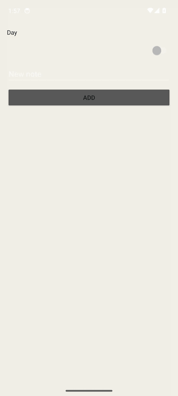

Notes, Release NativeAOT, emulator-recorded on the x86_64 API 34 emulator. Add writes Milk, then Oats.

> [!TIP]
> **Try it with a coding agent.** On a machine with the .NET SDK pinned in [`global.json`](global.json) (10.0.403), the `android` workload, a JDK, and an Android SDK, give the agent this prompt:
>
> ```text
> Clone https://github.com/filipef101/c-sharp-native and follow its README.
> Install the SDK from global.json (10.0.403), run `dotnet workload install android`,
> and point ANDROID_HOME at an Android SDK with a JDK and an x86_64 emulator image.
> The NDK is required for the NativeAOT link. Boot an emulator with KVM
> (`emulator -accel on`) and wait until `adb shell getprop sys.boot_completed` is 1.
> From the repo root, run both `dotnet test` commands in Quick start.
> Publish Release NativeAOT for the emulator ABI:
>   dotnet publish src/NativePoc.Android/NativePoc.Android.csproj -c Release -f net10.0-android -r android-x64
> Install the signed APK that publish prints, then:
>   adb shell am start -n com.scratch.nativepoc/nativepoc.PackingActivity
> Toggle a packed switch, rename an item, add an item, and copy the list.
> In another terminal run `tools/devx/cnative run android` and change the title
> string in src/NativePoc.Screen/Screen.cs. The counter should update in the
> same process. Do not commit a hot-reload token. Release does not compile the listener.
> ```

<a href="docs/media/packing-demo.mp4">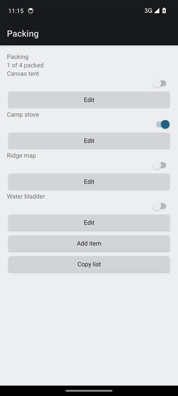</a>

Packing checklist, Release NativeAOT, on a KVM x86_64 emulator. The GIF is the clip; the link is the H.264 MP4.

<table>
<tr>
<td>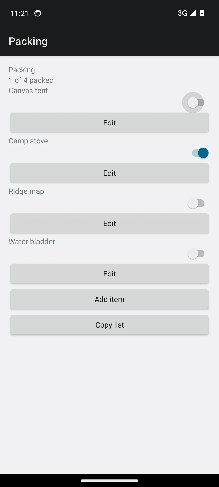</td>
<td>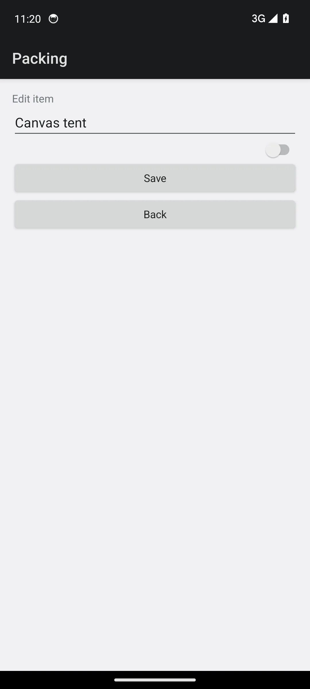</td>
<td>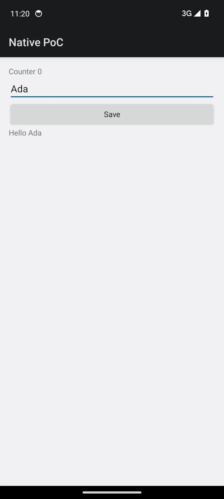</td>
</tr>
<tr>
<td>Packing list. <code>TextView</code>, <code>Switch</code>, and <code>Button</code>.</td>
<td>Editor. A real <code>EditText</code>.</td>
<td>Launcher. Counter, a name field, Save.</td>
</tr>
<tr>
<td colspan="3">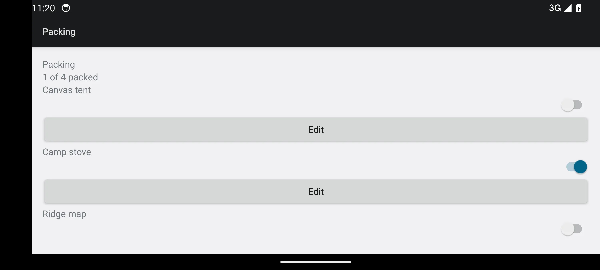</td>
</tr>
<tr>
<td colspan="3">Landscape still from before the packing screen was a ScrollView. Ridge map is cut off in that capture. In the video, rotation happens after the edits and keeps them.</td>
</tr>
</table>

<p>
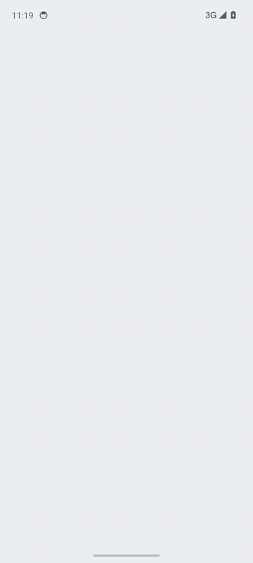
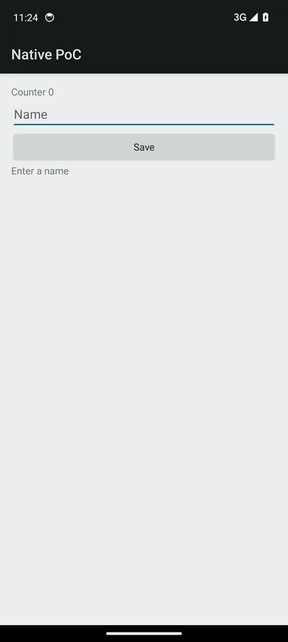
</p>

Counter, then a Debug hot reload of `Screen.cs` (`Counter` / `Enter a name` becomes `Clicks` / `Type a name`, then the file is restored). Same process. The save chip on the counter is Android showing the `poc-N` string that screen copies. It is not the hot-reload bearer.

This is a small UI runtime with no MAUI. You return an `Element` tree from C#. `TreeDiff` diffs it, `ViewReconciler` applies the patches, and `AndroidHost` builds `LinearLayout`, `TextView`, `Button`, `EditText`, and `Switch`. The packing sample is an offline list of fictional kit: no account and no network. State lives in `PackingSession.Shared` for the process. Release sets `PublishAot`. Debug hot reload is `tools/devx/cnative run android`, and it recompiles `src/NativePoc.Screen/Screen.cs` into the running process.

> [!NOTE]
> This is a pre-1.0 proof of concept. The Android host is the part that has been built and run. There is no API stability and no compatibility promise. iOS and the Spark binding are not in this tree.

The longer record is [research/android-poc-report.md](research/android-poc-report.md). The plan is [research/runtime-feasibility.md](research/runtime-feasibility.md).

## Contents

- [Principles](#principles)
- [How it works](#how-it-works)
- [Quick start](#quick-start)
- [A screen](#a-screen)
- [What works today, and what doesn't yet](#what-works-today-and-what-doesnt-yet)
- [Repository map](#repository-map)
- [Contributing](#contributing)

## Principles

### 1. Native widgets, not a canvas

What you write is a tree of `Column`, `Text`, `Button`, `TextField`, and `Switch`. What the phone draws is the platform widget of that kind. `AndroidHost.Create` maps them onto `android.widget` views. There is no canvas and no web view in this tree.

**Authored** in [`src/NativePoc.Android/AndroidHost.cs`](src/NativePoc.Android/AndroidHost.cs) and [`src/NativePoc.Core/Elements.cs`](src/NativePoc.Core/Elements.cs). **Observed** on the emulator in the clips above: the switch toggles, the editor is a text field, Save is a button.

### 2. Startup speed

Cold start is `TotalTime` from `adb shell am start -W -S`. The only startup table on this page is the one below. It is **measured**, copied from [evidence/mac-arm64-startup-run2.txt](evidence/mac-arm64-startup-run2.txt). Mac `pixel_8` arm64 emulator, API 36, n=20. p50 is the mean of the 10th and 11th sorted samples. p90 is the 18th sorted sample plus 0.1 times the gap to the 19th.

| Config | p50 (ms) | p90 (ms) |
| --- | --- | --- |
| MAUI empty baseline | 1604 | 1729 |
| Mono profiled AOT | 1533.5 | 1804 |
| Mono full AOT | 1428.5 | 1682.9 |
| NativeAOT | 1300 | 1711.3 |

NativeAOT has the lowest p50 in that file. Full Mono AOT has the lowest p90 (1682.9, against NativeAOT's 1711.3). Those APKs were built on Linux and timed on that Mac emulator. They are a different series from any x64 KVM `TotalTime` in the research report. TCG startup numbers in that report are withdrawn. The clips on this page were not timed as cold starts.

`tools/measure-arm64-startup.sh` is the script that defines that percentile. It expects four android-arm64 Release APKs beside it. Those APKs are not in this tree. This session did not re-run the script.

### 3. Hot reload is a requirement

What a reload can change, and what it cannot, is [docs/hot-reload.md](docs/hot-reload.md). That table is generated from the subset rules. Debug keeps a resident compiler on `localabstract:` plus `npoc-` and the package. The CLI reads `files/nativepoc-hotreload.socket` and forwards a host port taken from that package, so two listener packages can watch at once. The host forwarder uses the same `HotReloadAddress`. A listener run removes a stale forward such as `tcp:18765` to `localabstract:npoc-hotreload`. Saving `src/NativePoc.Screen/Screen.cs` reloads that screen in the same process. Saving `src/NativePoc.Core` or `src/NativePoc.Android` prints `rude edit -> restart required`. Release does not compile the listener (`HotReloadServer.Start` is inside `#if DEBUG`). The Release native library in the clip APK contains no `hotreload` or `npoc-hotreload` string.

**Measured** series, n=20, one pid, from [docs/devx/evidence/fixed-socket-percentiles.txt](docs/devx/evidence/fixed-socket-percentiles.txt). The clock is from the `Screen.cs` write until the reply line.

| Clock | p50 | p90 |
| --- | --- | --- |
| edit-to-screen | 59.8246 ms | 74.8963 ms |
| CLI edit-to-reply | 60.0 ms | 72.0 ms |

`dotnet watch` is not that path. On this workload it restarts the process.

The hot-reload GIF is a later Debug session on the same KVM emulator as the other clips (SDK 10.0.403, `cnative run android`). One edit changed `TitlePrefix` from `"Counter "` to `"Clicks "` and the empty prompt from `"Enter a name"` to `"Type a name"`. The screen followed. Restoring the file put `Counter 0` and `Enter a name` back. `cnative` printed three `reloaded in` lines for that recording: 42.0 ms (apply 17.6 ms), 28.6 ms (apply 11.4 ms), and 17.8 ms (apply 7.5 ms). That is one session, not the n=20 series. The source file in the tree is the original.

## How it works

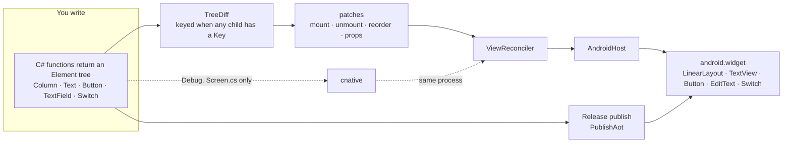

- **Elements** ([`src/NativePoc.Core/Elements.cs`](src/NativePoc.Core/Elements.cs)) are records. A `Key` is optional until a sibling has one. Mixed keyed and unkeyed children throw. Duplicate keys throw. A path deeper than four segments throws.
- **The diff** ([`src/NativePoc.Core/Diff.cs`](src/NativePoc.Core/Diff.cs)) walks the previous tree and the next. Keyed children keep their view when the key stays, and a move becomes a `Reorder`.
- **The reconciler** ([`src/NativePoc.Core/ViewReconciler.cs`](src/NativePoc.Core/ViewReconciler.cs)) applies those patches through `IElementHost`. The host is the only place that touches a platform view.
- **Android** ([`src/NativePoc.Android`](src/NativePoc.Android)) is that host. `MainActivity` renders the counter and is the launcher. `PackingActivity` renders the checklist. `AndroidNativeServices` is the clipboard and the vibrator call, and it is disposed with the activity.
- **Hot reload** ([`tools/devx`](tools/devx)) builds Debug, installs it, and pushes a new `Screen.cs` compile. The token is a per-process bearer created on the device. It is not stored in this tree.
- The longer path, including the NPC1 record and the reload socket, is [docs/architecture.md](docs/architecture.md). [docs/comparison.md](docs/comparison.md) is the comparison with MAUI, Avalonia, Uno, React Native, and NativeScript, limited to facts those projects document.

## Quick start

`global.json` pins SDK 10.0.403 with `latestFeature` roll-forward. You also need a JDK, `ANDROID_HOME`, and `dotnet workload install android`. NativeAOT linking needs the NDK. `cnative run android` reads `ro.product.cpu.abi`. `x86_64` selects `android-x64`. `arm64-v8a` selects `android-arm64`, on a phone or on an arm64 emulator. `--abi` overrides that. `--listener` publishes the Debug NativeAOT listener for the same RID. A normal Release publish is separate and has no listener.

The commands below are the ones in this repo. The two test projects were run on SDK 10.0.403 in the workspace that produced the clips: Core 28 passed, Packing 13 passed.

### 1. Host tests

```sh
dotnet test tests/NativePoc.Core.Tests/NativePoc.Core.Tests.csproj
dotnet test tests/NativePoc.Packing.Tests/NativePoc.Packing.Tests.csproj
```

### 2. Release NativeAOT, then the packing sample

```sh
dotnet publish src/NativePoc.Android/NativePoc.Android.csproj \
  -c Release -f net10.0-android -r android-x64
```

`PublishAot` and `EnablePreviewFeatures` are set when `Configuration` is `Release`. Install the signed APK that publish prints. Debug uses fast deployment, so a plain `adb install` of a Debug APK aborts. Release installs normally.

```sh
adb shell am start -n com.scratch.nativepoc/nativepoc.PackingActivity
```

The app id is `com.scratch.nativepoc`. `PackingActivity` sets its component name to `nativepoc.PackingActivity`. The launcher is `MainActivity`. On the v0.1.0-poc APK that component is `crc64ee53024f7ed0aa60.MainActivity`. `dotnet build -t:Run` starts the launcher for you:

```sh
dotnet build src/NativePoc.Android/NativePoc.Android.csproj \
  -c Debug -f net10.0-android -r android-x64 -t:Run -p:AdbTarget=-e
```

Phone publish is the same Release command with `-r android-arm64`. Mono AOT is that publish with `-p:PublishAot=false`. Full Mono AOT adds `-p:AndroidEnableProfiledAot=false`.

### 3. Hot reload

The emulator or device is already online. Saving `src/NativePoc.Screen/Screen.cs` reloads that screen. The [Dev loop](#dev-loop) lists the other files that reload the same way.

```sh
export DOTNET_ROOT="$HOME/.dotnet"
export ANDROID_HOME="$HOME/android-sdk"
export PATH="$DOTNET_ROOT:$ANDROID_HOME/platform-tools:$PATH"
tools/devx/cnative run android
```

`--device` selects an adb serial. `--abi` is `android-x64` or `android-arm64`. `--restart-on-rude` rebuilds when an edit needs a new process.

### Where the clips came from

**Observed** on this page, not the Mac startup series. AVD `poc34`, Pixel 6, Google APIs API 34, `x86_64`, emulator 37.2.13. `emulator -accel-check` printed `KVM (version 12) is installed and usable.` QEMU was started with `-accel on` and its command line contains `-enable-kvm`. `sys.boot_completed` was `1`, `ro.build.version.sdk` was `34`, and `ro.product.cpu.abi` was `x86_64`.

Packing and the counter were `adb shell screenrecord` of the v0.1.0-poc Release asset `packing-release-nativeaot-x86_64.apk`, sha256 `86d22bdb08537c51d566d0e6736c1b06a0c7c80f050ddc291ca9eda08c825d9d`, checked before install. [evidence/packing-apk-hashes.txt](evidence/packing-apk-hashes.txt) records a different local APK (`651c5d3d…`). The clips are the release asset, not that file. The packing clip toggles Canvas tent, renames Ridge map to Trail map, adds Lantern, copies the list, and rotates. The counter clip types Ada and presses Save.

PNG and WebP stills are `screencap` from that same boot. The list, editor, landscape, and counter stills are the seed packing list, the Canvas tent editor, the seed list in landscape, and the counter after typing Ada.

## Dev loop

`tools/devx/cnative run android` builds Debug, installs it on the online emulator, and stays up. Saving `src/NativePoc.Screen/Screen.cs` lowers that screen to a program the running process already knows how to evaluate. The listener applies those bytes on the UI thread. It does not load a new assembly for that edit.

Saving `samples/NativePoc.Packing/PackingScreen.cs` lowers that screen the same way. A row label, an added text field, or a reordered row is applied in the running process, and the packing list stays. `cnative new <name>` writes `samples/<name>/<Name>Screen.cs`, and that file reloads the same way. [Getting started](docs/getting-started.md) builds one from a clean clone.

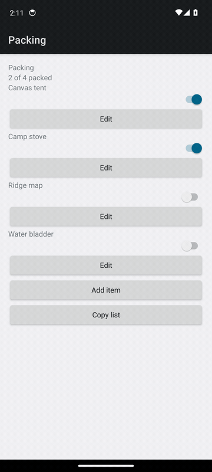

Emulator-run, 2026-11-11, AVD `poc34`, API 34, x86_64, KVM. `emulator -accel-check` reported KVM version 12, and QEMU was started with `-accel on`. Percentiles are Hyndman-Fan type 7, the formula in `tools/measure-arm64-startup.sh`.

Packing row-label edit to present, n=12, one pid (9382): p50 20.1565 ms, p90 30.7825 ms. The clock starts at the `PackingScreen.cs` write and stops after lower, socket, UI render, and `OnDraw`. The list rows stayed. The GIF above is a later session on that same emulator, pid 12505: the row buttons change from Edit to Open and the packed rows stay. It is one edit, not the n=12 series.

Counter `Screen.cs`, n=12, one pid (11590): `OnDraw` p50 41.3773 ms, p90 50.4457 ms; gfxinfo `FrameCompleted` p50 77.5302 ms, p90 94.5824 ms; screencap byte change p50 332.0824 ms, p90 343.4421 ms. The screencap figure includes pulling one PNG. `DisplayPresentTime` and `SurfaceFlinger --latency` were 0 on this swiftshader emulator, so the frame timestamp is gfxinfo `FrameCompleted`.

NativeAOT dev listener, emulator-run on that same AVD. `IsDynamicCodeSupported=False` on pid 4934. A Debug listener `.so` published from this tree is 9,815,760 bytes (signed APK 3,707,827, sha256 `43ffc3bf4657f405fc5e8b3339b7d495502b1842bef544d441546a38f41d379a`). The log is [docs/devx/evidence/listener-action-vm.txt](docs/devx/evidence/listener-action-vm.txt). The previous listener, pid 3985, was 9,756,560 bytes (signed APK 3,683,251, sha256 `6cf694d7943d14bec2554703799d1b77909aa7a5ee75235723900ed113d212b5`) in [docs/devx/evidence/listener-handlers.txt](docs/devx/evidence/listener-handlers.txt). The listener before that, pid 3242, was 9,728,848 bytes (signed APK 3,670,963, sha256 `2bec24e4e7424c2bcd6c1b666cd3f6f80d084941c3eb75a9991e1d59c6314631`) in [docs/devx/evidence/listener-new-screen.txt](docs/devx/evidence/listener-new-screen.txt). An earlier listener `.so` was 8,967,072 bytes (signed APK 3,404,461). The earlier trim, before styles, effects, images, field mode, and platform modules, was 8,798,208 bytes (signed APK 3,338,723). The same listener before dropping native debug info was 29,562,584 bytes (APK 7,676,387). The listener turns off `IlcGenerateDebugInfo` and `DebuggerSupport`, turns on invariant globalization, and a manifest overlay keeps that package debuggable so `run-as` can still read the token. A Release publish of the earlier tree is 6,181,648 bytes (unit 10's Release `.so` was 6,023,952). The extra over unit 10 is the navigation and list host, and the Release package is not debuggable.

Release cold start on this same emulator, `adb shell am start -W -S`, LaunchState COLD, n=20, none dropped, Hyndman-Fan type 7. QEMU pid 4419, `/dev/kvm` present. The unmodified tree's Release `.so` is 6,315,360 bytes (signed APK 2,728,487): TotalTime p50 1436.5 ms, p90 1575.9 ms. Unit 10's Release p50 on the older `.so` was 1470.0 ms, same method. After invariant globalization (no `icudt` in the `.so`), native debug info off, and the debugger, event source, and metadata updater off, that build's `.so` was 6,571,488 bytes (signed APK 2,814,503): TotalTime p50 765.5 ms, p90 925.8 ms. This tree also turns off stack traces, metrics, and startup hooks, skips the debug view walk, and registers the other screens after the first frame. Its Release `.so` is 6,189,440 bytes (signed APK 2,675,367). TotalTime sorted 663 689 693 709 717 718 736 749 751 759 774 775 777 792 825 853 858 864 882 1059. p50 766.5 ms, p90 865.8 ms. Marks from process start, n=20: managed main p50 32.0 p90 51.3, activity p50 50.0 p90 88.8, first render p50 101.0 p90 141.4, first present p50 136.0 p90 176.9. An empty Java activity with those same marks, package `com.scratch.floor`, APK 12,631 bytes, measured in the same series: TotalTime sorted 596 614 657 663 668 685 692 695 704 728 728 731 749 754 763 786 790 816 833 943, p50 728.0 ms, p90 817.7 ms. Its activity mark is p50 90.0, first render p50 106.5, first present p50 153.0. Native TotalTime sits 38.5 ms over that floor. Native reaches OnCreate (50.0 vs 90.0) and first present (136.0 vs 153.0) before the Java activity. The leftover is first-render to Displayed: native p50 650.0 ms, Java p50 605.0 ms. `dumpsys SurfaceFlinger --latency` printed only `16666666`. Framestats recorded 100 frames and the last column was non-zero on all 100. `dev-overlay` and `icudt` are not in the Release `.so`. `IsDynamicCodeSupported=False`.

Coordinator-measured on Filipe's MacBook Pro M5, not in this workspace. Android emulator AVD `pixel_8`, `arm64-v8a`, Android 16. APK `nativepoc-0.2.0-android-arm64.apk`, sha256 `b5b4a809f6e652642e0bea1394a451fa766fa00b0b05d39828773202f4873bac`. `am start -W -S`, LaunchState COLD, n=20 after one warmup, Hyndman-Fan type 7. logcat showed `IsDynamicCodeSupported=False`. No Java floor was measured on that Mac. Counter TotalTime, sample order 800 447 683 575 736 497 419 1059 871 816 842 444 485 463 444 449 474 400 462 406. Sorted 400 406 419 444 444 447 449 462 463 474 485 497 575 683 736 800 816 842 871 1059. p50 479.5 ms, p90 844.9 ms. The first ~10 samples are noisy. packing1000 (`--es nativepoc_bench packing1000`, logcat `window rows=1000 built=20 views=32`), sample order 447 364 408 362 382 449 369 361 594 918 486 470 428 577 544 457 457 469 514 846. Sorted 361 362 364 369 382 408 428 447 449 457 457 469 470 486 514 544 577 594 846 918. p50 457.0 ms, p90 619.2 ms. The same method is `tools/bench/cold-start.sh`. `--floor` builds the empty Java activity. That floor was not run on the Mac. The numbers are also in [docs/release-notes.md](docs/release-notes.md).

Coordinator-measured on Filipe's MacBook Pro M5, not in this workspace. AVD `pixel_8`, `arm64-v8a`, Android 16. The APKs are the ones in the previous progress mac-bench: nativepoc sha256 `ce39c83e7c1aa8aca8334fbbafd7d0dfa9be7e8e75fa933ce42abd111b881acb`, package `com.scratch.nativepoc`, activity `com.scratch.nativepoc/crc64ee53024f7ed0aa60.MainActivity`; empty Java floor sha256 `7a8b6e2daa328c69a943211fdba85daac225017ff760409d964bbb49b5fefb1c`, package `com.scratch.floor`, activity `com.scratch.floor/.FloorActivity`. `am start -W -S`, all COLD, one warmup each, n=20 interleaved (native, floor, packing1000 per round), Hyndman-Fan type 7. Present versus FrameCompleted was not captured on that Mac. Counter TotalTime, sample order 513 378 463 328 468 382 423 943 948 740 384 531 463 401 444 635 393 423 485 716. p50 463.0 ms, p90 760.3 ms. Floor TotalTime, sample order 423 416 378 501 407 313 410 337 505 502 341 460 367 307 386 296 358 393 530 517. p50 400.0 ms, p90 506.2 ms. packing1000 TotalTime, sample order 436 302 359 498 377 427 353 656 620 578 447 383 333 324 439 440 557 373 460 474. p50 437.5 ms, p90 582.2 ms. Counter is 63.0 ms over the floor at p50. Counter's p90 is the fat tail (943 and 948); packing1000's largest sample is 656. `tools/bench/mac-bench.sh` is the interleaved method. Its `--self-test` checks these three percentiles. It was not run on the Mac.

A second coordinator-measured run on that Mac used the same script, `tools/bench/mac-bench.sh --n 20`, interleaved, all COLD. AVD `pixel_8`, arm64, Android 16. The arm64 APK is sha256 `ac502d27eae357b7514787abe4faa245a859380ca3322406cadc41d19905b3d4`. The floor APK is the same `7a8b6e2daa328c69a943211fdba85daac225017ff760409d964bbb49b5fefb1c`. Host load average was 14.3 at the start, with other work on the machine. Counter TotalTime p50 423.5, p90 784.5, first present p50 213.5, UI p50 24.8, issue-draw-commands p50 0.2. Floor p50 362.5, p90 744.0, present p50 196.0, UI p50 21.9, draw p50 0.1. packing1000 p50 413.0, p90 562.6, present p50 246.0, UI p50 23.9, draw p50 0.2. Rounds 0–11 were steady (counter about 378–430, floor about 354–388, packing about 305–505). Rounds 12–16 were noisy in every series, floor included (floor 739, 1008, 789; counter 778, 1111, 688, 843). The p90 tail on this run is host contention. Counter is 61 ms over the floor at p50. This does not replace the table above. Draw p50 on this GPU is 0.2 ms. The x86 draw gap below is the swiftshader emulator.

Emulator-run follow-up on this x86_64 API 34 emulator, interleaved the same way, n=20, all COLD, Hyndman-Fan type 7. The binary is the x64 Release publish sha256 `0ac29e1248567a90377ba68d5c4c179145cf8a5f4f7dd2ff5e52e3e671a14da7`, uncompressed `lib/x86_64/libNativePoc.Android.so` 6,297,424 bytes. Host load average 0.71 at the start. Counter TotalTime p50 763.0, p90 828.6. packing1000 TotalTime p50 578.5, p90 641.5. First present p50 138.0 and 137.0. The name field logged `startup field-focus focused=0` on all 20 counter launches. `startup phase=catalog` was 0 ms on 18 launches and 1 ms on 2, and that line is after first-present. `startup gc` at activity and at present was gen0=1, gen1=0, gen2=0 on every launch of both series. There is no `Every` and no `Effect` on the counter. The first gfxinfo row's UI-thread interval, DrawStart minus PerformTraversalsStart, was p50 110.0 ms on the counter and 109.3 ms on packing1000. Issue-draw-commands, SwapBuffers minus IssueDrawCommandsStart, was p50 301.6 ms and 145.7 ms. The x86 gap is that draw-command interval on swiftshader. This run did not reproduce the Mac two-sample tail. The other catalogs are 3,338 bytes and are not that gap.

The packing screen with the nav stack and 1000 rows, `nativepoc_bench=packing1000`, same method. An earlier boot on this emulator, before the window, was TotalTime sorted 1662 1675 1760 1780 1814 1823 1825 1851 1855 1872 1896 1983 1988 2041 2059 2065 2068 2077 2115 2263, p50 1884.0 ms, p90 2080.8 ms, first render p50 753.0. On the boot that published the `.so` below, the same screen before the window was TotalTime sorted 1591 1687 1831 1833 1833 1879 1902 1909 1914 1924 1955 1965 1999 2000 2021 2028 2033 2043 2045 2231, p50 1939.5 ms, p90 2043.2 ms, first render p50 738.0, first present p50 982.5, n=20, all COLD. After the first frame keeps a 20-slot window (1000 rows, 20 built, 32 views) and the screens that are not showing stay bytes, that same boot measured TotalTime sorted 527 532 542 564 578 585 589 591 592 597 601 611 612 615 631 660 663 681 732 763, p50 599.0 ms, p90 686.1 ms. Activity p50 48.0. First render p50 92.5, p90 128.3. First present p50 132.0. Eval p50 0 ms, mount p50 9.5 ms. First render to Displayed p50 513.5 ms. The Release `.so` for that after series is 6,259,872 bytes uncompressed (signed APK 2,708,269). A list of 24 rows or fewer still expands, so the four-row packing screen keeps its switch, edit button, and swipe. The window's slots are the row label.

On this boot, that same installed APK (sha256 `b4f3b328ea82ffa33ee9ab15f21e73ea7f265c860e6437044828dd509373dd54`) was measured again before any startup edit. Host load average 0.11 at the start. packing1000 TotalTime sorted 582 598 611 627 643 663 673 679 680 689 704 739 747 775 787 835 837 863 867 868, p50 696.5 ms, p90 863.4 ms. First render p50 130.5. First present p50 171.5. Eval p50 0, mount p50 10.5. First render to Displayed p50 582.5. Still `window rows=1000 built=20 views=32`, n=20, all COLD, `IsDynamicCodeSupported=False`. The empty Java floor built by `tools/bench/build-floor.sh` on this boot is 12,649 bytes, sha256 `bb38c40cc4bad863d55741b9c425c78f5f316f71d880ab49da084cebbac43ba0`. It is not the 12,631-byte floor from the earlier boot. Floor TotalTime p50 679.0, p90 751.2. First render p50 91.0. First render to Displayed p50 587.5. Native TotalTime sat 17.5 ms over that floor, and the two gaps matched (582.5 and 587.5).

The starting window now uses `NativePocTheme`, whose `windowBackground` and splash background are the page color (`#F4F1EA`, and `#1C1917` in night mode). `ApplyWindow` sets that color from the stored theme before the first content. Text color and layout direction are applied before `SetContentView`, and direction is left alone when it already matches. `ReportFullyDrawn` runs from the first pre-draw. The first republish (sha256 `7feb678e748051e78069493e83c6752bcfe574615c5bdcb0c076c89133e46532`, `.so` 6,265,808 bytes) did not reach `ReportFullyDrawn`: the decor view's context was not the activity, and logcat had no `Fully drawn` line. That series, host load 1.26 at the start, was TotalTime p50 518.0, p90 561.4, first render p50 84.0, first render to Displayed p50 436.5. The following publish calls it on `MainActivity.Current`. sha256 `f7e2a6411480cc6337c30d995463ae654fc7171f11d92433d6e68acae03ccab9`, `.so` 6,265,872 bytes, signed APK 2,708,269 bytes. Host load 1.30 at the start. TotalTime sorted 489 490 502 503 506 510 513 517 518 519 520 531 543 554 556 558 564 582 616 676, p50 519.5, p90 585.4. First render p50 94.5. First present p50 140.5. The `report-fully-drawn` mark p50 140.5. Logcat `Fully drawn` p50 519.5, the same samples as Displayed. First render to Displayed p50 435.0. Eval p50 0, mount p50 8.0. `window rows=1000 built=20 views=32`. `ReportFullyDrawn` did not move TotalTime past the theme series. A second floor series started while the host load was 4.01: TotalTime p50 629.5, first render to Displayed p50 563.5. The native gap moved further than that floor.

On this same x86_64 API 34 emulator, that installed ReportFullyDrawn binary (sha256 `f7e2a6411480cc6337c30d995463ae654fc7171f11d92433d6e68acae03ccab9`) was compared with gfxinfo framestats. packing1000, `am start -W -S`, n=20 after one discarded warmup, every launch including the warmup COLD, Hyndman-Fan type 7. The clock is `/proc/<pid>/stat` starttime (field 22, clock ticks / 100) against framestats nanoseconds on this emulator. `DisplayPresentTime` was 0 on all 20 first frames, so the present mark is the pre-draw log and the frame clock is `FrameCompleted`. First render p50 100.0, p90 145.3. First present p50 137.0, p90 179.4. Render to present p50 30.0. IntendedVsync p50 184.8. DrawStart p50 309.2. SwapBuffers p50 411.0. FrameCompleted p50 482.1, p90 528.0. Present to FrameCompleted p50 362.3. FrameCompleted to Displayed p50 23.8, p90 36.6. One of those samples is −5.1, which is the 10 ms tick. Present to Displayed p50 377.0, p90 418.1. TotalTime and Fully drawn are the same samples: sorted 459 468 480 481 484 489 498 501 505 512 514 516 519 520 524 541 554 554 570 578, p50 513.0, p90 555.6. The app UI thread is done at first present. The time from that present to Displayed is the emulator frame pipeline: DrawStart's p50 is 172.2 ms after the first-present p50, and FrameCompleted is the bulk of the wait. The Displayed report follows FrameCompleted. `ReportFullyDrawn` does not end that wait early. This series is that binary, before the variable-height row slots.

The row window after that binary keeps 20 slots. A slot shows the row's first text, a second text when it is not empty, and a drawable when the row has one. Those three are different heights. A row that has not been built is one text line, so the first frame still builds 20 rows. On this emulator, one COLD launch of packing1000 on the rebuilt Release (`startup window rows=1000 built=20 views=92`) showed that line. It is one launch, not an n=20 TotalTime series. The signed APK for that launch is sha256 `25e14d2e2ae7a9d7d39a972fb6713d6b7df3a47fa32634f3e442b4effdc9c734`, uncompressed `lib/x86_64/libNativePoc.Android.so` 6,291,664 bytes. Eight swipes then moved the window from `first=0` to `first=106`. The visible labels were Item 0106 through Item 0124, with `Ridge line` on the rows whose index is divisible by 3 and `marker` on the rows whose index is divisible by 4. Scrolling back landed on `first=0` with Item 0000 still followed by `Ridge line` and `marker`. gfxinfo for that swipe session, pid 24935: 135 frames, 37 janky (27.41%), 50th percentile 34ms, 90th 48ms, 95th 53ms, 99th 61ms, 4 missed vsync, 16 slow UI thread, 36 slow issue-draw-commands, 37 frame deadlines missed. `cnative agent a11y --check` on packing was `violations=0` at font scale 1, 1.3, and 2 (density 420). Trips at font scale 2 was `violations=0`. This image's `uiautomator` dump has no `heading` attribute, so the report says `headings=0` and `heading-attribute=absent`. Buttons and switches that are fully on screen are at least 48dp. The 2x screenshots are in the progress notes, not in this tree.

The same window now keeps a height prefix (`RowPrefix`) so a rebind does not walk every row above the viewport to place the 20 slots. Emulator-run on the x64 Release sha256 `0ac29e1248567a90377ba68d5c4c179145cf8a5f4f7dd2ff5e52e3e671a14da7`, one COLD packing1000 launch, pid 31636, `startup window rows=1000 built=20 views=92`. gfxinfo was reset after that first frame, then eight swipes. The window moved to `first=174`. Scrolling back landed on `first=0` with canvas still 60489, Item 0000 followed by `Ridge line` and `marker`, and Item 0004 with `marker` and no subtitle. The swipe gfxinfo: 283 frames, 80 janky (28.27%), 50th percentile 34ms, 90th 53ms, 95th 61ms, 99th 69ms, 19 missed vsync, 36 slow UI thread, 1 slow bitmap upload, 78 slow issue-draw-commands, 80 frame deadlines missed. Slow UI thread and slow issue-draw-commands are separate counts. The draw-command count is the larger one. This is not the earlier 135-frame session.

Emulator-run on that same swipe script, this boot, before the slot change. The binary was the field-stroke publish sha256 `8c45935195126497b1dc3e6df2eeb48d83bf4ca9cdea6edf02075a5d9760a7e6`, which is not kept, and its list code matched the previous tree. 249 frames, 67 janky (26.91%), p50 34ms, p90 53ms, 24 slow UI thread, 65 slow issue-draw-commands, GPU p50 22ms, `first=168`. A two-swipe capture on that binary kept every frame in the framestats buffer: 55 frames, 16 janky, 16 slow issue-draw-commands. IssueDrawCommandsStart to SwapBuffers was p50 2.65ms (max 17.0). SwapBuffers to GpuCompleted was p50 22.11ms. IssueDrawCommandsStart to FrameCompleted was p50 25.18ms. Android 14's `JankTracker` counts "Slow issue draw commands" only on a missed-deadline frame, and the interval is IssueDrawCommandsStart to FrameCompleted, threshold 0.75× the frame interval. On this swiftshader emulator that interval is the GPU completion, so the counter matches the janky-frame count. Command recording is the smaller interval. A slot that already shows a still-visible row is now left alone (`RowWindowPlan`), and the canvas layout is replaced only when its height changes. The same eight swipes on the kept binary, sha256 `011a9785723326e575abcf191ff4992e222a0a9a174c88dd9b91364c0276ea7f`, `.so` 6,301,632 bytes, host load 1.14: 236 frames, 66 janky (27.97%), p50 34ms, p90 48ms, 20 slow UI thread, 0 slow bitmap uploads, 65 slow issue-draw-commands, `first=159`, then back to `first=0` with canvas 59730. Item 0000 still had `Ridge line` and `marker`. Item 0004 had `marker` and no subtitle. The bucket did not move. An earlier pass of the same source at host load 1.81 was 268 frames and 68 slow issue-draw-commands. A hardware layer on each slot made it worse (229 frames, 86 slow issue-draw-commands, GPU p50 25ms) and is not in this tree. Drawing each row from one view dropped the startup view count from 92 to 32 and left GPU p50 at 21ms (253 frames, 60 slow issue-draw-commands, host load 2.79). That drawing change is not in this tree either.

The counter's first-frame issue-draw-commands on this emulator, n=10, all COLD, Hyndman-Fan type 7, host load 0.03: 309.6 345.1 333.8 319.3 269.8 270.5 256.3 260.4 288.4 292.0, p50 290.2ms. The same interval after one `GradientDrawable` stroke on the name field, n=10, host load 1.05 at the start: 303.6 290.0 266.4 230.7 267.1 238.3 304.2 302.1 279.5 267.1, p50 273.3ms. The ranges overlap. The stroke is not in this tree. The Mac draw p50 above is 0.2ms, so this interval is the swiftshader first frame.

Release rebuilds of this tree, not published. x86_64 signed APK sha256 `0ac29e1248567a90377ba68d5c4c179145cf8a5f4f7dd2ff5e52e3e671a14da7`, 2,720,557 bytes, `.so` 6,297,424 bytes. That is the binary in the counter-tail series and the scroll above. arm64 signed APK sha256 `ac502d27eae357b7514787abe4faa245a859380ca3322406cadc41d19905b3d4`, 2,573,104 bytes, `lib/arm64-v8a/libNativePoc.Android.so` 6,507,952 bytes. Built here, not run. Neither `.so` contains `npoc-hotreload`. Package `com.scratch.nativepoc`, activity `crc64ee53024f7ed0aa60.MainActivity`.

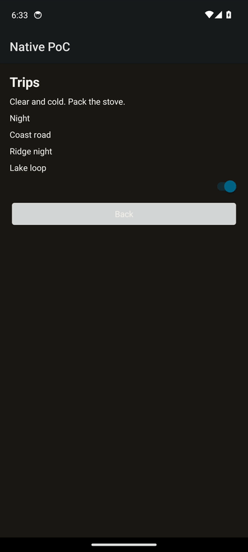

`samples/NativePoc.Trips` is a three-screen subset app (trip list, trip detail, packing). The clip is one Release process on this emulator: the detail shows the stored note `stove`, a swipe removes the tent row, a long-press leaves the name `Stove`, a pull-to-refresh replaces the label with `List updated`, and Back returns to the list. The weather line is the `weather` effect. The switch is the stored dark theme. The trip strings go through `L.Get` and the Android locale. `pt-PT` is in `StringTable`. `L.Plural` picks the one-string when the count is 1 and the other-string otherwise. Invariant globalization stays on. See [docs/localization.md](docs/localization.md).

`HostView` is one platform view with a kind, a prop, and an event. `samples/NativePoc.Web` is a `WebView` whose prop is `url` and whose event is `navigate`. `NativeViews` constructs it with a direct call. A reload that keeps the kind keeps the slot. See [docs/native-view.md](docs/native-view.md).

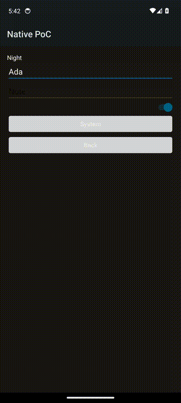

Same-pid subset reload on the earlier listener, n=10, pid 20966, Hyndman-Fan type 7. Title: `OnDraw` p50 28.5024 ms, p90 42.8412 ms; gfxinfo `FrameCompleted` p50 56.1642 ms, p90 74.8903 ms. Packing: `OnDraw` p50 25.7990 ms, p90 37.5417 ms; `FrameCompleted` p50 53.1393 ms, p90 62.9946 ms.

Same process on the listener above, pid 32111, n=10, Hyndman-Fan type 7, gfxinfo `FrameCompleted`. QEMU pid 4419, KVM present, `IsDynamicCodeSupported=False`. A style-only title size change mounted no new buttons: `OnDraw` p50 22.9500 ms, p90 28.8035 ms; frame p50 50.2316 ms, p90 68.8963 ms. An image source swap: `OnDraw` p50 17.2856 ms, p90 21.5776 ms; frame p50 46.0833 ms, p90 50.9797 ms. An effect whose resource stayed `places` applied once: `OnDraw` p50 21.8065 ms, p90 28.7446 ms; frame p50 46.5731 ms, p90 61.2351 ms. The form note caret stayed `start=13 end=13` across a label reload. Empty submit logged `share-skipped` and `haptic-ok`. A filled submit logged `share-text chars=13` and `haptic-ok`. `DisplayPresentTime` stays 0 on this swiftshader emulator.

A keyed list of 1000 rows, apply-to-present (the reply waits for `OnDraw`), n=5 fresh processes. `ScrollView` mounted 1037 views: first present p50 1071.3305 ms, p90 1136.1784 ms, TOTAL PSS p50 52,997 KB. The recycled window (20 slots, not AndroidX `RecyclerView`) mounted 34 views: first present p50 254.0235 ms, p90 358.3155 ms, TOTAL PSS p50 40,717 KB. Reload on one pid, n=5: scroll p50 23.8252 ms, p90 39.3966 ms; recycled list p50 37.8717 ms, p90 42.5501 ms.

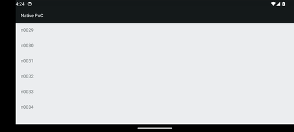

`tools/NativePoc.HotReload.Host` is the older clock. `a` is a benchmark that restarts the app, then times a file write through the reply. `b` times a payload that was compiled before the clock. `c` times the compile and does not touch the device.

## A screen

The packing list is a function. Each row's key is the item id, so a rename keeps that row's widgets and an added row is a mount. From [`samples/NativePoc.Packing/PackingScreen.cs`](samples/NativePoc.Packing/PackingScreen.cs):

```csharp
public static Element View(PackingItem item, Action onEdit, Action<bool> onPacked) =>
	new Column(
	[
		new Text(item.Name) { Key = "name" },
		new Switch(item.Packed, onPacked, "Packed " + item.Name) { Key = "packed" },
		new Button("Edit", onEdit, "Edit " + item.Name) { Key = "edit" },
	])
	{ Key = item.Id };

public static Element View(PackingState state, IPackingHost host)
{
	var children = new List<Element>
	{
		new Text("Packing") { Key = "title" },
		new Text(state.PackedCount + " of " + state.Items.Count + " packed") { Key = "progress" },
	};
	foreach (var item in state.Items)
	{
		var current = item;
		children.Add(ItemRow.View(
			current,
			() => PackingActions.BeginEdit(state, host, current.Id),
			value =>
			{
				PackingTelemetry.SwitchDeliveries++;
				current.Packed = value;
				host.Native.Pulse();
				host.RequestRender();
			}));
	}
	children.Add(new Button("Add item", () => PackingActions.BeginAdd(state, host), "Add item") { Key = "add" });
	children.Add(new Button("Copy list", () => PackingActions.Copy(state, host), "Copy list") { Key = "copy" });
	return new Column(children) { Key = "list" };
}
```

The counter, which is what hot reload swaps, is [`src/NativePoc.Screen/Screen.cs`](src/NativePoc.Screen/Screen.cs). Save increments `Count` and copies `"poc-" + count`.

The seed list is Canvas tent, Camp stove (packed), Ridge map, and Water bladder, in `PackingState.Seed`.

## What works today, and what doesn't yet

### Working

**Measured** on a device or an emulator, in the files named, or in the clips on this page.

- **Android widgets.** `Column`, `Text`, `Button`, `TextField`, and `Switch` are the views in [docs/media/packing-demo.gif](docs/media/packing-demo.gif) and the stills on API 34. The host maps them in [`AndroidHost.cs`](src/NativePoc.Android/AndroidHost.cs). It also maps `ScrollView`, `ListView`, and `Image`. Those three are in the tree now; the clip predates them.
- **Animation.** `Animated.Timing` and `Animated.Spring` scale the view with that key. A screen that never calls them does not arm a frame callback. A duration basis of 0, or either animator scale at 0, applies the end value on the same call. SwiftShader magnifies that draw. A host-GPU or device run is still pending.
- **Images.** A shelf tile decodes a build-time JPEG and bakes the corner radius off the UI thread, then presents one bitmap per frame. The eight JPEGs are written into the intermediate output and are not files in this repository. `NativePocImage` compiles that module. The widget floor leaves it off. A remote feed row uses the same HTTP backend as `Http.GetJson`, and leaving the screen aborts that fetch.
- **HTTP.** `Http.GetJson` and `Http.PostJson` stay the screen calls. The default backend is `java.net.HttpURLConnection` through `PlatformHttp` on the JNI registry, off the UI thread. `Pop` disconnects only that screen's sockets, including an in-flight image read, and logs one `http-cancel` line. A cancelled image logs `image-abort` and is not decoded. `NativePocVisit` compiles `samples/visit` into an opt-in showcase. `NativePocHttpManaged=true` keeps one `HttpClient` on `SocketsHttpHandler`. JSON is still the source-generated converter. An app that does not set `NativePocHttp` compiles neither. iOS would map the same call to `NSURLSession`. That host was not built. The measured sizes are in the progress81 paragraph above.
- **Grid.** A `ListView` with `Style.Across` of 2 or more is `nativepoc.KeyedList`, a two-column `GridLayoutManager`. `NativePocRecycler` is what pulls in `androidx.recyclerview`. The widget floor sets that flag false, and a build that does not set it drops the RecyclerView, core, and customview libraries before they are imported. Release sets `AndroidLinkTool` to `r8`. `proguard-jni.cfg` keeps `StartupProbe`, `StartupApp`, and `net.dot.jni.nativeaot.NativeAotRuntimeProvider`. `proguard-list.cfg` keeps `KeyedList` and the native methods the host registers. The reflective keep of every `LayoutManager` is removed, because `KeyedList` constructs `LinearLayoutManager` and `GridLayoutManager` itself.
- **Swipe back.** An edge drag tracks the current screen and reveals the one under it. A completed drag pops. The back button still pops with TalkBack on.
- **Note field.** The piece screen has a Note field stored by the persist module, with autofill off.
- **Stress flag.** `NativePocStress` defaults to false. The 1,000-row list is package `com.scratch.nativepoc.stress`. The measured showcase does not pass the flag.
- **Release is NativeAOT.** `PublishAot` is set for Release in [`NativePoc.Android.csproj`](src/NativePoc.Android/NativePoc.Android.csproj). The clip APK's `lib/x86_64/libNativePoc.Android.so` has no `hotreload` string. The earlier publish scan is [evidence/nativeaot-release-listener-scan.log](evidence/nativeaot-release-listener-scan.log).
- **Keyed updates.** A rename and an added row in the clip stay consistent with the keyed diff in [`Diff.cs`](src/NativePoc.Core/Diff.cs). Host tests cover the reconciler.
- **In-place hot reload of `Screen.cs`.** The n=20 series stayed on one pid. The numbers are in [docs/devx/evidence/fixed-socket-percentiles.txt](docs/devx/evidence/fixed-socket-percentiles.txt). The GIF is a later single session, edit and restore.
- **`cnative new` on the NativeAOT listener.** Pid 3242 logged `IsDynamicCodeSupported=False`, showed `Hello` and `Count 0`, then kept that pid across a style edit and a handler edit. On that build, `state.Count += 1` printed `subset.bad-lambda` and `--restart-on-rude` relaunched to pid 3456 with `Added` and `Count 1` still on screen. The log is [docs/devx/evidence/listener-new-screen.txt](docs/devx/evidence/listener-new-screen.txt).
- **Handler edits on the NativeAOT listener.** Pid 3985, `IsDynamicCodeSupported=False`, kept that pid. `state.Count += 1` applied in 23.8 ms and the tap showed Count 1. `-=`, `--`, `++`, string `+` and `+=`, interpolation, `x = !x`, a ternary, `if`/`else`, a local, list add/remove/clear, `Haptics.Confirm`, `Share.Text`, `Storage.Set`, `Theme.Mode`, `Push`, and `Pop` ran in that process. `state.Count *= 2` printed `subset.bad-lambda` and the pid stayed 3985. Changing `"Hello"` to `"Hello again"` printed `state kept Title="Hello" (initializer "Hello again"). cnative reset-state`, and `cnative reset-state` then showed Hello again. A notes screen opened while hello's Count was 1 showed Count 0. The log is [docs/devx/evidence/listener-handlers.txt](docs/devx/evidence/listener-handlers.txt).
- **Action VM on the NativeAOT listener.** Pid 4934, `IsDynamicCodeSupported=False`, kept that pid. `*=`, `/`, `%`, the comparisons, `for` / `while` / `foreach`, `++` as a value, an arithmetic interpolation hole, `?.` / `??`, `state.Title.Trim()`, and the fixed call table ran in that process. A 1,000-iteration loop applied in 21.9 ms and the ten taps were p50 7995.5 µs. `while (true)` logged `action stopped after 100000 steps` and the next edit still applied. The same loop in the Release binary, same emulator session, pid 5436, returned 1000 and the stopwatch read 0 µs at p50 on a 1 µs quantum. The log is [docs/devx/evidence/listener-action-vm.txt](docs/devx/evidence/listener-action-vm.txt).
- **Helpers, render reloads, and the same loop on a later listener.** Pid 5686, `IsDynamicCodeSupported=False`, kept that pid. Adding a helper applied in 10.0 ms and the tap showed Count 8. Editing it applied in 22.1 ms and the tap showed Count 9. A list-row helper applied in 9.9 ms and the tap showed Lantern and Rope. An early return, a ternary, an if/else, an added child, a removed child, and a keyed reorder all applied in that process. The 1,000-iteration loop, same handler as pid 4934, was p50 5544.0 µs (1.44× that 7995.5 µs). A tap that does not call `RequestRender` was p50 1696.5 µs. `RequestRender` alone was p50 4665.5 µs. `while (true)` logged `action stopped after 100000 steps` at 12592 µs and the pid stayed 5686. The log is [docs/devx/evidence/listener-helpers.txt](docs/devx/evidence/listener-helpers.txt).
- **Style, image, and effect reloads on the NativeAOT listener.** Pid 32111, n=10, `IsDynamicCodeSupported=False`. The numbers are in the Dev loop above. A style-only edit did not remount buttons, and the places effect applied once.
- **Text fields and platform modules.** A field can set `Keyboard`, `Lines`, `Submit`, and `OnSubmit` ([`Elements.cs`](src/NativePoc.Core/Elements.cs)). `Haptics.Confirm`, `Share.Text`, and `Clipboard.Copy` dispatch through a switch in [`PlatformModules.cs`](src/NativePoc.Android/PlatformModules.cs), with no reflection. The pid 32111 form run kept the note caret and logged `haptic-ok` plus `share-text chars=13`.
- **Debug state across a force-stop.** A Debug process writes `files/nativepoc-state.bin` on each render and reads it before the first frame ([`StateStore.cs`](src/NativePoc.Android/StateStore.cs)). Release keeps packing state in the process only. A force-stop of a Release process returns to `PackingState.Seed`. The portrait still was captured after a force-stop and shows that seed.
- **Packing behavior that review recorded** in [review/packing-fix/report.md](review/packing-fix/report.md): the switch changes packed state, system back leaves the editor, rotation keeps the process, the in-process clipboard round-trips, and the first row sits below the action bar. This page's clip repeats the switch, the rename, the add, the copy, and the rotation. Its log line was `clipboard-ok` for the five names.
- **Mac arm64 cold start,** the table above, copied from [evidence/mac-arm64-startup-run2.txt](evidence/mac-arm64-startup-run2.txt).

### Not yet, or not at all

- **A host GPU or a device for the shelf draw.** Scroll and startup numbers on this page that name SwiftShader were taken on emulator-5554 with `ro.hardware.egl=emulation`. That software GPU magnifies clip, shadow, and list draw. They are not a device result.
- **iOS.** `spikes/ios/NativePoc.iOS` is an authored UIKit host for the current record contract (column, text, button, field, switch, scroll, list, image, style, motion, gestures, modules, nav). It is not in `NativePoc.slnx`. `docs/ios-status.md` splits authored, tested on Linux, and never compiled. The `net10.0` tests do not compile `net10.0-ios`. There is no iOS run.
- **Spark.** Not in this checkout. Branch `feat-sparkline-aar-binding-0a93` is an app-level binding of one Apache-2.0 Spark 1.2.0 AAR. It is not a general AAR feature, and it is not in `src/`. arm64 for that probe was not run. **Unverified** from this tree.
- **Anything but Android as a running UI.** This tree's host is Android.
- **Release state after the process exits.** Release does not write `nativepoc-state.bin`. A force-stop returns to `PackingState.Seed`.
- **The landscape still.** It is an earlier capture, and Ridge map is cut off in that image. The packing screen in this tree is a `ScrollView`. That still was not recaptured after the scroll landed.
- **The packing sample on arm64.** The interactive packing proof in this repo is x86_64. The v0.2.0 arm64 APK's packing1000 cold start is the coordinator series above. Gestures on that Mac emulator were not part of the series.
- **Physical vibration.** `haptic-ok` is the vibrator API. Physical vibration was not measured.
- **A shell clipboard read.** This emulator image has no `cmd clipboard` implementation. The copy was checked from the app log, inside the process.
- **Time from render to the next scanned framebuffer,** and **`View.Dispose` observed on an `android.view.View`.** Both still **unverified**.
- **`dotnet watch` as a reload.** It restarts the process.
- **Paths deeper than four,** and mixed keyed and unkeyed siblings. The diff throws. That limit is **authored**.

## Repository map

| Path | What's there |
| --- | --- |
| [`src/NativePoc.Core`](src/NativePoc.Core) | Elements, `TreeDiff`, `ViewReconciler` |
| [`src/NativePoc.Screen`](src/NativePoc.Screen) | The counter. `cnative` lowers this file, `samples/NativePoc.Packing/PackingScreen.cs`, and `samples/<name>/<Name>Screen.cs` |
| [`src/NativePoc.Android`](src/NativePoc.Android) | Android host, `MainActivity`, `PackingActivity`, the Debug listener |
| [`samples/NativePoc.Packing`](samples/NativePoc.Packing) | The offline checklist |
| [`tests`](tests) | Host tests for the core and the packing sample |
| [`tools/devx`](tools/devx) | `cnative` |
| [`tools/measure-arm64-startup.sh`](tools/measure-arm64-startup.sh) | The cold-start script for the four arm64 APKs |
| [`evidence`](evidence) | Run logs, including the Mac startup file |
| [`docs/devx`](docs/devx) | Hot-reload measurements |
| [`docs/media`](docs/media) | The clips and stills on this page |
| [`CHANGELOG.md`](CHANGELOG.md) | Measured claims since v0.1.0-poc |
| [`research`](research) | The Android record and the plan |
| [`review`](review) | Packing runtime notes |

`main` is the Android proof. The Spark probe and the iOS spike are other branches. They are not in this commit.

## Contributing

The license is MIT ([`LICENSE`](LICENSE)).

Run the two test commands in Quick start before sending a change. A Debug token is created on the device at launch and read by `cnative`. It does not belong in the tree. Release must keep building with the listener compiled out.

Bugs and limits worth knowing are the ones in [What works today, and what doesn't yet](#what-works-today-and-what-doesnt-yet). The research report is the long form of how the Android proof was run.
