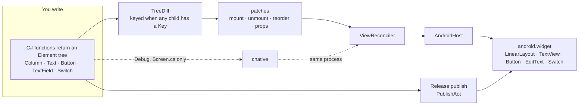

# C# Native

C# Native is a small UI runtime. A C# function returns an `Element` tree. A keyed diff reconciles it onto real Android widgets. Release publishes with NativeAOT. The Debug listener applies a screen edit, and a lowerable `[ReloadCallable]` method body, in the same process.

The Android dev loop, from a machine that already has the SDK in [`global.json`](global.json), the `android` workload, a JDK, and an online emulator:

```sh
tools/devx/cnative doctor
tools/devx/cnative new hello
tools/devx/cnative run android --listener
tools/devx/cnative reset-state
```

`doctor` checks the SDK, the workload, `adb`, a device, and the IL compiler. `new hello` writes `samples/hello/HelloScreen.cs`. `run android --listener` publishes the Debug NativeAOT listener and watches that file. Saving the screen reloads it in the same process. `reset-state` clears the kept bags and shows the initializers again. The walkthrough is [docs/getting-started.md](docs/getting-started.md).

`tools/check.sh` runs the core, devx, packing, and iOS managed-host tests, then `cnative inspect` on every sample screen and the counter, then the bench self-tests. Each step prints PASS or FAIL, and the script exits nonzero when any step fails. It needs bash and the .NET SDK. It does not require GNU `timeout` or `sha256sum`.

Startup, measured on the x86_64 API 34 emulator in this workspace. `tools/bench/mac-bench.sh --n 20`, `am start -W -S`, LaunchState COLD, Hyndman-Fan type 7. Release APK sha256 `066e572bcdee253bd561f10c012fbd28ae94b6c9fe12850fc63b6bada2da3eec`. Counter TotalTime p50 778.5 ms, p90 876.7 ms. Empty Java floor p50 750.0 ms. The lists are [docs/devx/evidence/cold-start.txt](docs/devx/evidence/cold-start.txt). This page did not remeasure that series.

Reload, measured. Screen edit to the reply, n=20, one pid, Hyndman-Fan type 7: edit-to-screen p50 59.8246 ms, p90 74.8963 ms. [docs/devx/evidence/fixed-socket-percentiles.txt](docs/devx/evidence/fixed-socket-percentiles.txt). A lowerable edit of `CounterService.Next` and `LibraryFormat.Label` on listener pid 17466 swapped in that process in 15.4 ms and 5.8 ms. [docs/devx/evidence/call-table.txt](docs/devx/evidence/call-table.txt). Statement bodies of those two methods swapped on listener pid 18899 in 14.1 ms and 7.5 ms. [docs/devx/evidence/statement-body.txt](docs/devx/evidence/statement-body.txt). A feed screen on that pid loaded JSON from the host. [docs/devx/evidence/dogfood-feed.txt](docs/devx/evidence/dogfood-feed.txt). One `RequestRender` on the counter, n=10: listener pid 18395 first tap 113 µs, p90 1045.6 µs; Release pid 18507 first tap 108 µs, p90 218.1 µs. [docs/devx/evidence/tap-phases.txt](docs/devx/evidence/tap-phases.txt).

## Results

The paragraphs above are older series. They were not remeasured for this section. Mac emulator is the pixel_8 arm64 emulator. Emulator-run is emulator-5554, SwiftShader, API 34, in this workspace. Built is a publish from this workspace that was not timed on a device. A guest load at or above 2 means only same-run relatives are usable. The lists and the commands are in [docs/devx/evidence/scroll-floor.txt](docs/devx/evidence/scroll-floor.txt).

Mac emulator, `c666e52`, feed APK sha256 prefix `740a0f5d`, `--n 20 --repeat 5`, guest load 3.6–14. Feed minus floor block deltas: 57.0, 53.5, 64.0, 82.5, 66.0. Median 64.0. Bootstrap 95% interval 53.5–82.5. TotalTime p50: feed 337, thin 293.5, floor 274. Feed p50 minus floor p50 is 63. Marks, p50, milliseconds since process start. Feed: java_end 44.5, jcw_enter 55, jcw_register 55.5, jcw_registered 71.5, jni 74, enter 82, layout 183, idle 251, flush 295. Floor: oncreate 37, layout 143. Thin: java_end 46, thin_class 58, thin_jni 65, thin_oncreate 71.

Mac emulator, `ca9992e`, feed APK sha256 prefix `cc759810`, `--n 20 --repeat 5`, guest load 7–26. Feed minus floor block deltas: 65.5, 61.5, 56.5, 44.0, 32.5. Median 56.5. Interval 32.5–65.5. TotalTime p50: counter 303.5, feed 320.5, thin 281.5, floor 269.5. Feed jcw_register 54.0 to jcw_registered 66.5 is 12.5 ms. `a11y-dismiss.sh` with that arm64 feed APK logged `performed=1 gone=1 next=1 undone=1 restored=1`. That run has no layout split. The 23 ms after the first layout is the `c666e52` split above.

The feed's first layout is 40 behind the floor (183, and the floor is at 143). The floor is already in onCreate at 37. The feed enters OnCreate at 82, so screen work starts 45 later. Enter to layout is 101 on the feed. Floor onCreate to layout is 106. The managed screen and the first layout are not the extra. After layout, the feed takes 154 to TotalTime and the floor takes 131, about 23. Those two slices are the 63. Before enter, the feed spends 44.5 to java_end, 10.5 loading the activity class, 0.5 building the method string, 16 in `registerNativeMembers` (55.5 to 71.5), 2.5 through the managed static constructor, and 8 to enter OnCreate. The 16 is five `Delegate.CreateDelegate` lookups plus one `RegisterNatives`. Thin, one JNI method, takes 19 from java_end 46 to thin_jni 65. The feed takes 29.5 from java_end 44.5 to jni 74. The five registrations are the slice the thin activity does not pay.

Not kept. `NativePocDeferNatives`, emulator-run: baseline block deltas 200.0 and 233.0, median 216.5, interval 200.0–233.0. Deferred: 210.5 and 227.0, median 218.8, interval 210.5–227.0, inside the baseline. `NativePocFastNatives`, one `RegisterNatives` of five prebuilt delegates, two emulator-run pairs, `--n 6 --repeat 2`, guest_load_p50 5.0–7.6. First pair: baseline 269.5 and 324.0, median 296.8, interval 269.5–324.0. Fast: 138.5 and 268.5, median 203.5, interval 138.5–268.5. The 1.0 gap is a floor block at 829.5, from samples 1339 and 1020, both over 1.5 times the floor median and still included. Second pair: baseline 292.0 and 213.5, median 252.8, interval 213.5–292.0. Fast: 195.0 and 264.5, median 229.8, interval 195.0–264.5. The intervals overlap. Register to registered on that pair was 1.5 and 1.0. The flag stays false. RELR, `NativePocEmbedSo`, `NativePocPackRelocs`, `NativePocVersionScript`, and `NativePocSymbolOrder` stayed off. The reloc experiment did not shorten startup.

Not kept. Moving the row-fit padding and the image flush to a message posted after the launch frame, emulator-run, `--n 6 --repeat 2`, guest_load_p50 6.7–7.0. Baseline block deltas 201.5 and 235.0, median 218.2, interval 201.5–235.0. Treatment: 270.5 and 314.0, median 292.2, interval 270.5–314.0. The treatment interval sits above the baseline. The code is the one-frame skip again. On a baseline sample, layout and draw were the same millisecond and the direction warm was after `Displayed`. A later feed launch logged `image-us=135`. The Mac flush at 295 is still 42 before TotalTime 337, and this emulator did not show that slice getting shorter.

Emulator-run developer loop, template `/tmp/p37/loop`, Debug listener, pid 25116. Unchanged `cnative run android --once`: wrapper 1.185 s, including a 0.87 s CLI build, then `Skipping publish`, `Skipping install`, `Skipping launch`, `Skipping reload`. The same run with `dotnet exec` of the built CLI was 0.187 s. An edit of the title initializer, Hello to Hiya, was 0.250 s, skipped install and launch, and logged `reloaded in 56.5 ms (lower 32.3 ms, apply 16.5 ms)`. The pid stayed 25116.

`cnative inspect <Screen.cs>` renders on `HeadlessHost` and prints tree, accessibility, and layout as JSON. It exits 1 for a missing label, a touch target under 48 dp, no heading, or a focus-order reversal, and the message names the id. Devx `InspectTests` runs it on the counter, the feed, the visit form, and packing, and fails if any of those four reports a lint code. A long-press name is at least 48 dp tall, the minimum `AndroidHost.SetGesture` already applies, so packing's tent name is no longer 336 by 24. `tools/check.sh` this run reported core 88 passed, devx 152 passed, packing 14 passed, iOS managed-host 6 passed, and inspect clean on every sample screen, including the notes list, detail, and edit. `PlatformConformance.Run` is the create, update, remove, text, list, accessibility, and hot-reload apply checks, and it pushes a screen, pops it, checks the heading key, and applies again with the stack still at depth 2. It passed on `HeadlessHost`, on the managed reconciler, and on `IosLogicSurface`. The UIKit project was not compiled. The split is [docs/ios-status.md](docs/ios-status.md). `ReloadAotPublishTests` builds the generator in the default run and kills the child if that build passes 90 s. The NativeAOT publish runs only when `NATIVEPOC_RELOAD_AOT=1`, and that publish was not run here.

The earlier `--n 6 --repeat 2` pair set `IlcDehydrate` false. The feed x64 `.so` had a `.hydrated` section of 1,133,552 bytes and 3,377 relative relocations. Invariant globalization, event source, reflection JSON, and size-optimized LINQ were already off or on. `StackTraceSupport` stays true. With dehydration off the section is gone, relative relocations are 59,130, and the `.so` is 9,091,192 bytes. Emulator-run, `--n 6 --repeat 2`, guest_load_p50 6.3–7.0 on the dehydrated feed and 4.9–5.2 with it off. Feed minus floor block deltas: dehydrated 338.0 and 309.0, median 323.5, interval 309.0–338.0. Off: 248.5 and 280.0, median 264.2, interval 248.5–280.0. The off interval sits under the dehydrated interval. TotalTime p50 dehydrated counter/feed/thin/floor 980.5/942.0/694.0/620.0. Off: 924.5/825.5/618.5/553.0. The floor also fell, from 620.0 to 553.0. Since process, feed, dehydrated: before 48.0, so_reloc 49.0, so_ctors 50.0, after 62.0, java_end 71.0. Off: before 68.5, so_reloc 75.0, so_ctors 77.5, after 87.0, java_end 90.5. Before to java_end is 23 ms and 22 ms. This emulator did not show a shorter load. The crash on the off build, pid 8962, logged `at NativePoc.CrashReport.ThrowNow() + 0x27` and `crash-screen`. There is no new Mac number. `NativePocFastNatives` and `NativePocDeferNatives` stay false.

Back on. The same emulator, one interleaved run, `--n 12 --repeat 4 --quiesce warn`. Wet is `IlcDehydrate` false, package `com.scratch.nativepoc`. Dry is `IlcDehydrate` true, package `com.scratch.nativepoc.dry`, so both APKs stay installed. The activity class is `crc64ee53024f7ed0aa60.MainActivity` on both. The floor is the same x64 list floor in every round. guest_load_p50 wet/dry/floor 5.6/5.6/5.7. n=48 each. TotalTime p50/p90 wet 809.0/874.4, dry 725.0/786.2, floor 627.5/723.7. Block deltas, series p50 minus floor p50, Hyndman-Fan 7, bootstrap B=1000 seed 8946: wet 149.5, 197.5, 168.5, 176.0, median 172.2, interval 149.5–197.5. Dry 62.5, 90.5, 99.5, 85.5, median 88.0, interval 62.5–99.5. The dry interval sits under the wet interval. No floor round was over 1.5 times the floor median. Dry is also smaller. The `.so` is 7,258,176 with dehydration on and 9,128,264 with it off, 1,870,088 bytes. The APK is 3,297,004 and 3,476,869, 179,865 bytes. Dry `.hydrated` NOBITS 1,136,232, RELACOUNT 3,379, `.rela.dyn` 81,144, `.data` 73,680. Wet has no `.hydrated`, RELACOUNT 59,261, `.rela.dyn` 1,422,312, `.data` 1,210,912. Since process, p50: wet before 55.5, so_ctors 65.5, after 91.0, java_end 95.5. Before to java_end is 40.0. so_ctors to after is 25.5. Dry before 38.0, so_ctors 43.5, after 60.5, java_end 66.5. Before to java_end is 28.5. so_ctors to after is 17.0. present_p50 wet 201.0, dry 165.0. layout wet 198.5, dry 161.0. Release sets `IlcDehydrate` true. Both bench `.so` files contain `PersistStore`, because that publish predates compiling the file only when `NativePocPersist` is true. The shipped counter and feed were republished after that removal. The dry package id is the bench package. The shipped product id is `com.scratch.nativepoc`. There is no new Mac number.

Emulator-run, visit x64, `NativePocPersist` true. Remember on pid 19301 logged `persist-put key=visit.place chars=4`, `persist-put key=visit.stop chars=25`, and `persist-record key=visit.stop id=Pier`. force-stop, then Recall on pid 19429 logged `persist-get key=visit.place chars=4`, `persist-get key=visit.stop chars=25`, and `persist-record-load key=visit.stop id=Pier`. The dump showed text `Pier`. The store is files under the app files directory, length-prefixed text, no reflection. `PersistStore.cs` is compiled only when `NativePocPersist` is true. A UTF-16 search finds `persist-put` in the visit `.so`. The counter `.so` has no `persist-put` and no `HttpURLConnection`. The feed `.so` has `HttpURLConnection` and no `persist-put`. A unit test edits the Remember literal from `Pier` to `Quay`, re-lowers, and the interpreter writes `Place=Quay` before the await. That reload was not driven through the emulator listener.

Emulator-run, the dev listener on emulator-5554, `cnative run android --listener --root visit`. Remember on pid 21265 logged `persist-put key=visit.place chars=4`, `persist-put key=visit.stop chars=25`, and `persist-record key=visit.stop id=Pier`. The place field and a visible `Pier` mark both read Pier. The mark literal was then edited to `Quay`. The same pid logged `hotreload-applied Visit program=1` and `state kept Place="Pier"`. The listener printed `reloaded in 28.6 ms (apply 24.0 ms)` and `edit-to-reply 72 ms`. The dump showed place Pier and mark Quay. force-stop, then a new process pid 21607 logged `nav-restore depth=8` and `state-loaded bytes=26264`, and Recall logged `persist-get key=visit.place chars=4`, `persist-get key=visit.stop chars=25`, and `persist-record-load key=visit.stop id=Pier`. The mark literal and the stop heading were put back to `Pier` and `Stop` after that run.

The 88 ms dry block delta against the 172 ms wet one is mostly after `java_end`. Measured from the same `/tmp/p41/bench` logs, n=48 each, median of paired deltas, Hyndman-Fan 7, `majflt` 0 on every sample. Wet before to so-reloc is 8.0 ms and +329 minor faults. Dry is 2.0 ms and +32 minor faults. RELACOUNT is 59,261 wet and 3,379 dry. so-reloc to so-ctors is 0.0 ms on both, +17 and +18 minor faults. so-ctors to after is 9.0 ms and +210 minor faults wet, 13.0 ms and +492 minor faults dry. Dry `.hydrated` is 1,136,232 bytes, about 277 pages. The extra dry faults in that slice are the hydration fill. Before to java-oncreate-end, paired, is 27.0 ms wet and 20.0 ms dry. The difference of the published p50s on that same slice is 40.0 against 28.5. Before to after, minor faults, 555 wet and 543 dry. The faults move from the reloc slice into the hydrate slice. present_p50 is 201.0 wet and 165.0 dry. `simpleperf` was not run. The counters are `/proc` `minflt` from `loadmark.c` and `StartupProbe.java`.

Rejected. `NativePocHydratePrefetch` calls `madvise(MADV_WILLNEED)` on the writable NOBITS tail at the end of the so-ctors constructor. A fresh interleaved run, emulator-5554, `--n 12 --repeat 4 --quiesce warn`, packages `com.scratch.nativepoc.base` and `com.scratch.nativepoc.pref`, both dehydrated, marks, http, and recycler on, persist and nav off. guest_load_p50 base/pref/floor 5.5/5.6/5.6. n=48 each. TotalTime p50/p90 base 740.5/796.9, pref 777.0/853.2, floor 660.0/734.6. Block deltas, series p50 minus floor p50: base 99.5, 56.5, 89.0, 44.5, median 72.8, interval 44.5–99.5. Prefetch 162.5, 104.0, 131.5, 83.0, median 117.8, interval 83.0–162.5. The intervals overlap and the prefetch median is higher. Paired so-ctors to after: base 12.0 ms and +489.5 minor faults, prefetch 19.5 ms and +769.0 minor faults. Every prefetch sample logged `startup hydrate-prefetch bytes=1260004`. No floor total was over 1.5 times the floor median 660.0 (max 811.0). The flag stays false. The default `.so` has no `hydrate-prefetch` string.

`Nav` push and pop compile only when `NativePocNav` is true. `NavFocus.cs` is the file that logs `nav-focus`. Tested: `PlatformConformance` on `HeadlessHost`, the managed reconciler, and `IosLogicSurface` pushes, pops, checks focus key `heading`, and keeps depth 2 across `Apply`. `tools/check.sh` this run: core 87, devx 152, packing 14, iOS managed-host 6, `passed=11 failed=0`. Emulator-run, the same listener, TalkBack service `com.google.android.marvin.talkback/.TalkBackService` enabled. Open on pid 22247 logged `nav-slide dir=push` and `nav-focus heading=Halt acted=1 held=1 depth=9`. Android back logged `nav-back invoked`, `nav-slide dir=pop`, and `nav-focus heading=Visit acted=1 held=1 depth=8`. `held` is `IsAccessibilityFocused` on the heading. The uiautomator dump did not mark `accessibilityFocused`. Depth 9 is the listener showing every sample onto one stack. An earlier edit of the stop heading to `Halt`, pid 21265, logged `reloaded in 18.9 ms (apply 14.6 ms)` and `reply Halt`, and the dump stayed on that screen. Counter `.hydrated` 1,077,344 and RELACOUNT 3,544. Feed 1,130,936 and 3,574. Visit 1,121,928 and 3,578. The three dex sha256 values are unchanged from the previous arm64 publish. A UTF-16 search finds `nav-focus` in the visit arm64 `.so` and not in the counter or feed `.so`. `persist-put` is in the visit `.so` and absent from counter and feed. Feed has `HttpURLConnection`. Counter has neither. The iOS `IosPlatform.Push` line `nav-focus heading=` is authored and was not compiled.

Emulator-run scroll, emulator-5554, SwiftShader, `scroll-bench.sh --swipes 8 --rounds 5`. Feed is the unit 162 dry bench APK, package `com.scratch.nativepoc.dry`, and that `.so` still contains `PersistStore`. Floor is the x64 list floor. guest load 1.44 to 3.81. Rounds 1 through 4 are at or above 2, so the comparison is same-run. Quiesce warned and left `com.scratch.nativepoc` running. gfxinfo janky percent, feed 35.78, 40.60, 37.39, 37.84, 31.54. Floor 58.65, 58.49, 55.75, 52.54, 41.48. Feed minus floor: -22.87, -17.89, -18.36, -14.70, -9.94. Median -17.89. The five deltas sit under zero. Framestats janky percent tracks the same gap. A few framestats rows have a FrameCompleted−IntendedVsync of about 10^11 ms (feed rounds 0, 1, and 4 had 3, 2, and 1 such rows). Those rows inflate p99. Work p50 stays under the floor on every round. No scroll code changed.

A cold launch of one screen is depth 1. `ScreenNav.Show` updates a program and does not push an id that is not already on the stack. The first `Show` on an empty stack adds that id only when `LaunchRoot` is empty or equal to it. `Push` builds the stack the user made, and `Restore` replays that stack. Tested: `A_catalog_of_screens_does_not_deepen_a_one_screen_launch` returned depth 4 before that change and depth 1 after it. Emulator-run, the dev listener, `--root notes`, TalkBack service `com.google.android.marvin.talkback/.TalkBackService`. Open logged `nav-focus heading=Note acted=1 held=1 depth=2`. Android back logged `nav-focus heading=Notes acted=1 held=1 depth=1`. The uiautomator dump did not mark `accessibilityFocused`. A cold launch logged `depth=1 top=notes`.

The dry present_p50 of 165 is the first draw. `/tmp/p41/bench/summary.txt` has dry draw and present both at 165.0, and TotalTime p50 725.0 against the floor 627.5. A fresh dehydrated feed on emulator-5554, `--n 12 --repeat 4`, package `com.scratch.nativepoc.base`, marks the first measure, layout, draw, and image flush. guest_load_p50 5.4. n=48. present_p50 and the first draw are both 161.5. First measure is 142.0 and its took-ms p50 is 0.0. First layout is 160.0 and its took-ms p50 is 6.5. Paint duration p50 is 0.0 and content duration p50 is 0.0. Render to measure, paired, is 21.0. java-oncreate-end to draw, paired, is 98.5. Phase flush and phase image were logged on 2 of 48 samples, at since-process 734, after present. Block deltas against the floor: 79.5, 90.5, 101.5, 87.5, median 89.0, interval 79.5–101.5. TotalTime p50/p90 739.0/818.6 against the floor 655.0/771.4. That gap is the wait from the end of `onCreate` to the first traversal, not an image flush.

Rejected. Skipping `Invalidate` when the view is not attached, same run, package `com.scratch.nativepoc.skip`. TotalTime p50/p90 767.5/891.8, present_p50 174.5. Block deltas 94.0, 130.5, 153.5, 79.0, median 112.2, interval 79.0–153.5. The intervals overlap and the skip median is higher. Paint and content duration stayed 0.0. No floor total was over 1.5 times 655.0. The call stays unconditional.

`scroll-bench.sh` drops a framestats row whose FrameCompleted−IntendedVsync is above 10000 ms and prints `clock_drop`. `adb` was reading the quiesce package list on stdin, so a force-stop stopped only the first bench package. The stop now redirects that stdin and waits until `pidof` is empty for every bench package. Self-tests passed on Linux bash 5.2.21 and on GNU bash 3.2.0 at `/tmp/bash-3.2/bash`. Emulator-run, `--swipes 8 --rounds 5`, the base feed against the x64 list floor. Both packages were force-stopped before every round, and `top` was not the other bench package. guest_load_p50 is 1.3 for both. Floor rounds 3 and 4 and feed round 4 are at or above 2, so those rounds are same-run. A separate package, `com.scratch.floor`, was the top CPU on floor rounds 3 and 4. It is not `com.scratch.listfloor`. Janky percent, bootstrap B=1000 seed 8946: feed median 28.4, interval 22.0–32.5. Floor median 43.4, interval 42.6–52.2. Feed minus floor median -17.9, interval -23.8 to -10.6. Frame p90 feed minus floor median -16.4, interval -20.0 to -8.6. Frame p99 median -22.7, interval -45.8 to -14.2. Feed round 3 and floor round 2 each logged `clock_drop 1`. The five janky deltas sit under zero.

`samples/notes` is a list, a detail screen, and an edit screen. It compiles only when persist and nav are both on. Add stores `notes.last` and `notes.item`. Edit keeps the id, writes the title back, and pops. The draft field submits with Send, the title moves to the body with Next, and the body saves with Go. Emulator-run on the listener: Add Milk logged `persist-put key=notes.last` and `persist-record key=notes.item id=Milk`. Edit to Oats logged `field-next from=title to=body`, `field-submit key=body`, and `persist-record id=Milk`. Back returned to the list. force-stop, then a new process logged `nav-restore depth=2` and the dump showed Note and Oats. A hot reload of the detail heading from Note to Card on pid 2335 logged `hotreload-applied Card program=1` and `state kept Title="Oats"`. The dump stayed on that screen. The heading source was put back to Note. Cold start of the notes Release, package `com.scratch.nativepoc.notes`, interleaved with the same floor, `--n 12 --repeat 4`. guest_load_p50 10.5 and 10.3, so only same-run relatives are usable. TotalTime p50/p90 notes 1447.0/1657.0, floor 1302.0/1472.6. present_p50 400.5. Block deltas 65.0, 229.0, 102.5, 134.5, median 118.5, interval 65.0–229.0. One launch logged `depth=1 top=notes`. No floor total was over 1.5 times 1302.0. The x64 APK is 3,097,461 bytes and the `.so` is 7,137,984. The arm64 APK is 2,937,720 bytes and the `.so` is 7,366,664. Visit now includes the notes screens. Its arm64 `.so` is 7,597,120 bytes. The previous visit `.so` was 7,568,584 bytes. Counter and feed contain neither `nav-focus` nor `persist-put`. Notes and visit contain both. Feed and visit contain `HttpURLConnection`. Counter and notes do not.

Release cold start does not open `nativepoc-state.bin`, does not replay a nav checkpoint, and the notes screen does not call `Persist.Get`. Emulator-run, emulator-5554, one interleaved `--n 12 --repeat 4 --quiesce warn` with notes (`com.scratch.nativepoc.notes`), a field-defer build (`com.scratch.nativepoc.noteslazy`), feed (`com.scratch.nativepoc.base`), and the x64 list floor. guest_load_p50 7.8, 7.9, 8.0, and 8.2, so these totals are same-run relatives. n=48 each. Every notes, noteslazy, and feed sample logged `state-load`, `nav-restore`, and `persist-read` at 0 ms. Those three are not the gap between notes and feed. TotalTime p50/p90 notes 1436.5/1555.3, feed 1317.0/1484.3, floor 1246.5/1370.9. present_p50 notes 380.5, feed 358.0. Block deltas, series p50 minus floor p50, Hyndman-Fan 7, bootstrap B=1000 seed 8946: notes 295.0, 118.5, 193.5, 98.0, median 156.0, interval 98.0–295.0. Feed 99.0, 44.5, 18.5, 59.5, median 52.0, interval 18.5–99.0. The intervals overlap. Paired activity-return to first-present is 54.0 ms on notes and 86.0 ms on feed, so notes is not waiting longer for the first traversal. activity-return p50 is 312.5 on notes and 245.5 on feed. `setContentView` (`content-view`) is the same millisecond as activity-return. Window focus is after present: present to focus, paired, is 712.0 ms on the 35 notes samples that logged it. No floor total was over 1.5 times 1246.5 (max 1522.0). The earlier +118.5 and about +89 ms were different runs, guest_load_p50 10.5 and 5.4.

The notes field turned touch focus and autofill on during the first `OnPreDraw`. The noteslazy package deferred that until after the launch idler, on that same run. TotalTime p50/p90 1448.0/1563.9, present_p50 363.5. Block deltas 190.0, 196.5, 213.0, 198.0, median 197.2, interval 190.0–213.0. The interval overlaps the notes interval and the median is higher. Rejected. Focus and autofill stay on the first pre-draw.

The wait until the first traversal sits after `setContentView` and `OnResume` and before the first `OnPreDraw`. On the feed in that run, content-view p50 is 245.0, resume is 250.0, activity-return is 245.5, and first-present is 358.0. The paired wait is 86.0 ms. Window focus is 735.0 ms after present on the feed samples that logged it. The hypothesis was that `ReportFullyDrawn` calls system_server from that first `OnPreDraw` and lengthens the frame `am start -W` records. A second interleaved run moved the call to the idle handler, package `com.scratch.nativepoc.drawn`, with the same feed baseline and the floor, `--n 12 --repeat 4`. guest_load_p50 feed/drawn/floor 7.7/7.9/7.9. n=48. TotalTime p50/p90 feed 1327.5/1462.9, drawn 1327.0/1522.1, floor 1281.0/1372.5. present_p50 feed 322.0, drawn 280.0. Paired activity-return to present is 92.0 ms on feed and 75.0 ms on drawn. On feed, present to report-fully-drawn is 0.0 ms. On drawn the report is at the idle handler, p50 981.5 on the 12 samples the log captured. Block deltas: feed 23.5, 104.5, -21.0, 9.5, median 16.5, interval -21.0–104.5. Drawn 45.5, 86.0, 53.5, 10.0, median 49.5, interval 10.0–86.0. The intervals overlap and the drawn median is higher. Rejected. `ReportFullyDrawn` stays in the first `OnPreDraw`. No floor total was over 1.5 times 1281.0 (max 1544.0).

A lowering error in a watched screen shows an on-device overlay and leaves the process up. Emulator-run, the dev listener, `--root notes`, pid 7809. A broken `samples/notes/NotesScreen.cs` line 33 logged `subset.not-a-screen: Invalid expression term ')'` and `The edit was not applied`. The overlay text was `samples/notes/NotesScreen.cs:33` and `Invalid expression term ')'`. The log was `dev-overlay id=subset.not-a-screen file=samples/notes/NotesScreen.cs:33 message=Invalid expression term ')'`. The dump still showed Note and Oats under the overlay. The restart prompt was declined. Restoring the line logged `reloaded in 23.6 ms (apply 20.2 ms)`, `edit-to-reply 64 ms`, `dev-overlay clear`, and `hotreload-applied Note` on the same pid. The next dump had no `dev-overlay`. The source was put back. `DevOverlay` is compiled only for a Debug listener. UTF-16 and ASCII `dev-overlay` are absent from the counter, feed, visit, and notes Release arm64 `.so` files.

The clean-folder walkthrough is [docs/getting-started.md](docs/getting-started.md). This run, seconds: pack 10.574, template install 0.399, `dotnet new` 0.566, tool install 0.597, doctor 0.294, `cnative run android` to `cnative: watching` 23.813, inspect 0.096 (exit 0, lint empty, heading `home/title` text Howdy), `tools/check.sh` 20.384. The edit logged `reloaded in 31.9 ms (lower 0.8 ms, apply 21.9 ms)` and `state kept Title="Hello" (initializer "Howdy")` on pid 8287. `cnative reset-state` then the dump showed Howdy. `dotnet new cnative-app --nav --persist` wrote both properties `true` (0.521 s). A default `dotnet new` wrote both `false` (0.566 s, and a second plain folder 0.492 s). A Debug build of the flagged project compiled `PersistStore.cs` and `NavFocus.cs`. The default listener `.so` has neither UTF-16 `persist-put` nor `nav-focus`. core 88, devx 152, packing 14, iOS managed-host 6, `passed=11 failed=0`. The machine already had the SDK and the IL compiler package. `mac-bench.sh --self-test` and `scroll-bench.sh --self-test` passed on macOS `/bin/bash` 3.2. The Mac emulator is still off. There is no new Mac timing.

Emulator-run, visit x64, pid 32456. IME Next on Place logged `field-next from=place to=when`. IME Go on When logged `field-submit key=when` and `a11y-announce text=Place is required`. With the keyboard shown (`mInputShown=true`, screen 1080x2400, visible bottom 1517), Place bottom 394 and When bottom 541 logged `field-scroll` `above=1`. Debug listener pid 32727, edit of the Locate title to Find: `reloaded in 27.1 ms (apply 23.2 ms)`, `state kept Place="Cafe" (initializer "")`, and the field still read Cafe. The source was put back to Locate.

`activity-return` 312.5 against 245.5 is the since-process clock at the end of `onCreate`, from the previous notes/feed/floor run (`/tmp/p44/bench174`, n=48). It is not the time spent building the screen. The paired body of `onCreate`, activity mark to activity-return, is 41.0 ms on notes and 26.5 ms on feed. Eval is 0 ms on both. Mount is 0 ms on notes and 4.5 ms on feed, and feed inflates more views (8 against 4). Nav is 19 µs on notes and 15 µs on feed. Inside that body the slices are activity to nav 16.5 against 13.5, nav to state-load 1.0 against 0.5, state-load to eval 13.5 against 6.0, and eval to return 3.0 against 1.0. The state-load to eval slice is the first `EditText`: the log writes `field-handle` there, and the feed screen has no text field. The other 52 ms of the 67 ms since-process gap is before the activity mark. Managed main is 109 against 75, and managed to activity is 118 against 104. guest_load_p50 on that run was about 8, so those two are cross-process and not a screen cost. `content-view` is the same millisecond as activity-return (312.5 and 245.0).

The change under test constructed that field with `defStyle` 0, skipping `editTextStyle`. Fresh interleaved run, emulator-5554, `--n 12 --repeat 4 --quiesce warn`, notes (`com.scratch.nativepoc.notes`), the plain-field package (`com.scratch.nativepoc.plain`), feed (`com.scratch.nativepoc.base`), and the x64 list floor. guest_load_p50 8.1, 8.3, 8.2, and 8.2, so these totals are same-run relatives. n=48. TotalTime p50/p90 notes 1454.0/1613.9, plain 1342.5/1490.3, feed 1364.5/1492.6, floor 1275.0/1444.6. present_p50 notes 427.0, plain 378.5, feed 339.5. activity-return p50 notes 309.0, plain 280.5, feed 228.0. The plain field did shrink the inside of `onCreate`: activity to return 54.5 against 36.0, and state-load to eval 15.5 against 11.0. Block deltas, series p50 minus floor p50, Hyndman-Fan 7, B=1000 seed 8946: notes 222.5, 112.5, 140.0, 248.0, median 181.2, interval 112.5–248.0. Plain 25.0, -62.0, 62.0, 204.5, median 43.5, interval -62.0–204.5. The intervals overlap. Rejected. The field stays `new EditText(context)`. No floor total was over 1.5 times 1275.0 (max 1544.0).

`NavTransition` animates a nav push and pop with an Android `Slide`. It is compiled only when `NativePocTransition` is true. The duration passed to the transition is 180 ms, and the system animator scale shortens it. `animator_duration_scale` or `transition_animation_scale` at 0 skips the transition. That is the Remove animations setting. Emulator-run, package `com.scratch.nativepoc.motion`, pid 1966. A push at scale 1.0 logged `nav-transition instant=0 scale=1.0 motion=1.0 ms=180 dir=push`. gfxinfo for that window: 9 frames, p50 34 ms, p90 93 ms. A pop at scale 0 logged `instant=1 scale=0.0 motion=0.0 ms=0 dir=pop` and rendered 2 frames, p50 32 ms. A push at scale 0 logged `instant=1` and rendered 3 frames, p50 17 ms, p90 32 ms. `MotionScale` is the tested decision: either scale at 0 is instant, and the duration is the 180 ms basis times the smaller scale. UTF-16 `nav-transition` is in the motion x64 `.so` and absent from the visit x64 `.so` and the feed x64 `.so`. Those two still contain `nav-slide`, which is the animation used when the module is off.

Theme mode `system` follows `uiMode`. Text is `sp`, and a button wraps. Emulator-run screenshots are in the progress45 artifacts: notes and visit in light (`theme mode=system dark=0 scale=1.0`), dark (`dark=1 scale=1.0`), and font scale 2.0 (`scale=2.0`). At scale 2 the notes heading is 996 by 123 px, the title field 996 by 161, and Add 996 by 141. At scale 1 those were 77, 126, and 126 tall. Visit at scale 2 shows Place, When, idle, Locate, Save, Remember, Recall, and Pier, each the full 996 px width. Pier's bottom is 1529. `cnative inspect` flags `fixed-height` for a text container with `Grow`, and when a text box does not grow at font scale 2. Notes and visit do not use `Grow`. The lint is empty on both.

`samples/showcase` is Northroom, four screens for a small ceramics shelf: home, the shelf, a piece, and the room. It compiles only when `NativePocShowcase` is true. That flag sets the package to `com.scratch.nativepoc.showcase` and the cold-start root to `home`. The home screen is one gradient banner, a row of three smaller tinted cards, and two list rows with a chevron. The shelf is a two-column grid of gradient tiles with the piece name under each tile, and the same top-left back arrow as the piece and the room. The piece screen is a large tile, the title, the note, that back arrow (accessibility label Back), and one pill-shaped button. The button reads Keep and is outlined until the piece is kept. It then reads Kept, fills, and its accessibility label is Unkeep. There is no second chip. The page stays the neutral surface. The accent `0xFF0F6E56` is the banner and the kept button. `Style.Across` lays a column out horizontally and splits the width left after padding and gaps, so the margins stay equal and each child stays inside the parent. `Style.Wash` is the second stop of a top-to-bottom gradient, and `Style.Stroke` is a 2 dp outline. Nav and the slide compile with `NativePocNav` and `NativePocTransition`. Keep stores `northroom.keep` through `Persist.Put`. Night and large type call `Theme.Mode` and `Theme.Scale`. The host applies system-bar insets on the content root of every screen. `cnative inspect` adds `system-bar` when a child sits in the top 24 dp. `Format(Element)` shifts the measured boxes by that inset, so a screen that starts at the origin is not flagged. A box passed in already under 24 dp is.

Emulator-run, emulator-5554, API 34, 1080x2400, density 420, SwiftShader. `cnative inspect` reported an empty lint on home, the shelf, the piece, and the room. Tested: `Inspect_flags_content_under_the_system_bars` flags a title at top 8 and does not flag the body at top 64, and a measured column has no `system-bar`. On the device the right home card's rounded corner matches the left. The inset from the outer edge grows 35, 28, 20, 12, 6, then 2 px over the first 30 px of the corner on both cards. The outer shadow is on both outer edges, (215, 212, 205) at 1 px and the page color (244, 241, 234) by 16 px. At font scale 1 the shelf back arrow is [42,170][168,296], the same bounds as the piece arrow, and the heading is [42,348][1038,460]. At font scale 2.0 the shelf opens with the heading at [42,389][1038,529], below the status bar, and the log is `a11y-reveal need=0`. Keep on Harbor bowl logged `persist-put key=northroom.keep chars=6`. The button text became Kept and the content description became Unkeep. The Night switch turned the page dark, the status bar and the navigation bar took the page color `(28, 25, 23)`, and the room read `Night is on.`

The stills are artifacts, not files in this repo. Light, dark, and font scale 2.0, for home, the shelf, the piece, and the room: `/opt/cursor/artifacts/progress49/showcase/home-light.png`, `home-dark.png`, `home-font2.png`, `shelf-light.png`, `shelf-dark.png`, `shelf-font2.png`, `piece-light.png`, `piece-dark.png`, `piece-font2.png`, `room-light.png`, `room-dark.png`, `room-font2.png`. The clip is `/opt/cursor/artifacts/progress49/showcase/northroom.mp4`. `ffprobe` reports 18.133333 s, 544 frames, 1080x2400, 30 fps. It shows home, the shelf, the piece, Keep turning into Kept, back, the room, then the same room and home after Night.

The x64 APK is 3,183,477 bytes, sha256 `24589f5e1d3cecf399146ce30e9747c6cb31a5792af31984c955da3cd8f97c7e`. The `.so` is 7,383,120 bytes, sha256 `31e74516a45198e1a3b4e7e65f8fdbebb8c6d4d5a6494f4bd514f71ccc3e00c2`. `classes.dex` is 56,900 bytes and contains `NativeAotRuntimeProvider`. UTF-16 `nav-transition`, `nav-focus`, `persist-put`, and `Harbor` are in that `.so`. UTF-16 `dev-overlay`, `image-sample`, and `jni-bind` are absent. The arm64 APK is 3,015,544 bytes, sha256 `c724fc5471ea7f5f4f0855f13599a1aa724f733cede8a05579d21c86c4eaed7c`. The arm64 `.so` is 7,621,704 bytes, sha256 `097bc890c216216256b86e96ecda69f0dbd88a33442bb6f4c5af63e36318ef28`. It was not installed on this x86_64 emulator.

Cold start of that x64 APK, `tools/bench/mac-bench.sh --n 12 --repeat 4 --quiesce warn`, interleaved with the x64 list floor, n=48, all COLD, Hyndman-Fan 7. guest_load_p50 showcase 8.2 and floor 8.4, so these totals are same-run relatives. TotalTime p50/p90 showcase 1500.5/1628.5, floor 1371.5/1511.3. present_p50 showcase 376.0. Block deltas, showcase p50 minus floor p50: 24.5, 200.0, 126.5, 142.0, median 134.2, interval 24.5–200.0, B=1000 seed 8946. Since-process p50: runtime showcase 219.0 and floor 156.0, theme 222.0, gradient 256.0, shadow 256.5, render 269.0 and floor 205.0, layout 366.0 and floor 340.5, draw 376.0 and floor 343.5. `phase=paint ms` p50 is 0. Theme is 3 ms after runtime. The first shadow is 0.5 ms after the first gradient. Deferring elevation until after the first present was a second run of the same bench, guest_load_p50 8.1 and 8.3. Block deltas 176.5, 108.5, 100.0, 188.0, median 142.5, interval 100.0–188.0. The median did not drop. Rejected. Elevation stays on the first frame. There is no new Mac timing.

A later x64 publish of the same flags added stopwatch marks on that path. `tools/bench/mac-bench.sh --n 12 --repeat 4 --quiesce warn`, interleaved with the same list floor, n=48, all COLD, Hyndman-Fan 7. guest_load_p50 showcase 7.7 and floor 7.7, so these totals are same-run relatives. TotalTime p50/p90 showcase 1398.0/1558.6, floor 1293.0/1430.1. present_p50 showcase 394.0. Block deltas, showcase p50 minus floor p50: 97.5, 42.5, 108.5, 121.5, median 103.0, interval 42.5–121.5, B=1000 seed 8946. Since-process p50: runtime showcase 231.5 and floor 107.5, render 269.5 and floor 185.5, layout 378.5 and floor 306.0, draw 394.0 and floor 314.5. The new stopwatch p50 values, microseconds: theme-resolve 5391.5, gradient-create 466.0, shadow-create 1177.5, stat-measure 205.0, traversal 43429.5. grid-measure did not fire. Since-process p50 for those marks: theme-resolve 252.0, gradient-create 269.5, shadow-create 269.5, stat-measure 335.0, traversal 380.0. Traversal is the largest of those phases, 43.4 ms from the scroll's first measure to its first layout. Theme resolve is 5.4 ms. Gradient creation is 0.5 ms and shadow creation is 1.2 ms, and the two overlap on the hero. Stat measure is 0.2 ms. No floor total was over 1.5 times 1293.0 (max 1482). Deferring card outlines and elevation until after the recorded frame was a second run of the same bench. Traversal us p50 fell to 36167.5. guest_load_p50 showcase 7.5 and floor 7.7. TotalTime p50/p90 showcase 1381.5/1551.6, floor 1320.5/1416.5. present_p50 319.0. Block deltas 118.0, 82.0, -21.5, 49.0, median 65.5, interval -21.5–118.0. The high end stayed at 118.0 against 121.5, and the showcase total moved 16.5 ms while the floor total moved the other way. Rejected. Outlines and elevation stay on the first frame. The APK that was measured for the kept run is 3,187,573 bytes, sha256 `7188c3eb1fdd45b964038149b1be046d49682027388d77bfe25c1585adb16300`. Its `.so` is 7,386,096 bytes, sha256 `989edc5c040b130e8ac0f004b0f97d48efbdadbf504a89175d0cf6182a06826b`. `classes.dex` is 56,856 bytes and contains `NativeAotRuntimeProvider`. UTF-16 `nav-transition`, `nav-focus`, `persist-put`, and `Harbor` are in that `.so`. UTF-16 `dev-overlay`, `hotreload`, `image-sample`, and `jni-bind` are absent. The arm64 showcase was not rebuilt. `Every_Northroom_screen_runs_on_the_headless_host` runs home, the shelf, the piece, and the room on `HeadlessHost` and checks the 24 dp inset, the shared back arrow, Keep, and font scale 2. The UIKit host was not compiled. `net10.0-ios` was not compiled. There is no new Mac timing.

The Debug listener on that emulator, package `com.scratch.nativepoc`, `--root home`, pid 4478, is the hot reload of this run. The first push of `src/NativePoc.Screen/Screen.cs` failed with `Keyed children cannot be mixed with unkeyed children` while the warm tree was still mounted. The process stayed up. The push of `samples/showcase/HomeScreen.cs` then presented Northroom and logged `reload-nav depth=1 top=home`. The shelf was depth 2 and Harbor bowl was depth 3. Keep logged `persist-put key=northroom.keep chars=6`, and the button read Kept with accessibility label Unkeep. Saving the banner subtitle to "Small-batch ceramics, fired this week." and the pieces value from 8 to 12, while that piece was on screen, wrote the file twice. The first apply was `reloaded in 43.8 ms (apply 39.1 ms)`, edit-to-reply 88 ms, device prepare 1.7 ms and eval 11.9 ms. The second was `reloaded in 14.0 ms (apply 12.3 ms)`, edit-to-reply 52 ms, prepare 0.1 ms and eval 1.7 ms. Both logged `reload-nav depth=3 top=piece kept=harbor`, and the visible row stayed Harbor bowl and Kept. Back logged depth 2 and then depth 1 with heading Northroom, and home showed the new subtitle and 12. `samples/showcase/HomeScreen.cs` was restored after that. The clip taken while the apply ran, with the piece left on Kept, is `/opt/cursor/artifacts/progress50/showcase/northroom-reload.mp4`. The clip of the edited home, the return to Harbor bowl still reading Kept, and home again is `/opt/cursor/artifacts/progress50/showcase/northroom-after.mp4`.

The warm-tree refusal was the reconciler. `TreeDiff` treated any keyed child as a keyed list and then required keys on both sides, so the unkeyed warm column (`RecordProgram.WarmProgram`, the text `.`) threw `Keyed children cannot be mixed with unkeyed children` on the first push of `src/NativePoc.Screen/Screen.cs`. The lowerer was not the cause. Every child of that screen has a key, and a real mix inside one parent is still `subset.mixed-keys` with the node span, which the dev overlay shows as `file:line`. The diff now replaces the children when one side is entirely unkeyed and the other is entirely keyed. A mix on either side still throws the same message. `WarmReloadTests` covers both directions, an unkeyed edit that keeps the child, and the mix. The Debug listener on emulator-5554, package `com.scratch.nativepoc`, `--root home`, pid 25611, applied that first push: `reloaded in 822.2 ms (apply 59.2 ms)`, `reply Counter 0 program=1 present=1`, then Packing, then home at `reload-nav depth=1 top=home`. There was no mixed-keys line and no `dev-overlay`. Harbor bowl at depth 3 logged `persist-put key=northroom.keep chars=6`, and the button read Kept. Saving the piece title as `state.Title + " · fired"` applied in `reloaded in 106.4 ms (apply 99.1 ms)`, edit-to-reply 148 ms, and the visible title became `Harbor bowl · fired` while Kept stayed. The home subtitle "Small-batch ceramics, fired this week." and the pieces value 12 then applied in `reloaded in 21.2 ms (apply 18.9 ms)`, edit-to-reply 60 ms. Back returned to that home. `samples/showcase/HomeScreen.cs` and `samples/showcase/PieceScreen.cs` were restored after that. The clip is `/opt/cursor/artifacts/progress51/showcase/northroom-reload.mp4`. `ffprobe` reports 19.986578 s, 451 frames, 720x1280, `avg_frame_rate` 5073750/224849 (22.57 fps). The median frame interval is 0.0387 s, 25.8 fps. `adb shell screenrecord --size 720x1280` wrote it. Full 1080x2400 `screenrecord` on this emulator stored 2 frames.

The same x64 showcase, `tools/bench/mac-bench.sh --n 12 --repeat 4 --quiesce warn`, interleaved with the same list floor, n=48, all COLD, Hyndman-Fan 7. guest_load_p50 showcase 7.8 and floor 7.9, so these totals are same-run relatives. TotalTime p50/p90 showcase 1017.0/1073.2, floor 660.5/835.9. present_p50 354.0. Block deltas, showcase p50 minus floor p50: 288.5, 411.5, 335.5, 373.5, median 354.5, interval 288.5–411.5, B=1000 seed 8946. Stopwatch us p50: traversal 21686.5, scroll-measure 7187.5, scroll-layout 676.5, scroll-draw 5492.5, hero-measure 3844.0, stat-measure 490.0, pieces-measure 141.0, kept-measure 38.0, kiln-measure 43.0, shelf-measure 718.5, room-measure 36.0. The paired gap from the end of the first scroll measure to the start of its layout is 9860 us p50. Four later cold starts logged a second scroll measure, `scroll-measure-again`, at 34, 37, 39, and 47 us, so that gap is the window relayout. Hero measure is the largest subtree inside the scroll measure. Building one bold `StaticLayout` off the main thread before the first frame dropped hero-measure us p50 to 1493.5 and traversal us p50 to 16438.5. That second run, guest_load_p50 6.8 and 6.8, TotalTime p50/p90 showcase 1028.0/1090.1, floor 695.5/839.3. Block deltas 389.0, 227.0, 343.5, 363.5, median 353.5, interval 227.0–389.0. The showcase total did not drop. Rejected. The warm is not in this tree. The x64 APK of the breakdown run is 3,191,669 bytes, sha256 `257098a5cda15f1bfd8c98dc80ef163a278530142ef0bf32c90bdac3638cd467`. The x64 APK from this commit is 3,191,669 bytes, sha256 `bb8161bd65683ce2a4780c1312af5cca2a6cd784562d9a3640ecd47846217677`. Its `.so` is 7,395,984 bytes, sha256 `9b722d536f658a9f73a14a5c62286566327db2c9bab90a0a4b4bf6c68cc517ce`. `classes.dex` is 58,132 bytes, sha256 `6e0431c9173978798e7262894ee6f6b0347ba0089cf18afa13cc5c6fd11b7be9`, and contains `NativeAotRuntimeProvider`. UTF-16 `scroll-measure`, `Harbor`, `nav-transition`, and `persist-put` are in that `.so`. UTF-16 `HoldCard`, `text-warm`, `dev-overlay`, `hotreload`, `image-sample`, and `jni-bind` are absent. The arm64 APK from this commit is 3,023,736 bytes, sha256 `306257501ec52ae7bc339d5c5f6d3070cc0e53aceaa5026efda3393be8c9fe2e`. Its `.so` is 7,635,320 bytes, sha256 `e776261bc59d401e4092450d689c2d117a5ca46f637040fa88c5b9caf9ce73ee`. It was not installed on this x86_64 emulator. There is no new Mac timing.

The canonical cold-start floor for Northroom is an empty column, key `page`, package `com.scratch.nativepoc.widgetfloor`, screen id `floor`. It is the showcase Release with the same flags plus `NativePocWidgetFloor`. The activity on both packages is `crc64ee53024f7ed0aa60.MainActivity`. How to publish and run it is in [docs/getting-started.md](docs/getting-started.md). The emulator is `emulator-5554`, AVD `poc34`, API 34, x86_64, 1080x2400, density 420, SwiftShader, started as `emulator -avd poc34 -accel on -no-window -no-audio -no-boot-anim -gpu swiftshader_indirect -no-snapshot-save -memory 2048 -cores 2`. `tools/bench/mac-bench.sh --device emulator-5554 --n 12 --repeat 4 --quiesce warn`, n=48, all COLD, Hyndman-Fan 7. guest_load_p50 showcase 6.2 and floor 6.3, so these totals are same-run relatives. TotalTime p50/p90 showcase 946.0/1031.7, floor 647.5/748.3. present_p50 showcase 125.0. Block deltas, showcase p50 minus floor p50: 351.0, 386.5, 216.0, 315.5, median 333.2, interval 216.0–386.5, B=1000 seed 8946. Stopwatch us p50: relayout-gap 4191.5, scroll-measure 5329.5, scroll-again 38.0, scroll-layout 700.0, scroll-draw 7015.0. The first insets line is top 128, bottom 63, left 0, right 0, and it is logged before that first scroll measure. The 4191.5 µs gap runs from the end of the measure to the start of layout, which is `relayoutWindow`. The second measure is the 38.0 µs `scroll-measure-again`. One later publish left decor fitting on, skipped the inset padding and `RequestApplyInsets`, and skipped rewriting the bar colors before `setContentView`. That run still logged scroll-again 40.5 µs and relayout-gap 4652.0 µs. Against the same floor APK, guest_load_p50 showcase 5.8 and floor 5.7, TotalTime p50/p90 showcase 883.0/960.2, floor 541.5/737.3. Block deltas 361.5, 306.5, 318.0, 393.5, median 339.8, interval 306.5–393.5. That interval is higher than 216.0–386.5. Rejected. `SetDecorFitsSystemWindows(false)` and the inset padding stay. On the launch checked before the revert, the Northroom heading was [105,233][975,345] and the status bar was [0,0][1080,128]. The measured showcase APK is 3,191,669 bytes, sha256 `2418e74e260ae6dcff0a4a33c086f0fe3d2ec94a882f10ef455cb9e9af643a9c`. The floor APK is 3,191,669 bytes, sha256 `5bb30c9131a1fa391be1f706514c529bf0f05472c33cca0d097a72fce78b85f9`. The arm64 showcase was not rebuilt. There is no new Mac timing.

The Debug listener on that emulator, package `com.scratch.nativepoc`, `cnative run android --listener --root home`, pid 32266, is the shelf edit run. The list gap was widened to 280 so the shelf could scroll, then the shelf was scrolled until Harbor bowl was above the viewport. Field plate sat at [42,1175][519,1232]. Deleting the keyed Moss tile applied in `reloaded in 32.9 ms (apply 28.0 ms)`, edit-to-reply 72 ms, device prepare 0.6 ms and eval 5.6 ms. Moss left the tree and Field plate moved to [42,1188][519,1245]. The heading stayed off screen. Inserting a keyed Extra bowl row above Field plate applied in `reloaded in 28.5 ms (apply 24.4 ms)`, edit-to-reply 72 ms, prepare 0.1 ms and eval 10.8 ms. Ash stayed at [42,128] and Field plate moved down to [42,2238][519,2295]. Renaming the harbor key to harbour applied in `reloaded in 31.7 ms (apply 29.1 ms)`, edit-to-reply 72 ms, prepare 0.9 ms and eval 11.8 ms. Those bounds stayed, and a scroll back to the top still showed Harbor bowl. An unclosed `new Text("The shelf"` logged `samples/showcase/ShelfScreen.cs:59:25: subset.not-a-screen: Syntax error, ',' expected` and `The edit was not applied`. The overlay text was `samples/showcase/ShelfScreen.cs:59` and `Syntax error, ',' expected`. The log was `dev-overlay id=subset.not-a-screen file=samples/showcase/ShelfScreen.cs:59 message=Syntax error, ',' expected`. The shelf heading and Harbor bowl stayed under the overlay, and the pid stayed 32266. The restart prompt was declined. Restoring the line logged `reloaded in 28.5 ms (apply 26.0 ms)`, edit-to-reply 68 ms, and `dev-overlay clear` on the same pid. `samples/showcase/ShelfScreen.cs` was restored after that. `Keyed_shelf_insert_delete_and_rename_keep_the_scroll` keeps the scroll view, a stable tile, and `ScrollY` across that delete, insert, and rename on `MemoryHost`. [docs/ios-status.md](docs/ios-status.md) maps each Northroom widget to the UIKit view the authored host creates and names what that host does not apply. The UIKit project was not compiled. `net10.0-ios` was not compiled. `tools/check.sh` this run: core 101, devx 162, packing 14, iOS managed-host 6, `passed=11 failed=0`.

The feed with `NativePocImage` and `NativePocHttp` was emulator-run on the same device. The server sent one 4000 by 3000 JPEG, 237,189 bytes, at `http://10.0.2.2:8094/img/`. Before the image view was laid out the log was `image-sample in=4000x3000 sample=16 target=126`. For the laid-out row it was `image-sample in=4000x3000 sample=2 target=996`. A 4000 by 3000 frame at 4 bytes a pixel is 48,000,000 bytes. Sample 2 keeps a quarter of the pixels. After that first screen, `dumpsys meminfo` reported native heap 238,823 KB and total PSS 262,158 KB. Graphics was 0. After scrolling to new rows the native heap was 365,291 KB and total PSS 390,036 KB, and 11 more `sample=2` lines had been logged. Scrolling back logged `image-cache hit source=http://10.0.2.2:8094/img/0010`, then 0009, 0008, and 0007. The image x64 `.so` is 7,252,592 bytes, sha256 `c54a82247fde8244a140826d6df64948d5a58354570219842cb20f4fa1ba7987`. UTF-16 `image-sample` and `image-cache` are in it. UTF-16 `jni-bind` is not. The bind screen with `NativePocJni` was emulator-run next. Pulse logged `jni-bind class=android/os/Vibrator method=vibrate` and the note changed from `ready` to `sent`. The JNI x64 `.so` is 7,123,808 bytes, sha256 `1d2b9a7226f87ef349c7cd17ba393a57f0dba64e5dd1d8442b3152441e4ce8c1`. UTF-16 `jni-bind` is in it. UTF-16 `image-sample` is not. The showcase x64 and arm64 `.so` files have neither string.

`docs/api.md` lists every public type and member of `NativePoc.Core` and `NativePoc.Screen` as `stable`, `experimental`, or `internal-ought-to-be`. `PublicApiTests` fails when that set changes. The Android host types `MainActivity`, `PackingActivity`, `RecreateReceiver`, and `FeedModule`, and the generators `CompiledScreenGenerator` and `ReloadDispatchGenerator`, are `internal-ought-to-be`. The test fails if another public type appears in those two projects. `tools/check.sh` this run: core 99, devx 161, packing 14, iOS managed-host 6, `passed=11 failed=0`. The Mac emulator is still off. There is no new Mac timing.

Rerun the cold start on a pixel_8 arm64 emulator:

```sh
tools/bench/mac-bench.sh --device <pixel_8> --n 20 --repeat 5 --quiesce warn --out /tmp/feed-cold \
  --run counter:nativepoc-feed-android-arm64.apk:com.scratch.nativepoc/crc64ee53024f7ed0aa60.MainActivity \
  --run feed:nativepoc-feed-android-arm64.apk:com.scratch.nativepoc/crc64ee53024f7ed0aa60.MainActivity:'--es nativepoc_root feed' \
  --run thin:nativepoc-feed-android-arm64.apk:com.scratch.nativepoc/nativepoc.ThinActivity \
  --run floor:nativepoc-listfloor-android-arm64.apk:com.scratch.listfloor/.ListFloorActivity
```

The `--n 6 --repeat 2` attribution used that script on emulator-5554. The interleaved `--n 12 --repeat 4` pair is in [docs/devx/evidence/scroll-floor.txt](docs/devx/evidence/scroll-floor.txt). Scroll, visit cold start, and the accessibility check:

```sh
tools/bench/scroll-bench.sh --serial <pixel_8> --swipes 8 --rounds 5 \
  --run feed:nativepoc-feed-android-arm64.apk:com.scratch.nativepoc/crc64ee53024f7ed0aa60.MainActivity:'--es nativepoc_root feed' \
  --run floor:nativepoc-listfloor-android-arm64.apk:com.scratch.listfloor/.ListFloorActivity
tools/bench/cold-start.sh --device <pixel_8> --n 10 --name visit --out /tmp/cold-visit \
  --apk nativepoc-visit-android-arm64.apk \
  --component com.scratch.nativepoc/crc64ee53024f7ed0aa60.MainActivity \
  -- --es nativepoc_root visit
tools/bench/a11y-dismiss.sh --apk nativepoc-feed-android-arm64.apk --serial <pixel_8>
tools/bench/visit-ime.sh --serial <pixel_8>
tools/bench/persist-restart.sh --serial <pixel_8>
```

Those pixel_8 commands were not run. `visit-ime.sh` and `persist-restart.sh` drive the visit build that is already installed. A pixel_8 is arm64-v8a, so the dismiss check uses the arm64 feed APK, and the visit scripts follow an install of the arm64 visit APK. If the APK has no `lib` folder for the device ABI and a sibling file swaps `android-x64` and `android-arm64` in the name, `a11y-dismiss.sh` installs that sibling. `mac-bench.sh --self-test` and `scroll-bench.sh --self-test` passed on macOS `/bin/bash` 3.2. There is no new Mac timing.

| build | label | APK bytes | APK sha256 | .so bytes | .so sha256 |
| --- | --- | --- | --- | --- | --- |
| counter arm64 | built, dehydrated | 2,904,952 | `40b4edf97a57dfe3f4a5bad353e122b644003adcb552f72733cbdfc8ed1e1669` | 7,291,528 | `49481e557be8024a88202b4c96f1bdacd9712395e72a2ff466cde6918a62b33b` |
| feed arm64, marks on | built, dehydrated | 3,137,263 | `2ace66d25e0dad0351683e47648bd84ec9216ba4c14125512bb621df87bf0e36` | 7,464,168 | `825d7128a3c41029696ebebf076b0971641a54a7753e964ce8c033064893a05f` |
| visit arm64, persist, nav, transition | built, dehydrated | 3,027,832 | `7154827ca9e20aeeace3026b9260c74f03bbe9de52ebb33f83a96db119f0f2ba` | 7,630,808 | `e77db6351c13624ff10033e691c79c20a86728a81b5f53621083522fc57b3225` |
| notes arm64, persist, nav, transition, marks | built, dehydrated | 2,950,008 | `c742d8f9bb153928cb7265f7115471af69c4fc613a60951f91647a22013f0395` | 7,400,840 | `c88c003a97178f11205573b50597623edca7aa81b9ea72729761a0c090bc6995` |
| notes x64 | emulator-run, cold start | 3,097,461 | `af780ceef2f6105f901efdbe978287453513752c21a1c18a04ab6c05e1b5120c` | 7,137,984 | `6dc8eceb7221927f11e194dad9e370e2f4af5e228526d9a0284983448af9ebc1` |
| showcase x64, nav, persist, transition, marks | emulator-run, cold start | 3,183,477 | `24589f5e1d3cecf399146ce30e9747c6cb31a5792af31984c955da3cd8f97c7e` | 7,383,120 | `31e74516a45198e1a3b4e7e65f8fdbebb8c6d4d5a6494f4bd514f71ccc3e00c2` |
| showcase x64, phase marks | emulator-run, cold start | 3,187,573 | `7188c3eb1fdd45b964038149b1be046d49682027388d77bfe25c1585adb16300` | 7,386,096 | `989edc5c040b130e8ac0f004b0f97d48efbdadbf504a89175d0cf6182a06826b` |
| showcase arm64, nav, persist, transition, marks | built | 3,015,544 | `c724fc5471ea7f5f4f0855f13599a1aa724f733cede8a05579d21c86c4eaed7c` | 7,621,704 | `097bc890c216216256b86e96ecda69f0dbd88a33442bb6f4c5af63e36318ef28` |
| visit x64 | emulator-run, force-stop | 3,171,189 | `89801d3431c06516baa374794415e67e0afcb157678eee3254cff12e6c8fe699` | 7,322,096 | `fb8b0954e780991a945f3912b55ab92ac0cc5ec876ad661c54bc882f08bc130c` |
| list floor arm64 | not rebuilt | 531,381 | `6f6e7ea018f333f9c5ae4c979e3d21021825ceb37e55835f895f33dd71fa40e1` |  |  |
| bench wet feed x64 | emulator-run, dehydrate off | 3,476,869 | `658e080d806998d6c7652758982eaaa54c5db98f49e0b5391e970ec0d6a9c34e` | 9,128,264 | `4909597e0048299d91bce9ac5aa21757ade908e6ae07848ba4143c31955f4b91` |
| bench dry feed x64 | emulator-run, dehydrated | 3,297,004 | `f6eaed67c1ea2fa03780eaa81f3fa71a20d29ab4c5cecd4d8e9485dd828694b0` | 7,258,176 | `b2e214f9c3d61d4928b3f397476b505185fe1f1c67b40fdf229370b369cf7127` |

This publish, dehydrated. `.hydrated` counter 1,075,688, feed 1,129,808, visit 1,130,240, notes 1,092,224. RELACOUNT 3,542, 3,572, 3,591, and 3,561. UTF-16 `dev-overlay` is absent from all four Release `.so` files. `nav-focus` and `persist-put` are in the visit and notes `.so` files and absent from counter and feed. `nav-transition` is in the visit and notes `.so` files and absent from counter and feed. `nav-slide` is in counter and feed and absent from visit and notes. `HttpURLConnection` is in feed and visit and absent from counter and notes.

`IosLogicSurface` passes `PlatformConformance` on Linux. The UIKit sources in `spikes/ios` call the same policy and were not compiled. [docs/ios-status.md](docs/ios-status.md). No iOS binary.


Notes, Release NativeAOT, emulator-recorded on the x86_64 API 34 emulator. Add writes Milk, then Oats.

> [!TIP]
> **Try it with a coding agent.** On a machine with the .NET SDK pinned in [`global.json`](global.json) (10.0.403), the `android` workload, a JDK, and an Android SDK, give the agent this prompt:
>
> ```text
> Clone https://github.com/filipef101/c-sharp-native and follow its README.
> Install the SDK from global.json (10.0.403), run `dotnet workload install android`,
> and point ANDROID_HOME at an Android SDK with a JDK and an x86_64 emulator image.
> The NDK is required for the NativeAOT link. Boot an emulator with KVM
> (`emulator -accel on`) and wait until `adb shell getprop sys.boot_completed` is 1.
> From the repo root, run both `dotnet test` commands in Quick start.
> Publish Release NativeAOT for the emulator ABI:
>   dotnet publish src/NativePoc.Android/NativePoc.Android.csproj -c Release -f net10.0-android -r android-x64
> Install the signed APK that publish prints, then:
>   adb shell am start -n com.scratch.nativepoc/nativepoc.PackingActivity
> Toggle a packed switch, rename an item, add an item, and copy the list.
> In another terminal run `tools/devx/cnative run android` and change the title
> string in src/NativePoc.Screen/Screen.cs. The counter should update in the
> same process. Do not commit a hot-reload token. Release does not compile the listener.
> ```

<a href="docs/media/packing-demo.mp4"></a>

Packing checklist, Release NativeAOT, on a KVM x86_64 emulator. The GIF is the clip; the link is the H.264 MP4.

<table>
<tr>
<td></td>
<td></td>
<td></td>
</tr>
<tr>
<td>Packing list. <code>TextView</code>, <code>Switch</code>, and <code>Button</code>.</td>
<td>Editor. A real <code>EditText</code>.</td>
<td>Launcher. Counter, a name field, Save.</td>
</tr>
<tr>
<td colspan="3"></td>
</tr>
<tr>
<td colspan="3">Landscape still from before the packing screen was a ScrollView. Ridge map is cut off in that capture. In the video, rotation happens after the edits and keeps them.</td>
</tr>
</table>

<p>


</p>

Counter, then a Debug hot reload of `Screen.cs` (`Counter` / `Enter a name` becomes `Clicks` / `Type a name`, then the file is restored). Same process. The save chip on the counter is Android showing the `poc-N` string that screen copies. It is not the hot-reload bearer.

This is a small UI runtime with no MAUI. You return an `Element` tree from C#. `TreeDiff` diffs it, `ViewReconciler` applies the patches, and `AndroidHost` builds `LinearLayout`, `TextView`, `Button`, `EditText`, and `Switch`. The packing sample is an offline list of fictional kit: no account and no network. State lives in `PackingSession.Shared` for the process. Release sets `PublishAot`. Debug hot reload is `tools/devx/cnative run android`, and it recompiles `src/NativePoc.Screen/Screen.cs` into the running process.

> [!NOTE]
> This is a pre-1.0 proof of concept. The Android host is the part that has been built and run. There is no API stability and no compatibility promise. iOS and the Spark binding are not in this tree.

The longer record is [research/android-poc-report.md](research/android-poc-report.md). The plan is [research/runtime-feasibility.md](research/runtime-feasibility.md).

## Contents

- [Principles](#principles)
- [How it works](#how-it-works)
- [Quick start](#quick-start)
- [A screen](#a-screen)
- [What works today, and what doesn't yet](#what-works-today-and-what-doesnt-yet)
- [Repository map](#repository-map)
- [Contributing](#contributing)

## Principles

### 1. Native widgets, not a canvas

What you write is a tree of `Column`, `Text`, `Button`, `TextField`, and `Switch`. What the phone draws is the platform widget of that kind. `AndroidHost.Create` maps them onto `android.widget` views. There is no canvas and no web view in this tree.

**Authored** in [`src/NativePoc.Android/AndroidHost.cs`](src/NativePoc.Android/AndroidHost.cs) and [`src/NativePoc.Core/Elements.cs`](src/NativePoc.Core/Elements.cs). **Observed** on the emulator in the clips above: the switch toggles, the editor is a text field, Save is a button.

### 2. Startup speed

Cold start is `TotalTime` from `adb shell am start -W -S`. The only startup table on this page is the one below. It is **measured**, copied from [evidence/mac-arm64-startup-run2.txt](evidence/mac-arm64-startup-run2.txt). Mac `pixel_8` arm64 emulator, API 36, n=20. p50 is the mean of the 10th and 11th sorted samples. p90 is the 18th sorted sample plus 0.1 times the gap to the 19th.

| Config | p50 (ms) | p90 (ms) |
| --- | --- | --- |
| MAUI empty baseline | 1604 | 1729 |
| Mono profiled AOT | 1533.5 | 1804 |
| Mono full AOT | 1428.5 | 1682.9 |
| NativeAOT | 1300 | 1711.3 |

NativeAOT has the lowest p50 in that file. Full Mono AOT has the lowest p90 (1682.9, against NativeAOT's 1711.3). Those APKs were built on Linux and timed on that Mac emulator. They are a different series from any x64 KVM `TotalTime` in the research report. TCG startup numbers in that report are withdrawn. The clips on this page were not timed as cold starts.

`tools/measure-arm64-startup.sh` is the script that defines that percentile. It expects four android-arm64 Release APKs beside it. Those APKs are not in this tree. This session did not re-run the script.

### 3. Hot reload is a requirement

Debug keeps a resident compiler on the fixed socket `localabstract:npoc-hotreload`. Saving `src/NativePoc.Screen/Screen.cs` reloads that screen in the same process. Saving `src/NativePoc.Core` or `src/NativePoc.Android` prints `rude edit -> restart required`. Release does not compile the listener (`HotReloadServer.Start` is inside `#if DEBUG`). The Release native library in the clip APK contains no `hotreload` or `npoc-hotreload` string.

**Measured** series, n=20, one pid, from [docs/devx/evidence/fixed-socket-percentiles.txt](docs/devx/evidence/fixed-socket-percentiles.txt). The clock is from the `Screen.cs` write until the reply line.

| Clock | p50 | p90 |
| --- | --- | --- |
| edit-to-screen | 59.8246 ms | 74.8963 ms |
| CLI edit-to-reply | 60.0 ms | 72.0 ms |

`dotnet watch` is not that path. On this workload it restarts the process.

The hot-reload GIF is a later Debug session on the same KVM emulator as the other clips (SDK 10.0.403, `cnative run android`). One edit changed `TitlePrefix` from `"Counter "` to `"Clicks "` and the empty prompt from `"Enter a name"` to `"Type a name"`. The screen followed. Restoring the file put `Counter 0` and `Enter a name` back. `cnative` printed three `reloaded in` lines for that recording: 42.0 ms (apply 17.6 ms), 28.6 ms (apply 11.4 ms), and 17.8 ms (apply 7.5 ms). That is one session, not the n=20 series. The source file in the tree is the original.

## How it works



- **Elements** ([`src/NativePoc.Core/Elements.cs`](src/NativePoc.Core/Elements.cs)) are records. A `Key` is optional until a sibling has one. Mixed keyed and unkeyed children throw. Duplicate keys throw. A path deeper than four segments throws.
- **The diff** ([`src/NativePoc.Core/Diff.cs`](src/NativePoc.Core/Diff.cs)) walks the previous tree and the next. Keyed children keep their view when the key stays, and a move becomes a `Reorder`.
- **The reconciler** ([`src/NativePoc.Core/ViewReconciler.cs`](src/NativePoc.Core/ViewReconciler.cs)) applies those patches through `IElementHost`. The host is the only place that touches a platform view.
- **Android** ([`src/NativePoc.Android`](src/NativePoc.Android)) is that host. `MainActivity` renders the counter and is the launcher. `PackingActivity` renders the checklist. `AndroidNativeServices` is the clipboard and the vibrator call, and it is disposed with the activity.
- **Hot reload** ([`tools/devx`](tools/devx)) builds Debug, installs it, and pushes a new `Screen.cs` compile. The token is a per-process bearer created on the device. It is not stored in this tree.
- The longer path, including the NPC1 record and the reload socket, is [docs/architecture.md](docs/architecture.md). [docs/comparison.md](docs/comparison.md) is the comparison with MAUI, Avalonia, Uno, React Native, and NativeScript, limited to facts those projects document.

## Quick start

`global.json` pins SDK 10.0.403 with `latestFeature` roll-forward. You also need a JDK, `ANDROID_HOME`, and `dotnet workload install android`. NativeAOT linking needs the NDK. `cnative run android` reads `ro.product.cpu.abi`. `x86_64` selects `android-x64`. `arm64-v8a` selects `android-arm64`, on a phone or on an arm64 emulator. `--abi` overrides that. `--listener` publishes the Debug NativeAOT listener for the same RID. A normal Release publish is separate and has no listener.

The commands below are the ones in this repo. The two test projects were run on SDK 10.0.403 in the workspace that produced the clips: Core 28 passed, Packing 13 passed.

### 1. Host tests

```sh
dotnet test tests/NativePoc.Core.Tests/NativePoc.Core.Tests.csproj
dotnet test tests/NativePoc.Packing.Tests/NativePoc.Packing.Tests.csproj
```

### 2. Release NativeAOT, then the packing sample

```sh
dotnet publish src/NativePoc.Android/NativePoc.Android.csproj \
  -c Release -f net10.0-android -r android-x64
```

`PublishAot` and `EnablePreviewFeatures` are set when `Configuration` is `Release`. Install the signed APK that publish prints. Debug uses fast deployment, so a plain `adb install` of a Debug APK aborts. Release installs normally.

```sh
adb shell am start -n com.scratch.nativepoc/nativepoc.PackingActivity
```

The app id is `com.scratch.nativepoc`. `PackingActivity` sets its component name to `nativepoc.PackingActivity`. The launcher is `MainActivity`. On the v0.1.0-poc APK that component is `crc64ee53024f7ed0aa60.MainActivity`. `dotnet build -t:Run` starts the launcher for you:

```sh
dotnet build src/NativePoc.Android/NativePoc.Android.csproj \
  -c Debug -f net10.0-android -r android-x64 -t:Run -p:AdbTarget=-e
```

Phone publish is the same Release command with `-r android-arm64`. Mono AOT is that publish with `-p:PublishAot=false`. Full Mono AOT adds `-p:AndroidEnableProfiledAot=false`.

### 3. Hot reload

The emulator or device is already online. Saving `src/NativePoc.Screen/Screen.cs` reloads that screen. The [Dev loop](#dev-loop) lists the other files that reload the same way.

```sh
export DOTNET_ROOT="$HOME/.dotnet"
export ANDROID_HOME="$HOME/android-sdk"
export PATH="$DOTNET_ROOT:$ANDROID_HOME/platform-tools:$PATH"
tools/devx/cnative run android
```

`--device` selects an adb serial. `--abi` is `android-x64` or `android-arm64`. `--restart-on-rude` rebuilds when an edit needs a new process.

### Where the clips came from

**Observed** on this page, not the Mac startup series. AVD `poc34`, Pixel 6, Google APIs API 34, `x86_64`, emulator 37.2.13. `emulator -accel-check` printed `KVM (version 12) is installed and usable.` QEMU was started with `-accel on` and its command line contains `-enable-kvm`. `sys.boot_completed` was `1`, `ro.build.version.sdk` was `34`, and `ro.product.cpu.abi` was `x86_64`.

Packing and the counter were `adb shell screenrecord` of the v0.1.0-poc Release asset `packing-release-nativeaot-x86_64.apk`, sha256 `86d22bdb08537c51d566d0e6736c1b06a0c7c80f050ddc291ca9eda08c825d9d`, checked before install. [evidence/packing-apk-hashes.txt](evidence/packing-apk-hashes.txt) records a different local APK (`651c5d3d…`). The clips are the release asset, not that file. The packing clip toggles Canvas tent, renames Ridge map to Trail map, adds Lantern, copies the list, and rotates. The counter clip types Ada and presses Save.

PNG and WebP stills are `screencap` from that same boot. The list, editor, landscape, and counter stills are the seed packing list, the Canvas tent editor, the seed list in landscape, and the counter after typing Ada.

## Dev loop

`tools/devx/cnative run android` builds Debug, installs it on the online emulator, and stays up. Saving `src/NativePoc.Screen/Screen.cs` lowers that screen to a program the running process already knows how to evaluate. The listener applies those bytes on the UI thread. It does not load a new assembly for that edit.

Saving `samples/NativePoc.Packing/PackingScreen.cs` lowers that screen the same way. A row label, an added text field, or a reordered row is applied in the running process, and the packing list stays. `cnative new <name>` writes `samples/<name>/<Name>Screen.cs`, and that file reloads the same way. [Getting started](docs/getting-started.md) builds one from a clean clone.


Emulator-run, 2026-11-11, AVD `poc34`, API 34, x86_64, KVM. `emulator -accel-check` reported KVM version 12, and QEMU was started with `-accel on`. Percentiles are Hyndman-Fan type 7, the formula in `tools/measure-arm64-startup.sh`.

Packing row-label edit to present, n=12, one pid (9382): p50 20.1565 ms, p90 30.7825 ms. The clock starts at the `PackingScreen.cs` write and stops after lower, socket, UI render, and `OnDraw`. The list rows stayed. The GIF above is a later session on that same emulator, pid 12505: the row buttons change from Edit to Open and the packed rows stay. It is one edit, not the n=12 series.

Counter `Screen.cs`, n=12, one pid (11590): `OnDraw` p50 41.3773 ms, p90 50.4457 ms; gfxinfo `FrameCompleted` p50 77.5302 ms, p90 94.5824 ms; screencap byte change p50 332.0824 ms, p90 343.4421 ms. The screencap figure includes pulling one PNG. `DisplayPresentTime` and `SurfaceFlinger --latency` were 0 on this swiftshader emulator, so the frame timestamp is gfxinfo `FrameCompleted`.

NativeAOT dev listener, emulator-run on that same AVD. `IsDynamicCodeSupported=False` on pid 4934. A Debug listener `.so` published from this tree is 9,815,760 bytes (signed APK 3,707,827, sha256 `43ffc3bf4657f405fc5e8b3339b7d495502b1842bef544d441546a38f41d379a`). The log is [docs/devx/evidence/listener-action-vm.txt](docs/devx/evidence/listener-action-vm.txt). The previous listener, pid 3985, was 9,756,560 bytes (signed APK 3,683,251, sha256 `6cf694d7943d14bec2554703799d1b77909aa7a5ee75235723900ed113d212b5`) in [docs/devx/evidence/listener-handlers.txt](docs/devx/evidence/listener-handlers.txt). The listener before that, pid 3242, was 9,728,848 bytes (signed APK 3,670,963, sha256 `2bec24e4e7424c2bcd6c1b666cd3f6f80d084941c3eb75a9991e1d59c6314631`) in [docs/devx/evidence/listener-new-screen.txt](docs/devx/evidence/listener-new-screen.txt). An earlier listener `.so` was 8,967,072 bytes (signed APK 3,404,461). The earlier trim, before styles, effects, images, field mode, and platform modules, was 8,798,208 bytes (signed APK 3,338,723). The same listener before dropping native debug info was 29,562,584 bytes (APK 7,676,387). The listener turns off `IlcGenerateDebugInfo` and `DebuggerSupport`, turns on invariant globalization, and a manifest overlay keeps that package debuggable so `run-as` can still read the token. A Release publish of the earlier tree is 6,181,648 bytes (unit 10's Release `.so` was 6,023,952). The extra over unit 10 is the navigation and list host, and the Release package is not debuggable.

Release cold start on this same emulator, `adb shell am start -W -S`, LaunchState COLD, n=20, none dropped, Hyndman-Fan type 7. QEMU pid 4419, `/dev/kvm` present. The unmodified tree's Release `.so` is 6,315,360 bytes (signed APK 2,728,487): TotalTime p50 1436.5 ms, p90 1575.9 ms. Unit 10's Release p50 on the older `.so` was 1470.0 ms, same method. After invariant globalization (no `icudt` in the `.so`), native debug info off, and the debugger, event source, and metadata updater off, that build's `.so` was 6,571,488 bytes (signed APK 2,814,503): TotalTime p50 765.5 ms, p90 925.8 ms. This tree also turns off stack traces, metrics, and startup hooks, skips the debug view walk, and registers the other screens after the first frame. Its Release `.so` is 6,189,440 bytes (signed APK 2,675,367). TotalTime sorted 663 689 693 709 717 718 736 749 751 759 774 775 777 792 825 853 858 864 882 1059. p50 766.5 ms, p90 865.8 ms. Marks from process start, n=20: managed main p50 32.0 p90 51.3, activity p50 50.0 p90 88.8, first render p50 101.0 p90 141.4, first present p50 136.0 p90 176.9. An empty Java activity with those same marks, package `com.scratch.floor`, APK 12,631 bytes, measured in the same series: TotalTime sorted 596 614 657 663 668 685 692 695 704 728 728 731 749 754 763 786 790 816 833 943, p50 728.0 ms, p90 817.7 ms. Its activity mark is p50 90.0, first render p50 106.5, first present p50 153.0. Native TotalTime sits 38.5 ms over that floor. Native reaches OnCreate (50.0 vs 90.0) and first present (136.0 vs 153.0) before the Java activity. The leftover is first-render to Displayed: native p50 650.0 ms, Java p50 605.0 ms. `dumpsys SurfaceFlinger --latency` printed only `16666666`. Framestats recorded 100 frames and the last column was non-zero on all 100. `dev-overlay` and `icudt` are not in the Release `.so`. `IsDynamicCodeSupported=False`.

Coordinator-measured on Filipe's MacBook Pro M5, not in this workspace. Android emulator AVD `pixel_8`, `arm64-v8a`, Android 16. APK `nativepoc-0.2.0-android-arm64.apk`, sha256 `b5b4a809f6e652642e0bea1394a451fa766fa00b0b05d39828773202f4873bac`. `am start -W -S`, LaunchState COLD, n=20 after one warmup, Hyndman-Fan type 7. logcat showed `IsDynamicCodeSupported=False`. No Java floor was measured on that Mac. Counter TotalTime, sample order 800 447 683 575 736 497 419 1059 871 816 842 444 485 463 444 449 474 400 462 406. Sorted 400 406 419 444 444 447 449 462 463 474 485 497 575 683 736 800 816 842 871 1059. p50 479.5 ms, p90 844.9 ms. The first ~10 samples are noisy. packing1000 (`--es nativepoc_bench packing1000`, logcat `window rows=1000 built=20 views=32`), sample order 447 364 408 362 382 449 369 361 594 918 486 470 428 577 544 457 457 469 514 846. Sorted 361 362 364 369 382 408 428 447 449 457 457 469 470 486 514 544 577 594 846 918. p50 457.0 ms, p90 619.2 ms. The same method is `tools/bench/cold-start.sh`. `--floor` builds the empty Java activity. That floor was not run on the Mac. The numbers are also in [docs/release-notes.md](docs/release-notes.md).

Coordinator-measured on Filipe's MacBook Pro M5, not in this workspace. AVD `pixel_8`, `arm64-v8a`, Android 16. The APKs are the ones in the previous progress mac-bench: nativepoc sha256 `ce39c83e7c1aa8aca8334fbbafd7d0dfa9be7e8e75fa933ce42abd111b881acb`, package `com.scratch.nativepoc`, activity `com.scratch.nativepoc/crc64ee53024f7ed0aa60.MainActivity`; empty Java floor sha256 `7a8b6e2daa328c69a943211fdba85daac225017ff760409d964bbb49b5fefb1c`, package `com.scratch.floor`, activity `com.scratch.floor/.FloorActivity`. `am start -W -S`, all COLD, one warmup each, n=20 interleaved (native, floor, packing1000 per round), Hyndman-Fan type 7. Present versus FrameCompleted was not captured on that Mac. Counter TotalTime, sample order 513 378 463 328 468 382 423 943 948 740 384 531 463 401 444 635 393 423 485 716. p50 463.0 ms, p90 760.3 ms. Floor TotalTime, sample order 423 416 378 501 407 313 410 337 505 502 341 460 367 307 386 296 358 393 530 517. p50 400.0 ms, p90 506.2 ms. packing1000 TotalTime, sample order 436 302 359 498 377 427 353 656 620 578 447 383 333 324 439 440 557 373 460 474. p50 437.5 ms, p90 582.2 ms. Counter is 63.0 ms over the floor at p50. Counter's p90 is the fat tail (943 and 948); packing1000's largest sample is 656. `tools/bench/mac-bench.sh` is the interleaved method. Its `--self-test` checks these three percentiles. It was not run on the Mac.

A second coordinator-measured run on that Mac used the same script, `tools/bench/mac-bench.sh --n 20`, interleaved, all COLD. AVD `pixel_8`, arm64, Android 16. The arm64 APK is sha256 `ac502d27eae357b7514787abe4faa245a859380ca3322406cadc41d19905b3d4`. The floor APK is the same `7a8b6e2daa328c69a943211fdba85daac225017ff760409d964bbb49b5fefb1c`. Host load average was 14.3 at the start, with other work on the machine. Counter TotalTime p50 423.5, p90 784.5, first present p50 213.5, UI p50 24.8, issue-draw-commands p50 0.2. Floor p50 362.5, p90 744.0, present p50 196.0, UI p50 21.9, draw p50 0.1. packing1000 p50 413.0, p90 562.6, present p50 246.0, UI p50 23.9, draw p50 0.2. Rounds 0–11 were steady (counter about 378–430, floor about 354–388, packing about 305–505). Rounds 12–16 were noisy in every series, floor included (floor 739, 1008, 789; counter 778, 1111, 688, 843). The p90 tail on this run is host contention. Counter is 61 ms over the floor at p50. This does not replace the table above. Draw p50 on this GPU is 0.2 ms. The x86 draw gap below is the swiftshader emulator.

Emulator-run follow-up on this x86_64 API 34 emulator, interleaved the same way, n=20, all COLD, Hyndman-Fan type 7. The binary is the x64 Release publish sha256 `0ac29e1248567a90377ba68d5c4c179145cf8a5f4f7dd2ff5e52e3e671a14da7`, uncompressed `lib/x86_64/libNativePoc.Android.so` 6,297,424 bytes. Host load average 0.71 at the start. Counter TotalTime p50 763.0, p90 828.6. packing1000 TotalTime p50 578.5, p90 641.5. First present p50 138.0 and 137.0. The name field logged `startup field-focus focused=0` on all 20 counter launches. `startup phase=catalog` was 0 ms on 18 launches and 1 ms on 2, and that line is after first-present. `startup gc` at activity and at present was gen0=1, gen1=0, gen2=0 on every launch of both series. There is no `Every` and no `Effect` on the counter. The first gfxinfo row's UI-thread interval, DrawStart minus PerformTraversalsStart, was p50 110.0 ms on the counter and 109.3 ms on packing1000. Issue-draw-commands, SwapBuffers minus IssueDrawCommandsStart, was p50 301.6 ms and 145.7 ms. The x86 gap is that draw-command interval on swiftshader. This run did not reproduce the Mac two-sample tail. The other catalogs are 3,338 bytes and are not that gap.

The packing screen with the nav stack and 1000 rows, `nativepoc_bench=packing1000`, same method. An earlier boot on this emulator, before the window, was TotalTime sorted 1662 1675 1760 1780 1814 1823 1825 1851 1855 1872 1896 1983 1988 2041 2059 2065 2068 2077 2115 2263, p50 1884.0 ms, p90 2080.8 ms, first render p50 753.0. On the boot that published the `.so` below, the same screen before the window was TotalTime sorted 1591 1687 1831 1833 1833 1879 1902 1909 1914 1924 1955 1965 1999 2000 2021 2028 2033 2043 2045 2231, p50 1939.5 ms, p90 2043.2 ms, first render p50 738.0, first present p50 982.5, n=20, all COLD. After the first frame keeps a 20-slot window (1000 rows, 20 built, 32 views) and the screens that are not showing stay bytes, that same boot measured TotalTime sorted 527 532 542 564 578 585 589 591 592 597 601 611 612 615 631 660 663 681 732 763, p50 599.0 ms, p90 686.1 ms. Activity p50 48.0. First render p50 92.5, p90 128.3. First present p50 132.0. Eval p50 0 ms, mount p50 9.5 ms. First render to Displayed p50 513.5 ms. The Release `.so` for that after series is 6,259,872 bytes uncompressed (signed APK 2,708,269). A list of 24 rows or fewer still expands, so the four-row packing screen keeps its switch, edit button, and swipe. The window's slots are the row label.

On this boot, that same installed APK (sha256 `b4f3b328ea82ffa33ee9ab15f21e73ea7f265c860e6437044828dd509373dd54`) was measured again before any startup edit. Host load average 0.11 at the start. packing1000 TotalTime sorted 582 598 611 627 643 663 673 679 680 689 704 739 747 775 787 835 837 863 867 868, p50 696.5 ms, p90 863.4 ms. First render p50 130.5. First present p50 171.5. Eval p50 0, mount p50 10.5. First render to Displayed p50 582.5. Still `window rows=1000 built=20 views=32`, n=20, all COLD, `IsDynamicCodeSupported=False`. The empty Java floor built by `tools/bench/build-floor.sh` on this boot is 12,649 bytes, sha256 `bb38c40cc4bad863d55741b9c425c78f5f316f71d880ab49da084cebbac43ba0`. It is not the 12,631-byte floor from the earlier boot. Floor TotalTime p50 679.0, p90 751.2. First render p50 91.0. First render to Displayed p50 587.5. Native TotalTime sat 17.5 ms over that floor, and the two gaps matched (582.5 and 587.5).

The starting window now uses `NativePocTheme`, whose `windowBackground` and splash background are the page color (`#F4F1EA`, and `#1C1917` in night mode). `ApplyWindow` sets that color from the stored theme before the first content. Text color and layout direction are applied before `SetContentView`, and direction is left alone when it already matches. `ReportFullyDrawn` runs from the first pre-draw. The first republish (sha256 `7feb678e748051e78069493e83c6752bcfe574615c5bdcb0c076c89133e46532`, `.so` 6,265,808 bytes) did not reach `ReportFullyDrawn`: the decor view's context was not the activity, and logcat had no `Fully drawn` line. That series, host load 1.26 at the start, was TotalTime p50 518.0, p90 561.4, first render p50 84.0, first render to Displayed p50 436.5. The following publish calls it on `MainActivity.Current`. sha256 `f7e2a6411480cc6337c30d995463ae654fc7171f11d92433d6e68acae03ccab9`, `.so` 6,265,872 bytes, signed APK 2,708,269 bytes. Host load 1.30 at the start. TotalTime sorted 489 490 502 503 506 510 513 517 518 519 520 531 543 554 556 558 564 582 616 676, p50 519.5, p90 585.4. First render p50 94.5. First present p50 140.5. The `report-fully-drawn` mark p50 140.5. Logcat `Fully drawn` p50 519.5, the same samples as Displayed. First render to Displayed p50 435.0. Eval p50 0, mount p50 8.0. `window rows=1000 built=20 views=32`. `ReportFullyDrawn` did not move TotalTime past the theme series. A second floor series started while the host load was 4.01: TotalTime p50 629.5, first render to Displayed p50 563.5. The native gap moved further than that floor.

On this same x86_64 API 34 emulator, that installed ReportFullyDrawn binary (sha256 `f7e2a6411480cc6337c30d995463ae654fc7171f11d92433d6e68acae03ccab9`) was compared with gfxinfo framestats. packing1000, `am start -W -S`, n=20 after one discarded warmup, every launch including the warmup COLD, Hyndman-Fan type 7. The clock is `/proc/<pid>/stat` starttime (field 22, clock ticks / 100) against framestats nanoseconds on this emulator. `DisplayPresentTime` was 0 on all 20 first frames, so the present mark is the pre-draw log and the frame clock is `FrameCompleted`. First render p50 100.0, p90 145.3. First present p50 137.0, p90 179.4. Render to present p50 30.0. IntendedVsync p50 184.8. DrawStart p50 309.2. SwapBuffers p50 411.0. FrameCompleted p50 482.1, p90 528.0. Present to FrameCompleted p50 362.3. FrameCompleted to Displayed p50 23.8, p90 36.6. One of those samples is −5.1, which is the 10 ms tick. Present to Displayed p50 377.0, p90 418.1. TotalTime and Fully drawn are the same samples: sorted 459 468 480 481 484 489 498 501 505 512 514 516 519 520 524 541 554 554 570 578, p50 513.0, p90 555.6. The app UI thread is done at first present. The time from that present to Displayed is the emulator frame pipeline: DrawStart's p50 is 172.2 ms after the first-present p50, and FrameCompleted is the bulk of the wait. The Displayed report follows FrameCompleted. `ReportFullyDrawn` does not end that wait early. This series is that binary, before the variable-height row slots.

The row window after that binary keeps 20 slots. A slot shows the row's first text, a second text when it is not empty, and a drawable when the row has one. Those three are different heights. A row that has not been built is one text line, so the first frame still builds 20 rows. On this emulator, one COLD launch of packing1000 on the rebuilt Release (`startup window rows=1000 built=20 views=92`) showed that line. It is one launch, not an n=20 TotalTime series. The signed APK for that launch is sha256 `25e14d2e2ae7a9d7d39a972fb6713d6b7df3a47fa32634f3e442b4effdc9c734`, uncompressed `lib/x86_64/libNativePoc.Android.so` 6,291,664 bytes. Eight swipes then moved the window from `first=0` to `first=106`. The visible labels were Item 0106 through Item 0124, with `Ridge line` on the rows whose index is divisible by 3 and `marker` on the rows whose index is divisible by 4. Scrolling back landed on `first=0` with Item 0000 still followed by `Ridge line` and `marker`. gfxinfo for that swipe session, pid 24935: 135 frames, 37 janky (27.41%), 50th percentile 34ms, 90th 48ms, 95th 53ms, 99th 61ms, 4 missed vsync, 16 slow UI thread, 36 slow issue-draw-commands, 37 frame deadlines missed. `cnative agent a11y --check` on packing was `violations=0` at font scale 1, 1.3, and 2 (density 420). Trips at font scale 2 was `violations=0`. This image's `uiautomator` dump has no `heading` attribute, so the report says `headings=0` and `heading-attribute=absent`. Buttons and switches that are fully on screen are at least 48dp. The 2x screenshots are in the progress notes, not in this tree.

The same window now keeps a height prefix (`RowPrefix`) so a rebind does not walk every row above the viewport to place the 20 slots. Emulator-run on the x64 Release sha256 `0ac29e1248567a90377ba68d5c4c179145cf8a5f4f7dd2ff5e52e3e671a14da7`, one COLD packing1000 launch, pid 31636, `startup window rows=1000 built=20 views=92`. gfxinfo was reset after that first frame, then eight swipes. The window moved to `first=174`. Scrolling back landed on `first=0` with canvas still 60489, Item 0000 followed by `Ridge line` and `marker`, and Item 0004 with `marker` and no subtitle. The swipe gfxinfo: 283 frames, 80 janky (28.27%), 50th percentile 34ms, 90th 53ms, 95th 61ms, 99th 69ms, 19 missed vsync, 36 slow UI thread, 1 slow bitmap upload, 78 slow issue-draw-commands, 80 frame deadlines missed. Slow UI thread and slow issue-draw-commands are separate counts. The draw-command count is the larger one. This is not the earlier 135-frame session.

Emulator-run on that same swipe script, this boot, before the slot change. The binary was the field-stroke publish sha256 `8c45935195126497b1dc3e6df2eeb48d83bf4ca9cdea6edf02075a5d9760a7e6`, which is not kept, and its list code matched the previous tree. 249 frames, 67 janky (26.91%), p50 34ms, p90 53ms, 24 slow UI thread, 65 slow issue-draw-commands, GPU p50 22ms, `first=168`. A two-swipe capture on that binary kept every frame in the framestats buffer: 55 frames, 16 janky, 16 slow issue-draw-commands. IssueDrawCommandsStart to SwapBuffers was p50 2.65ms (max 17.0). SwapBuffers to GpuCompleted was p50 22.11ms. IssueDrawCommandsStart to FrameCompleted was p50 25.18ms. Android 14's `JankTracker` counts "Slow issue draw commands" only on a missed-deadline frame, and the interval is IssueDrawCommandsStart to FrameCompleted, threshold 0.75× the frame interval. On this swiftshader emulator that interval is the GPU completion, so the counter matches the janky-frame count. Command recording is the smaller interval. A slot that already shows a still-visible row is now left alone (`RowWindowPlan`), and the canvas layout is replaced only when its height changes. The same eight swipes on the kept binary, sha256 `011a9785723326e575abcf191ff4992e222a0a9a174c88dd9b91364c0276ea7f`, `.so` 6,301,632 bytes, host load 1.14: 236 frames, 66 janky (27.97%), p50 34ms, p90 48ms, 20 slow UI thread, 0 slow bitmap uploads, 65 slow issue-draw-commands, `first=159`, then back to `first=0` with canvas 59730. Item 0000 still had `Ridge line` and `marker`. Item 0004 had `marker` and no subtitle. The bucket did not move. An earlier pass of the same source at host load 1.81 was 268 frames and 68 slow issue-draw-commands. A hardware layer on each slot made it worse (229 frames, 86 slow issue-draw-commands, GPU p50 25ms) and is not in this tree. Drawing each row from one view dropped the startup view count from 92 to 32 and left GPU p50 at 21ms (253 frames, 60 slow issue-draw-commands, host load 2.79). That drawing change is not in this tree either.

The counter's first-frame issue-draw-commands on this emulator, n=10, all COLD, Hyndman-Fan type 7, host load 0.03: 309.6 345.1 333.8 319.3 269.8 270.5 256.3 260.4 288.4 292.0, p50 290.2ms. The same interval after one `GradientDrawable` stroke on the name field, n=10, host load 1.05 at the start: 303.6 290.0 266.4 230.7 267.1 238.3 304.2 302.1 279.5 267.1, p50 273.3ms. The ranges overlap. The stroke is not in this tree. The Mac draw p50 above is 0.2ms, so this interval is the swiftshader first frame.

Release rebuilds of this tree, not published. x86_64 signed APK sha256 `0ac29e1248567a90377ba68d5c4c179145cf8a5f4f7dd2ff5e52e3e671a14da7`, 2,720,557 bytes, `.so` 6,297,424 bytes. That is the binary in the counter-tail series and the scroll above. arm64 signed APK sha256 `ac502d27eae357b7514787abe4faa245a859380ca3322406cadc41d19905b3d4`, 2,573,104 bytes, `lib/arm64-v8a/libNativePoc.Android.so` 6,507,952 bytes. Built here, not run. Neither `.so` contains `npoc-hotreload`. Package `com.scratch.nativepoc`, activity `crc64ee53024f7ed0aa60.MainActivity`.


`samples/NativePoc.Trips` is a three-screen subset app (trip list, trip detail, packing). The clip is one Release process on this emulator: the detail shows the stored note `stove`, a swipe removes the tent row, a long-press leaves the name `Stove`, a pull-to-refresh replaces the label with `List updated`, and Back returns to the list. The weather line is the `weather` effect. The switch is the stored dark theme. The trip strings go through `L.Get` and the Android locale. `pt-PT` is in `StringTable`. `L.Plural` picks the one-string when the count is 1 and the other-string otherwise. Invariant globalization stays on. See [docs/localization.md](docs/localization.md).

`HostView` is one platform view with a kind, a prop, and an event. `samples/NativePoc.Web` is a `WebView` whose prop is `url` and whose event is `navigate`. `NativeViews` constructs it with a direct call. A reload that keeps the kind keeps the slot. See [docs/native-view.md](docs/native-view.md).


Same-pid subset reload on the earlier listener, n=10, pid 20966, Hyndman-Fan type 7. Title: `OnDraw` p50 28.5024 ms, p90 42.8412 ms; gfxinfo `FrameCompleted` p50 56.1642 ms, p90 74.8903 ms. Packing: `OnDraw` p50 25.7990 ms, p90 37.5417 ms; `FrameCompleted` p50 53.1393 ms, p90 62.9946 ms.

Same process on the listener above, pid 32111, n=10, Hyndman-Fan type 7, gfxinfo `FrameCompleted`. QEMU pid 4419, KVM present, `IsDynamicCodeSupported=False`. A style-only title size change mounted no new buttons: `OnDraw` p50 22.9500 ms, p90 28.8035 ms; frame p50 50.2316 ms, p90 68.8963 ms. An image source swap: `OnDraw` p50 17.2856 ms, p90 21.5776 ms; frame p50 46.0833 ms, p90 50.9797 ms. An effect whose resource stayed `places` applied once: `OnDraw` p50 21.8065 ms, p90 28.7446 ms; frame p50 46.5731 ms, p90 61.2351 ms. The form note caret stayed `start=13 end=13` across a label reload. Empty submit logged `share-skipped` and `haptic-ok`. A filled submit logged `share-text chars=13` and `haptic-ok`. `DisplayPresentTime` stays 0 on this swiftshader emulator.

A keyed list of 1000 rows, apply-to-present (the reply waits for `OnDraw`), n=5 fresh processes. `ScrollView` mounted 1037 views: first present p50 1071.3305 ms, p90 1136.1784 ms, TOTAL PSS p50 52,997 KB. The recycled window (20 slots, not AndroidX `RecyclerView`) mounted 34 views: first present p50 254.0235 ms, p90 358.3155 ms, TOTAL PSS p50 40,717 KB. Reload on one pid, n=5: scroll p50 23.8252 ms, p90 39.3966 ms; recycled list p50 37.8717 ms, p90 42.5501 ms.


`tools/NativePoc.HotReload.Host` is the older clock. `a` is a benchmark that restarts the app, then times a file write through the reply. `b` times a payload that was compiled before the clock. `c` times the compile and does not touch the device.

## A screen

The packing list is a function. Each row's key is the item id, so a rename keeps that row's widgets and an added row is a mount. From [`samples/NativePoc.Packing/PackingScreen.cs`](samples/NativePoc.Packing/PackingScreen.cs):

```csharp
public static Element View(PackingItem item, Action onEdit, Action<bool> onPacked) =>
	new Column(
	[
		new Text(item.Name) { Key = "name" },
		new Switch(item.Packed, onPacked, "Packed " + item.Name) { Key = "packed" },
		new Button("Edit", onEdit, "Edit " + item.Name) { Key = "edit" },
	])
	{ Key = item.Id };

public static Element View(PackingState state, IPackingHost host)
{
	var children = new List<Element>
	{
		new Text("Packing") { Key = "title" },
		new Text(state.PackedCount + " of " + state.Items.Count + " packed") { Key = "progress" },
	};
	foreach (var item in state.Items)
	{
		var current = item;
		children.Add(ItemRow.View(
			current,
			() => PackingActions.BeginEdit(state, host, current.Id),
			value =>
			{
				PackingTelemetry.SwitchDeliveries++;
				current.Packed = value;
				host.Native.Pulse();
				host.RequestRender();
			}));
	}
	children.Add(new Button("Add item", () => PackingActions.BeginAdd(state, host), "Add item") { Key = "add" });
	children.Add(new Button("Copy list", () => PackingActions.Copy(state, host), "Copy list") { Key = "copy" });
	return new Column(children) { Key = "list" };
}
```

The counter, which is what hot reload swaps, is [`src/NativePoc.Screen/Screen.cs`](src/NativePoc.Screen/Screen.cs). Save increments `Count` and copies `"poc-" + count`.

The seed list is Canvas tent, Camp stove (packed), Ridge map, and Water bladder, in `PackingState.Seed`.

## What works today, and what doesn't yet

### Working

**Measured** on a device or an emulator, in the files named, or in the clips on this page.

- **Android widgets.** `Column`, `Text`, `Button`, `TextField`, and `Switch` are the views in [docs/media/packing-demo.gif](docs/media/packing-demo.gif) and the stills on API 34. The host maps them in [`AndroidHost.cs`](src/NativePoc.Android/AndroidHost.cs). It also maps `ScrollView`, `ListView`, and `Image`. Those three are in the tree now; the clip predates them.
- **Release is NativeAOT.** `PublishAot` is set for Release in [`NativePoc.Android.csproj`](src/NativePoc.Android/NativePoc.Android.csproj). The clip APK's `lib/x86_64/libNativePoc.Android.so` has no `hotreload` string. The earlier publish scan is [evidence/nativeaot-release-listener-scan.log](evidence/nativeaot-release-listener-scan.log).
- **Keyed updates.** A rename and an added row in the clip stay consistent with the keyed diff in [`Diff.cs`](src/NativePoc.Core/Diff.cs). Host tests cover the reconciler.
- **In-place hot reload of `Screen.cs`.** The n=20 series stayed on one pid. The numbers are in [docs/devx/evidence/fixed-socket-percentiles.txt](docs/devx/evidence/fixed-socket-percentiles.txt). The GIF is a later single session, edit and restore.
- **`cnative new` on the NativeAOT listener.** Pid 3242 logged `IsDynamicCodeSupported=False`, showed `Hello` and `Count 0`, then kept that pid across a style edit and a handler edit. On that build, `state.Count += 1` printed `subset.bad-lambda` and `--restart-on-rude` relaunched to pid 3456 with `Added` and `Count 1` still on screen. The log is [docs/devx/evidence/listener-new-screen.txt](docs/devx/evidence/listener-new-screen.txt).
- **Handler edits on the NativeAOT listener.** Pid 3985, `IsDynamicCodeSupported=False`, kept that pid. `state.Count += 1` applied in 23.8 ms and the tap showed Count 1. `-=`, `--`, `++`, string `+` and `+=`, interpolation, `x = !x`, a ternary, `if`/`else`, a local, list add/remove/clear, `Haptics.Confirm`, `Share.Text`, `Storage.Set`, `Theme.Mode`, `Push`, and `Pop` ran in that process. `state.Count *= 2` printed `subset.bad-lambda` and the pid stayed 3985. Changing `"Hello"` to `"Hello again"` printed `state kept Title="Hello" (initializer "Hello again"). cnative reset-state`, and `cnative reset-state` then showed Hello again. A notes screen opened while hello's Count was 1 showed Count 0. The log is [docs/devx/evidence/listener-handlers.txt](docs/devx/evidence/listener-handlers.txt).
- **Action VM on the NativeAOT listener.** Pid 4934, `IsDynamicCodeSupported=False`, kept that pid. `*=`, `/`, `%`, the comparisons, `for` / `while` / `foreach`, `++` as a value, an arithmetic interpolation hole, `?.` / `??`, `state.Title.Trim()`, and the fixed call table ran in that process. A 1,000-iteration loop applied in 21.9 ms and the ten taps were p50 7995.5 µs. `while (true)` logged `action stopped after 100000 steps` and the next edit still applied. The same loop in the Release binary, same emulator session, pid 5436, returned 1000 and the stopwatch read 0 µs at p50 on a 1 µs quantum. The log is [docs/devx/evidence/listener-action-vm.txt](docs/devx/evidence/listener-action-vm.txt).
- **Helpers, render reloads, and the same loop on a later listener.** Pid 5686, `IsDynamicCodeSupported=False`, kept that pid. Adding a helper applied in 10.0 ms and the tap showed Count 8. Editing it applied in 22.1 ms and the tap showed Count 9. A list-row helper applied in 9.9 ms and the tap showed Lantern and Rope. An early return, a ternary, an if/else, an added child, a removed child, and a keyed reorder all applied in that process. The 1,000-iteration loop, same handler as pid 4934, was p50 5544.0 µs (1.44× that 7995.5 µs). A tap that does not call `RequestRender` was p50 1696.5 µs. `RequestRender` alone was p50 4665.5 µs. `while (true)` logged `action stopped after 100000 steps` at 12592 µs and the pid stayed 5686. The log is [docs/devx/evidence/listener-helpers.txt](docs/devx/evidence/listener-helpers.txt).
- **Style, image, and effect reloads on the NativeAOT listener.** Pid 32111, n=10, `IsDynamicCodeSupported=False`. The numbers are in the Dev loop above. A style-only edit did not remount buttons, and the places effect applied once.
- **Text fields and platform modules.** A field can set `Keyboard`, `Lines`, `Submit`, and `OnSubmit` ([`Elements.cs`](src/NativePoc.Core/Elements.cs)). `Haptics.Confirm`, `Share.Text`, and `Clipboard.Copy` dispatch through a switch in [`PlatformModules.cs`](src/NativePoc.Android/PlatformModules.cs), with no reflection. The pid 32111 form run kept the note caret and logged `haptic-ok` plus `share-text chars=13`.
- **Debug state across a force-stop.** A Debug process writes `files/nativepoc-state.bin` on each render and reads it before the first frame ([`StateStore.cs`](src/NativePoc.Android/StateStore.cs)). Release keeps packing state in the process only. A force-stop of a Release process returns to `PackingState.Seed`. The portrait still was captured after a force-stop and shows that seed.
- **Packing behavior that review recorded** in [review/packing-fix/report.md](review/packing-fix/report.md): the switch changes packed state, system back leaves the editor, rotation keeps the process, the in-process clipboard round-trips, and the first row sits below the action bar. This page's clip repeats the switch, the rename, the add, the copy, and the rotation. Its log line was `clipboard-ok` for the five names.
- **Mac arm64 cold start,** the table above, copied from [evidence/mac-arm64-startup-run2.txt](evidence/mac-arm64-startup-run2.txt).

### Not yet, or not at all

- **iOS.** `spikes/ios/NativePoc.iOS` is an authored UIKit host for the current record contract (column, text, button, field, switch, scroll, list, image, style, motion, gestures, modules, nav). It is not in `NativePoc.slnx`. `docs/ios-status.md` splits authored, tested on Linux, and never compiled. The `net10.0` tests do not compile `net10.0-ios`. There is no iOS run.
- **Spark.** Not in this checkout. Branch `feat-sparkline-aar-binding-0a93` is an app-level binding of one Apache-2.0 Spark 1.2.0 AAR. It is not a general AAR feature, and it is not in `src/`. arm64 for that probe was not run. **Unverified** from this tree.
- **Anything but Android as a running UI.** This tree's host is Android.
- **Release state after the process exits.** Release does not write `nativepoc-state.bin`. A force-stop returns to `PackingState.Seed`.
- **The landscape still.** It is an earlier capture, and Ridge map is cut off in that image. The packing screen in this tree is a `ScrollView`. That still was not recaptured after the scroll landed.
- **The packing sample on arm64.** The interactive packing proof in this repo is x86_64. The v0.2.0 arm64 APK's packing1000 cold start is the coordinator series above. Gestures on that Mac emulator were not part of the series.
- **Physical vibration.** `haptic-ok` is the vibrator API. Physical vibration was not measured.
- **A shell clipboard read.** This emulator image has no `cmd clipboard` implementation. The copy was checked from the app log, inside the process.
- **Time from render to the next scanned framebuffer,** and **`View.Dispose` observed on an `android.view.View`.** Both still **unverified**.
- **`dotnet watch` as a reload.** It restarts the process.
- **Paths deeper than four,** and mixed keyed and unkeyed siblings. The diff throws. That limit is **authored**.

## Repository map

| Path | What's there |
| --- | --- |
| [`src/NativePoc.Core`](src/NativePoc.Core) | Elements, `TreeDiff`, `ViewReconciler` |
| [`src/NativePoc.Screen`](src/NativePoc.Screen) | The counter. `cnative` lowers this file, `samples/NativePoc.Packing/PackingScreen.cs`, and `samples/<name>/<Name>Screen.cs` |
| [`src/NativePoc.Android`](src/NativePoc.Android) | Android host, `MainActivity`, `PackingActivity`, the Debug listener |
| [`samples/NativePoc.Packing`](samples/NativePoc.Packing) | The offline checklist |
| [`tests`](tests) | Host tests for the core and the packing sample |
| [`tools/devx`](tools/devx) | `cnative` |
| [`tools/measure-arm64-startup.sh`](tools/measure-arm64-startup.sh) | The cold-start script for the four arm64 APKs |
| [`evidence`](evidence) | Run logs, including the Mac startup file |
| [`docs/devx`](docs/devx) | Hot-reload measurements |
| [`docs/media`](docs/media) | The clips and stills on this page |
| [`CHANGELOG.md`](CHANGELOG.md) | Measured claims since v0.1.0-poc |
| [`research`](research) | The Android record and the plan |
| [`review`](review) | Packing runtime notes |

`main` is the Android proof. The Spark probe and the iOS spike are other branches. They are not in this commit.

## Contributing

The license is MIT ([`LICENSE`](LICENSE)).

Run the two test commands in Quick start before sending a change. A Debug token is created on the device at launch and read by `cnative`. It does not belong in the tree. Release must keep building with the listener compiled out.

Bugs and limits worth knowing are the ones in [What works today, and what doesn't yet](#what-works-today-and-what-doesnt-yet). The research report is the long form of how the Android proof was run.
