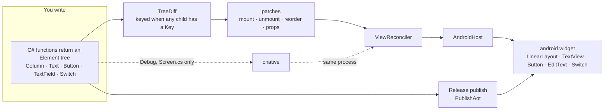

# C# native widgets

**Write a screen as a C# element tree. A keyed diff reconciles it onto real Android widgets, Release publishes with NativeAOT, and a resident compiler hot-reloads that screen in the same process.**

> [!TIP]
> **Try it with a coding agent.** On a machine with the .NET SDK pinned in [`global.json`](global.json) (10.0.403), the `android` workload, a JDK, and an Android SDK, give the agent this prompt:
>
> ```text
> Clone https://github.com/filipef101/c-sharp-native and follow its README.
> Install the SDK from global.json (10.0.403), run `dotnet workload install android`,
> and point ANDROID_HOME at an Android SDK with a JDK and an x86_64 emulator image.
> The NDK is required for the NativeAOT link. Boot an emulator with KVM
> (`emulator -accel on`) and wait until `adb shell getprop sys.boot_completed` is 1.
> From the repo root, run both `dotnet test` commands in Quick start.
> Publish Release NativeAOT for the emulator ABI:
>   dotnet publish src/NativePoc.Android/NativePoc.Android.csproj -c Release -f net10.0-android -r android-x64
> Install the signed APK that publish prints, then:
>   adb shell am start -n com.scratch.nativepoc/nativepoc.PackingActivity
> Toggle a packed switch, rename an item, add an item, and copy the list.
> In another terminal run `tools/devx/cnative run android` and change the title
> string in src/NativePoc.Screen/Screen.cs. The counter should update in the
> same process. Do not commit a hot-reload token. Release does not compile the listener.
> ```

<a href="docs/media/packing-demo.mp4"></a>

Packing checklist, Release NativeAOT, on a KVM x86_64 emulator. The GIF is the clip; the link is the H.264 MP4.

<table>
<tr>
<td></td>
<td></td>
<td></td>
</tr>
<tr>
<td>Packing list. <code>TextView</code>, <code>Switch</code>, and <code>Button</code>.</td>
<td>Editor. A real <code>EditText</code>.</td>
<td>Launcher. Counter, a name field, Save.</td>
</tr>
<tr>
<td colspan="3"></td>
</tr>
<tr>
<td colspan="3">Landscape, seed list. The column does not scroll, so Ridge map is cut off. In the video, rotation happens after the edits and keeps them.</td>
</tr>
</table>

<p>


</p>

Counter, then a Debug hot reload of `Screen.cs` (`Counter` / `Enter a name` becomes `Clicks` / `Type a name`, then the file is restored). Same process. The save chip on the counter is Android showing the `poc-N` string that screen copies. It is not the hot-reload bearer.

This is a small UI runtime with no MAUI. You return an `Element` tree from C#. `TreeDiff` diffs it, `ViewReconciler` applies the patches, and `AndroidHost` builds `LinearLayout`, `TextView`, `Button`, `EditText`, and `Switch`. The packing sample is an offline list of fictional kit: no account and no network. State lives in `PackingSession.Shared` for the process. Release sets `PublishAot`. Debug hot reload is `tools/devx/cnative run android`, and it recompiles `src/NativePoc.Screen/Screen.cs` into the running process.

> [!NOTE]
> This is a pre-1.0 proof of concept. The Android host is the part that has been built and run. There is no API stability and no compatibility promise. iOS and the Spark binding are not in this tree.

The longer record is [research/android-poc-report.md](research/android-poc-report.md). The plan is [research/runtime-feasibility.md](research/runtime-feasibility.md).

## Contents

- [Principles](#principles)
- [How it works](#how-it-works)
- [Quick start](#quick-start)
- [A screen](#a-screen)
- [What works today, and what doesn't yet](#what-works-today-and-what-doesnt-yet)
- [Repository map](#repository-map)
- [Contributing](#contributing)

## Principles

### 1. Native widgets, not a canvas

What you write is a tree of `Column`, `Text`, `Button`, `TextField`, and `Switch`. What the phone draws is the platform widget of that kind. `AndroidHost.Create` maps them onto `android.widget` views. There is no canvas and no web view in this tree.

**Authored** in [`src/NativePoc.Android/AndroidHost.cs`](src/NativePoc.Android/AndroidHost.cs) and [`src/NativePoc.Core/Elements.cs`](src/NativePoc.Core/Elements.cs). **Observed** on the emulator in the clips above: the switch toggles, the editor is a text field, Save is a button.

### 2. Startup speed

Cold start is `TotalTime` from `adb shell am start -W -S`. The only startup table on this page is the one below. It is **measured**, copied from [evidence/mac-arm64-startup-run2.txt](evidence/mac-arm64-startup-run2.txt). Mac `pixel_8` arm64 emulator, API 36, n=20. p50 is the mean of the 10th and 11th sorted samples. p90 is the 18th sorted sample plus 0.1 times the gap to the 19th.

| Config | p50 (ms) | p90 (ms) |
| --- | --- | --- |
| MAUI empty baseline | 1604 | 1729 |
| Mono profiled AOT | 1533.5 | 1804 |
| Mono full AOT | 1428.5 | 1682.9 |
| NativeAOT | 1300 | 1711.3 |

NativeAOT has the lowest p50 in that file. Full Mono AOT has the lowest p90 (1682.9, against NativeAOT's 1711.3). Those APKs were built on Linux and timed on that Mac emulator. They are a different series from any x64 KVM `TotalTime` in the research report. TCG startup numbers in that report are withdrawn. The clips on this page were not timed as cold starts.

`tools/measure-arm64-startup.sh` is the script that defines that percentile. It expects four android-arm64 Release APKs beside it. Those APKs are not in this tree. This session did not re-run the script.

### 3. Hot reload is a requirement

Debug keeps a resident compiler on the fixed socket `localabstract:npoc-hotreload`. Saving `src/NativePoc.Screen/Screen.cs` reloads that screen in the same process. Saving `src/NativePoc.Core` or `src/NativePoc.Android` prints `rude edit -> restart required`. Release does not compile the listener (`HotReloadServer.Start` is inside `#if DEBUG`). The Release native library in the clip APK contains no `hotreload` or `npoc-hotreload` string.

**Measured** series, n=20, one pid, from [docs/devx/evidence/fixed-socket-percentiles.txt](docs/devx/evidence/fixed-socket-percentiles.txt). The clock is from the `Screen.cs` write until the reply line.

| Clock | p50 | p90 |
| --- | --- | --- |
| edit-to-screen | 59.8246 ms | 74.8963 ms |
| CLI edit-to-reply | 60.0 ms | 72.0 ms |

`dotnet watch` is not that path. On this workload it restarts the process.

The hot-reload GIF is a later Debug session on the same KVM emulator as the other clips (SDK 10.0.403, `cnative run android`). One edit changed `TitlePrefix` from `"Counter "` to `"Clicks "` and the empty prompt from `"Enter a name"` to `"Type a name"`. The screen followed. Restoring the file put `Counter 0` and `Enter a name` back. `cnative` printed three `reloaded in` lines for that recording: 42.0 ms (apply 17.6 ms), 28.6 ms (apply 11.4 ms), and 17.8 ms (apply 7.5 ms). That is one session, not the n=20 series. The source file in the tree is the original.

## How it works



- **Elements** ([`src/NativePoc.Core/Elements.cs`](src/NativePoc.Core/Elements.cs)) are records. A `Key` is optional until a sibling has one. Mixed keyed and unkeyed children throw. Duplicate keys throw. A path deeper than four segments throws.
- **The diff** ([`src/NativePoc.Core/Diff.cs`](src/NativePoc.Core/Diff.cs)) walks the previous tree and the next. Keyed children keep their view when the key stays, and a move becomes a `Reorder`.
- **The reconciler** ([`src/NativePoc.Core/ViewReconciler.cs`](src/NativePoc.Core/ViewReconciler.cs)) applies those patches through `IElementHost`. The host is the only place that touches a platform view.
- **Android** ([`src/NativePoc.Android`](src/NativePoc.Android)) is that host. `MainActivity` renders the counter and is the launcher. `PackingActivity` renders the checklist. `AndroidNativeServices` is the clipboard and the vibrator call, and it is disposed with the activity.
- **Hot reload** ([`tools/devx`](tools/devx)) builds Debug, installs it, and pushes a new `Screen.cs` compile. The token is a per-process bearer created on the device. It is not stored in this tree.

## Quick start

`global.json` pins SDK 10.0.403 with `latestFeature` roll-forward. You also need a JDK, `ANDROID_HOME`, and `dotnet workload install android`. NativeAOT linking needs the NDK. `android-x64` is the emulator RID. `android-arm64` is the phone RID.

The commands below are the ones in this repo. The two test projects were run on SDK 10.0.403 in the workspace that produced the clips: Core 28 passed, Packing 13 passed.

### 1. Host tests

```sh
dotnet test tests/NativePoc.Core.Tests/NativePoc.Core.Tests.csproj
dotnet test tests/NativePoc.Packing.Tests/NativePoc.Packing.Tests.csproj
```

### 2. Release NativeAOT, then the packing sample

```sh
dotnet publish src/NativePoc.Android/NativePoc.Android.csproj \
  -c Release -f net10.0-android -r android-x64
```

`PublishAot` and `EnablePreviewFeatures` are set when `Configuration` is `Release`. Install the signed APK that publish prints. Debug uses fast deployment, so a plain `adb install` of a Debug APK aborts. Release installs normally.

```sh
adb shell am start -n com.scratch.nativepoc/nativepoc.PackingActivity
```

The app id is `com.scratch.nativepoc`. `PackingActivity` sets its component name to `nativepoc.PackingActivity`. The launcher is `MainActivity`. On the v0.1.0-poc APK that component is `crc64ee53024f7ed0aa60.MainActivity`. `dotnet build -t:Run` starts the launcher for you:

```sh
dotnet build src/NativePoc.Android/NativePoc.Android.csproj \
  -c Debug -f net10.0-android -r android-x64 -t:Run -p:AdbTarget=-e
```

Phone publish is the same Release command with `-r android-arm64`. Mono AOT is that publish with `-p:PublishAot=false`. Full Mono AOT adds `-p:AndroidEnableProfiledAot=false`.

### 3. Hot reload

The emulator or device is already online. Only `src/NativePoc.Screen/Screen.cs` reloads in place.

```sh
export DOTNET_ROOT="$HOME/.dotnet"
export ANDROID_HOME="$HOME/android-sdk"
export PATH="$DOTNET_ROOT:$ANDROID_HOME/platform-tools:$PATH"
tools/devx/cnative run android
```

`--device` selects an adb serial. `--abi` is `android-x64` or `android-arm64`. `--restart-on-rude` rebuilds when an edit needs a new process.

### Where the clips came from

**Observed** on this page, not the Mac startup series. AVD `poc34`, Pixel 6, Google APIs API 34, `x86_64`, emulator 37.2.13. `emulator -accel-check` printed `KVM (version 12) is installed and usable.` QEMU was started with `-accel on` and its command line contains `-enable-kvm`. `sys.boot_completed` was `1`, `ro.build.version.sdk` was `34`, and `ro.product.cpu.abi` was `x86_64`.

Packing and the counter were `adb shell screenrecord` of the v0.1.0-poc Release asset `packing-release-nativeaot-x86_64.apk`, sha256 `86d22bdb08537c51d566d0e6736c1b06a0c7c80f050ddc291ca9eda08c825d9d`, checked before install. [evidence/packing-apk-hashes.txt](evidence/packing-apk-hashes.txt) records a different local APK (`651c5d3d…`). The clips are the release asset, not that file. The packing clip toggles Canvas tent, renames Ridge map to Trail map, adds Lantern, copies the list, and rotates. The counter clip types Ada and presses Save.

PNG and WebP stills are `screencap` from that same boot. The list, editor, landscape, and counter stills are the seed packing list, the Canvas tent editor, the seed list in landscape, and the counter after typing Ada.

## Dev loop

`tools/devx/cnative run android` builds Debug, installs it on the online emulator, and stays up. Saving `src/NativePoc.Screen/Screen.cs` lowers that screen to a program the running process already knows how to evaluate. The listener applies those bytes on the UI thread. It does not load a new assembly for that edit.

Saving `samples/NativePoc.Packing/PackingScreen.cs` lowers that screen the same way. A row label, an added text field, or a reordered row is applied in the running process, and the packing list stays. `cnative new <name>` writes `samples/<name>/<Name>Screen.cs`, and that file reloads the same way. [Getting started](docs/getting-started.md) builds one from a clean clone.


Emulator-run, 2026-11-11, AVD `poc34`, API 34, x86_64, KVM. `emulator -accel-check` reported KVM version 12, and QEMU was started with `-accel on`. Percentiles are Hyndman-Fan type 7, the formula in `tools/measure-arm64-startup.sh`.

Packing row-label edit to present, n=12, one pid (9382): p50 20.1565 ms, p90 30.7825 ms. The clock starts at the `PackingScreen.cs` write and stops after lower, socket, UI render, and `OnDraw`. The list rows stayed. The GIF above is a later session on that same emulator, pid 12505: the row buttons change from Edit to Open and the packed rows stay. It is one edit, not the n=12 series.

Counter `Screen.cs`, n=12, one pid (11590): `OnDraw` p50 41.3773 ms, p90 50.4457 ms; gfxinfo `FrameCompleted` p50 77.5302 ms, p90 94.5824 ms; screencap byte change p50 332.0824 ms, p90 343.4421 ms. The screencap figure includes pulling one PNG. `DisplayPresentTime` and `SurfaceFlinger --latency` were 0 on this swiftshader emulator, so the frame timestamp is gfxinfo `FrameCompleted`.

NativeAOT dev listener, emulator-run on that same AVD. `IsDynamicCodeSupported=False`. The listener `.so` in this tree is 8,798,208 bytes (signed APK 3,338,723). The same listener before dropping native debug info was 29,562,584 bytes (APK 7,676,387). Those flags are `IlcGenerateDebugInfo` false, `DebuggerSupport` false, and invariant globalization, and they are not on the Release publish. A Release publish of this tree is 6,181,648 bytes (unit 10's Release `.so` was 6,023,952). The extra is the navigation and list host, and the Release package is not debuggable. A manifest overlay keeps the listener package debuggable so `run-as` can still read the token.

Same-pid subset reload, n=10, pid 20966, Hyndman-Fan type 7. Title: `OnDraw` p50 28.5024 ms, p90 42.8412 ms; gfxinfo `FrameCompleted` p50 56.1642 ms, p90 74.8903 ms. Packing: `OnDraw` p50 25.7990 ms, p90 37.5417 ms; `FrameCompleted` p50 53.1393 ms, p90 62.9946 ms.

A keyed list of 1000 rows, apply-to-present (the reply waits for `OnDraw`), n=5 fresh processes. `ScrollView` mounted 1037 views: first present p50 1071.3305 ms, p90 1136.1784 ms, TOTAL PSS p50 52,997 KB. The recycled window (20 slots, not AndroidX `RecyclerView`) mounted 34 views: first present p50 254.0235 ms, p90 358.3155 ms, TOTAL PSS p50 40,717 KB. Reload on one pid, n=5: scroll p50 23.8252 ms, p90 39.3966 ms; recycled list p50 37.8717 ms, p90 42.5501 ms.


`tools/NativePoc.HotReload.Host` is the older clock. `a` is a benchmark that restarts the app, then times a file write through the reply. `b` times a payload that was compiled before the clock. `c` times the compile and does not touch the device.

## A screen

The packing list is a function. Each row's key is the item id, so a rename keeps that row's widgets and an added row is a mount. From [`samples/NativePoc.Packing/PackingScreen.cs`](samples/NativePoc.Packing/PackingScreen.cs):

```csharp
public static Element View(PackingItem item, Action onEdit, Action<bool> onPacked) =>
	new Column(
	[
		new Text(item.Name) { Key = "name" },
		new Switch(item.Packed, onPacked, "Packed " + item.Name) { Key = "packed" },
		new Button("Edit", onEdit, "Edit " + item.Name) { Key = "edit" },
	])
	{ Key = item.Id };

public static Element View(PackingState state, IPackingHost host)
{
	var children = new List<Element>
	{
		new Text("Packing") { Key = "title" },
		new Text(state.PackedCount + " of " + state.Items.Count + " packed") { Key = "progress" },
	};
	foreach (var item in state.Items)
	{
		var current = item;
		children.Add(ItemRow.View(
			current,
			() => PackingActions.BeginEdit(state, host, current.Id),
			value =>
			{
				PackingTelemetry.SwitchDeliveries++;
				current.Packed = value;
				host.Native.Pulse();
				host.RequestRender();
			}));
	}
	children.Add(new Button("Add item", () => PackingActions.BeginAdd(state, host), "Add item") { Key = "add" });
	children.Add(new Button("Copy list", () => PackingActions.Copy(state, host), "Copy list") { Key = "copy" });
	return new Column(children) { Key = "list" };
}
```

The counter, which is what hot reload swaps, is [`src/NativePoc.Screen/Screen.cs`](src/NativePoc.Screen/Screen.cs). Save increments `Count` and copies `"poc-" + count`.

The seed list is Canvas tent, Camp stove (packed), Ridge map, and Water bladder, in `PackingState.Seed`.

## What works today, and what doesn't yet

### Working

**Measured** on a device or an emulator, in the files named, or in the clips on this page.

- **Android widgets.** The five element kinds mount real `android.widget` views. The packing clip and the stills are that UI on API 34.
- **Release is NativeAOT.** `PublishAot` is set for Release. The clip APK's `lib/x86_64/libNativePoc.Android.so` has no `hotreload` string. The earlier publish scan is [evidence/nativeaot-release-listener-scan.log](evidence/nativeaot-release-listener-scan.log).
- **Keyed updates.** A rename and an added row in the clip stay consistent with the keyed diff. Host tests cover the reconciler.
- **In-place hot reload of `Screen.cs`.** The n=20 series stayed on one pid. The GIF is a later single session, edit and restore.
- **Packing behavior that review recorded** in [review/packing-fix/report.md](review/packing-fix/report.md): the switch changes packed state, system back leaves the editor, rotation keeps the process, the in-process clipboard round-trips, and the first row sits below the action bar. This page's clip repeats the switch, the rename, the add, the copy, and the rotation. Its log line was `clipboard-ok` for the five names.
- **Mac arm64 cold start,** the table above.

### Not yet, or not at all

- **iOS.** Not in this checkout. The record on `main` is branch `feat-ios-feasibility-8497`: a UIKit spike was authored (`UIStackView`, `UILabel`, `UIButton`, `UITextField`) and was not compiled or run. The spike sources and `docs/ios/linux-ios-build.txt` are not in this tree, so that build log is **unverified** from here.
- **Spark.** Not in this checkout. Branch `feat-sparkline-aar-binding-0a93` is an app-level binding of one Apache-2.0 Spark 1.2.0 AAR. It is not a general AAR feature, and it is not in `src/`. arm64 for that probe was not run. **Unverified** from this tree.
- **Anything but Android as a running UI.** This tree's host is Android.
- **State beyond the process.** `PackingSession.Shared` is one static object. Rotation keeps it. A force-stop builds a new process and `PackingState.Seed` returns. Nothing is written to a bundle or a file. The portrait list still was captured after a force-stop and shows that seed.
- **A scrolling list.** Landscape leaves later rows under the fold. The landscape still shows that on the seed list.
- **The packing sample on arm64.** The running proof in this repo is x86_64. **Unverified** on arm64.
- **Physical vibration.** `haptic-ok` is the vibrator API. Physical vibration was not measured.
- **A shell clipboard read.** This emulator image has no `cmd clipboard` implementation. The copy was checked from the app log, inside the process.
- **Time from render to the next scanned framebuffer,** and **`View.Dispose` observed on an `android.view.View`.** Both still **unverified**.
- **`dotnet watch` as a reload.** It restarts the process.
- **Paths deeper than four,** and mixed keyed and unkeyed siblings. The diff throws. That limit is **authored**.

## Repository map

| Path | What's there |
| --- | --- |
| [`src/NativePoc.Core`](src/NativePoc.Core) | Elements, `TreeDiff`, `ViewReconciler` |
| [`src/NativePoc.Screen`](src/NativePoc.Screen) | The counter. The only file `cnative` reloads in place |
| [`src/NativePoc.Android`](src/NativePoc.Android) | Android host, `MainActivity`, `PackingActivity`, the Debug listener |
| [`samples/NativePoc.Packing`](samples/NativePoc.Packing) | The offline checklist |
| [`tests`](tests) | Host tests for the core and the packing sample |
| [`tools/devx`](tools/devx) | `cnative` |
| [`tools/measure-arm64-startup.sh`](tools/measure-arm64-startup.sh) | The cold-start script for the four arm64 APKs |
| [`evidence`](evidence) | Run logs, including the Mac startup file |
| [`docs/devx`](docs/devx) | Hot-reload measurements |
| [`docs/media`](docs/media) | The clips and stills on this page |
| [`research`](research) | The Android record and the plan |
| [`review`](review) | Packing runtime notes |

`main` is the Android proof. The Spark probe and the iOS spike are other branches. They are not in this commit.

## Contributing

The license is MIT ([`LICENSE`](LICENSE)).

Run the two test commands in Quick start before sending a change. A Debug token is created on the device at launch and read by `cnative`. It does not belong in the tree. Release must keep building with the listener compiled out.

Bugs and limits worth knowing are the ones in [What works today, and what doesn't yet](#what-works-today-and-what-doesnt-yet). The research report is the long form of how the Android proof was run.
