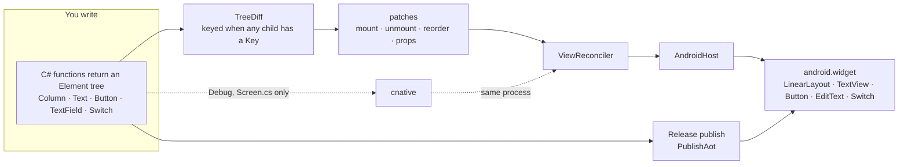

# C# native widgets

**Write a screen as a C# element tree. A keyed diff reconciles it onto real Android widgets, Release publishes with NativeAOT, and a resident compiler hot-reloads that screen in the same process.**

> [!TIP]
> **Try it with a coding agent.** On a machine with the .NET SDK pinned in [`global.json`](global.json) (10.0.403), the `android` workload, a JDK, and an Android SDK, give the agent this prompt:
>
> ```text
> Clone https://github.com/filipef101/c-sharp-native and follow its README.
> Install the SDK from global.json (10.0.403), run `dotnet workload install android`,
> and point ANDROID_HOME at an Android SDK with a JDK and an x86_64 emulator image.
> The NDK is required for the NativeAOT link. Boot an emulator with KVM
> (`emulator -accel on`) and wait until `adb shell getprop sys.boot_completed` is 1.
> From the repo root, run both `dotnet test` commands in Quick start.
> Publish Release NativeAOT for the emulator ABI:
>   dotnet publish src/NativePoc.Android/NativePoc.Android.csproj -c Release -f net10.0-android -r android-x64
> Install the signed APK that publish prints, then:
>   adb shell am start -n com.scratch.nativepoc/nativepoc.PackingActivity
> Toggle a packed switch, rename an item, add an item, and copy the list.
> In another terminal run `tools/devx/cnative run android` and change the title
> string in src/NativePoc.Screen/Screen.cs. The counter should update in the
> same process. Do not commit a hot-reload token. Release does not compile the listener.
> ```

<a href="docs/media/packing-demo.mp4"></a>

Packing checklist, Release NativeAOT, on a KVM x86_64 emulator. The GIF is the clip; the link is the H.264 MP4.

<table>
<tr>
<td></td>
<td></td>
<td></td>
</tr>
<tr>
<td>Packing list. <code>TextView</code>, <code>Switch</code>, and <code>Button</code>.</td>
<td>Editor. A real <code>EditText</code>.</td>
<td>Launcher. Counter, a name field, Save.</td>
</tr>
<tr>
<td colspan="3"></td>
</tr>
<tr>
<td colspan="3">Landscape still from before the packing screen was a ScrollView. Ridge map is cut off in that capture. In the video, rotation happens after the edits and keeps them.</td>
</tr>
</table>

<p>


</p>

Counter, then a Debug hot reload of `Screen.cs` (`Counter` / `Enter a name` becomes `Clicks` / `Type a name`, then the file is restored). Same process. The save chip on the counter is Android showing the `poc-N` string that screen copies. It is not the hot-reload bearer.

This is a small UI runtime with no MAUI. You return an `Element` tree from C#. `TreeDiff` diffs it, `ViewReconciler` applies the patches, and `AndroidHost` builds `LinearLayout`, `TextView`, `Button`, `EditText`, and `Switch`. The packing sample is an offline list of fictional kit: no account and no network. State lives in `PackingSession.Shared` for the process. Release sets `PublishAot`. Debug hot reload is `tools/devx/cnative run android`, and it recompiles `src/NativePoc.Screen/Screen.cs` into the running process.

> [!NOTE]
> This is a pre-1.0 proof of concept. The Android host is the part that has been built and run. There is no API stability and no compatibility promise. iOS and the Spark binding are not in this tree.

The longer record is [research/android-poc-report.md](research/android-poc-report.md). The plan is [research/runtime-feasibility.md](research/runtime-feasibility.md).

## Contents

- [Principles](#principles)
- [How it works](#how-it-works)
- [Quick start](#quick-start)
- [A screen](#a-screen)
- [What works today, and what doesn't yet](#what-works-today-and-what-doesnt-yet)
- [Repository map](#repository-map)
- [Contributing](#contributing)

## Principles

### 1. Native widgets, not a canvas

What you write is a tree of `Column`, `Text`, `Button`, `TextField`, and `Switch`. What the phone draws is the platform widget of that kind. `AndroidHost.Create` maps them onto `android.widget` views. There is no canvas and no web view in this tree.

**Authored** in [`src/NativePoc.Android/AndroidHost.cs`](src/NativePoc.Android/AndroidHost.cs) and [`src/NativePoc.Core/Elements.cs`](src/NativePoc.Core/Elements.cs). **Observed** on the emulator in the clips above: the switch toggles, the editor is a text field, Save is a button.

### 2. Startup speed

Cold start is `TotalTime` from `adb shell am start -W -S`. The only startup table on this page is the one below. It is **measured**, copied from [evidence/mac-arm64-startup-run2.txt](evidence/mac-arm64-startup-run2.txt). Mac `pixel_8` arm64 emulator, API 36, n=20. p50 is the mean of the 10th and 11th sorted samples. p90 is the 18th sorted sample plus 0.1 times the gap to the 19th.

| Config | p50 (ms) | p90 (ms) |
| --- | --- | --- |
| MAUI empty baseline | 1604 | 1729 |
| Mono profiled AOT | 1533.5 | 1804 |
| Mono full AOT | 1428.5 | 1682.9 |
| NativeAOT | 1300 | 1711.3 |

NativeAOT has the lowest p50 in that file. Full Mono AOT has the lowest p90 (1682.9, against NativeAOT's 1711.3). Those APKs were built on Linux and timed on that Mac emulator. They are a different series from any x64 KVM `TotalTime` in the research report. TCG startup numbers in that report are withdrawn. The clips on this page were not timed as cold starts.

`tools/measure-arm64-startup.sh` is the script that defines that percentile. It expects four android-arm64 Release APKs beside it. Those APKs are not in this tree. This session did not re-run the script.

### 3. Hot reload is a requirement

Debug keeps a resident compiler on the fixed socket `localabstract:npoc-hotreload`. Saving `src/NativePoc.Screen/Screen.cs` reloads that screen in the same process. Saving `src/NativePoc.Core` or `src/NativePoc.Android` prints `rude edit -> restart required`. Release does not compile the listener (`HotReloadServer.Start` is inside `#if DEBUG`). The Release native library in the clip APK contains no `hotreload` or `npoc-hotreload` string.

**Measured** series, n=20, one pid, from [docs/devx/evidence/fixed-socket-percentiles.txt](docs/devx/evidence/fixed-socket-percentiles.txt). The clock is from the `Screen.cs` write until the reply line.

| Clock | p50 | p90 |
| --- | --- | --- |
| edit-to-screen | 59.8246 ms | 74.8963 ms |
| CLI edit-to-reply | 60.0 ms | 72.0 ms |

`dotnet watch` is not that path. On this workload it restarts the process.

The hot-reload GIF is a later Debug session on the same KVM emulator as the other clips (SDK 10.0.403, `cnative run android`). One edit changed `TitlePrefix` from `"Counter "` to `"Clicks "` and the empty prompt from `"Enter a name"` to `"Type a name"`. The screen followed. Restoring the file put `Counter 0` and `Enter a name` back. `cnative` printed three `reloaded in` lines for that recording: 42.0 ms (apply 17.6 ms), 28.6 ms (apply 11.4 ms), and 17.8 ms (apply 7.5 ms). That is one session, not the n=20 series. The source file in the tree is the original.

## How it works



- **Elements** ([`src/NativePoc.Core/Elements.cs`](src/NativePoc.Core/Elements.cs)) are records. A `Key` is optional until a sibling has one. Mixed keyed and unkeyed children throw. Duplicate keys throw. A path deeper than four segments throws.
- **The diff** ([`src/NativePoc.Core/Diff.cs`](src/NativePoc.Core/Diff.cs)) walks the previous tree and the next. Keyed children keep their view when the key stays, and a move becomes a `Reorder`.
- **The reconciler** ([`src/NativePoc.Core/ViewReconciler.cs`](src/NativePoc.Core/ViewReconciler.cs)) applies those patches through `IElementHost`. The host is the only place that touches a platform view.
- **Android** ([`src/NativePoc.Android`](src/NativePoc.Android)) is that host. `MainActivity` renders the counter and is the launcher. `PackingActivity` renders the checklist. `AndroidNativeServices` is the clipboard and the vibrator call, and it is disposed with the activity.
- **Hot reload** ([`tools/devx`](tools/devx)) builds Debug, installs it, and pushes a new `Screen.cs` compile. The token is a per-process bearer created on the device. It is not stored in this tree.
- The longer path, including the NPC1 record and the reload socket, is [docs/architecture.md](docs/architecture.md). [docs/comparison.md](docs/comparison.md) is the comparison with MAUI, Avalonia, Uno, React Native, and NativeScript, limited to facts those projects document.

## Quick start

`global.json` pins SDK 10.0.403 with `latestFeature` roll-forward. You also need a JDK, `ANDROID_HOME`, and `dotnet workload install android`. NativeAOT linking needs the NDK. `cnative run android` reads `ro.product.cpu.abi`. `x86_64` selects `android-x64`. `arm64-v8a` selects `android-arm64`, on a phone or on an arm64 emulator. `--abi` overrides that. `--listener` publishes the Debug NativeAOT listener for the same RID. A normal Release publish is separate and has no listener.

The commands below are the ones in this repo. The two test projects were run on SDK 10.0.403 in the workspace that produced the clips: Core 28 passed, Packing 13 passed.

### 1. Host tests

```sh
dotnet test tests/NativePoc.Core.Tests/NativePoc.Core.Tests.csproj
dotnet test tests/NativePoc.Packing.Tests/NativePoc.Packing.Tests.csproj
```

### 2. Release NativeAOT, then the packing sample

```sh
dotnet publish src/NativePoc.Android/NativePoc.Android.csproj \
  -c Release -f net10.0-android -r android-x64
```

`PublishAot` and `EnablePreviewFeatures` are set when `Configuration` is `Release`. Install the signed APK that publish prints. Debug uses fast deployment, so a plain `adb install` of a Debug APK aborts. Release installs normally.

```sh
adb shell am start -n com.scratch.nativepoc/nativepoc.PackingActivity
```

The app id is `com.scratch.nativepoc`. `PackingActivity` sets its component name to `nativepoc.PackingActivity`. The launcher is `MainActivity`. On the v0.1.0-poc APK that component is `crc64ee53024f7ed0aa60.MainActivity`. `dotnet build -t:Run` starts the launcher for you:

```sh
dotnet build src/NativePoc.Android/NativePoc.Android.csproj \
  -c Debug -f net10.0-android -r android-x64 -t:Run -p:AdbTarget=-e
```

Phone publish is the same Release command with `-r android-arm64`. Mono AOT is that publish with `-p:PublishAot=false`. Full Mono AOT adds `-p:AndroidEnableProfiledAot=false`.

### 3. Hot reload

The emulator or device is already online. Saving `src/NativePoc.Screen/Screen.cs` reloads that screen. The [Dev loop](#dev-loop) lists the other files that reload the same way.

```sh
export DOTNET_ROOT="$HOME/.dotnet"
export ANDROID_HOME="$HOME/android-sdk"
export PATH="$DOTNET_ROOT:$ANDROID_HOME/platform-tools:$PATH"
tools/devx/cnative run android
```

`--device` selects an adb serial. `--abi` is `android-x64` or `android-arm64`. `--restart-on-rude` rebuilds when an edit needs a new process.

### Where the clips came from

**Observed** on this page, not the Mac startup series. AVD `poc34`, Pixel 6, Google APIs API 34, `x86_64`, emulator 37.2.13. `emulator -accel-check` printed `KVM (version 12) is installed and usable.` QEMU was started with `-accel on` and its command line contains `-enable-kvm`. `sys.boot_completed` was `1`, `ro.build.version.sdk` was `34`, and `ro.product.cpu.abi` was `x86_64`.

Packing and the counter were `adb shell screenrecord` of the v0.1.0-poc Release asset `packing-release-nativeaot-x86_64.apk`, sha256 `86d22bdb08537c51d566d0e6736c1b06a0c7c80f050ddc291ca9eda08c825d9d`, checked before install. [evidence/packing-apk-hashes.txt](evidence/packing-apk-hashes.txt) records a different local APK (`651c5d3d…`). The clips are the release asset, not that file. The packing clip toggles Canvas tent, renames Ridge map to Trail map, adds Lantern, copies the list, and rotates. The counter clip types Ada and presses Save.

PNG and WebP stills are `screencap` from that same boot. The list, editor, landscape, and counter stills are the seed packing list, the Canvas tent editor, the seed list in landscape, and the counter after typing Ada.

## Dev loop

`tools/devx/cnative run android` builds Debug, installs it on the online emulator, and stays up. Saving `src/NativePoc.Screen/Screen.cs` lowers that screen to a program the running process already knows how to evaluate. The listener applies those bytes on the UI thread. It does not load a new assembly for that edit.

Saving `samples/NativePoc.Packing/PackingScreen.cs` lowers that screen the same way. A row label, an added text field, or a reordered row is applied in the running process, and the packing list stays. `cnative new <name>` writes `samples/<name>/<Name>Screen.cs`, and that file reloads the same way. [Getting started](docs/getting-started.md) builds one from a clean clone.


Emulator-run, 2026-11-11, AVD `poc34`, API 34, x86_64, KVM. `emulator -accel-check` reported KVM version 12, and QEMU was started with `-accel on`. Percentiles are Hyndman-Fan type 7, the formula in `tools/measure-arm64-startup.sh`.

Packing row-label edit to present, n=12, one pid (9382): p50 20.1565 ms, p90 30.7825 ms. The clock starts at the `PackingScreen.cs` write and stops after lower, socket, UI render, and `OnDraw`. The list rows stayed. The GIF above is a later session on that same emulator, pid 12505: the row buttons change from Edit to Open and the packed rows stay. It is one edit, not the n=12 series.

Counter `Screen.cs`, n=12, one pid (11590): `OnDraw` p50 41.3773 ms, p90 50.4457 ms; gfxinfo `FrameCompleted` p50 77.5302 ms, p90 94.5824 ms; screencap byte change p50 332.0824 ms, p90 343.4421 ms. The screencap figure includes pulling one PNG. `DisplayPresentTime` and `SurfaceFlinger --latency` were 0 on this swiftshader emulator, so the frame timestamp is gfxinfo `FrameCompleted`.

NativeAOT dev listener, emulator-run on that same AVD. `IsDynamicCodeSupported=False`. The listener `.so` published from this tree is 8,967,072 bytes (signed APK 3,404,461). The earlier trim, before styles, effects, images, field mode, and platform modules, was 8,798,208 bytes (signed APK 3,338,723). The same listener before dropping native debug info was 29,562,584 bytes (APK 7,676,387). The listener turns off `IlcGenerateDebugInfo` and `DebuggerSupport`, turns on invariant globalization, and a manifest overlay keeps that package debuggable so `run-as` can still read the token. A Release publish of the earlier tree is 6,181,648 bytes (unit 10's Release `.so` was 6,023,952). The extra over unit 10 is the navigation and list host, and the Release package is not debuggable.

Release cold start on this same emulator, `adb shell am start -W -S`, LaunchState COLD, n=20, none dropped, Hyndman-Fan type 7. QEMU pid 4419, `/dev/kvm` present. The unmodified tree's Release `.so` is 6,315,360 bytes (signed APK 2,728,487): TotalTime p50 1436.5 ms, p90 1575.9 ms. Unit 10's Release p50 on the older `.so` was 1470.0 ms, same method. After invariant globalization (no `icudt` in the `.so`), native debug info off, and the debugger, event source, and metadata updater off, that build's `.so` was 6,571,488 bytes (signed APK 2,814,503): TotalTime p50 765.5 ms, p90 925.8 ms. This tree also turns off stack traces, metrics, and startup hooks, skips the debug view walk, and registers the other screens after the first frame. Its Release `.so` is 6,189,440 bytes (signed APK 2,675,367). TotalTime sorted 663 689 693 709 717 718 736 749 751 759 774 775 777 792 825 853 858 864 882 1059. p50 766.5 ms, p90 865.8 ms. Marks from process start, n=20: managed main p50 32.0 p90 51.3, activity p50 50.0 p90 88.8, first render p50 101.0 p90 141.4, first present p50 136.0 p90 176.9. An empty Java activity with those same marks, package `com.scratch.floor`, APK 12,631 bytes, measured in the same series: TotalTime sorted 596 614 657 663 668 685 692 695 704 728 728 731 749 754 763 786 790 816 833 943, p50 728.0 ms, p90 817.7 ms. Its activity mark is p50 90.0, first render p50 106.5, first present p50 153.0. Native TotalTime sits 38.5 ms over that floor. Native reaches OnCreate (50.0 vs 90.0) and first present (136.0 vs 153.0) before the Java activity. The leftover is first-render to Displayed: native p50 650.0 ms, Java p50 605.0 ms. `dumpsys SurfaceFlinger --latency` printed only `16666666`. Framestats recorded 100 frames and the last column was non-zero on all 100. `dev-overlay` and `icudt` are not in the Release `.so`. `IsDynamicCodeSupported=False`.

Coordinator-measured on Filipe's MacBook Pro M5, not in this workspace. Android emulator AVD `pixel_8`, `arm64-v8a`, Android 16. APK `nativepoc-0.2.0-android-arm64.apk`, sha256 `b5b4a809f6e652642e0bea1394a451fa766fa00b0b05d39828773202f4873bac`. `am start -W -S`, LaunchState COLD, n=20 after one warmup, Hyndman-Fan type 7. logcat showed `IsDynamicCodeSupported=False`. No Java floor was measured on that Mac. Counter TotalTime, sample order 800 447 683 575 736 497 419 1059 871 816 842 444 485 463 444 449 474 400 462 406. Sorted 400 406 419 444 444 447 449 462 463 474 485 497 575 683 736 800 816 842 871 1059. p50 479.5 ms, p90 844.9 ms. The first ~10 samples are noisy. packing1000 (`--es nativepoc_bench packing1000`, logcat `window rows=1000 built=20 views=32`), sample order 447 364 408 362 382 449 369 361 594 918 486 470 428 577 544 457 457 469 514 846. Sorted 361 362 364 369 382 408 428 447 449 457 457 469 470 486 514 544 577 594 846 918. p50 457.0 ms, p90 619.2 ms. The same method is `tools/bench/cold-start.sh`. `--floor` builds the empty Java activity. That floor was not run on the Mac. The numbers are also in [docs/release-notes.md](docs/release-notes.md).

The packing screen with the nav stack and 1000 rows, `nativepoc_bench=packing1000`, same method. An earlier boot on this emulator, before the window, was TotalTime sorted 1662 1675 1760 1780 1814 1823 1825 1851 1855 1872 1896 1983 1988 2041 2059 2065 2068 2077 2115 2263, p50 1884.0 ms, p90 2080.8 ms, first render p50 753.0. On the boot that published the `.so` below, the same screen before the window was TotalTime sorted 1591 1687 1831 1833 1833 1879 1902 1909 1914 1924 1955 1965 1999 2000 2021 2028 2033 2043 2045 2231, p50 1939.5 ms, p90 2043.2 ms, first render p50 738.0, first present p50 982.5, n=20, all COLD. After the first frame keeps a 20-slot window (1000 rows, 20 built, 32 views) and the screens that are not showing stay bytes, that same boot measured TotalTime sorted 527 532 542 564 578 585 589 591 592 597 601 611 612 615 631 660 663 681 732 763, p50 599.0 ms, p90 686.1 ms. Activity p50 48.0. First render p50 92.5, p90 128.3. First present p50 132.0. Eval p50 0 ms, mount p50 9.5 ms. First render to Displayed p50 513.5 ms. The Release `.so` for that after series is 6,259,872 bytes uncompressed (signed APK 2,708,269). A list of 24 rows or fewer still expands, so the four-row packing screen keeps its switch, edit button, and swipe. The window's slots are the row label.

On this boot, that same installed APK (sha256 `b4f3b328ea82ffa33ee9ab15f21e73ea7f265c860e6437044828dd509373dd54`) was measured again before any startup edit. Host load average 0.11 at the start. packing1000 TotalTime sorted 582 598 611 627 643 663 673 679 680 689 704 739 747 775 787 835 837 863 867 868, p50 696.5 ms, p90 863.4 ms. First render p50 130.5. First present p50 171.5. Eval p50 0, mount p50 10.5. First render to Displayed p50 582.5. Still `window rows=1000 built=20 views=32`, n=20, all COLD, `IsDynamicCodeSupported=False`. The empty Java floor built by `tools/bench/build-floor.sh` on this boot is 12,649 bytes, sha256 `bb38c40cc4bad863d55741b9c425c78f5f316f71d880ab49da084cebbac43ba0`. It is not the 12,631-byte floor from the earlier boot. Floor TotalTime p50 679.0, p90 751.2. First render p50 91.0. First render to Displayed p50 587.5. Native TotalTime sat 17.5 ms over that floor, and the two gaps matched (582.5 and 587.5).

The starting window now uses `NativePocTheme`, whose `windowBackground` and splash background are the page color (`#F4F1EA`, and `#1C1917` in night mode). `ApplyWindow` sets that color from the stored theme before the first content. Text color and layout direction are applied before `SetContentView`, and direction is left alone when it already matches. `ReportFullyDrawn` runs from the first pre-draw. The first republish (sha256 `7feb678e748051e78069493e83c6752bcfe574615c5bdcb0c076c89133e46532`, `.so` 6,265,808 bytes) did not reach `ReportFullyDrawn`: the decor view's context was not the activity, and logcat had no `Fully drawn` line. That series, host load 1.26 at the start, was TotalTime p50 518.0, p90 561.4, first render p50 84.0, first render to Displayed p50 436.5. The following publish calls it on `MainActivity.Current`. sha256 `f7e2a6411480cc6337c30d995463ae654fc7171f11d92433d6e68acae03ccab9`, `.so` 6,265,872 bytes, signed APK 2,708,269 bytes. Host load 1.30 at the start. TotalTime sorted 489 490 502 503 506 510 513 517 518 519 520 531 543 554 556 558 564 582 616 676, p50 519.5, p90 585.4. First render p50 94.5. First present p50 140.5. The `report-fully-drawn` mark p50 140.5. Logcat `Fully drawn` p50 519.5, the same samples as Displayed. First render to Displayed p50 435.0. Eval p50 0, mount p50 8.0. `window rows=1000 built=20 views=32`. `ReportFullyDrawn` did not move TotalTime past the theme series. A second floor series started while the host load was 4.01: TotalTime p50 629.5, first render to Displayed p50 563.5. The native gap moved further than that floor.

On this same x86_64 API 34 emulator, that installed ReportFullyDrawn binary (sha256 `f7e2a6411480cc6337c30d995463ae654fc7171f11d92433d6e68acae03ccab9`) was compared with gfxinfo framestats. packing1000, `am start -W -S`, n=20 after one discarded warmup, every launch including the warmup COLD, Hyndman-Fan type 7. The clock is `/proc/<pid>/stat` starttime (field 22, clock ticks / 100) against framestats nanoseconds on this emulator. `DisplayPresentTime` was 0 on all 20 first frames, so the present mark is the pre-draw log and the frame clock is `FrameCompleted`. First render p50 100.0, p90 145.3. First present p50 137.0, p90 179.4. Render to present p50 30.0. IntendedVsync p50 184.8. DrawStart p50 309.2. SwapBuffers p50 411.0. FrameCompleted p50 482.1, p90 528.0. Present to FrameCompleted p50 362.3. FrameCompleted to Displayed p50 23.8, p90 36.6. One of those samples is −5.1, which is the 10 ms tick. Present to Displayed p50 377.0, p90 418.1. TotalTime and Fully drawn are the same samples: sorted 459 468 480 481 484 489 498 501 505 512 514 516 519 520 524 541 554 554 570 578, p50 513.0, p90 555.6. The app UI thread is done at first present. The time from that present to Displayed is the emulator frame pipeline: DrawStart's p50 is 172.2 ms after the first-present p50, and FrameCompleted is the bulk of the wait. The Displayed report follows FrameCompleted. `ReportFullyDrawn` does not end that wait early. This series is that binary, before the variable-height row slots.

The row window after that binary keeps 20 slots. A slot shows the row's first text, a second text when it is not empty, and a drawable when the row has one. Those three are different heights. A row that has not been built is one text line, so the first frame still builds 20 rows. On this emulator, one COLD launch of packing1000 on the rebuilt Release (`startup window rows=1000 built=20 views=92`) showed that line. It is one launch, not an n=20 TotalTime series. The signed APK for that launch is sha256 `25e14d2e2ae7a9d7d39a972fb6713d6b7df3a47fa32634f3e442b4effdc9c734`, uncompressed `lib/x86_64/libNativePoc.Android.so` 6,291,664 bytes. Eight swipes then moved the window from `first=0` to `first=106`. The visible labels were Item 0106 through Item 0124, with `Ridge line` on the rows whose index is divisible by 3 and `marker` on the rows whose index is divisible by 4. Scrolling back landed on `first=0` with Item 0000 still followed by `Ridge line` and `marker`. gfxinfo for that swipe session, pid 24935: 135 frames, 37 janky (27.41%), 50th percentile 34ms, 90th 48ms, 95th 53ms, 99th 61ms, 4 missed vsync, 16 slow UI thread, 36 slow issue-draw-commands, 37 frame deadlines missed. `cnative agent a11y --check` on packing was `violations=0` at font scale 1, 1.3, and 2 (density 420). Trips at font scale 2 was `violations=0`. This image's `uiautomator` dump has no `heading` attribute, so the report says `headings=0` and `heading-attribute=absent`. Buttons and switches that are fully on screen are at least 48dp. The 2x screenshots are in the progress notes, not in this tree.


`samples/NativePoc.Trips` is a three-screen subset app (trip list, trip detail, packing). The clip is one Release process on this emulator: the detail shows the stored note `stove`, a swipe removes the tent row, a long-press leaves the name `Stove`, a pull-to-refresh replaces the label with `List updated`, and Back returns to the list. The weather line is the `weather` effect. The switch is the stored dark theme. The trip strings go through `L.Get` and the Android locale. `pt-PT` is in `StringTable`. `L.Plural` picks the one-string when the count is 1 and the other-string otherwise. Invariant globalization stays on. See [docs/localization.md](docs/localization.md).

`HostView` is one platform view with a kind, a prop, and an event. `samples/NativePoc.Web` is a `WebView` whose prop is `url` and whose event is `navigate`. `NativeViews` constructs it with a direct call. A reload that keeps the kind keeps the slot. See [docs/native-view.md](docs/native-view.md).


Same-pid subset reload on the earlier listener, n=10, pid 20966, Hyndman-Fan type 7. Title: `OnDraw` p50 28.5024 ms, p90 42.8412 ms; gfxinfo `FrameCompleted` p50 56.1642 ms, p90 74.8903 ms. Packing: `OnDraw` p50 25.7990 ms, p90 37.5417 ms; `FrameCompleted` p50 53.1393 ms, p90 62.9946 ms.

Same process on the listener above, pid 32111, n=10, Hyndman-Fan type 7, gfxinfo `FrameCompleted`. QEMU pid 4419, KVM present, `IsDynamicCodeSupported=False`. A style-only title size change mounted no new buttons: `OnDraw` p50 22.9500 ms, p90 28.8035 ms; frame p50 50.2316 ms, p90 68.8963 ms. An image source swap: `OnDraw` p50 17.2856 ms, p90 21.5776 ms; frame p50 46.0833 ms, p90 50.9797 ms. An effect whose resource stayed `places` applied once: `OnDraw` p50 21.8065 ms, p90 28.7446 ms; frame p50 46.5731 ms, p90 61.2351 ms. The form note caret stayed `start=13 end=13` across a label reload. Empty submit logged `share-skipped` and `haptic-ok`. A filled submit logged `share-text chars=13` and `haptic-ok`. `DisplayPresentTime` stays 0 on this swiftshader emulator.

A keyed list of 1000 rows, apply-to-present (the reply waits for `OnDraw`), n=5 fresh processes. `ScrollView` mounted 1037 views: first present p50 1071.3305 ms, p90 1136.1784 ms, TOTAL PSS p50 52,997 KB. The recycled window (20 slots, not AndroidX `RecyclerView`) mounted 34 views: first present p50 254.0235 ms, p90 358.3155 ms, TOTAL PSS p50 40,717 KB. Reload on one pid, n=5: scroll p50 23.8252 ms, p90 39.3966 ms; recycled list p50 37.8717 ms, p90 42.5501 ms.


`tools/NativePoc.HotReload.Host` is the older clock. `a` is a benchmark that restarts the app, then times a file write through the reply. `b` times a payload that was compiled before the clock. `c` times the compile and does not touch the device.

## A screen

The packing list is a function. Each row's key is the item id, so a rename keeps that row's widgets and an added row is a mount. From [`samples/NativePoc.Packing/PackingScreen.cs`](samples/NativePoc.Packing/PackingScreen.cs):

```csharp
public static Element View(PackingItem item, Action onEdit, Action<bool> onPacked) =>
	new Column(
	[
		new Text(item.Name) { Key = "name" },
		new Switch(item.Packed, onPacked, "Packed " + item.Name) { Key = "packed" },
		new Button("Edit", onEdit, "Edit " + item.Name) { Key = "edit" },
	])
	{ Key = item.Id };

public static Element View(PackingState state, IPackingHost host)
{
	var children = new List<Element>
	{
		new Text("Packing") { Key = "title" },
		new Text(state.PackedCount + " of " + state.Items.Count + " packed") { Key = "progress" },
	};
	foreach (var item in state.Items)
	{
		var current = item;
		children.Add(ItemRow.View(
			current,
			() => PackingActions.BeginEdit(state, host, current.Id),
			value =>
			{
				PackingTelemetry.SwitchDeliveries++;
				current.Packed = value;
				host.Native.Pulse();
				host.RequestRender();
			}));
	}
	children.Add(new Button("Add item", () => PackingActions.BeginAdd(state, host), "Add item") { Key = "add" });
	children.Add(new Button("Copy list", () => PackingActions.Copy(state, host), "Copy list") { Key = "copy" });
	return new Column(children) { Key = "list" };
}
```

The counter, which is what hot reload swaps, is [`src/NativePoc.Screen/Screen.cs`](src/NativePoc.Screen/Screen.cs). Save increments `Count` and copies `"poc-" + count`.

The seed list is Canvas tent, Camp stove (packed), Ridge map, and Water bladder, in `PackingState.Seed`.

## What works today, and what doesn't yet

### Working

**Measured** on a device or an emulator, in the files named, or in the clips on this page.

- **Android widgets.** `Column`, `Text`, `Button`, `TextField`, and `Switch` are the views in the packing clip and the stills on API 34. The host also maps `ScrollView`, `ListView`, and `Image`. Those three are in the tree now; the clip predates them.
- **Release is NativeAOT.** `PublishAot` is set for Release. The clip APK's `lib/x86_64/libNativePoc.Android.so` has no `hotreload` string. The earlier publish scan is [evidence/nativeaot-release-listener-scan.log](evidence/nativeaot-release-listener-scan.log).
- **Keyed updates.** A rename and an added row in the clip stay consistent with the keyed diff. Host tests cover the reconciler.
- **In-place hot reload of `Screen.cs`.** The n=20 series stayed on one pid. The GIF is a later single session, edit and restore.
- **Style, image, and effect reloads on the NativeAOT listener.** Pid 32111, n=10, `IsDynamicCodeSupported=False`. The numbers are in the Dev loop. A style-only edit did not remount buttons, and the places effect applied once.
- **Text fields and platform modules.** A field can set `Keyboard`, `Lines`, `Submit`, and `OnSubmit`. `Haptics.Confirm`, `Share.Text`, and `Clipboard.Copy` dispatch through a switch in `PlatformModules`, with no reflection. The pid 32111 form run kept the note caret and logged `haptic-ok` plus `share-text chars=13`.
- **Debug state across a force-stop.** A Debug process writes `files/nativepoc-state.bin` on each render and reads it before the first frame. Release keeps packing state in the process only. A force-stop of a Release process returns to `PackingState.Seed`. The portrait still was captured after a force-stop and shows that seed.
- **Packing behavior that review recorded** in [review/packing-fix/report.md](review/packing-fix/report.md): the switch changes packed state, system back leaves the editor, rotation keeps the process, the in-process clipboard round-trips, and the first row sits below the action bar. This page's clip repeats the switch, the rename, the add, the copy, and the rotation. Its log line was `clipboard-ok` for the five names.
- **Mac arm64 cold start,** the table above.

### Not yet, or not at all

- **iOS.** `spikes/ios/NativePoc.iOS` is an authored UIKit host for the current record contract (column, text, button, field, switch, scroll, list, image, style, motion, gestures, modules, nav). It is not in `NativePoc.slnx`. `docs/ios-status.md` splits authored, tested on Linux, and never compiled. The `net10.0` tests do not compile `net10.0-ios`. There is no iOS run.
- **Spark.** Not in this checkout. Branch `feat-sparkline-aar-binding-0a93` is an app-level binding of one Apache-2.0 Spark 1.2.0 AAR. It is not a general AAR feature, and it is not in `src/`. arm64 for that probe was not run. **Unverified** from this tree.
- **Anything but Android as a running UI.** This tree's host is Android.
- **Release state after the process exits.** Release does not write `nativepoc-state.bin`. A force-stop returns to `PackingState.Seed`.
- **The landscape still.** It is an earlier capture, and Ridge map is cut off in that image. The packing screen in this tree is a `ScrollView`. That still was not recaptured after the scroll landed.
- **The packing sample on arm64.** The interactive packing proof in this repo is x86_64. The v0.2.0 arm64 APK's packing1000 cold start is the coordinator series above. Gestures on that Mac emulator were not part of the series.
- **Physical vibration.** `haptic-ok` is the vibrator API. Physical vibration was not measured.
- **A shell clipboard read.** This emulator image has no `cmd clipboard` implementation. The copy was checked from the app log, inside the process.
- **Time from render to the next scanned framebuffer,** and **`View.Dispose` observed on an `android.view.View`.** Both still **unverified**.
- **`dotnet watch` as a reload.** It restarts the process.
- **Paths deeper than four,** and mixed keyed and unkeyed siblings. The diff throws. That limit is **authored**.

## Repository map

| Path | What's there |
| --- | --- |
| [`src/NativePoc.Core`](src/NativePoc.Core) | Elements, `TreeDiff`, `ViewReconciler` |
| [`src/NativePoc.Screen`](src/NativePoc.Screen) | The counter. `cnative` lowers this file, `samples/NativePoc.Packing/PackingScreen.cs`, and `samples/<name>/<Name>Screen.cs` |
| [`src/NativePoc.Android`](src/NativePoc.Android) | Android host, `MainActivity`, `PackingActivity`, the Debug listener |
| [`samples/NativePoc.Packing`](samples/NativePoc.Packing) | The offline checklist |
| [`tests`](tests) | Host tests for the core and the packing sample |
| [`tools/devx`](tools/devx) | `cnative` |
| [`tools/measure-arm64-startup.sh`](tools/measure-arm64-startup.sh) | The cold-start script for the four arm64 APKs |
| [`evidence`](evidence) | Run logs, including the Mac startup file |
| [`docs/devx`](docs/devx) | Hot-reload measurements |
| [`docs/media`](docs/media) | The clips and stills on this page |
| [`research`](research) | The Android record and the plan |
| [`review`](review) | Packing runtime notes |

`main` is the Android proof. The Spark probe and the iOS spike are other branches. They are not in this commit.

## Contributing

The license is MIT ([`LICENSE`](LICENSE)).

Run the two test commands in Quick start before sending a change. A Debug token is created on the device at launch and read by `cnative`. It does not belong in the tree. Release must keep building with the listener compiled out.

Bugs and limits worth knowing are the ones in [What works today, and what doesn't yet](#what-works-today-and-what-doesnt-yet). The research report is the long form of how the Android proof was run.
