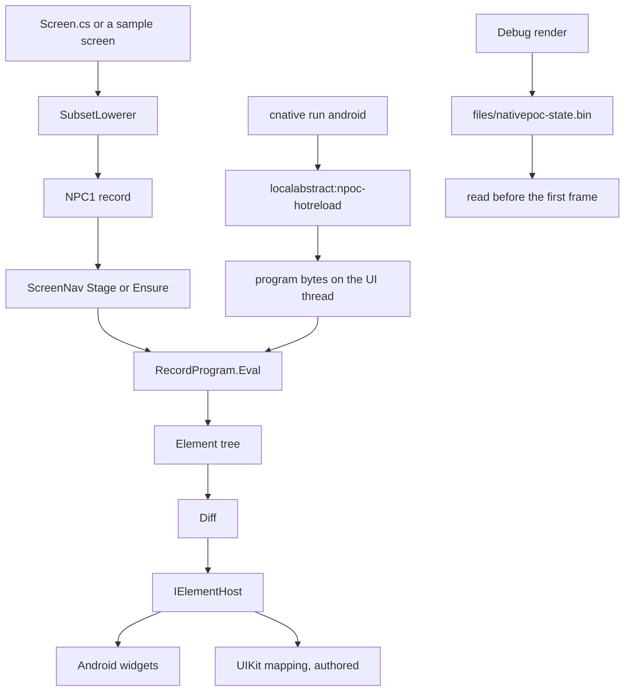

# Architecture

This page describes the path in this tree, from a C# screen function to an Android view. The UIKit host is authored and is not compiled here. See [ios-status.md](ios-status.md).

## Element tree

A screen is a function that returns an `Element`. The types live in [`src/NativePoc.Core/Elements.cs`](../src/NativePoc.Core/Elements.cs): column, text, button, text field, switch, scroll, list, image, and `HostView`. A `Key` is optional until a sibling has one. [`Diff.cs`](../src/NativePoc.Core/Diff.cs) walks the previous tree and the next. [`ViewReconciler`](../src/NativePoc.Core/ViewReconciler.cs) applies that diff through `IElementHost`. The host is the only type that constructs a platform view.

## Subset lowering

[`SubsetLowerer`](../tools/devx/NativePoc.Devx.Cli/SubsetLowerer.cs) reads one screen file in the subset documented in [screen-program-subset.md](screen-program-subset.md). `cnative lower` prints the record as JSON or as a C# byte array. A construct outside the subset is a diagnostic. It is not rewritten into a nearby construct.

## NPC records

`RecordProgram.Encode` writes a payload whose first four bytes are `N`, `P`, `C`, `1`. The next byte is `ScreenProgram.Version` (1). The byte after that is the constant 2. `Decode` checks the magic and the version, then reads from the following byte. It does not branch on that constant. After the header:

- a string table
- props (`TypeString`, `TypeBool`, `TypeInt`, `TypeList`, `TypeScreen`)
- the opcode body
- 16 bytes of the SHA-256 of the source, or zeros when there is no source

`TypeScreen` holds a screen id. `ScreenNav.Stage` stores those bytes and does not decode them. `Push` and `Top` call `Ensure`, which decodes the staged screen. The counter is the launcher. The other catalogs stay bytes until a navigation asks for them.

## Interpreter

`RecordProgram.Bind` returns a `Bound` whose `Render` function evaluates the opcode body. The evaluator is a stack of slots. Lists of more than `EagerRowLimit` (24) push one `ListView` of a `WindowList`. Indexing a `WindowList` evaluates that row. Lists of 24 rows or fewer still expand, so the four-row packing screen keeps its switch, edit button, and swipe. `RowWindow` on Android keeps 20 slots (`RowWindow.Window`). Each slot is a title, a subtitle when the row has a second text, and an image when the row has a drawable. Slot offsets come from `RowPrefix`, which stores those heights and answers the row at a scroll offset without walking the rows above it on every rebind. `RowWindowPlan` leaves a slot that already shows a still-visible row in place, so a one-row scroll rebinds one slot. The text-only window's packing1000 first frame built 20 of 1000 rows and mounted 32 views. That count is in the README, from the x86_64 emulator series on sha256 `f7e2a6411480cc6337c30d995463ae654fc7171f11d92433d6e68acae03ccab9`. The variable-height slots, measured on one later COLD launch, were `views=92` with the same `rows=1000 built=20`.

## Host

`AndroidHost` implements `IElementHost`. `NativeViews` constructs an `Android.Webkit.WebView` for `HostView` with a direct call. There is no reflection on that path. `ThemeRuntime.Paint` sets the page color and the text color. `LocaleRuntime` selects a `StringTable` and sets layout direction. Invariant globalization stays on. The Release configuration sets `PublishAot`. The listener is absent from a normal Release build. `NativePocDevListener` on a Debug publish turns `PublishAot` on and keeps the program-only listener. That flag refuses a Release build.

The UIKit project maps the same element kinds, including `Host` to `UIView`. It is not in the solution that this tree builds.

## Reload and checkpoint

Debug `cnative run android` builds for the device ABI, installs, and watches the screen files. A save that stays inside the subset is lowered again and sent on `localabstract:npoc-hotreload`. The token is a per-process file read with `run-as`. It is not a launch extra. The program-only listener applies the record and does not load an assembly. A change under `src/NativePoc.Core` or `src/NativePoc.Android` is a restart.

A Debug process writes `files/nativepoc-state.bin` on each render and reads it before the first frame. `cnative run android` also captures the running checkpoint before a deploy and writes it back after launch. Release does not write that file. A Release force-stop returns to the seed state.
