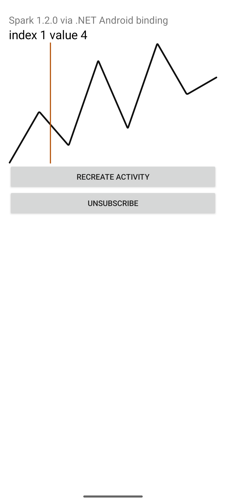
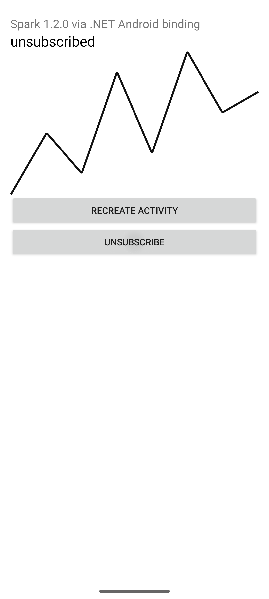

# AAR binding is an app project, not a framework feature

Filipe, a resposta curta é não incluir agora um suporte genérico a binding de AAR no produto. Um binding moderno do gerador .NET Android, apontado para a biblioteca Java antiga Spark 1.2.0, compilou e correu em Debug e em Release NativeAOT num emulador KVM. O callback de scrub, o `Recreate` da Activity e o unsubscribe chegaram ao log e à tela. Isso mostra que o gerador aguenta um AAR pequeno quando o projeto de binding é da aplicação. Não mostra que o produto deva passar a oferecer essa camada. O caminho por omissão continua a ser chamar os wrappers do Android SDK que o Native PoC já usa, como `ClipboardManager`, sem projeto de binding.

## What was decided

The prototype had to answer one question. Can one small AAR be bound with the current .NET Android generator, consumed through a typed C# adapter, and actually deliver a Java callback under `net10.0-android` NativeAOT on a booted KVM emulator?

It can, for this library, after one metadata edit. That result is not a reason to add binding infrastructure to the framework.

Spark 1.2.0 is a 2016 Java library from Robinhood Markets, Apache-2.0. The binding project uses the .NET 10 Android generator in workload `36.1.118`. The toolchain is current. The library is not. This is not a claim that Spark is maintained.

The Xamarin compatibility matrix was dropped before any package restore. No legacy bridge was built.

## What the probe consumes

The activity in `compatibility/Sparkline.Probe/MainActivity.cs` does not mention a Java type. It builds a `SparklineSeries`, hosts a `SparklineViewAdapter`, and listens for `SparklineScrub`. `OnDestroy` removes that listener and calls `Dispose`. The Recreate button calls `Activity.Recreate`. The Unsubscribe button clears the Java listener and leaves the view on screen.

`SparklineViewAdapter` is the only type that touches `Com.Robinhood.Spark.SparkView`. It sets the line, turns scrubbing on, installs one `SparkAdapter` and one `OnScrubListener`, and clears that listener on `Unsubscribe`. The packaged Spark style sets `spark_scrubEnabled` to false, so the adapter sets `ScrubEnabled` itself. A move that arrives before 250 ms cancels the gesture inside Spark, so the harness holds the pointer for 700 ms before it moves.

Two shapes were compared in this session, without a second app. Calling `SparkView` from the activity would make every consumer repeat the listener and dispose rules. Keeping those rules in `SparklineViewAdapter` leaves the activity as ordinary Android code. The second shape is the one in the tree. There is no shared extension interface, and nothing under `src/` or `samples/` was edited.

## Evidence

| Check | State | What was observed |
| --- | --- | --- |
| KVM boot | RUN | `emulator -accel-check` reported KVM usable. QEMU pid 6985 held `/dev/kvm`. `sys.boot_completed` was `1`. No TCG run. |
| Debug `android-x64` | RUN | `dynamic=True compiled=False`. One raw scrub became one emit, `index=1 value=4`, then one ended event. |
| Release NativeAOT `android-x64` | RUN | `dynamic=False compiled=False`. Same scrub, recreate, and unsubscribe sequence. APK contains `classes.dex` and `lib/x86_64/libSparkline.Probe.so` only. |
| Activity recreate | RUN | Same pid. `destroy id=1`, `unsubscribe` with `listener-null=True`, `dispose id=1`, then `create id=2`. The next scrub is `id=2` only. |
| Unsubscribe | RUN | After Unsubscribe, another slow press did not add a `raw index=` line. Screen text became `unsubscribed`. |
| Duplicate delivery | RUN | Each gesture logged one `raw index=` and one `emit index=`. The same-index suppressor did not run, because Spark did not repeat an index before the finger lifted. |
| `arm64` device | UNVERIFIED | The publish that ran is `android-x64`, which is the emulator ABI. |

Screenshots from the release process:





Debug screenshots are `evidence/debug-scrub.png` and `evidence/debug-unsubscribed.png`. Logs are `evidence/debug-sparkprobe.log` and `evidence/release-sparkprobe.log`.

The signed Release APK is `artifacts/sparkline-probe-nativeaot-android-x64.apk`.

```
acfe7905d1fd9f89d0beaa47b6378d40e39097e7a471de5d4feaa7d3a7bbb0aa
```

## Binding fixes that were required

The AAR bytes were not recompiled. SHA256 of `com.robinhood.spark:spark:1.2.0` is `bf8841ce3cb9b583c161acf70792d664088c132df73e0ec72cc01f57f788d534`. Its manifest requests no permissions. The only Maven dependency is `support-annotations` 26.1.0, which is on the binding classpath with `Bind=false` and is removed from the generated API.

`Transforms/Metadata.xml` removes two nodes. The `android.support.annotation` package would otherwise be generated as C# interfaces. `SparkView.FillType` is an `@IntDef` that collides with the generated `FillType` property. Without that removal the binding does not compile. That is adaptation of the generated C# binding, not a new Java binary.

The generator still warns `BG8C01` because `SparkView` implements the package-private `ScrubGestureDetector.ScrubListener`. The public callback used here is `SparkView.OnScrubListener`. The warning did not stop the build or the run.

`docs/compatibility/evidence/release-publish.log` records two ILC notes from `Android.Runtime.RuntimeNativeMethods` in `Mono.Android.Runtime`. That log does not contain `XA1040`. No trim warning was printed from `Sparkline.Adapter` or `Sparkline.Probe`.

## Why this does not belong in the framework

A direct SDK call, such as the existing `ClipboardManager` use in `src/NativePoc.Android`, needs no binding project, no `Metadata.xml`, and no extra `classes.dex` types. The workload owns those wrappers.

An AAR binding adds a project the app must keep. Names collide. Package-private Java interfaces warn. The listener has to be a real `Java.Lang.Object`, registered once, and cleared before `Dispose`, or a late JNI call hits a dead peer. NativeAOT then has to keep that callable wrapper. This probe showed that chain working for one library. It also showed the packaging step can ship a stale APK if the native image is rebuilt and the signed package is not. The release run that counts used the APK whose `libSparkline.Probe.so` is 5522648 bytes and contains the Recreate button.

Add a binding project when a product feature needs a specific library the SDK does not ship. Do not add a general AAR-binding feature now. One adapted library is not a framework surface.

## Commands

The emulator AVD is `sparkprobe`, image `system-images;android-36;google_apis;x86_64`.

```bash
export JAVA_HOME=/usr/lib/jvm/java-21-openjdk-amd64
export ANDROID_HOME="$HOME/android-sdk"
export ANDROID_SDK_ROOT="$ANDROID_HOME"
export DOTNET_ROOT="$HOME/.dotnet"
export PATH="$DOTNET_ROOT:$ANDROID_HOME/platform-tools:$ANDROID_HOME/emulator:$PATH"

emulator -avd sparkprobe -no-window -no-audio -no-boot-anim -no-snapshot \
  -gpu swiftshader_indirect -accel on -no-metrics

dotnet publish compatibility/Sparkline.Probe/Sparkline.Probe.csproj \
  -c Release -f net10.0-android -r android-x64

bash compatibility/observe-probe.sh
```

`observe-probe.sh` refuses to start unless `sys.boot_completed` is `1`. It runs Debug with `-t:Run -p:AdbTarget=-e`, then installs the Release APK and resolves the activity with `cmd package resolve-activity`. The harness holds the pointer, moves it, taps Recreate, scrubs again, taps Unsubscribe, and scrubs once more.

## Playbook record

pstack `0.15.36` is installed at `~/.cursor/plugins/cache/cursor-public/9717366/ae5650febf4320793844c12c4adaa937f417f8da`. `plugin.json` in that directory is the version source. `~/.cursor/rules/pstack-models.mdc` is absent. `setup-pstack` was not run and no role file was rewritten.

Files read and applied:

- `skills/poteto-mode/SKILL.md`
- `skills/poteto-mode/playbooks/prototype.md`
- `skills/how/SKILL.md` and `skills/how/references/explainer-prompt.md`
- `skills/architect/SKILL.md` and `skills/arena/SKILL.md`
- `skills/principle-prove-it-works/SKILL.md`
- `skills/benchmark-checklist/SKILL.md`
- `skills/unslop/SKILL.md`
- `skills/technical-writing/SKILL.md`

The matched playbook is Prototype, not Investigation. The question is settled by running the callback, not by reading about it. Step 2 was skipped because the library and the question were already fixed. Step 4 was skipped because a second SDK-wrapper app would copy the sample writer's surface. The comparison is the existing `ClipboardManager` call, which was read, not rebuilt. Step 6 did not open the Feature playbook. A framework change was the thing this result argues against, and `src/` was out of bounds.

The how skill's simple path spawned one explainer, [Explain SDK binding path](bc-86745731-869d-567e-b4ba-8815b3983615), `subagent_type` `generalPurpose`, model `grok-4.7-xhigh`. The Task tool has no readonly flag. The prompt forbade writes. That agent's explanation was not delivered back before the probe had to be built, so the grounding used in the code is the parent read of `src/NativePoc.Android/NativePoc.Android.csproj`, `MainActivity.cs`, `AndroidManifest.xml`, `research/runtime-feasibility.md`, `research/android-poc-report.md`, `global.json`, and `README.md`.

Architect and arena leaves ran in this same Grok 4.7 non-fast session, sequentially. They were not spawned. The user required every role to be Grok 4.7 without `-fast`, forbade other model families, and said not to stop after intermediate playbook steps. A cross-family judge was therefore not run. Same-model independent review was not a second agent in the end. It was this session's own pass over the logs, the APK listing, and the screenshots. No timing number is reported, so the benchmark checklist was read and not applied.

**Prove it works** is why the recommendation follows the release log and the release screenshot, not the fact that `dotnet publish` returned 0.
