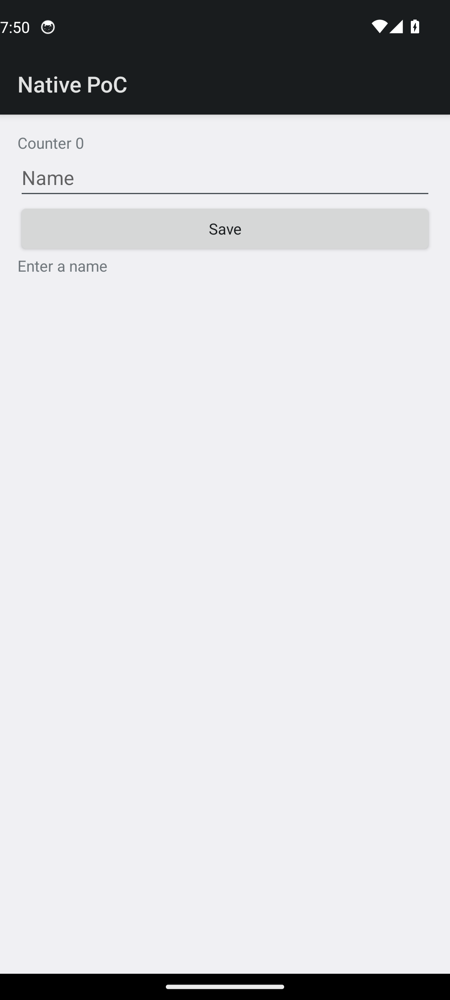
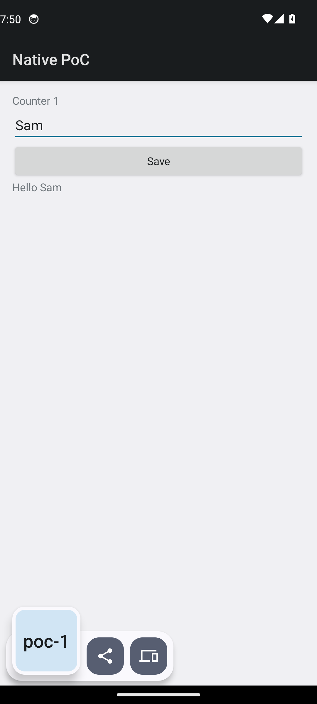
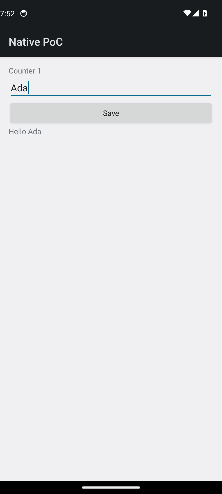
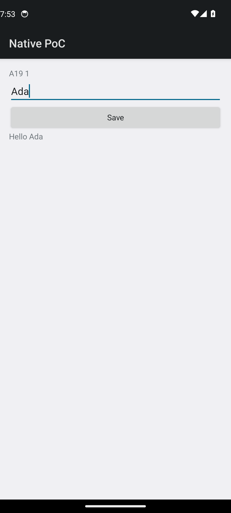
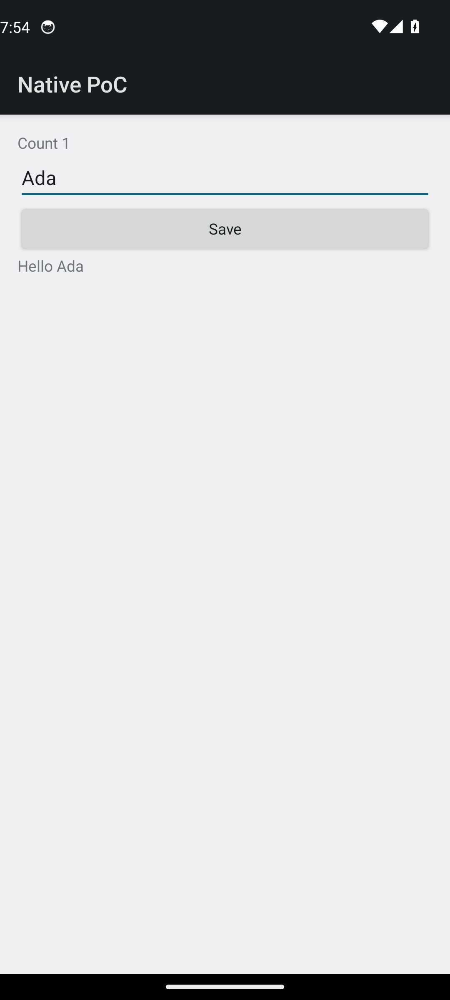

# Persona A — C# developer, new to mobile

Started from [README.md](../../README.md) only. `docs/devx/comparison.md` was not used until persona B. CLI help was the host usage line printed when the DLL was run with no arguments.

Environment the README names, as set for the commands below: `DOTNET_ROOT=$HOME/.dotnet`, `ANDROID_HOME=$HOME/android-sdk`, `JAVA_HOME=/usr/lib/jvm/java-21-openjdk-amd64`, JDK `openjdk version "21.0.12.1"`. `adb` was on `PATH` because the emulator setup put it there (finding F8, UNVERIFIED without that).

## Setup and build

README requirements list the SDK, the `android` workload, Android SDK 36, build-tools 36.0.0, an x86_64 image, `ANDROID_HOME`, and a JDK. They do not give install commands, an AVD name, or an emulator command. Those were done in [kvm.md](kvm.md) before this persona, because the evaluation required a booted emulator.

`dotnet workload list`:

```
Workload version: 10.0.403

Installed Workload Id      Manifest Version       Installation Source
---------------------------------------------------------------------
android                    36.1.118/10.0.100      SDK 10.0.400
```

The README Debug command, `2026-11-08T19:49:18Z` to `2026-11-08T19:49:50Z`, exit 0:

```
dotnet build src/NativePoc.Android/NativePoc.Android.csproj \
  -c Debug -f net10.0-android -r android-x64 -t:Run -p:AdbTarget=-e
```

```
Build succeeded.
    0 Warning(s)
    0 Error(s)

Time Elapsed 00:00:25.69
```

The log is [logs/a-build.log](logs/a-build.log). The console never said "installed" or "launched". `adb shell pm path com.scratch.nativepoc` returned a `base.apk`, `pidof` was `6280`, and the resumed activity was `com.scratch.nativepoc/crc64ee53024f7ed0aa60.MainActivity`. The token file existed and was 32 hex characters. The hex is not copied here.

Stuck: the success line looks like a build, not a deploy. The activity name is a generated CRC, which the README does not mention.

## First run

UI dump texts: `Native PoC`, `Counter 0`, `Name`, `Save`, `Enter a name`.



The README does not describe this screen or how to type into the emulator. Input below used `adb shell input`, which is outside the docs.

## First input

`2026-11-08T19:50:23Z` to `2026-11-08T19:50:27Z`. Tap the field at `(540,427)`, `input text Sam`, Back, tap Save at `(540,549)`.

UI dump: `Native PoC`, `Counter 1`, `Sam`, `Save`, `Hello Sam`. `pidof` stayed `6280`.



Logcat later in the session, for this pid's successor, showed `clipboard-ok poc-1` when Save ran. The screenshot shows a system clipboard chip reading `poc-1`. Nothing in the README says Save writes the clipboard.

## Edit, then the documented reload

A save of `Screen.cs` is not watched by anything the README starts. The documented reload is:

```
dotnet build tools/NativePoc.HotReload.Host/NativePoc.HotReload.Host.csproj
dotnet tools/NativePoc.HotReload.Host/bin/Debug/net10.0/NativePoc.HotReload.Host.dll a
```

Host build: `2026-11-08T19:51:33Z` to `2026-11-08T19:51:35Z`, exit 0.

No-args help, exit 2:

```
Usage: NativePoc.HotReload.Host <a|b|c|once>
```

`a`, `b`, and `c` are described in the README as 20-sample modes. `once` appears only in this usage line.

### Mode `a` on the committed file

`2026-11-08T19:51:35Z` to `2026-11-08T19:51:55Z`, exit 1. Pid `6280` became `6573`. Full log: [logs/a-host-a-first.txt](logs/a-host-a-first.txt).

```
clock=file-write then Roslyn compile then abstract-socket send through the post-render reply
cold=sample 0, the first load after process start; no compile and no send before it
pid=6573
exception=InvalidOperationException (31,3): error CS0246: The type or namespace name 'IReadOnlyList<>' could not be found (are you missing a using directive or an assembly reference?)
```

The command restarted the app before the compile. `Sam` was gone. The tool's own setup had typed `Ada` and tapped Save. UI dump: `Counter 1`, `Ada`, `Hello Ada`.



`git status` showed `evidence/hot-reload-a.log` modified. The benchmark rewrites a file under `evidence/`. That file was restored after the session.

Stuck: the project sets `<ImplicitUsings>enable</ImplicitUsings>` in `src/NativePoc.Screen/NativePoc.Screen.csproj`, so `dotnet build` succeeds, and the hot-reload compiler then reports `IReadOnlyList<>` missing. The error has no file path. Line 31 is `IReadOnlyList<Element> children` in the committed `Screen.cs`.

### Mode `a` after adding the using

Added `using System.Collections.Generic;` (reverted at the end of the session) and ran `a` again. `2026-11-08T19:52:49Z` to `2026-11-08T19:53:50Z`, exit 0. Pid `6573` became `6872` (another restart). Summary: [logs/a-host-a-retry-summary.txt](logs/a-host-a-retry-summary.txt).

```
sample=0 ms=829.9 pid=6872 reply=A00 1 collectible=True ui=Native PoC | A00 1 | Ada | Save | Hello Ada ok=True
sample=19 ms=16.6 pid=6872 reply=A19 1 collectible=True ui=Native PoC | A19 1 | Ada | Save | Hello Ada ok=True
samples-ms=829.9,45.8,27.3,20.2,18.5,15.8,17.2,17.4,16.0,16.5,25.4,16.7,15.2,19.1,16.0,20.9,16.6,14.8,14.0,16.6
cold-ms=829.9
p50-all-ms=17.0
p50-warm-ms=16.7
min-ms=14.0
max-ms=829.9
```



The command also rewrote `evidence/hot-reload-a-cold.png` and `evidence/hot-reload-a-warm.png`. Those were restored. The user's edit is not the edit this command applies: it overwrites `TitlePrefix` with `A00` through `A19` and restores the file it read at start.

### One deliberate edit, via `once`

Changed `TitlePrefix` to `Count ` and waited. At +3 s the UI still said `A19 1`. Nothing was watching.

`once` from `2026-11-08T19:54:20Z` to `2026-11-08T19:54:22Z`, exit 0. Pid stayed `6872`. Log: [logs/a-host-once.log](logs/a-host-once.log).

```
once-ms=20.6 bytes=7680 reply=Count 1 collectible=True
ui=Native PoC | Count 1 | Ada | Save | Hello Ada
pid=6872
```



`Ada` and `Hello Ada` stayed. This is the in-place reload. The README does not name `once`.

Running `once` also rewrote `evidence/hot-reload-once.log`. Restored afterwards. `cnative` puts that file back; the host DLL does not.

## Compile error

`TitlePrefix = ;` then `once`. Same second, exit 1. Pid stayed `6872`. Log: [logs/a-host-once-error.log](logs/a-host-once-error.log).

```
exception=InvalidOperationException (7,36): error CS1525: Invalid expression term ';'
```

UI stayed `Count 1`, `Ada`, `Hello Ada`. No error on the device.


Stuck: the diagnostic is wrapped in `InvalidOperationException`, and it has no path. A C# developer can map `(7,36)` only by having the file open.

## Recovery from the compile error

Restored `TitlePrefix = "Count "` and ran `once`. `2026-11-08T19:54:47Z` to `2026-11-08T19:54:50Z`, exit 0, pid `6872`.

```
once-ms=23.1 bytes=7680 reply=Count 1 collectible=True
ui=Native PoC | Count 1 | Ada | Save | Hello Ada
pid=6872
```

The reply matches the fixed source. The pixels did not change, because the previous good push had already shown `Count 1`.

## Rude edit

The README never says "rude edit". Two attempts:

1. Added `RudeGeneration` to `AppState` and read it from `Screen.cs`, then `once` **without** rebuilding Core. Exit 1, pid `6872`. Log: [logs/a-host-once-rude-norebuild.log](logs/a-host-once-rude-norebuild.log).

```
exception=InvalidOperationException (11,65): error CS1061: 'AppState' does not contain a definition for 'RudeGeneration' and no accessible extension method 'RudeGeneration' accepting a first argument of type 'AppState' could be found (are you missing a using directive or an assembly reference?)
```

That reads as a compile error, which it is: the host compiles against the Core DLL already on disk.

2. `dotnet build src/NativePoc.Core/NativePoc.Core.csproj` (`Time Elapsed 00:00:01.11`, exit 0), then `once` again. Exit 1, pid still `6872`. Log: [logs/a-host-once-rude.log](logs/a-host-once-rude.log).

```
exception=InvalidOperationException MissingMethodException: Method not found: int NativePoc.AppState.get_RudeGeneration()
```

UI stayed `Count 1`, `Ada`, `Hello Ada`. The host did not say restart. There is no `rude edit -> restart required` on this path. That sentence exists only in `cnative`.

## Recovery from the rude edit

`git checkout -- src` and a rebuild of Core, then `once` on the committed `Screen.cs`. Exit 1, pid `6872`. Log: [logs/a-host-once-clean.log](logs/a-host-once-clean.log).

```
exception=InvalidOperationException (31,3): error CS0246: The type or namespace name 'IReadOnlyList<>' could not be found (are you missing a using directive or an assembly reference?)
```

The device kept the last good assembly (`Count 1`, `Ada`). The committed source cannot be pushed again until the using is restored. `evidence/` was checked out clean at the end.
