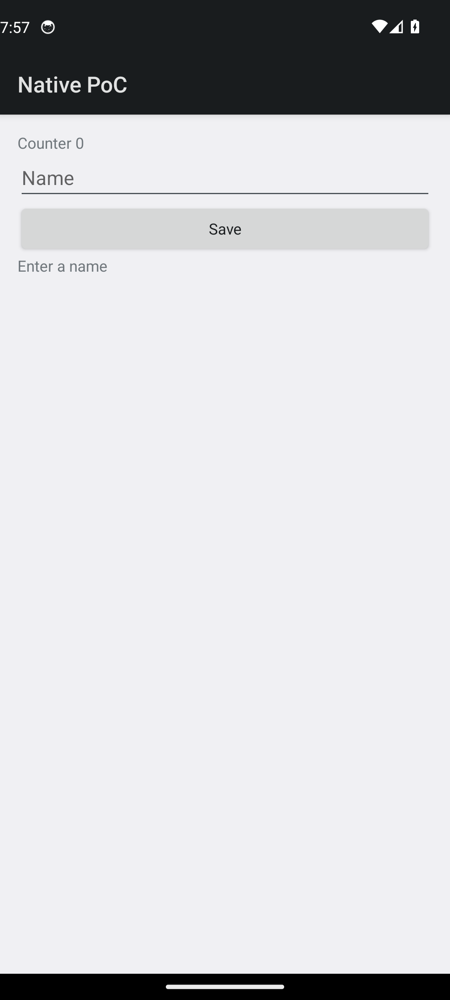
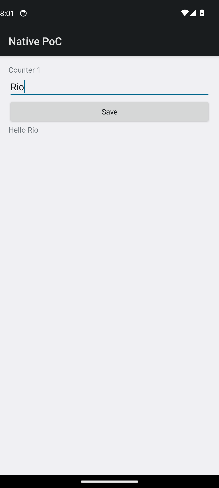
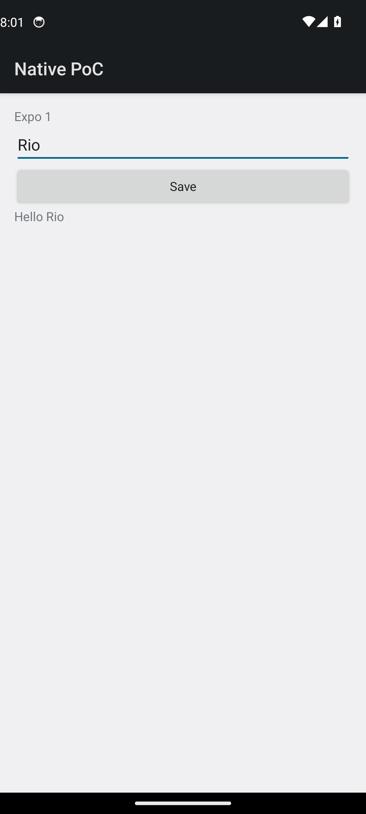

# Persona B — React Native / Expo developer

Started from the top of [docs/devx/comparison.md](../devx/comparison.md), which is the only page that documents `tools/devx/cnative run android`. Then the CLI help. Expo's own first-run docs are compared in [expo.md](expo.md) and were not executed.

The comparison page says to export `DOTNET_ROOT`, `ANDROID_HOME`, and `JAVA_HOME`, with platform-tools on `PATH`. Those were set. The page also says the command does not boot an emulator. The emulator from [kvm.md](kvm.md) was already online as `emulator-5554`.

## Help

Every invocation builds before it prints anything. Times are the `Time Elapsed` lines.

| Command | Exit | Build elapsed | What followed the build |
| --- | --- | --- | --- |
| `tools/devx/cnative` | 2 | `00:00:01.27` | `Usage: cnative run android` and the option list |
| `tools/devx/cnative --help` | 0 | `00:00:00.84` | the option list |
| `tools/devx/cnative help` | 0 | `00:00:00.80` | the option list |
| `tools/devx/cnative run android --help` | 0 | `00:00:00.80` | the option list |

The usage text:

```
cnative run android [options]

  Build Debug, install it on the running emulator or device, launch it,
  read the hot reload token with adb run-as, and push Screen.cs edits.

  --device <serial>     adb serial. Default: the only online device.
  --abi <rid>           android-x64 or android-arm64. Default: the device ABI.
  --debounce <ms>       quiet period before a reload. Default: 250.
  --restart-on-rude     rebuild and relaunch when an edit needs a restart.
  --once                push the current screen once and exit.
  --help                show this text.
```

Stuck: "hot reload token" and "adb run-as" are internals. The text does say `Screen.cs`. It does not say the path, it does not say Core and Android edits restart the app, and it does not say the command refuses to boot an emulator. `--help` costs a build.

## First `cnative run android` (leftover app data)

Persona A had already deployed, so `files/nativepoc-hotreload.token` was on disk. Command started `2026-11-08T19:56:14Z` in a TTY (`script`, so the prompt path is interactive). Log: [logs/b-stale-token-first.txt](logs/b-stale-token-first.txt).

```
cnative: building Debug android-x64 for emulator-5554
Build succeeded.
    0 Warning(s)
    0 Error(s)
Time Elapsed 00:00:04.43
cnative: launching com.scratch.nativepoc/crc64ee53024f7ed0aa60.MainActivity
cnative: pid 7932
cnative: waiting for a hot reload token via adb run-as
cnative: token read via adb run-as (files/nativepoc-hotreload.token)
src/NativePoc.Screen/Screen.cs:31:3: error CS0246: The type or namespace name 'IReadOnlyList<>' could not be found (are you missing a using directive or an assembly reference?)
cnative: watching src/NativePoc.Screen
```

`Build succeeded` and then a compile error in the same file. The project build uses implicit usings. The hot-reload compile does not. The CLI stayed up because a compile error is not `ReloadStatus.Failed`.

The token it kept did not match the process it had just started. SHA-256 prefixes (12 hex), not the token:

| Source | Fingerprint |
| --- | --- |
| Live `files/nativepoc-hotreload.token` and `@npoc-…` socket | `4dd3abdd500a` |
| `/tmp/nativepoc-hotreload.token` and `adb forward` `localabstract:npoc-…` | `dd85ad5a0e43` |

`run-as cat /proc/net/unix` printed `cat: /proc/net/unix: Permission denied` (exit 1). The shell user can read that table; the app user cannot. The comparison page already says this.

A save that added the using and set `TitlePrefix` to `Expo ` produced:

```
cnative: reload src/NativePoc.Screen/Screen.cs
reload failed
exception=EndOfStreamException The hot reload connection closed early.
```

A second save (`Expo2`) printed the same pair again. UI stayed `Counter 1`, `Rio`, `Hello Rio`. Pid stayed `7932`. The forward still pointed at the old socket, so the new process never saw the DLL.

Ctrl-C printed `cnative: stopped`.

## Clean data, then the same command

`adb shell pm clear com.scratch.nativepoc` printed `Success`. Sources were restored first. Second TTY session, log [logs/b-clean-session.txt](logs/b-clean-session.txt).

```
Time Elapsed 00:00:10.38
cnative: launching com.scratch.nativepoc/crc64ee53024f7ed0aa60.MainActivity
cnative: pid 8995
cnative: waiting for a hot reload token via adb run-as
cnative: token read via adb run-as (files/nativepoc-hotreload.token)
src/NativePoc.Screen/Screen.cs:31:3: error CS0246: The type or namespace name 'IReadOnlyList<>' could not be found (are you missing a using directive or an assembly reference?)
cnative: watching src/NativePoc.Screen
```

Device file, `/tmp` token, and the live socket all fingerprinted `3291494e3b86`. `adb forward --list` was empty, because the compile threw before `ForwardAbstract`. This is the launch that works: there was no previous token file to read.



UI dump: `Native PoC`, `Counter 0`, `Name`, `Save`, `Enter a name`.

## First input

`2026-11-08T20:00:57Z`. Same taps as persona A, text `Rio`. UI dump: `Counter 1`, `Rio`, `Hello Rio`. Pid `8995`.



## Edit and hot reload

One write: `using System.Collections.Generic;` plus `TitlePrefix = "Expo "`. Saved `2026-11-08T20:01:01Z`. By `2026-11-08T20:01:06Z`:

```
cnative: reload src/NativePoc.Screen/Screen.cs
reloaded in 2682.9 ms (apply 47.3 ms)
reply Expo 1 collectible=True
```

Pid stayed `8995`. UI dump: `Expo 1`, `Rio`, `Save`, `Hello Rio`.


The line that matters to an Expo developer is `reloaded in 2682.9 ms`. `apply 47.3 ms` is the host's send clock. The rest is a new `dotnet exec` of `NativePoc.HotReload.Host` per save. Nothing in the help text says that.

## Compile error

`TitlePrefix = ;` at `2026-11-08T20:01:22Z`. Within 3 s:

```
cnative: reload src/NativePoc.Screen/Screen.cs
src/NativePoc.Screen/Screen.cs:7:36: error CS1525: Invalid expression term ';'
```

Pid stayed `8995`. UI stayed `Expo 1`, `Rio`, `Hello Rio`. The device did not show an error.



This format is the one the comparison page promises (`file:line:col`). It is only the `cnative` formatter. The host DLL, used by persona A, prints `exception=InvalidOperationException (7,36): …` with no path.

## Recovery

Restored the constant as `"Fixed "` at `2026-11-08T20:01:33Z`.

```
cnative: reload src/NativePoc.Screen/Screen.cs
reloaded in 2517.0 ms (apply 21.0 ms)
reply Fixed 1 collectible=True
```

Pid `8995`. UI dump: `Fixed 1`, `Rio`, `Hello Rio`.


## Rude edit

Added `public int RudeGeneration { get; set; }` to `AppState` in `src/NativePoc.Core/Elements.cs` at `2026-11-08T20:01:50Z`. The TTY showed:

```
rude edit -> restart required
src/NativePoc.Core/Elements.cs
Restart the app? [y/N]
```

Answer `n`. The CLI printed the `n` and nothing else. Pid stayed `8995`. The comparison page says a declined answer waits. It does not say the process will sit there with no next step. The hint `pass --restart-on-rude to rebuild and relaunch` is printed only when stdin is not a terminal (`ReloadConsole.FollowUp` with `offerFlag` set from `!interactive`). On a terminal, `n` is a dead end.

A second property (`SecondRude`) asked again:

```
rude edit -> restart required
src/NativePoc.Core/Elements.cs
Restart the app? [y/N]
```

Answer `y` at `2026-11-08T20:02:03Z`. The log then has `restarting`, a Debug build `Time Elapsed 00:00:04.20`, and:

```
cnative: launching com.scratch.nativepoc/crc64ee53024f7ed0aa60.MainActivity
cnative: pid 9323
cnative: waiting for a hot reload token via adb run-as
cnative: token read via adb run-as (files/nativepoc-hotreload.token)
```

UI dump: `Native PoC`, `Fixed 0`, `Name`, `Save`, `Enter a name`. `Rio` was gone. The redeploy is a new process, so `AppState` starts over. The running assembly is the project build, which does contain `Fixed` because that source was still on disk.


No second `cnative: watching` line. The watch loop was already running and does not announce itself again. About two minutes of silence followed. That silence matches the code: a file-classified rude restart relaunches and returns to the loop without another push. It is indistinguishable from a hang on the terminal. At `2026-11-08T20:04:05Z` SIGQUIT was sent. The process printed `cnative: stopped` and `script` recorded `COMMAND_EXIT_CODE="0"`.

UNVERIFIED: whether the token read during that restart was the new process's token. No save was pushed before the signal. `/tmp/nativepoc-hotreload.token` was still the previous push's token (`3291494e3b86`) because the temp file is written only when a push starts. The live socket had fingerprint `025c372766bf`. Those two facts do not by themselves prove what the CLI held in memory.

## Next launch, with a token file already present

`tools/devx/cnative run android` again, sources still carrying the using (so the startup push can get past compile). Log: [logs/b-stale-token-relaunch.txt](logs/b-stale-token-relaunch.txt). `script` recorded `COMMAND_EXIT_CODE="1"`.

```
Time Elapsed 00:00:01.46
cnative: pid 9492
cnative: waiting for a hot reload token via adb run-as
cnative: token read via adb run-as (files/nativepoc-hotreload.token)
reload failed
exception=EndOfStreamException The hot reload connection closed early.
```

There is no `cnative: watching` line. The shell prompt came back.

| Source | Fingerprint |
| --- | --- |
| Token file of the previous pid `9323`, before this launch | `025c372766bf` |
| `/tmp/nativepoc-hotreload.token` used for the push | `025c372766bf` |
| New pid `9492` token file and `@npoc-…` socket | `b08018f09a8c` |

The CLI read the previous file, forwarded to a socket the new process does not own, the connection closed, and because that startup result is `Failed` the command exited. A second launch does not recover a first launch. `pm clear` is what made the earlier session work, and the docs do not mention it.

Sources and `evidence/` were restored with `git checkout` after these runs.
